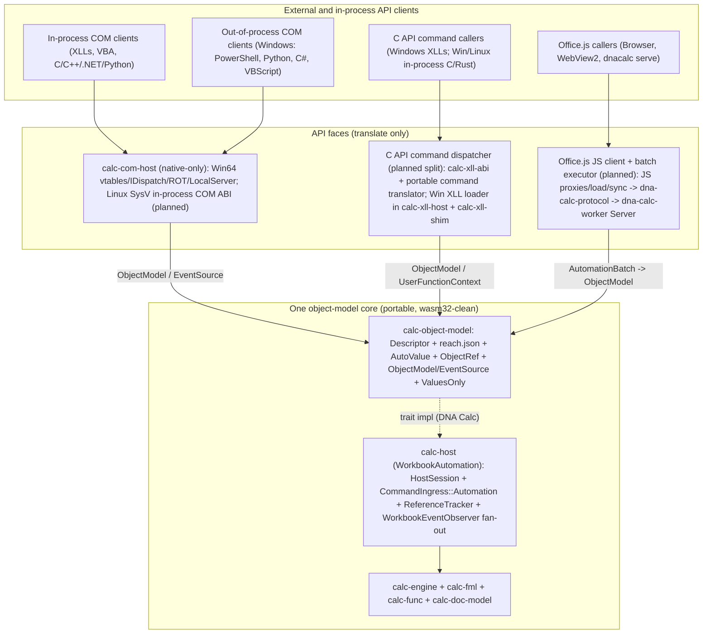
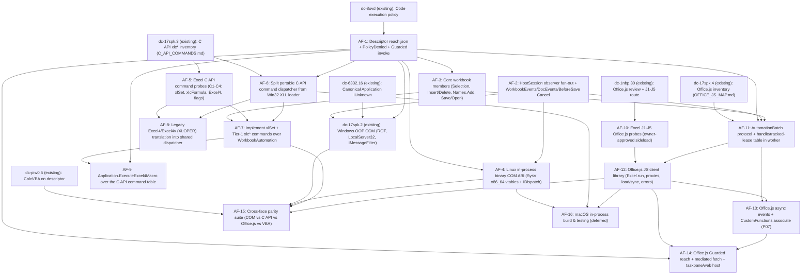

# DNA Calc exposed API: three faces over one object-model core

Status: architecture and plan for epic `dc-17spk`, task `dc-17spk.1` (2026-11-23). Design document only; no code changes.

Companion documents:
- `docs/architecture/OBJECT_MODEL.md` — the one Rust object model, descriptor, profiles, and measured Excel COM behaviour.
- `docs/architecture/XLL_COM_HOSTING.md` — native `.xll` hosting, `MdCallBack12`, `XLCALL32.DLL`, and X0–X19 Excel traces.
- `docs/architecture/ADDIN_SURROGATE.md` — the per-session surrogate process boundary for native add-ins (Stages 3–4).
- `docs/architecture/CODE_EXECUTION_POLICY.md` — the shared `Off` / `Guarded` / `Unguarded` model, origins, and ten-capability vocabulary (`dc-8ovd`).
- `docs/architecture/LINUX_DESKTOP_SHELL.md` — Linux desktop shell options (`dnacalc serve`, WebKitGTK) and native add-in boundaries.

---

## 1. Architecture: three faces over one core

Owner direction (2026-11-22/23, `dc-17spk`): DNA Calc exposes one programmable Excel API through three external faces over a single implementation:

1. **COM object model face** — dual vtables, `IDispatch`, `ITypeInfo`, connection points, and Windows out-of-process activation (`GetObject`/ROT, optional `LocalServer32`).
2. **Excel C API command face** — `xlcXXX` command-equivalents and `xlSet` through `Excel4`/`Excel4v` (`XLOPER`) and `Excel12`/`Excel12v` (`XLOPER12`), distinct from the `xlfXXX` worksheet functions already served by `crates/calc-xll-host`.
3. **Office.js scripting face** — the Excel JavaScript API (`Excel.run`, `RequestContext`, client proxy objects, `load`/`sync` batching, tracked objects, async events, and `CustomFunctions`).

VBA (`crates/calc-vba`, `crates/calc-host-vba`) is not a fourth divergent implementation: `dc-piw0.5` (which blocks `dc-17spk`) binds CalcVBA's Excel and Office references to the same `calc-object-model` descriptor and `calc_host::automation` handlers, retiring `calc-vba`'s private member tables (`crates/calc-vba/src/runtime/spreadsheet.rs`, `crates/calc-vba/src/events/source.rs`).

### 1.1 Architectural rules

1. **One descriptor.** Every interface, member identity, ABI fact, and Guarded capability reach entry is described once under `crates/calc-object-model/descriptor/`. No face keeps a private semantic switch or member table.
2. **One semantic owner per member.** Workbook semantics live in `crates/calc-host/src/automation.rs` (`WorkbookAutomation`, backed by `HostSession::dispatch_from(CommandIngress::Automation, ...)` and `calc-engine`/`calc-doc-model`). Workbook-free application members live in `crates/calc-object-model/src/profile/values_only.rs` (`ValuesOnly`). Only COM-by-nature Office add-in/ribbon/CommandBar objects live in `crates/calc-com-host/src/office.rs`.
3. **Faces only translate.** Each face converts wire/ABI values, object identities, batches, events, and errors between its client protocol and `calc_object_model::{ObjectModel, Call, AutoValue, AutoError, ObjectRef, EventSource}`. No face holds a shadow workbook, a second evaluator, a second dependency graph, or a second event switch.
4. **Guarded reach read from the descriptor.** Every face enforces `CODE_EXECUTION_POLICY.md`'s three-level model (`Off`, `Guarded`, `Unguarded`) using per-member `reach` annotations read from the descriptor and audited through one sink.
5. **The engine does no more than Excel.** Every face follows measured Excel behaviour (COM: E1–E11, X19, Q0–Q22; C API: X0–X18 plus new command probes; Office.js: J1–J5). There is no `DnaExcel` dialect with invented semantics (`docs/architecture/review-2026-11/pro/harvest/14-harvest.md`).
6. **Dependency ceiling preserved.** `tools/xtask/architecture.json` rules remain intact: `calc-object-model` and `calc-host` stay `portable` (`wasm32-unknown-unknown` clean); `dna-onecalc`, `dna-onecalc-desktop`, `dna-formula-ui`, and `calc-addin-host` never depend on `calc-host` or `calc-engine`; `calc-platform-desktop` stays free of product dependencies; `dna-calc` (UI page/skins) never depends on `calc-host`, `calc-engine`, `calc-doc`, or `dna-calc-worker`.

### 1.2 Crate layering and seams

Why the `ObjectModel` trait seam in `crates/calc-object-model/src/model.rs:88-100` is essential:
- `crates/calc-addin-host`, `crates/calc-com-host`, and `crates/calc-xll-host` sit below OneCalc's dependency ceiling (`tools/xtask/architecture.json:266-288`), so none of them may depend on `calc-host`.
- DNA Calc (`apps/dna-calc-desktop/src/automation.rs`, `apps/dna-calc-worker/src/server.rs`, `apps/dnacalc`) constructs `WorkbookAutomation` (`crates/calc-host/src/automation.rs`) and binds it as `Rc<dyn ObjectModel>` into every active face.
- DNA Calc - Formula Explorer (`apps/dna-onecalc`, `apps/dna-onecalc-desktop`) binds `ValuesOnly` (`crates/calc-object-model/src/profile/values_only.rs`), so every workbook/range member returns Excel error `1004` `"needs a workbook: open in DNA Calc"` uniformly across every face.

### 1.3 How one operation maps across all three faces

Every workbook action converges onto one `WorkbookAutomation` handler and one `HostSession::dispatch_from(CommandIngress::Automation, ...)` transaction:

| Workbook operation | COM face | C API command face | Office.js face | Single semantic owner |
|---|---|---|---|---|
| Write values to `A1:B2` | `Range.Value2 = arr` (1-based 2-D `SAFEARRAY(VARIANT)`) | `Excel12(xlSet, &res, 2, &ref, &multi)` (raw values, no formula parse) or `xlcFormula` | `range.values = [[1,2],[3,4]]; await ctx.sync()` | `WorkbookAutomation::put_value2` (`crates/calc-host/src/automation/mutation.rs:104-111`) -> `SkinIntent::Edit` |
| Enter a formula in `C1` | `Range.Formula = "=SUM(A1:B1)"` | `Excel12(xlcFormula, &res, 2, &str, &ref)` (or active selection if `ref` omitted) | `range.formulas = [["=SUM(A1:B1)"]]; await ctx.sync()` | `WorkbookAutomation::put_formula` (`crates/calc-host/src/automation/formula.rs:228-276`) -> `SkinIntent::EnterEntries` |
| Read `Value2` of `A1` | `Range.Value2` -> scalar `VT_R8` | `Excel12(xlCoerce, &res, 1, &ref)` -> `XL_NUM` | `range.load("values"); await ctx.sync()` -> `[[n]]` (always 2-D) | `WorkbookAutomation::read` (`crates/calc-host/src/automation.rs:792-848`) -> `calc_host::project` / `UserFunctionContext::values_of` |
| Format address | `Range.Address(True, True, xlA1)` -> `"$A$1"` | `Excel12(xlfReftext, &res, 2, &ref, &true)` | `range.load("address"); await ctx.sync()` -> `"Sheet1!A1"` | `calc_object_model::geometry::address` (`crates/calc-object-model/src/geometry.rs:107`) |
| Recalculate | `Application.Calculate` / `Worksheet.Calculate` / `Range.Calculate` | `xlcCalculateNow` / `xlcCalculateDocument` | `ctx.application.calculate("Recalculate")` / `sheet.calculate()` / `range.calculate()` | `WorkbookAutomation::calculate*` (`crates/calc-host/src/automation/mutation.rs:397-437`) -> `SkinIntent::Recalculate` / `Calculate` / `CalculateRange` |
| Clear contents | `Range.ClearContents` | `xlcClear(3)` on active selection | `range.clear("Contents"); await ctx.sync()` | `WorkbookAutomation::clear_contents` (`mutation.rs:249-262`) -> `CellEdit::Clear` |
| Create table | `sheet.ListObjects.Add(1, rng, , 1)` | No 1:1 XLM command | `sheet.tables.add("A1:C3", true)` | `WorkbookAutomation::tables_add` (`crates/calc-host/src/automation/report.rs:72`) -> `WorkbookCommand::Table` |
| Create chart / shape | `sheet.ChartObjects.Add(...)` / `sheet.Shapes.AddShape(...)` | `xlcCreateObject` (legacy; deferred) | `sheet.charts.add(...)` / `sheet.shapes.addGeometricShape(...)` | `WorkbookAutomation::chart_objects_add` / `shapes_add_shape` (`report_draw.rs`) -> `WorkbookCommand::Chart*` / `Shape` |
| Toggle events | `Application.EnableEvents = False` | No 1:1 `xlc*` command (COM only) | `ctx.runtime.enableEvents = false` (measured in J-series) | `WorkbookAutomation::put_events` (`automation.rs:879-889`) -> `HostSession::workbook_events_switch()` |

### 1.4 Handling non-1:1 operations

Not every API member is a 1:1 rename of a COM member. Three explicit categories keep the one-owner rule intact:

1. **Selection-implicit C API commands.** Many `xlc*` commands omit the target range and act on the active selection (`xlcClear`, `xlcFormula` with 1 argument, `xlcFormatNumber`, `xlcEditDelete`). The C API translator holds no selection state: it reads `Application.Selection` (once `Application.Selection` is registered on `WorkbookAutomation`) through `ObjectModel::invoke`, then dispatches the target COM descriptor member (`Range.ClearContents`, `Range.Formula`, etc.) on that `ObjectRef`.
2. **Face-native protocol services.** Operations that belong to a face's transport rather than the workbook model stay in that face crate and never enter `calc-host`:
   - COM: `IUnknown`, `IDispatch`, `ITypeInfo`, `ISupportErrorInfo`, `IConnectionPointContainer`, `COMAddIns`, `CommandBars`, `IRibbonExtensibility`, `IRtdServer`, ROT/class-factory registration (`crates/calc-com-host`).
   - C API: `xlFree`, `xlStack`, `xlGetName`, `xlGetHwnd`, `xlGetInst`, `xlGetInstPtr`, `xlAbort`, `xlRunningOnCluster`, `xlAsyncReturn`, `xlEventRegister`, `xlfRegister`, `xlfUnregister`, `xlfRegisterId`, `xlfCall` (`crates/calc-xll-host`).
   - Office.js: `Excel.run`, `RequestContext`, `load`, `sync`, `trackedObjects`, `isNullObject`, `getItemOrNullObject` wrapper flag, JS Promise scheduling, `CustomFunctions.associate`.
3. **Workbook operations present in C API or Office.js with no exact COM descriptor twin.** Examples: `xlSet` (writes raw values into a reference without Excel's formula/entry text coercion, unlike `Range.Value` Put), Office.js `Range.valuesAsJson` (rich typed cell values), or Office.js `Range.getUsedRange(valuesOnly)`. These still live in `calc-host` (as helper methods on `WorkbookAutomation` or `HostSession` commands, keyed by an explicit entry in `calc-object-model`'s cross-face mapping metadata so Guarded `reach` and coverage counts remain uniform). A face crate never calls `calc-doc-model` or `calc-engine` directly.

### 1.5 Cross-face summary matrix

| Dimension | COM object model | C API commands (`xlc*` + `xlSet`) | Office.js (Excel JS API) |
|---|---|---|---|
| **Binding** | Dual vtables (generated x64) + `IDispatch` (`GetIDsOfNames`/`Invoke`) + `ITypeInfo` | `Excel12`/`Excel12v` (`XLOPER12`) & `Excel4`/`Excel4v` (`XLOPER`); `0x8000\|Cetab`, `xlSet`, `XL_INTL`, `XL_PROMPT` | JS proxy `ObjectPath` recipes queued in `RequestContext`, flushed on `await context.sync()` |
| **Values** | `VARIANT`, `BSTR`, 1-based 2-D `SAFEARRAY(VARIANT)`, `VT_DATE`, `VT_CY`, `VT_ERROR` SCODE | `XLOPER12` (UTF-16, 32-bit ref) / `XLOPER` (ANSI, 16-bit ref); `FP12`/`FP` | JSON/tagged wire -> JS 2-D `any[][]`, `""` for blanks, error strings or `CellValue` |
| **Identity** | Per-acquisition `Wrapper` (`Range`/`Window`); canonical `Application` (`dc-6332.16`) | Transient `XlSRef12`/`XlRef12` + `SheetMap` `IDSHEET`; no retained object handles | Run-scoped host handle IDs; `trackedObjects` promotes `ReferenceTracker` leases |
| **Threading** | Owner STA; wrong-thread `RPC_E_WRONG_THREAD`; `IMessageFilter` `RPC_E_CALL_REJECTED` in calc | Owner main lane for commands/`#`/normal; `$` pool gets `128`; `xlAsyncReturn` any thread | Always async across UI <-> worker/host; cooperative `setTimeout(0)` calc slices |
| **Events** | Synchronous `IConnectionPoint` (`AppEvents`, `WorkbookEvents`, `DocEvents`, `ByRef Cancel`) | `xlEventRegister` (`CalculationEnded`/`Canceled`) + legacy `xlcOn*` hooks | Asynchronous `onChanged`/`onCalculated`/`onSelectionChanged` messages; no `ByRef Cancel` |
| **Errors** | `HRESULT` + `IErrorInfo` + `EXCEPINFO` (`0x800A03EC` / `DISP_E_EXCEPTION`) | `CallbackReply` (`xlret*` status + `#VALUE!` write or `FALSE` bool) + frame refusal | Rejected `sync()` Promise with `OfficeExtension.Error` (`RichApi.ErrorCodes` + `debugInfo`) |
| **Guarded** | Native in-process add-ins not loaded in Guarded; OOP COM & VBA checked/audited via descriptor `reach` | Native XLLs not loaded in Guarded; `ExecuteExcel4Macro` / embedded C API checked via `reach` | **Runs in Guarded** inside browser/WebView2 sandbox; every op checked via `reach` + mediated fetch |
| **Wasm** | No binary COM ABI (`calc-com-host` native-only); `calc-object-model` core runs in wasm | No native `XLOPER` ABI (`calc-xll-*` native-only); XLM text macro only if routed portably | **Natural browser face** over dedicated `dna-calc-worker` (`postMessage`) |

---

## 2. Shared core extensions required across all three faces

The core already exists and is `portable`: `crates/calc-object-model` (`Descriptor`, `AutoValue`, `AutoError`, `ObjectRef`, `ObjectKey`, `ObjectModel`, `EventSource`, `ValuesOnly`) and `crates/calc-host/src/automation.rs` (`WorkbookAutomation`, `AutomationHost`, `AutomationObserver`). Five shared additions are needed in the core so none of the three faces duplicates policy, identity, or event plumbing:

1. **Per-member Guarded reach in the descriptor (`crates/calc-object-model/descriptor/reach.json`).**
   - `crates/calc-object-model/descriptor/*.json` is regenerated on Windows by `tools/com-descriptor` (`crates/calc-object-model/src/descriptor.rs:6`: "never hand-edit the JSON"). Hand-editing `reach` into `excel.json` would be wiped on the next regeneration.
   - Instead, commit a small overlay file `crates/calc-object-model/descriptor/reach.json` keyed by `(interface, member, invoke_kind)` (plus an `"xlc"` section for XLM commands without a COM twin, and an `"officejs"` check verifying every mapped JS member inherits its descriptor member's reach). `Descriptor::get()` loads `reach.json` beside the four library JSONs and attaches `Member::reach: CapabilitySet` (using the ten capability names of `CODE_EXECUTION_POLICY.md` section 2.2: `fs.read`, `fs.write`, `process`, `env`, `settings`, `ffi`, `com.activate`, `ui.keys`, `network`, `project.write`).
   - A portable unit test in `crates/calc-object-model/tests/descriptor.rs` verifies every entry in `reach.json` resolves in the descriptor and every member listed in `CODE_EXECUTION_POLICY.md` section 2.2 (`Workbooks.Open`, `Workbook.SaveAs`, `Workbook.FollowHyperlink`, `Application.ExecuteExcel4Macro`, `Application.RegisterXLL`, `Application.Run`, `Application.VBE`, `Workbook.VBProject`, etc.) carries its declared capabilities.
   - Add `AutoError::PolicyDenied { capability: &'static str, subject: String, number: i32 }` to `crates/calc-object-model/src/model.rs:36` and a single `PolicyChecker` hook on `ApplicationHost` / `WorkbookAutomation::invoke` so every face checks reach in one place and logs to one audit sink before calling any handler.

2. **Multi-observer event fan-out in `HostSession` (`crates/calc-host/src/events.rs`).**
   - Today `WorkbookEventState` (`crates/calc-host/src/events.rs:91-100`) holds a single `owner: Option<Rc<dyn WorkbookEventHandler>>` (VBA) and a single `observer: Option<Rc<dyn WorkbookEventObserver>>` (COM `AutomationObserver`).
   - Replace `observer` with an ordered observer registry (`add_workbook_event_observer` / `remove_workbook_event_observer`, keyed by a token) and extend `WorkbookEventObserver` with `workbook_open`, `before_save` (for COM synchronous `WorkbookEvents.BeforeSave` with `Cancel`), and `selection_changed` (for Office.js `onSelectionChanged` and COM `SheetSelectionChange`).
   - All observers share `HostSession::workbook_events_switch()` (`Rc<Cell<bool>>`). Synchronous observers (VBA, then COM) finish before asynchronous observers (Office.js event queue) enqueue notifications.

3. **Canonical `Application` identity and multi-workbook readiness (`dc-6332.16`).**
   - `WorkbookAutomation::snapshot` (`crates/calc-host/src/automation.rs:84-92, 282-315`) currently tracks one active `HostSession` with a monotonic `workbook: u64` incarnation ID. Keep that single-workbook incarnation honest (never a fake `Book1` in DNA Calc), and prepare `ObjectKey::Workbook(u64)` for a future multi-workbook application registry once cross-workbook calculation ownership lands (`harvest/14-harvest.md` section 6).
   - `calc-com-host` caches one canonical `Application` `Wrapper` per `Projection` so `Application.Application`, `Application.Parent`, `Window.Application`, `Window.Parent.Application`, and out-of-process `GetObject` return the exact same controlling `IUnknown` (`dc-6332.16`, measured in X19 `COM_IDENTITY`).

4. **Truthful `OperationOutcome` for commit-then-fail writes.**
   - `WorkbookAutomation::mutate_pre` (`crates/calc-host/src/automation/mutation.rs:446-510`) currently converts a post-commit calculation failure or `HostProgress::Waiting` into a plain `Err(AutoError::not_modelled(...))`, discarding the committed `AuthoredRevision`.
   - Extend the internal outcome returned to callers (especially Office.js batch execution and C API diagnostics) to carry whether the authored edit committed (`revision`) separately from calculation/event faults (`14-object-model-and-js-answer.md` section 3.7), so callers never retry a committed mutation blindly.

5. **CalcVBA convergence (`dc-piw0.5`, prerequisite of `dc-17spk`).**
   - `crates/calc-vba/src/runtime/spreadsheet.rs` and `crates/calc-vba/src/events/source.rs` still use private member tables and synthetic IIDs (`types::APP`, `types::RANGE`). `dc-piw0.5` moves CalcVBA onto `calc-object-model`'s descriptor metadata (IIDs, DISPIDs, slots, and the `reach.json` side table keyed by DISPID per `CODE_EXECUTION_POLICY.md` question 8) and `WorkbookAutomation`. Once `dc-piw0.5` lands, COM, VBA, C API commands, and Office.js all share the exact same member handlers and `ReferenceTracker` leases.

---

## 3. Face 1: COM object model

### 3.1 Binding

- **Descriptor-generated vtables (dual interfaces):** `crates/calc-com-host/generate.rs` reads `crates/calc-object-model/descriptor/{excel,office,addin-designer,accessibility}.json` at build time and emits one static `RawVtable<N>` for every interface whose slots `7..vtable_slots` are completely described (`OBJECT_MODEL.md` rule 4; incomplete interfaces are never advertised via `QueryInterface` and stay `IDispatch`-only). Each slot is a monomorphized thunk `thunk_<shape>::<I, S>` forwarding to `decode_slot` (`crates/calc-com-host/src/dispatch.rs:206-271`).
  - Win64 x64 register classes (`generate.rs:5-11`): `R4` as `f32`, `R8` and `DATE` as `f64`, all other parameters (`BSTR`, `I2`, `I4`, `BOOL`, `CY`, pointers, by-value `VARIANT` passed by hidden pointer on Win64) as `usize`.
  - `[lcid]` parameters populate `Call::lcid`; `[out, retval]` pointers are zeroed before dispatch (`zero_out`) and written via `write_abi` on success (`dispatch.rs:226-262`).
  - Early-bound calls never silently retry through `IDispatch::Invoke` on failure.
- **`IDispatch` (dispinterfaces and late-bound clients):** Excel's type library declares 28 types in `excel.json` as dispatch-only (7 vtable slots), including `Range`, `Window`, `Windows`, `Areas`, `Names`, `Name`, `WorksheetFunction`, `AppEvents`, `WorkbookEvents`, and `DocEvents`.
  - `GetIDsOfNames` (`dispatch.rs:39-100`) resolves member names and parameter names case-insensitively across base chains from `Descriptor::get()`.
  - `Invoke` (`dispatch.rs:102-204`) and `arguments::bind` (`crates/calc-com-host/src/arguments.rs:14-52`) map reverse-order positional `rgvarg`, named DISPIDs, `DISPID_PROPERTYPUT` (`-3`), `VT_BYREF` (unwrapped via `VariantCopyInd` in `values.rs:202-207`), and omitted optionals (`VT_ERROR` / `DISP_E_PARAMNOTFOUND` -> `AutoValue::Missing`) into the same `Call`. Assigning to a getter-only property returns `DISP_E_BADPARAMCOUNT` (VBA error 450, measured in `dc-piw0` Q3; `dispatch.rs:132-138`).
  - `GetTypeInfo` (`crates/calc-com-host/src/typeinfo.rs`) builds an in-memory `ITypeLib` once per STA via `CreateTypeLib2(SYS_WIN64, "DnaCalcObjects.tlb")` with `TKIND_DISPATCH` `FUNCDESC`s and parameter names, so `TypeName(rng)` answers `"Range"` and late-bound introspection works without writing files or touching Excel's registry keys.

### 3.2 Identity and lifetime

- **Wrapper identity:** `Wrapper` (`crates/calc-com-host/src/runtime.rs:77-92`) is `#[repr(C)]` with primary vtable, `AtomicU32` refcount, `ObjectRef`, weak links to `State` and `ObjectModel`, `Arc<Apartment>`, and two inline tear-offs (`ISupportErrorInfo` and `IConnectionPointContainer`).
  - `Range` and `Window`: one fresh `Wrapper` per acquisition (matching Excel's measured E1 and X19 `COM_IDENTITY` results: two `Range("A2")` acquisitions are not `Is`, two `AccessibleObjectFromWindow` calls return distinct `IUnknown`s).
  - `Application`: **must be canonical** (`dc-6332.16`). `State` must hold one weak pointer to the canonical `Application` `Wrapper` (re-`AddRef`'d on `Application.Application`, `Application.Parent`, `Window.Application`, `Window.Parent.Application`, and `GetObject`) while alive, so all `Application` acquisitions share one controlling `IUnknown`.
- **Acquisition accounting:** `ResultValues` (`projection.rs:46-73`) tracks every `ObjectRef` returned by `ObjectModel::invoke` (including inside nested `AutoArray`s). If conversion or `QueryInterface` fails, or a caller discards the result, `Drop` calls `ObjectModel::released` exactly once for every unwrapped object. `ArgumentScope` (`projection.rs:77-96`) releases borrowed foreign `IDispatch` arguments at call end without holding `RefCell` borrows during client `Release`.
- **Tracker release:** `destroy()` (`runtime.rs:213-221`) removes the wrapper from `State::wrappers` and calls `ObjectModel::released(&wrapper.target)`, which decrements `WorkbookAutomation::ranges` and releases the `ReferenceTracker` slot when the last lease drops (`crates/calc-host/src/automation.rs:904-918`).
- **Disconnection:** Dropping `Projection` closes add-ins, drains `Apartment::retired`, sets `apartment.connected = false`, and clears connections and foreign refs (`projection.rs:473-488`). Calls on any surviving wrapper return `CO_E_OBJNOTCONNECTED`.
- **Out-of-process client rundown:** When an external COM client crashes without calling `Release`, Windows COM's DCOM/LRPC stub manager pings the client and releases the server-side stub references (~6 minutes default DCOM rundown). On workbook close or application exit, DNA Calc calls `CoDisconnectObject` on active exported objects (or disconnects via `apartment.connected = false`) so shutdown never hangs waiting on dead external clients.

### 3.3 Out-of-process COM on Windows (`dc-17spk.2`)

Today `calc-com-host` is strictly in-process: `WM_GETOBJECT`/`OBJID_NATIVEOM` on the `XLMAIN > XLDESK > EXCEL7` chain (`platform/calc-platform-desktop/src/shell.rs:74-84`, `calc-com-host/src/projection.rs:295-304`) is the only entry door (`calc-com-host/src/lib.rs:3`: "No class registration, activation hook, type-library registration or registry write").

Out-of-process COM adds external automation reach while upholding the hard constraint of `XLL_COM_HOSTING.md` section 8 (**never write, alter, or shadow Microsoft Excel's HKLM or HKCU ProgIDs, CLSIDs, TypeLibs, or interface keys**):

1. **DNA-owned activation identities (no Excel shadowing).**
   - Define DNA Calc's own permanent GUIDs (distinct from Excel's `{00024500-...}` and `{00020813-...}`):
     - `LIBID_DnaCalcObjects` (DNA Calc's generated TypeLib identity)
     - `CLSID_DnaCalcApplication` + ProgID `DnaCalc.Application` (and versioned `DnaCalc.Application.1`)
     - `CLSID_DnaCalcWorkbook` + ProgID `DnaCalc.Workbook` (optional for file moniker class binding)
   - External clients attach to a running instance via `GetObject(, "DnaCalc.Application")` or `GetObject("C:\\path\\book.xlsx")`, or launch a new instance via `CreateObject("DnaCalc.Application")` / `New-Object -ComObject DnaCalc.Application`.
   - Excel's own `Excel.Application` registration is never touched; both Excel and DNA Calc coexist cleanly on the same Windows machine.
2. **Running Object Table (ROT) registration.**
   - On startup (when external COM exposure is enabled on `dna-calc-desktop --app` or `--automation`), the STA registers the canonical `Application` `IUnknown` in the ROT via `RegisterActiveObject(&app, &CLSID_DnaCalcApplication, ACTIVEOBJECT_WEAK)` (storing the revoke cookie). `ACTIVEOBJECT_WEAK` ensures the ROT does not keep DNA Calc alive after the user closes the window.
   - Whenever a saved workbook opens or completes Save As to a local filesystem path, the STA registers a file moniker (`CreateFileMoniker(full_path)`) in `IRunningObjectTable::Register(ROTFLAGS_REGISTRATIONKEEPSALIVE == 0, &workbook_unk, &moniker)` and revokes the previous cookie on Save As or workbook close. This lets `GetObject("C:\\work\\budget.xlsx")` return the live `Workbook` wrapper of the open workbook.
   - On shutdown (`WM_CLOSE` / `Projection::drop`), every ROT cookie is revoked before `CoUninitialize`.
3. **Optional `LocalServer32` class factory (per-user `HKCU`, no admin).**
   - Add an opt-in CLI/installer command (`dna-calc-desktop --register-com` / `--unregister-com`) that writes **only** under `HKCU\Software\Classes\`:
     - `DnaCalc.Application\CLSID` -> `{CLSID_DnaCalcApplication}`
     - `CLSID\{CLSID_DnaCalcApplication}\LocalServer32` -> `"<exe>" --embedding`
     - `CLSID\{CLSID_DnaCalcApplication}\ProgID` -> `DnaCalc.Application`
     - `TypeLib\{LIBID_DnaCalcObjects}\1.0\0\win64` -> `<per-user-data-dir>\DnaCalcObjects.tlb`
   - When launched with `--embedding` (or during normal `--app` startup if registered), the STA registers an `IClassFactory` via `CoRegisterClassObject(&CLSID_DnaCalcApplication, &factory, CLSCTX_LOCAL_SERVER, REGCLS_MULTIPLEUSE | REGCLS_SUSPENDED)` followed by `CoResumeClassObjects()`.
   - `IClassFactory::CreateInstance` returns the canonical `Application` `IUnknown` (respecting `IUnknown` aggregation refusal `CLASS_E_NOAGGREGATION`) and tracks server lock count (`LockServer` + external ref count) so an `--embedding` headless automation instance exits cleanly when the last external client releases it unless `Application.Visible = True` was requested.
4. **Cross-apartment and cross-process marshalling (Excel-present vs. no-Office machines).**
   - **Late-bound (`IDispatch`):** `oleaut32.dll` ships a built-in standard proxy/stub for `IDispatch` (`{00020400-0000-0000-C000-000000000046}`) and `IConnectionPointContainer`/`IConnectionPoint`. PowerShell (`New-Object -ComObject`), VBScript, Python `win32com.client.Dispatch`, and C# `dynamic` work across apartments and processes automatically once the object is in the ROT or returned by `IClassFactory`.
   - **Early-bound dual interfaces (`_Application`, `_Workbook`, `_Worksheet`, etc.):** Standard type-library marshalling (`PSOAInterface` `{00020424-0000-0000-C000-000000000046}`) requires `HKCR\Interface\{IID}\ProxyStubClsid32` and `TypeLib` to point to a registered `.tlb` containing that `IID` with `TYPEFLAG_FDUAL | TYPEFLAG_FOLEAUTOMATION`.
     - On a machine **with Excel installed**, Excel's own `HKLM\Software\Classes\Interface\{000208D5-...}` already registers `PSOAInterface` against `EXCEL.EXE`'s type library; DNA Calc must **never** overwrite those `Interface\{Excel-IID}` keys. Early-bound cross-process calls for Excel IIDs use Excel's existing `PSOAInterface` registration, while our server's generated vtables match those exact slots byte for byte.
     - On a machine **without Office** (`dc-6332.16` no-Office lane), Excel's `Interface\{Excel-IID}` keys are absent! Two clean options exist without touching any Excel registration (since none exists): (a) late-bound `IDispatch` works everywhere with zero interface keys; (b) for early-bound marshalling on a no-Office machine, `DnaCalcObjects.tlb` (saved to per-user app data from `typeinfo.rs` with real `TKIND_INTERFACE | TYPEFLAG_FDUAL | TYPEFLAG_FOLEAUTOMATION` dual definitions, not only `TKIND_DISPATCH`) registers `PSOAInterface` under `HKCU\Software\Classes\Interface\{IID}` **only if** no existing `HKLM` registration exists for that IID (checked before write, reverted cleanly by `--unregister-com`), OR clients bind through `IDispatch` / a DNA-owned `IMarshal` proxy. Decide and verify in `dc-6332.16` + `dc-17spk.2` on a real no-Office Windows host!
5. **STA `IMessageFilter` during calculation.**
   - Excel's measured X19 `COM_STA2` result (`OBJECT_MODEL.md` section 9): a marshaled call to `Application.Version` from another STA while Excel is calculating returns `RPC_E_CALL_REJECTED` (`0x80010001`).
   - Register a Rust `IMessageFilter` via `CoRegisterMessageFilter` on DNA Calc's STA. While `HostSession` is inside a non-reentrant calculation slice or edit commit (and the incoming call is `CALLTYPE_TOPLEVEL`, not `CALLTYPE_NESTED` from a synchronous event callback), `HandleInComingCall` returns `SERVERCALL_REJECTED` (which COM delivers to the remote client as `RPC_E_CALL_REJECTED`), preventing reentrant mutation corruption and deadlocks.
6. **Alignment with Add-in Surrogate (`ADDIN_SURROGATE.md` Stage 4).**
   - Today (`apps/dna-calc-desktop/src/app.rs`) the desktop is a single process, so `Projection`, `WorkbookAutomation`, ROT, and `LocalServer32` live in that process.
   - Once Stage 4 moves `HostSession`, `WorkbookAutomation`, and the COM STA into the surrogate process (`ADDIN_SURROGATE.md` section 2–3), ROT registration and the `LocalServer32` factory live in the surrogate (where `HostSession` and the STA live), while edits committed via out-of-process COM flow through the exact same durable controller commit point (`ADDIN_SURROGATE.md` section 7).

### 3.4 In-process COM on Linux (and macOS later)

Today `crates/calc-com-host/src/lib.rs:83-110` compiles all COM runtime modules under `#[cfg(windows)]`. On Linux, two distinct in-process layers apply:

1. **Portable Rust `ObjectModel` API (works on Linux today).** `calc-object-model` and `calc_host::automation::WorkbookAutomation` compile and pass all 626-member coverage and report tests on Linux. Rust embedders and CalcVBA (`dc-piw0.5`) call `ObjectModel::invoke(&target, &call)` directly with zero OS COM dependency.
2. **In-process binary COM ABI on Linux (`x86_64` SysV ABI, new work).** For native C/C++/Python/.NET in-process callers on Linux that expect binary `IUnknown`/`IDispatch`/dual-vtable pointers:
   - Extract the OS-independent ABI logic (wrapper refcounting, `ObjectRef` table, `arguments::bind`, descriptor vtable generation, `IConnectionPoint` dispatch) from Win32-only APIs (`LresultFromObject`, `CreateTypeLib2`, `Win32_System_Registry`, `RtdClient`).
   - Provide a Linux `#[repr(C)]` ABI layer (`calc-com-abi` or non-Windows module in `calc-com-host`) defining binary-compatible `GUID`, `HRESULT`, `VARIANT` (24 bytes), `BSTR` (length-prefixed UTF-16 buffer with a Rust-owned allocator replacing `oleaut32::SysAllocString`/`SysFreeString`), `SAFEARRAY`, `DISPPARAMS`, `EXCEPINFO`, `IUnknown`, `IDispatch`, and `IConnectionPointContainer`.
   - **Calling-convention divergence to handle explicitly in `generate.rs`:** Win64 `extern "system"` passes 4 arguments in `rcx/rdx/r8/r9` or `xmm0..xmm3` with 32-byte shadow space and passes >8-byte structs (like by-value `VARIANT` in `Application.Run`) via hidden caller-allocated pointer; Linux x86_64 SysV `extern "C"` passes up to 6 integer/pointer arguments in `rdi/rsi/rdx/rcx/r8/r9`, up to 8 float arguments in `xmm0..xmm7` **independently** of integer register positions, and passes 24-byte `VARIANT` by value on the stack (`MEMORY` class)! The Linux thunk generator in `generate.rs` must emit genuine SysV parameter types (including `VARIANT` by value where the descriptor says `VARIANT`, not `usize`) rather than reusing the Win64 `usize`-register erasure trick!
   - **Explicit Linux exclusions:** No `WM_GETOBJECT`, no ROT, no `LocalServer32`, no Win32 `CreateTypeLib2` (expose descriptor-backed `ITypeInfo` stub or return `E_NOTIMPL` on `GetTypeInfo` until a portable `ITypeInfo` vtable is needed), and no Windows COM add-in DLL loading (`COMAddIns` / `RtdClient` remain Windows-only typed refusals).

### 3.5 Threading, events, errors, and Guarded reach (COM)

- **Threading:** Owner STA thread checked via `Apartment::check()` (`runtime.rs:56-65`); wrong-thread direct calls return `RPC_E_WRONG_THREAD`; cross-thread `Release` defers `destroy()` to `Apartment::retired` (`runtime.rs:200-209`); marshaled calls during calculation return `RPC_E_CALL_REJECTED` via `IMessageFilter`.
- **Events:** `IConnectionPointContainer` / `IConnectionPoint` (`crates/calc-com-host/src/events.rs`) snapshots sinks before delivery and invokes with declared-order named DISPIDs `[0, 1, ...]` (measured X0).
  - Gaps to close: add `WorkbookEvents` (`BeforeSave`, `Open`, `SheetChange`, `SheetCalculate`) and `DocEvents` (`Change`, `Calculate`) routing in `AutomationObserver`, plus `VT_BYREF | VT_BOOL` `Cancel` copyback in `State::raise` (`events.rs:147-211`) so a COM `BeforeSave` sink can cancel a save synchronously (`harvest/14-harvest.md` E5).
- **Errors:** Uniform Rule 5 lowering in `runtime.rs:357-391` (`SetErrorInfo` + `0x800A03EC` on vtable / null `EXCEPINFO`; `DISP_E_EXCEPTION` + `EXCEPINFO` with `wCode=0`, `scode=0x800A03EC` when `EXCEPINFO` is non-null; `CO_E_OBJNOTCONNECTED` on `Disconnected`; `PolicyDenied` -> `0x800A0046` error 70 or `0x800A01AD` error 429). `dispatch.rs:199, 267` calls `state.record(&e)` once so worksheet UDFs cannot swallow `NotModelled` refusals.
- **Guarded reach:** Native in-process COM add-ins never load in `Guarded` (`CODE_EXECUTION_POLICY.md` section 1). In `Unguarded`, descriptor-member reach is still audited. Out-of-process COM clients run in their own OS process (not contained by Guarded), so DNA Calc enforces the application's automation/macro policy before admitting `Application.Run`, `ExecuteExcel4Macro`, `RegisterXLL`, or external file/network members, and audits every reaching member.

---

## 4. Face 2: Excel C API command face (`xlc*` and `xlSet`)

Excel's C API (`Excel4`/`Excel4v` and `Excel12`/`Excel12v`) has three function-number namespaces (`crates/calc-xll-abi/src/lib.rs:40-45`):
- `xlfXXX` (`0x0000..=0x0FFF`): worksheet and XLM information functions — **already served** for 478 Ftab functions + `614` (`FILTER`) + 11 lifecycle/registry/info callbacks in `crates/calc-xll-host/src/callbacks.rs`.
- `XL_SPECIAL` (`0x4000`, `16384..=16403`): host services — 13 served today, **excluding `xlSet` (`16387`)**, which is a command-context cell-write operation belonging to this command face.
- `XL_COMMAND` (`0x8000 | Cetab`, `xlcXXX`): Excel 4 macro commands — **only 1 (`XLC_MESSAGE = 32890`) is handled today**, and it only sets an in-memory status string without reaching `calc-host`.

### 4.1 Binding: `Excel12`/`Excel12v`, `Excel4`/`Excel4v`, flags, and arguments

- **Excel 12 entry points (Unicode, large grid):**
  - Windows XLLs call `MdCallBack12(xlfn, count, opers, result)` exported from `dna-calc-desktop.exe` / `dna-onecalc-desktop.exe` (`apps/dna-calc-desktop/src/main.rs:27-34`) or `Excel12`/`Excel12v` in companion `XLCALL32.DLL` (`platform/calc-xll-shim/src/bridge.rs:36-63`, `variadic.c:6-15`).
  - Operands are 32-byte `XlOper12` (`crates/calc-xll-abi/src/lib.rs:137-140`): UTF-16 length-prefixed strings (up to 32,767 code units), 32-bit `XlRef12` (`row_first..row_last` in `0..1_048_576`, `col_first..col_last` in `0..16_384`), `XlMRef12` multi-area references, `XlSRef12` active-sheet references, `Fp12` arrays, `XlBigData`.
- **Excel 4 entry points (legacy ANSI, small grid):**
  - Legacy XLLs and C callers invoke `Excel4` (`__cdecl` variadic) and `Excel4v` (`__stdcall`) in `XLCALL32.DLL` (today stubbed to return `32` in `platform/calc-xll-shim/src/variadic.c:17-22`).
  - Add `XlOper` (legacy `XLOPER`), `XlRef` (`u16` rows `0..65_536`, `u8` cols `0..256`), `XlMRef`, `XlSRef`, `Fp`, and ANSI byte-counted strings (max 255 bytes, code-page conversion matching `calc-xll-host/src/call.rs:56-117` on Windows / UTF-8 or Windows-1252 table on Linux, measured against Excel!) to `crates/calc-xll-abi`.
  - `Excel4`/`Excel4v` lowers legacy `XLOPER` inputs to `CalcValue` / `AutoValue`, calls the **exact same** command/function dispatcher as `Excel12`, and narrows the result back to `XLOPER` (returning `xlretFailed` or truncating/refusing per measured Excel rules when a string exceeds 255 bytes or a reference exceeds 65,536 rows / 256 columns — measure in C-API probes before freezing).
- **Flag bits on `xlfn` (never silently stripped, `crates/calc-xll-abi/src/lib.rs:40-45`):**
  - `XL_COMMAND` (`0x8000`): selects the `xlc*` command table (Cetab index = `xlfn & 0x0FFF`).
  - `XL_INTL` (`0x2000`): forces US-English formula syntax, A1/R1C1 spellings, and locale-independent command argument parsing (matching `Range.Formula` rather than `Range.FormulaLocal`). Without `XL_INTL`, locale-dependent syntax must follow the session's UI/locale rules or refuse explicitly if non-en-US parsing is unmodelled.
  - `XL_PROMPT` (`0x1000`): requests Excel's interactive command dialog (e.g., `xlcFormula | xlPrompt`, `xlcFileSaveAs | xlPrompt`). In headless/non-interactive execution or where no dialog bridge exists, `XL_PROMPT` MUST return a typed `NotModelled` refusal — never silently strip `XL_PROMPT` and mutate the workbook!
- **Argument rules:**
  - Positional `0..=255`; omitted trailing arguments and `XL_MISSING` (`0x80`) map to `AutoValue::Missing`; blank cells (`XL_NIL`, `0x100`) map to `AutoValue::Empty`.
  - Reference arguments (`XL_SREF` on active sheet, `XL_REF` with `IDSHEET` decoded via `SheetMap`) convert to `ReferenceLike`, are retained for the duration of the command via `ReferenceTracker` (producing an `ObjectRef` of interface `Range`), passed to the descriptor handler, and released before returning.
  - `xlc*` commands with an optional target reference that the caller omits (e.g., `xlcFormula("=A1+1")`, `xlcClear(3)`) resolve `Application.Selection` through `ObjectModel` first, then invoke the descriptor member on that `Range`!

### 4.2 Mapping `xlc*` commands and `xlSet` onto `ObjectModel` and `calc-host`

A declarative command table (to be inventoried completely in `dc-17spk.3` -> `docs/architecture/C_API_COMMANDS.md`) maps each `xlc*` Cetab number to its owning object-model interface/member (or explicit host service):

| Command group | Representative C API numbers | Target `ObjectModel` / `calc-host` owner | Translation notes |
|---|---|---|---|
| **Direct value write** | `xlSet` (16387) | `Range.Value2` Put (`WorkbookAutomation::put_value2`) | Command-context only; writes literal/array values directly without formula entry parsing (verify against Excel whether `xlSet` fires `Change`, respects calc mode, and handles text strings starting with `=`). |
| **Formulas & entry** | `xlcFormula`, `xlcFormulaArray`, `xlcFormulaFill`, `xlcClear` | `Range.Formula` Put (`formula.rs:228`), `Range.FormulaArray` Put, `Range.ClearContents` (`mutation.rs:249`) | `xlcFormula(text, [ref])` defaults `ref` to `Application.Selection`; respects `XL_INTL`. |
| **Calculation** | `xlcCalculateNow`, `xlcCalculateDocument`, `xlcCalculation` | `_Application.Calculate`, `_Worksheet.Calculate` (`mutation.rs:397-429`), `_Application.Calculation` Put | Maps directly to existing `SkinIntent::Recalculate` / `Calculate` / `SetCalcMode`. |
| **Selection & navigation** | `xlcSelect`, `xlcActivate`, `xlcWorkbookActivate`, `xlcWorkbookSelect` | `Range.Select`, `_Worksheet.Activate`, `_Workbook.Activate` | Updates `HostSession` selection (`SkinIntent::SetSelection`) through `WorkbookAutomation`. |
| **Names** | `xlcDefineName`, `xlcDeleteName` | `Names.Add`, `Name.Delete` (extend `navigation.rs` / `calc-host/src/names.rs`) | Distinct from `xlfSetName` (88), which sets/deletes XLL/macro-sheet names (`callbacks.rs:883-899`). |
| **Sheets & structure** | `xlcWorkbookInsert`, `xlcWorkbookDelete`, `xlcWorkbookName`, `xlcInsert`, `xlcEditDelete` | `Sheets.Add`, `_Worksheet.Delete`, `_Worksheet.Name` Put, `Range.Insert`, `Range.Delete` | Structural edits update `ReferenceTracker` at commit (`calc-host/src/session.rs`) automatically. |
| **Workbooks & files** | `xlcNew`, `xlcOpen`, `xlcSave`, `xlcSaveAs`, `xlcFileClose` | `Workbooks.Add`, `Workbooks.Open`, `_Workbook.Save`, `_Workbook.SaveAs`, `_Workbook.Close` | Carries `fs.read` / `fs.write` / `network` Guarded reach from the descriptor. |
| **Formatting & layout** | `xlcFormatNumber`, `xlcFormatFont`, `xlcColumnWidth`, `xlcRowHeight`, `xlcBorder`, `xlcPatterns` | `Range.NumberFormat`, `Font.*`, `Range.ColumnWidth`, `Range.RowHeight`, `Borders.*`, `Interior.*` | Translates XLM positional flags into `calc-host` format/axis commands via `WorkbookAutomation`. |
| **Macro execution** | `xlcRun`, `xlcOnKey`, `xlcOnTime`, `xlcOnSheet`, `xlcOnRecalc` | `_Application.Run` (`values_only.rs:329`), `_Application.OnKey` / `OnTime`, `HostSession` events | `xlcRun` routes through `Application.Run`; `xlcOn*` hooks attach to the single event/scheduler owner. |
| **UI / controller feedback** | `xlcEcho` (`0x8000 \| 141`), `xlcMessage` (`0x8000 \| 122`), `xlcAlert` | `_Application.ScreenUpdating`, `_Application.StatusBar`, controller dialog bridge | Under `ADDIN_SURROGATE.md` section 5, `xlcAlert` crosses as a `parent`-scoped controller request; headless mode refuses `xlcAlert` typed. |

*(Only the three command numbers verified in the repository today — `XL_SET = 16387`, `XLC_MESSAGE = 0x8000 | 122 = 32890` in `crates/calc-xll-abi/src/lib.rs:58, 63`, and `ECHO = 0x8000 | 141 = 32909` in `crates/calc-xll-host/src/callbacks.rs:622, 1785` — are numbered here. Exact Cetab numbers and argument lists for every `xlcXXX` constant in `xlcall.h` are inventoried in `dc-17spk.3`, `docs/architecture/C_API_COMMANDS.md`.)*

### 4.3 Identity and lifetime

- **No persistent object wrappers:** C API references are value descriptors (`XlSRef12` or `XlMRef12` + `IDSHEET`).
- **Sheet handles (`SheetMap`, `crates/calc-xll-abi/src/value.rs:10-23`):** Generational `SheetId`s map to opaque non-zero `usize` handles. `xlSheetId` encodes, `xlSheetNm` formats `[Book]Sheet`, and deleted sheets fail resolution rather than aliasing a new sheet.
- **Callback result storage:** Host-allocated `XL_STR`/`XL_MULTI`/`XL_REF` callback results live in `State::allocations` (`callbacks.rs:543-552`) until `xlFree` releases them (nulling the pointer word and setting `xltype = XL_MISSING` as measured in x13, `callbacks.rs:567-576`).
- **Temporary `ObjectModel` acquisitions:** When a C API command translates an `XLOPER12` reference into an `ObjectKey::Range(StoredReference)` to invoke `WorkbookAutomation`, an RAII scope calls `ObjectModel::released` before `Excel12`/`Excel4` returns, so commands never leak `ReferenceTracker` slots.
- **Return memory ownership:** Add-in returns with `xlbitDLLFree` invoke `xlAutoFree12` in a `FrameKind::FreeOnly` frame on the calling thread (`callbacks.rs:61-79, 366-375`).

### 4.4 Threading, calling contexts, and Linux in-process split

| Entry context | Thread | `xlc*` commands & `xlSet` | Evidence / code |
|---|---|---|---|
| **Normal worksheet UDF** | Main lane (STA) | `2` (`xlretInvXlfn`) + `#VALUE!` (measured denial) | `callbacks.rs:639` (x13) |
| **Thread-safe (`$`) UDF** | Worker pool (1–4 threads, `worker.rs`) | `128` (`xlretNotThreadSafe`) + `#VALUE!` (measured denial) | `callbacks.rs:638` (x13) |
| **Macro-equivalent (`#`) UDF** | Main lane (STA) | Non-mutating subset per Excel (`xlcMessage`/`xlcEcho` -> `0` + `FALSE`); mutating commands refused/denied as measured | `callbacks.rs:707-714, 754-769` (x13) |
| **Registered command (`macro_type == 2`, `Application.Run`)** | Main lane (STA) | **Admitted** via `ObjectModel` -> `WorkbookAutomation` (`with_session_mut`, `CommandIngress::Automation`) | `native.rs:1058-1092`, `desktop/src/automation.rs:109-136` |
| **Lifecycle (`xlAutoOpen`/`xlAutoClose`)** | Main lane (STA) | Admitted subset (`xlcMessage` returns `TRUE`; verify workbook-edit commands during open in C-API probes) | `callbacks.rs:768` (X3) |
| **In-process C API command host (Win/Linux embedder)** | Main lane (STA) | **Admitted** inside an explicit command frame bound to `Rc<dyn ObjectModel>` | New portable command frame |
| **`xlAutoFree12` (`FreeOnly`)** | Calling thread | Refused (`32` + `#VALUE!` + `dc-6332.13` refusal; Excel crashes there) | `callbacks.rs:366-375` (x13) |
| **Background async thread** | Any thread | Only `xlAsyncReturn` (16400); all other calls return `32` (`xlretFailed`) | `callbacks.rs:357-364` (X0) |

**Enabling Linux (and macOS later) in-process C API commands without inventing a `.so` XLL plugin ABI:**
- Today `crates/calc-xll-abi` already compiles and passes all layout tests on Linux (it refuses only `wasm32`). Only `crates/calc-xll-host` compiles all runtime modules strictly under `#[cfg(windows)]` because Win32 DLL loading (`LoadLibraryExW`, `GetProcAddress`, `dbghelp`, `user32` in `native.rs`) lives in the same crate as `callbacks.rs`.
- Extract the OS-independent C API command & value dispatcher (`calc-capi-commands` or a non-Windows module in `calc-xll-host`) that holds an `Rc<dyn ObjectModel>`, `SheetMap`, `Arena`, callback allocation table, and command-frame guard, with zero `kernel32`/`user32`/`libffi` dependency.
- On Windows, `calc-xll-host`'s `MdCallBack12` and `calc-xll-shim`'s `Excel4`/`Excel4v`/`Excel12`/`Excel12v` route `XL_COMMAND` and `XL_SET` into that shared command dispatcher.
- On Linux, in-process C/C++/Rust embedders (and `dnacalc` / Linux tests) enter the exact same `Excel12`/`Excel12v`/`Excel4`/`Excel4v` command dispatcher over `WorkbookAutomation` using SysV `extern "C"`. Loading unmodified Windows `.xll` PE DLLs remains a typed platform refusal on Linux (`LINUX_DESKTOP_SHELL.md`: we do not invent a non-Excel `.so` XLL plugin format).

### 4.5 Events, errors, and Guarded reach (C API)

- **Events:**
  - `xlEventRegister` (`1` = `CalculationEnded`, `2` = `CalculationCanceled`, `callbacks.rs:851-867`) registers native callbacks per module; firing must hook into `HostSession`'s interactive recalculation lifecycle (and **not** fire on programmatic `Application.Calculate`, matching Microsoft's documented rule in `XLL_COM_HOSTING.md` section 5).
  - Legacy XLM event hooks (`xlcOnSheet`, `xlcOnRecalc`, `xlcOnEntry`, `xlcOnData`) register observers on `HostSession`'s single observer fan-out and dispatch their named macro via `Application.Run`. `xlcOnKey` and `xlcOnTime` require UI/timer controller hooks and stay typed refusals until their own beads land.
- **Errors:**
  - Every callback exits through `CallbackReply::apply` (`callbacks.rs:135-160`).
  - `AutoError` -> C API mapping:
    - `NotModelled { what, owner }` -> `xlretInvXlfn` (2) or `xlretFailed` (32) + `#VALUE!` in `*result` + `refuse(frame, ...)` (Honesty Rule 2).
    - `Status(DISP_E_BADPARAMCOUNT)` -> `xlretInvCount` (4); `Status(DISP_E_TYPEMISMATCH)` -> `xlretInvXloper` (8) or `xlretFailed` (32) as measured.
    - `Excel { .. }` (runtime failure of an implemented `xlc*` command) -> `xlretSuccess` (0) with `xltypeBool(FALSE)` or `xlretFailed` (32) per Excel's measured per-command answer.
    - `PolicyDenied` -> `xlretFailed` (32) + `#VALUE!` + audit record.
    - `Disconnected` -> `xlretFailed` (32) + `#VALUE!`.
  - Measured Excel denials (`measured_denial`, `callbacks.rs:629-644`) return Excel's exact status and write `#VALUE!` with `refusal: None`.
- **Guarded reach:**
  - Native `.xll` DLLs never load in `Guarded` (`CODE_EXECUTION_POLICY.md` section 1).
  - When C API commands run under `Guarded` — specifically through VBA's `Application.ExecuteExcel4Macro` or a Guarded in-process embedder — every `xlc*` command checks the mapped descriptor member's `reach` (plus `reach.json`'s `"xlc"` overlay for commands like `xlcExec` -> `process`, `xlcOpen` -> `fs.read` + `network`, `xlcSaveAs` -> `fs.write`, `xlcSendKeys` -> `ui.keys`, `xlcRegister` -> `ffi`) through the same `PolicyChecker` and audit sink.

---

## 5. Face 3: Office.js scripting face (Excel JavaScript API)

### 5.1 Binding: proxies, `load`/`sync` batching, promises, and Excel fidelity

Office.js is fundamentally asynchronous and batched, unlike synchronous COM and C API calls:

- **Entry point:** `await Excel.run(async (context) => { ... })` creates a `RequestContext` bound to the active workbook incarnation (never silently rebinding to a different workbook if the user switches files while a Promise awaits).
- **Proxy objects and `ObjectPath`s:** Calling `context.workbook.worksheets.getItem("Sheet1").getRange("A1:B2")` performs **zero** host calls. It returns a JS proxy holding a declarative `ObjectPath` tree (`Root(Workbook) -> Property("Worksheets") -> Method("Item", ["Sheet1"]) -> Method("Range", ["A1:B2"])`) and an empty local loaded-property map.
- **`load(...)` and `context.sync()`:**
  - `proxy.load("values, formulas, address")` (or `["values", "numberFormat"]`, navigation paths like `"items/name"`, or omitted/`"*"` for scalar properties) appends a `Load` op to `context._queue`. Reading an unloaded property synchronously throws `OfficeExtension.Error` (`code: "PropertyNotLoaded"`).
  - Property assignments (`range.values = [[1, 2]]`) and method calls (`range.clear("Contents")`, `context.application.calculate("Recalculate")`, `sheet.tables.add("A1:C3", true)`) append `SetProperty` / `InvokeMethod` ops in exact statement order.
  - `await context.sync()` flushes `context._queue` as **one** batch message to the workbook host, waits for the reply, hydrates every `Load` op's snapshot on the corresponding JS proxies (at the exact point in the batch where `load` appeared — a `load` before a write followed by a `calculate` and another `load` preserves both snapshots separately!), and resolves the Promise.
  - `Excel.run` performs one final `sync()` if queued ops remain when the user callback resolves; if the callback throws/rejects, only unsubmitted queued ops are discarded (already-synced commits remain).
- **Null-object pattern:** `getItemOrNullObject(...)` and `getActiveCell()` / `getUsedRangeOrNullObject()` produce a proxy whose `isNullObject` property loads as `true` (instead of failing the batch with `ItemNotFound`) when the target does not exist.
- **Representation translation (Office.js <-> `AutoValue`):** The Office.js translator converts Excel's JS conventions to and from `AutoValue` without changing `calc-host`'s canonical semantics:

| Concept | Office.js surface | `AutoValue` / `calc-host` core |
|---|---|---|
| Single-cell `range.values` / `formulas` | Always 2-D `[[v]]` (`1×1` nested JS array) | Scalar `AutoValue` for 1×1, `AutoArray` for multi-cell |
| Blank cell in `range.values` | Empty string `""` (empty cell vs `""` text distinguished via `valueTypes` / `valuesAsJson`) | `AutoValue::Empty` vs `AutoValue::Text("")` |
| Worksheet error in `range.values` | Error spelling string (`"#N/A"`, `"#DIV/0!"`) or structured `CellValue` in `valuesAsJson` | `AutoValue::Error(2042)` / `CalcValue::error` |
| `rowIndex` / `columnIndex` | 0-based integers (`A1` is `(0, 0)`) | 1-based `Range.Row` / `Range.Column` (`A1` is `(1, 1)`) |
| `range.address` | Sheet-qualified A1 without `$` (`"Sheet1!A1:B2"`, quoted if sheet has spaces) | `geometry::address` (`row_absolute: false, column_absolute: false` + sheet qualifier) |
| `range.values` dates/numbers | Serial IEEE-754 `number` (identical to `Value2`, not JS `Date`) | `AutoValue::R8(f64)` |
| Member names | camelCase (`worksheets`, `getRange`, `clear`, `calculate`) | Descriptor PascalCase (`Worksheets`, `Range`, `ClearContents`, `Calculate`) via `OFFICE_JS_MAP.md` (`dc-17spk.4`) |

- **No `DnaExcel` dialect (`harvest/14-harvest.md`):** Office.js batch ordering, partial-failure hydration, `trackedObjects` reuse across runs, concurrent `sync()` rejection, and async `CustomFunctions` eligibility must follow Excel's measured Office.js behaviour from experiments J1–J5 (`dc-1nbp.30`). Where J1–J5 have not yet run, unmeasured edge cases stay explicit refusals or clearly labelled provisional behaviour until measured.

### 5.2 Batch wire protocol over `dna-calc-protocol` and `dna-calc-worker`

Office.js reuses the existing worker transport (`apps/dna-calc-protocol/src/lib.rs`, `apps/dna-calc-worker/src/server.rs`, `apps/dna-calc-worker/src/worker.rs`, `apps/dna-calc/web/desktop-bridge.js`) rather than introducing a second RPC stack:

- Add `Request::AutomationBatch(AutomationBatchRequest)` and `Request::AutomationRelease(AutomationReleaseRequest)` to `apps/dna-calc-model/src/projection.rs` (re-exported by `dna-calc-protocol`), returning `Reply::AutomationBatch(AutomationBatchReply)`.
- **Internal value fidelity:** `AutomationBatch` encodes values in a tagged `WireAutoValue` format that preserves `Empty`, `Null`, `Missing`, `Bool`, `I4`, `R8` (with exact IEEE-754 bits for `-0.0` so JSON cannot collapse `-0.0` to `0`), `Text` (UTF-16 code units if unpaired surrogates occur), `Error(CVErr)`, `Object(HandleId)`, and 2-D `Array`. Only the JS client adapter maps `WireAutoValue` to public Office.js `any[][]`, keeping capture/verdict records lossless (`14-object-model-and-js-answer.md` 3.10).
- **Batch execution on `Server` (`apps/dna-calc-worker/src/server.rs`):**
  1. `Server` owns one `Rc<WorkbookAutomation>` bound to its `Workbook`/`HostSession` (sharing `HostSession::workbook_events_switch()`, `ReferenceTracker`, and `WorkbookEventObserver` fan-out).
  2. Each `BatchOp` in the request (`ResolvePath`, `Invoke`, `Load`, `Track`, `Untrack`, `SubscribeEvent`, `UnsubscribeEvent`) executes sequentially on the owner lane:
     - Check workbook incarnation and Guarded `reach` policy before invoking `WorkbookAutomation::invoke`.
     - Execute the op; if it is a `Load`, capture the snapshot immediately at that op's position in the batch.
     - If an op fails, **stop at the first failing op**: do not execute the suffix, do not roll back earlier committed ops, record the failing op ordinal, `OperationOutcome` (whether that op itself committed an authored edit), and mapped error.
  3. After the batch finishes (or fails), `Server` flushes its normal `HostDelta` tile updates so the grid UI reflects every committed edit immediately.
- **No automatic replay on lost transport:** Each `AutomationBatchRequest` carries a unique `batch_id` (matching `Server::commands` `CommandJournal` in `apps/dna-calc-worker/src/server.rs:93`). If a WebSocket/bridge disconnects mid-batch, the client reports unknown outcome and never replays mutations automatically.

### 5.3 Identity and lifetime

- **Host handle table (`AutomationHandles` on `Server`):** Maps client-visible opaque `HandleId(u64)` -> `(context_id, ObjectRef, tracked: bool)`.
  - Each `ObjectRef` created during `ResolvePath` or `Invoke` owns one `ReferenceTracker` lease inside `WorkbookAutomation::ranges` (`crates/calc-host/src/automation.rs:104`).
  - **Untracked handles:** Released automatically when `Excel.run` ends (via a `final_release: true` flag on the last `sync()` or an explicit `Request::AutomationRelease { context_id }`). Already-loaded JS properties remain readable as plain JS values; any further `sync()` referencing a released handle returns `InvalidObjectPath`.
  - **Tracked handles (`context.trackedObjects.add(proxy)` / `remove(proxy)`):** `Track` and `Untrack` are ordered ops inside the batch. A tracked handle stays alive past `context_id` teardown and keeps its `ReferenceTracker` slot alive across structural edits (inserting/deleting rows moves the tracked `Range` automatically via `ReferenceTracker::apply` in `crates/calc-fml/src/reference/tracked.rs:58-85`), until `Untrack`, workbook close (which tombstones the incarnation and releases all handles), or explicit context disposal.
  - **Wrapper equality:** Two `sheet.getRange("A1")` proxies are distinct JS objects (`a !== b`) with independent loaded property caches, even when backed by the same `ReferenceTracker` slot.

### 5.4 Threading and async execution

- **Never blocking:** Every JS-to-host call is an async Promise over the worker/bridge channel. There is no `Atomics.wait` or blocking cross-worker RPC.
- **Browser (`wasm32`):** The page (or a sandboxed script iframe / worker) sends `Request::AutomationBatch` via `Worker.postMessage` to `dna-calc-worker` (`apps/dna-calc-worker/src/worker.rs:84-118`). If a batch invokes calculation, `worker.rs` advances budgeted calculation slices cooperatively via `setTimeout(..., 0)` (`worker.rs:123-161`) and resolves the batch Promise once the calculation settles (or reports `Waiting` / `Failed` per E9/J1).
- **Desktop (Windows WebView2 and Linux `dnacalc serve`):** The exact same JS client sends `Request::AutomationBatch` through `apps/dna-calc/web/desktop-bridge.js` (`chrome.webview.postMessage` on Windows, authenticated loopback WebSocket on Linux) to the native `Server` on the STA/worker thread.
- **Non-snapshot across `await`:** Ordinary JS `await` does not flush `context._queue` and holds no lock on `HostSession`. Between two `context.sync()` calls, user edits or recalculations may advance `AuthoredRevision`; each `sync()` re-validates workbook incarnation, handle liveness, and Guarded policy.
- **Custom functions (`CustomFunctions.associate`):**
  - Registered into `calc-fml::CallableTable` with metadata from `functions.json` (parameter names, descriptions, volatile/streaming/requiresAddress flags), feeding the same `assist` completion/signature help used by XLLs and VBA (`ONECALC_ADDINS.md` section "Argument names, help and category").
  - Synchronous pure JS custom functions run in the JS runtime and return values via `CalcValue`; async (`Promise`) and streaming (`CustomFunctions.StreamingInvocation`) custom functions use `calc-engine`'s P07 async continuation and RTD-style admitted input updates (`ExternalOperation`), tagged with `(workbook_incarnation, invocation_id, eligibility_token)` so stale completions after an edit or workbook close are discarded.
  - Calling `Excel.run` to mutate cells from inside a custom function is refused unless J5 measures an exception (preserving the universal UDF-write prohibition).

### 5.5 Events, errors, and Guarded reach (Office.js)

- **Events:**
  - `worksheet.onChanged.add(fn)`, `worksheet.onCalculated.add(fn)`, `workbook.onSelectionChanged.add(fn)`, and `table.onChanged.add(fn)` queue a `SubscribeEvent` op that attaches an `AutomationEventObserver` to `HostSession`'s observer fan-out and returns a `SubscriptionId` (for `EventHandlerResult.remove()`).
  - Delivery is **always asynchronous**: `HostSession` finishes all synchronous VBA and COM handlers first, then the Office.js observer emits `Event::AutomationEvent { subscription_id, payload }` on `Server`'s outbound event stream (with workbook incarnation, sheet ID, A1 address, revision, and edit source).
  - Any workbook edits performed by the JS event handler submit a new `Excel.run` batch later. Synchronous `ByRef Cancel` (such as `BeforeSave`) does not exist in Office.js.
- **Errors:**
  - Client-side errors (`PropertyNotLoaded`, concurrent `sync()` if J4 confirms refusal) throw synchronously or reject locally as `OfficeExtension.Error`.
  - Host-side errors reject the `sync()` Promise with `OfficeExtension.Error` carrying:
    - `code`: mapped from `AutoError` (`NotModelled` -> `"ApiNotFound"` / `"GeneralException"` with `"DNA Calc does not model <what> yet (<owner>)"`; `Excel` -> `RichApi.ErrorCodes` such as `"InvalidArgument"`, `"ItemNotFound"`, `"InvalidReference"`, `"GeneralException"`; `Disconnected` -> `"InvalidObjectPath"`; `PolicyDenied` -> `"AccessDenied"`).
    - `debugInfo`: `{ code, message, errorLocation, statement, surroundingStatements, fullStatements }`, plus verdict refusal metadata so test harnesses count `NotModelled` refusals as failures even when JS code uses `try/catch`.
  - On partial failure, the submitted queue (including unexecuted suffix) is cleared so a subsequent `sync()` cannot silently re-run skipped mutations.
- **Guarded reach (`CODE_EXECUTION_POLICY.md` section 1):**
  - Unlike native XLL/COM add-ins, **Office.js runs in `Guarded`**. Because JS executes inside the browser / WebView2 / sandboxed runtime, its only paths outside memory are the Office.js bridge and network `fetch`.
  - `Off`: JS add-ins/scripts do not load.
  - `Guarded`: every `BatchOp` checks its mapped descriptor member's `reach` from `descriptor/reach.json` via the shared `PolicyChecker` and logs to the per-workbook audit sink (blocking `fs.read`, `fs.write`, `network`, `process`, `ffi`, `project.write`, etc. with `"AccessDenied"` while allowing pure workbook/range/table/chart/shape/calculation operations). Network `fetch` from JS add-ins routes through the host's mediated fetch policy (refused in `Guarded` until a per-workbook/per-addin allow-list exists, `CODE_EXECUTION_POLICY.md` question 3 & 13).
  - `Unguarded`: the same sandbox runs with host bridges allowing all capabilities, still audited.

---

## 6. Platforms and WebAssembly scope

### 6.1 Platform matrix

| Platform / target | Face 1: COM object model | Face 2: C API commands (`xlc*` / `xlSet`) | Face 3: Office.js | Formula Explorer (OneCalc) |
|---|---|---|---|---|
| **Windows x64 (in-process)** | **Full native COM** (`calc-com-host`: vtables, `IDispatch`, `CreateTypeLib2`, `IConnectionPoint`, `WM_GETOBJECT` on `XLMAIN>XLDESK>EXCEL7`, Office `COMAddIns`/Ribbon, RTD) | **Full native C API** (`MdCallBack12` + `XLCALL32.DLL`: `Excel12`/`Excel12v`, `Excel4`/`Excel4v` planned, unmodified x64 XLLs + in-process callers) | **WebView2 page / task pane** (`dna-calc-desktop --app`) over `desktop-bridge.js` -> native `Server` + `WorkbookAutomation` | Values-only profile (`ValuesOnly`); workbook/range calls answer `1004` `"needs a workbook: open in DNA Calc"` |
| **Windows x64 (out-of-process)** | **ROT + optional HKCU `LocalServer32`** (`dc-17spk.2`): `DnaCalc.Application`, workbook file monikers, canonical `Application` identity, `IMessageFilter`, TypeLib marshalling (never touching Excel's keys) | Not applicable (Excel's C API is strictly in-process) | Not applicable (or optional local bridge only if explicitly added later; not part of `dc-17spk`) | No out-of-process workbook COM server |
| **Windows x86 (32-bit)** | Out of scope (`compile_error!` in `calc-com-host` / `calc-xll-host`; DNA Calc ships x64) | Out of scope (`X7` deferred) | Same JS client if ever hosted; no x86 desktop exe | Out of scope |
| **Linux x86_64 (in-process)** | **Portable Rust `ObjectModel`** (today) + **in-process SysV binary COM ABI** (`IUnknown`/`IDispatch`/dual vtables without `oleaut32`/`WM_GETOBJECT`/ROT, planned) | **In-process C API command dispatcher** (`Excel12`/`Excel12v`/`Excel4`/`Excel4v` SysV `extern "C"` over `WorkbookAutomation`, planned); Windows `.xll` DLL loading stays refused (`LINUX_DESKTOP_SHELL.md`) | **Browser via `dnacalc serve`** (authenticated loopback WebSocket in `apps/dnacalc/src/serve.rs` + `desktop-bridge.js`) and future WebKitGTK shell | Values-only (`ValuesOnly`), portable Rust/VBA + browser |
| **macOS (later; deferred)** | Same architecture as Linux (portable `ObjectModel` + SysV/AAPCS64 in-process ABI; no Win32 COM/ROT); compilation and testing deferred | Same architecture as Linux (in-process C API dispatcher; no Windows `.xll` DLLs); compilation and testing deferred | `dnacalc serve` or future `WKWebView` shell; compilation and testing deferred | Values-only; deferred |
| **Browser (`wasm32-unknown-unknown`)** | **No binary COM ABI** (`calc-com-host` refuses wasm32). `calc-object-model` + `WorkbookAutomation` + CalcVBA compile and run natively in wasm32 | **No native `XLOPER` ABI** (`calc-xll-*` refuse wasm32). XLM text (`ExecuteExcel4Macro`) only if routed through the portable command table | **Natural browser face:** `Excel.run` / `RequestContext` in page JS -> `postMessage` (`dna-calc-protocol`) -> dedicated wasm `dna-calc-worker` (`Server` + `WorkbookAutomation`) | Browser OneCalc stays strictly values-only (`dna-onecalc` has no `calc-host`/`calc-engine`) |

### 6.2 Why Office.js is the natural browser (wasm32) face

In the browser (`wasm32-unknown-unknown`), there is no Win32 STA, no `WM_GETOBJECT`, no ROT, no `LoadLibrary`, and no native `XLOPER12` pointer ABI (`calc-com-host`, `calc-xll-abi`, `calc-xll-host`, `calc-xll-shim`, and `calc-addin-host` all enforce `#[cfg(target_arch = "wasm32")] compile_error!`). By contrast, the entire calculation and object-model stack below the faces is **already `portable` and tested in headless Chrome and Firefox**:

- `crates/calc-object-model` (`portability = "portable"`)
- `crates/calc-host` including `WorkbookAutomation` (`portability = "portable"`)
- `crates/calc-vba` and `crates/calc-host-vba` (`portability = "portable"`)
- `apps/dna-calc-model`, `apps/dna-calc-protocol`, and `apps/dna-calc-worker` (`portability = "portable"`)

Because the browser UI already talks to `dna-calc-worker` asynchronously over `Worker.postMessage` (`apps/dna-calc-worker/src/worker.rs:84-161`), and both desktop shells (`dna-calc-desktop` via `chrome.webview` and `dnacalc serve` via loopback WebSocket) tunnel that exact same `Worker` protocol through `apps/dna-calc/web/desktop-bridge.js`, building the Office.js face over `Request::AutomationBatch` on `dna-calc-protocol` gives DNA Calc **one identical Office.js implementation across browser wasm, Windows WebView2, and Linux `dnacalc serve`** with zero platform forks.

---

## 7. What exists today (measured 2026-11-23) and the gaps

### 7.1 Object-model descriptor and profile coverage

Measured on Linux (`dna-firehorse`, commit `591fe3e1c`) by running:
- `cargo test -p calc-object-model values_only_descriptor_coverage_lists_every_registered_member -- --nocapture`
- `cargo test -p calc-host --test calc-host-integration workbook_descriptor_coverage_lists_own_and_inherited_members -- --nocapture`

Descriptor inventory (`crates/calc-object-model/descriptor/*.json`, generated by `tools/com-descriptor`):
- `excel.json`: Excel 1.9 (`EXCEL.EXE 16.0.20527.20150`), 40 types (8 dual, 28 dispinterface, 4 coclass), 2,916 raw members.
- `office.json`: Office 2.8 (`MSO.DLL 16.0.20527.20112`), 21 types (19 dual, 2 coclass), 364 raw members.
- `addin-designer.json`: AddInDesignerObjects 1.0 (`MSADDNDR.OLB 16.0.20527.20112`), 1 dual interface, 5 raw members.
- `accessibility.json`: Accessibility 1.1 (`oleacc.dll 7.2.26100.9549`), 1 dual interface, 21 raw members.
- Total across all 57 complete advertised layouts (with base-interface members included): **3,545** `(interface, DISPID, invoke_kind)` members.

Registered handler counts (including conditional refusals and values-only workbook refusals; workbook counts include values-only fallback with overrides counted once):

| Interface group | Descriptor members | `ValuesOnly` handlers | `WorkbookAutomation` handlers | Change vs. `OBJECT_MODEL.md` §10 (2026-11-14) |
|---|---:|---:|---:|---|
| `_Application` | 467 | 18 | 21 | unchanged |
| `Workbooks` | 19 | 5 | 5 | unchanged |
| `_Workbook` | 282 | 6 | 9 | unchanged |
| `_Worksheet` | 151 | 3 | 10 | unchanged |
| `Sheets` | 22 | 0 | 5 | unchanged |
| `Range` | 253 | 9 | **26** | +3 (`Formula` Get/Put, `Text` Get; `formula.rs`) |
| `Areas` | 7 | 0 | 5 | unchanged |
| `Names` / `Name` | 8 / 36 | 0 / 0 | 5 / 5 | unchanged |
| `Window` | 107 | 3 | 3 | unchanged |
| `WorksheetFunction` | 420 | 420 | 420 | unchanged (402/417 method names resolve in catalogue) |
| `ListObjects` / `ListObject` / `ListColumns` / `ListColumn` / `ListRows` | 9 / 59 / 8 / 16 / 9 | 0 | 4 / **15** / 3 / 2 / 2 | +4 on `ListObject` (`Delete`, `Unlist`, `TableStyle` Get/Put) |
| `ChartObjects` / `ChartObject` / `_Chart` / `ChartTitle` | 54 / 49 / 208 / 48 | 0 | 4 / 11 / **11** / 2 | +2 on `_Chart` (`PlotBy` Get/Put) |
| `SeriesCollection` / `Series` | 11 / 113 | 0 | 3 / **7** | +4 on `Series` (`Values` Get/Put, `XValues` Get/Put) |
| `Shapes` / `Shape` / `TextFrame2` / `TextRange2` | 29 / 109 / 35 / 44 | 0 | 8 / 23 / 1 / 2 | unchanged |
| `FillFormat` / `LineFormat` / `ColorFormat` / `ConnectorFormat` | 48 / 33 / 14 / 15 | 0 | 1 / 3 / 2 / 8 | unchanged |
| Zero-handler interfaces (`Windows`, `AppEvents`, `WorkbookEvents`, `DocEvents`, `Axes`, `Axis`, `AxisTitle`, `Legend`, `ListRow`, `ShapeRange`, `IRtdServer`, `IRTDUpdateEvent`, `IAccessible`, Office/Add-in Designer) | 964 | 0 | 0 | unchanged |
| **All complete advertised layouts** | **3,545** | **464** | **626** | **+13** (was 613 on 2026-11-14) |

Outside those portable profile counts, `crates/calc-com-host/src/office.rs` registers **49** COM-by-nature handlers (2 on `_Application`: `COMAddIns`, `CommandBars`; 47 across `COMAddIns`, `COMAddIn`, `_CommandBars`, `CommandBar`, `CommandBarControls`, `CommandBarPopup`, `_CommandBarButton`). Note also that `apps/dna-calc-desktop/src/automation.rs:109-136` now wires `AutomationHost::with_session_mut` for both `SessionAccess::Server` and `SessionAccess::Session`, closing the command-write desktop gap noted in `OBJECT_MODEL.md` section 11.

### 7.2 Face 1 (COM) today and gaps

- **Exists today:**
  - Complete Win64 x64 Rust COM projection (`crates/calc-com-host`), zero C++: `build.rs`/`generate.rs` vtables, `IDispatch` (`dispatch.rs`, `arguments.rs`), in-memory `CreateTypeLib2` (`typeinfo.rs`), `ISupportErrorInfo`, `IConnectionPointContainer` (`events.rs`, `AppEvents` `SheetChange`/`SheetCalculate`/`AfterCalculate`), `WM_GETOBJECT`/`OBJID_NATIVEOM` (`platform/calc-platform-desktop/src/shell.rs`), `Office` COM add-ins/CommandBars/ribbon XML (`office.rs`), `RtdClient` (`rtd.rs`, `rtd_native.rs`).
  - Bound to DNA Calc's real `HostSession` via `apps/dna-calc-desktop/src/automation.rs` (both `--app` and `--engine`).
- **Gaps:**
  1. **No out-of-process COM** (`dc-17spk.2`): no ROT registration (`RegisterActiveObject`, workbook file monikers), no `LocalServer32` class factory or per-user `--register-com`, no `--embedding` mode, no `IMessageFilter` (`RPC_E_CALL_REJECTED` during calc), no saved/registered `DnaCalcObjects.tlb` for cross-process dual marshalling on no-Office machines.
  2. **Non-canonical `Application` identity** (`dc-6332.16`): `runtime.rs:105-138` creates a fresh `Wrapper` on every acquisition.
  3. **Incomplete COM events:** `WorkbookEvents` and `DocEvents` are not raised by `AutomationObserver`; `State::raise` (`events.rs:147-211`) lacks `VT_BYREF | VT_BOOL` copyback for `BeforeSave(Cancel)`.
  4. **No Linux in-process binary COM ABI:** all runtime modules in `crates/calc-com-host/src/lib.rs:83-110` are `#[cfg(windows)]`; `generate.rs` only handles Win64 register classes.
  5. **CalcVBA still on separate tables** (`dc-piw0.5`): `crates/calc-vba/src/runtime/spreadsheet.rs` and `crates/calc-vba/src/events/source.rs` are not yet bound to `calc-object-model`.
  6. **Descriptor `reach` absent:** no `reach` field in `crates/calc-object-model/src/descriptor.rs`, no `AutoError::PolicyDenied` in `model.rs`, no Guarded member-reach check in `WorkbookAutomation::invoke` (`dc-8ovd`).
  7. **Open workbook-member gaps (`OBJECT_MODEL.md` §11, `dc-1nbp.6`, `dc-piw0.11`):** `Range.Formula2`, `Application.Evaluate`, `Application.Selection`/`ActiveCell`, `Range.Select`/`Insert`/`Delete`, `Workbooks.Open`/`Add`, `Workbook.Save`/`SaveAs`/`Close`, sheet-local `Names`, `SAFEARRAY` ranks/element types beyond 2-D `VT_VARIANT`, and multi-workbook registry.

### 7.3 Face 2 (C API commands) today and gaps

- **Exists today:**
  - `crates/calc-xll-abi`: `XLOPER12`/`FP12`/`XLREF12`/`XLMREF12`/`XLSREF12` layouts (builds on Linux and Windows, refuses wasm32), `XllSignature` parser (parses both legacy `P`/`R`/`C`/`D`/`F`/`G`/`K`/`O` and Excel 12 codes), `Arena`, `SheetMap`.
  - `crates/calc-xll-host` (`#[cfg(windows)]` only):
    - Worksheet functions (`xlf*`): **478** Ftab entries via `calc_catalogue::binary_function` (`crates/calc-catalogue/src/file_function_ids.rs`) + `614` (`FILTER`, `invoke.rs:687-691`) + 12 explicit callbacks (`xlfRegister`, `xlfCall`, `xlfRegisterId`, `xlfUnregister`, `xlfSetName` delete-only, `xlfCaller`, `xlfEvaluate` registered names/constants, `xlfReftext`, `xlfGetWorkspace` items 2 & 37, `xlfVolatile`, `xlfRtd`, `xlUDF`).
    - `XL_SPECIAL`: **13** callbacks served (`xlFree`, `xlStack`, `xlCoerce`, `xlSheetId`, `xlSheetNm`, `xlAbort`, `xlGetInst` measured denial 32, `xlGetHwnd`, `xlGetName`, `xlAsyncReturn`, `xlEventRegister`, `xlRunningOnCluster`, `xlGetInstPtr`).
    - **`XL_COMMAND` (`xlc*`) and `xlSet`:** **1** `xlc*` command handled (`XLC_MESSAGE = 32890`, `callbacks.rs:754-769`, setting `State::status_message` only). `XL_SET` (`16387`) is declared in `crates/calc-xll-abi/src/lib.rs:63` but **not handled in `callbacks.rs`**. Every other `xlc*` command is refused (`callbacks.rs:707-714, 1047-1053`) or hits `measured_denial` from worksheet functions.
  - `platform/calc-xll-shim`: `Excel12`/`Excel12v`/`XLCallVer`/`LPenHelper` work on Windows; **`Excel4` and `Excel4v` are stubs returning `32` (`xlretFailed`)** (`platform/calc-xll-shim/src/variadic.c:17-22`).
- **Gaps:**
  1. **No `xlc*` inventory** (`dc-17spk.3`): `xlcall.h` commands are not yet enumerated and grouped by object-model owner.
  2. **Zero `ObjectModel` wiring in `calc-xll-host`:** `XllHost` holds no `Rc<dyn ObjectModel>`, so no `xlc*` command or `xlSet` can dispatch through `WorkbookAutomation`.
  3. **Zero `Excel4`/`Excel4v` / legacy `XLOPER` support:** no `XlOper`/`XlRef`/`XlMRef`/`XlSRef`/`Fp` structs in `calc-xll-abi`, no ANSI narrowing/widening converter, no `Excel4`/`Excel4v` dispatcher (DISC-004).
  4. **No Linux in-process C API command dispatcher:** `crates/calc-xll-host/src/lib.rs:82-89` compiles only a failing stub on non-Windows because Win32 DLL loading and callback dispatch are coupled.
  5. **`XL_INTL` / `XL_PROMPT` handling:** flags are preserved in `calc-xll-abi`, not yet decoded for command dispatch.
  6. **No `Application.ExecuteExcel4Macro`:** XLM text macros cannot invoke the same command table yet.
  7. **`xlEventRegister` firing:** registered callbacks in `State::events` (`callbacks.rs:864`) are not yet fired by `HostSession` on interactive calculation end/cancel.

### 7.4 Face 3 (Office.js) today and gaps

- **Exists today:**
  - **Zero Office.js runtime code** in `crates/`, `apps/`, or `platform/` (verified by `git grep`: 0 hits for `Office.js`, `Excel.run`, `RequestContext`, `CustomFunctions`).
  - Portable core and transport foundations exist: `calc-object-model` (`464` values-only handlers) + `calc-host` (`WorkbookAutomation`, `626` handlers) build and test on `wasm32-unknown-unknown`; `dna-calc-protocol`, `dna-calc-worker` (`apps/dna-calc-worker/src/worker.rs`), `apps/dna-calc/web/desktop-bridge.js`, `apps/dna-calc-desktop/src/app.rs`, and `apps/dnacalc/src/serve.rs` carry `Request`/`Reply`/`Event` across browser wasm, Windows WebView2, and Linux loopback WebSocket.
- **Gaps:**
  1. **No Office.js API inventory** (`dc-17spk.4`): Excel JS API objects/members/requirement sets are not yet mapped to `calc-object-model` descriptor members.
  2. **No Excel J1–J5 probes** (`dc-1nbp.30`): requires an owner-approved sideload route that does not modify HKCU registry or Trust Center settings.
  3. **No `AutomationBatch` protocol or handle/tracked-lease table** in `dna-calc-model`/`dna-calc-protocol`/`dna-calc-worker`.
  4. **No JS client library** (`Excel.run`, `RequestContext`, proxy `ObjectPath`s, `load`/`sync`, `trackedObjects`, `isNullObject`, `OfficeExtension.Error`, `CustomFunctions.associate`).
  5. **No async Office.js event bridge** (`Event::AutomationEvent` on `Server` + `HostSession` observer fan-out).
  6. **No Office.js add-in manifest / task-pane / shared-runtime host** (`dc-1nbp.30`).

---

## 8. Follow-up epics and beads (in dependency order)

### 8.1 Relationship to existing open beads

Several prerequisites and initial tasks already exist in `.beads/issues.jsonl` and must be reused rather than duplicated:

| Existing bead | Status | Role in this programme |
|---|---|---|
| `dc-piw0.5` | `in_progress` (P1) | Blocks `dc-17spk`: binds CalcVBA's Excel and Office references to `calc-object-model` and `calc_host::automation`. |
| `dc-6332.16` | `in_progress` (P3) | Canonical `Application` `IUnknown` identity, second-STA marshalling, and no-Office Windows acceptance. |
| `dc-8ovd` | `open` (P1) | Cross-runtime Code Execution Policy (`CODE_EXECUTION_POLICY.md`): Guarded origins, capability vocabulary, and member reach. |
| `dc-1nbp.6` | `open` (P2) | Excel object-model probes E1–E11 (`Range.Value` conversions, `Formula2`, `Evaluate`, multi-area puts). |
| `dc-1nbp.30` | `in_progress` (P3) | Office.js review: owner-approved J1–J5 sideload route, task-pane/manifest/shared-runtime decisions. |
| `dc-17spk.2` | `open` (P2) | Existing child of `dc-17spk`: Out-of-process COM on Windows (`GetObject`/ROT, `LocalServer32`, TypeLib marshalling). |
| `dc-17spk.3` | `open` (P2) | Existing child of `dc-17spk`: C API command inventory (`docs/architecture/C_API_COMMANDS.md`). |
| `dc-17spk.4` | `open` (P2) | Existing child of `dc-17spk`: Office.js inventory (`docs/architecture/OFFICE_JS_MAP.md`). |

### 8.2 Dependency order

### 8.3 Proposed beads to create (under `dc-17spk` or face-specific child epics)

#### Wave 0 — Shared core foundations (prerequisite to all three faces)

- **AF-1 — Descriptor `reach.json`, `AutoError::PolicyDenied`, and one Guarded check in `ObjectModel::invoke`** (Priority: P1; depends on: `dc-8ovd`)
  - **Scope:** Add `crates/calc-object-model/descriptor/reach.json` (keyed by `Interface.Member (InvokeKind)` plus `"xlc"` section), load into `Member::reach` in `crates/calc-object-model/src/descriptor.rs`, add `AutoError::PolicyDenied` in `model.rs`, and wire one `PolicyChecker` + audit call inside `WorkbookAutomation::invoke` (`crates/calc-host/src/automation.rs`) and `ValuesOnly::invoke`. Keep `tools/com-descriptor` regeneration lossless.
  - **Platform:** Portable (Linux, Windows, wasm32).
  - **Acceptance tests:**
    1. `descriptor_reach_overlay_resolves_every_entry` (`crates/calc-object-model/tests/descriptor.rs`, portable + wasm): every key in `reach.json` exists in `Descriptor::get()`, and `Workbooks.Open`, `Workbook.SaveAs`, `Application.ExecuteExcel4Macro`, `Application.RegisterXLL`, `Application.Run`, `Application.VBE` carry their `CODE_EXECUTION_POLICY.md` §2.2 capabilities.
    2. `guarded_policy_refuses_and_audits_reaching_members_once` (`crates/calc-host/tests/automation.rs`, portable + wasm): calling a reaching member under `Guarded` returns `AutoError::PolicyDenied` and logs one audit record; calling pure `Range.Value2` / `Calculate` succeeds with zero denials; calling under `Unguarded` succeeds and logs one allowed audit record.

- **AF-2 — `HostSession` observer fan-out, `WorkbookEvents`/`DocEvents`, and synchronous `ByRef Cancel`** (Priority: P1; depends on: none)
  - **Scope:** Replace single `observer` slot in `crates/calc-host/src/events.rs:93` with ordered multi-observer registration (`add_workbook_event_observer` / `remove_workbook_event_observer`), add `workbook_open`, `before_save`, and `selection_changed` callbacks to `WorkbookEventObserver`, wire `WorkbookEvents` and `DocEvents` in `AutomationObserver` (`crates/calc-host/src/automation.rs:939-1013`), and add `VT_BYREF | VT_BOOL` copyback in `crates/calc-com-host/src/events.rs:147-211`.
  - **Platform:** Portable core (Linux/Windows/wasm32) + Windows COM event test.
  - **Acceptance tests:**
    1. `multiple_observers_receive_ordered_events_under_one_enable_events_switch` (`crates/calc-host/tests/automation.rs`, portable + wasm): two registered observers (standing in for COM and Office.js) receive `WorksheetChange`, `WorksheetCalculate`, `AfterCalculate`, and `SelectionChanged` in registration order after the VBA handler, and both suppress when `EnableEvents = false`.
    2. `com_before_save_sink_cancels_save_via_byref_bool` (`crates/calc-com-host/src/tests.rs`, Windows): a COM `WorkbookEvents` sink setting `*Cancel = VARIANT_TRUE` cancels `HostSession` save before file replacement, matching E5.

- **AF-3 — Core workbook automation members required by all three faces** (Priority: P2; depends on: `AF-1`, `dc-1nbp.6`)
  - **Scope:** Add missing shared Tier-1 workbook members once in `crates/calc-host/src/automation/` (never in a face crate): `Application.Selection`, `Application.ActiveCell`, `Application.Calculation` (Get/Put), `Application.ScreenUpdating` (Get/Put), `Range.Select`, `Range.Formula2` (Get/Put, per E7), `Range.FormulaArray` (Get/Put), `Range.NumberFormat` (Get/Put), `Range.Insert`, `Range.Delete`, `Worksheet.UsedRange`, `Worksheet.Activate`, `Sheets.Add`, `Worksheet.Delete`, `Names.Add`, `Name.Delete`, `Workbook.Save`/`SaveAs`/`Close`, `Workbooks.Add`/`Open`, and truthful `OperationOutcome` reporting in `mutation.rs`.
  - **Platform:** Portable (Linux, Windows, wasm32).
  - **Acceptance tests:**
    1. Portable round-trip tests in `crates/calc-host/tests/automation.rs` (running natively and in wasm32) verifying each added member against `HostSession`, including `ReferenceTracker` survival across `Range.Insert`/`Delete`, `Formula` vs `Formula2` spill/intersection (E7), and `OperationOutcome` preserving committed revision on post-commit recalc failure.
    2. `workbook_descriptor_coverage_lists_own_and_inherited_members` reports the exact new total over `3,545` with zero regressions on existing 626 handlers.

#### Wave 1 — COM face (Windows out-of-process and Linux in-process)

- **Existing bead `dc-17spk.2` — Out-of-process COM on Windows: `GetObject`/ROT, optional HKCU `LocalServer32`, `IMessageFilter`, TypeLib marshalling** (Priority: P2; depends on: `dc-6332.16`, `AF-1`, `AF-2`)
  - **Scope:** Canonical `Application` `Wrapper` (`dc-6332.16`), `RegisterActiveObject` (`ACTIVEOBJECT_WEAK`) under DNA-owned `CLSID_DnaCalcApplication` (`DnaCalc.Application`), `CreateFileMoniker` ROT registration for open saved workbooks, opt-in `--register-com`/`--unregister-com` writing only `HKCU\Software\Classes` (never touching Excel's keys), `--embedding` `IClassFactory` (`CoRegisterClassObject`), `IMessageFilter` returning `SERVERCALL_REJECTED` (`RPC_E_CALL_REJECTED`) during calculation, saved per-user `DnaCalcObjects.tlb` with dual `TYPEFLAG_FOLEAUTOMATION` layouts, and `CoDisconnectObject` on shutdown. Document Stage 4 surrogate placement.
  - **Platform:** Windows x64 (cross-built on Linux with `cargo-xwin`, executed on Windows via `docs/plan/windows-queue.md`).
  - **Acceptance tests:**
    1. Out-of-process Win64 PowerShell and Rust clients attach to a running `dna-calc-desktop` via `GetObject(, "DnaCalc.Application")` and `GetObject("<book.xlsx>")`, read/write `Range.Value2` and `Range.Formula`, subscribe to `AppEvents.SheetChange` / `AfterCalculate`, observe events, and detach cleanly with zero leaked `ReferenceTracker` slots.
    2. Separate STA/process call during an active calculation receives `RPC_E_CALL_REJECTED` (`0x80010001`).
    3. `--register-com` + `CreateObject("DnaCalc.Application")` launches `--embedding`, runs automation, and exits on final `Release`; `--unregister-com` leaves zero `HKCU` entries and zero diff on Excel's `HKLM`/`HKCU` registry keys.
    4. Repeat late-bound and early-bound marshalling on a no-Office Windows machine (`dc-6332.16`).

- **AF-4 — Linux in-process binary COM ABI projection** (Priority: P2; depends on: `AF-1`, `AF-2`)
  - **Scope:** Factor OS-independent wrapper/dispatch/event machinery out of Win32 modules in `crates/calc-com-host`, add a Linux SysV x86_64 `#[repr(C)]` `VARIANT`/`BSTR`/`SAFEARRAY`/`IUnknown`/`IDispatch`/`IConnectionPointContainer` ABI layer (no `oleaut32`, no `WM_GETOBJECT`/ROT/`LocalServer`), and extend `crates/calc-com-host/generate.rs` to emit SysV-ABI-correct vtable thunks (handling 6 integer + 8 XMM registers and stack-passed by-value `VARIANT`s accurately).
  - **Platform:** Linux x86_64 (`cargo xtask check` native).
  - **Acceptance tests:**
    1. A compiled C fixture (`gcc` test binary or `cdylib` test on Linux) receives raw `_Application*` and `IDispatch*` from `calc-com-host` against a real `WorkbookAutomation` + `HostSession`, calls early-bound `_Application::get_Version`, `_Application::get_Range`, `_Application::Run` (31 by-value `VARIANT` args), and late-bound `Range.Value2` get/put via `IDispatch::Invoke`, receives `AppEvents.SheetChange` on a C `IDispatch` sink, and verifies `0` leaked wrappers/tracker slots after `Release`.
    2. Verify `calc-com-host` still `compile_error!`s on `wasm32-unknown-unknown` and passes `cargo xwin check` on Windows x64.

#### Wave 2 — C API command face (`xlc*`, `xlSet`, `Excel4`/`Excel4v`, Linux in-process)

- **Existing bead `dc-17spk.3` — C API command inventory (`docs/architecture/C_API_COMMANDS.md`)** (Priority: P2; depends on: none)
  - **Scope:** Enumerate every `xlcXXX` command from `xlcall.h` (number, name, arguments, XLM equivalent, today's status in `calc-xll-host`), group by object-model owner, and identify Tier-1 implementation set. No code.
  - **Acceptance tests:** Document lists 100% of `xlcall.h` `xlc*` constants with verified counts matching `crates/calc-xll-abi` and `crates/calc-xll-host/src/callbacks.rs`.

- **AF-5 — Excel C API command probes (batch C1–C4)** (Priority: P2; depends on: `dc-17spk.3`)
  - **Scope:** Extend `crates/calc-xll-fixture` and `crates/calc-xll-reference` on Windows Excel 16.0.20527 to measure: (C1) `xlSet` semantics (formula strings starting with `=`, automatic vs manual calc, `Change` event firing, multi-area/shape mismatch, return code); (C2) Tier-1 `xlc*` return codes, `XL_INTL` and `XL_PROMPT` behaviour, and `#`-UDF vs command-context legality; (C3) legacy `Excel4`/`Excel4v` (`XLOPER` ANSI code page, >255-char string truncation/failure, >65,536-row/256-col ref failure); (C4) `Application.ExecuteExcel4Macro` return values, error codes, and `xlc*` reach.
  - **Platform:** Windows x64 + Excel (queued in `docs/plan/windows-queue.md`).
  - **Acceptance tests:** Trace files and JSON summaries committed under `crates/calc-xll-reference/traces/` with two agreeing fresh Excel trials per batch and zero Excel registry/Trust Center drift.

- **AF-6 — Split portable C API command dispatcher from Win32 XLL DLL loader** (Priority: P2; depends on: `dc-17spk.3`, `AF-1`)
  - **Scope:** Separate the OS-independent C API callback/command dispatcher (`XLOPER12` decoding, `SheetMap`, `Arena`, `CallbackReply`, `State::allocations`, `xlFree`, `xlCoerce`, `xlSheetId`/`xlSheetNm`, `ObjectModel` command frame, Guarded reach check) from Win32 `LoadLibraryExW`/`user32`/`dbghelp` XLL loading in `crates/calc-xll-host`. Export an in-process `Excel12`/`Excel12v` command entry usable on both Windows and Linux without loading `.xll` DLLs, while keeping `calc-xll-host`'s existing X1–X19 Windows XLL behaviour unchanged.
  - **Platform:** Linux x86_64 and Windows x64 (remains `native-only`, refuses `wasm32`).
  - **Acceptance tests:**
    1. Linux native tests in `crates/calc-xll-host` enter a command frame bound to `WorkbookAutomation`, invoke `xlSheetId`, `xlSheetNm`, `xlCoerce`, `xlFree`, `xlcMessage`, and `xlfSum`, and verify zero leaked `State::allocations` and exact `CallbackReply` statuses.
    2. Windows `cargo xtask app xll-accept onecalc` (350/350) and X1/x13/x14/x17/x18 traces remain unchanged.

- **AF-7 — Implement `xlSet` and Tier-1 `xlc*` commands over `WorkbookAutomation`** (Priority: P2; depends on: `AF-3`, `AF-5`, `AF-6`)
  - **Scope:** Bind `Rc<dyn ObjectModel>` into the C API command dispatcher (`apps/dna-calc-desktop/src/automation.rs` on Windows; in-process command host on Linux). Implement `xlSet` (16387) and Tier-1 `xlc*` commands (`xlcFormula`, `xlcFormulaArray`, `xlcSelect`, `xlcCalculateNow`, `xlcCalculateDocument`, `xlcEcho`, `xlcClear`, `xlcDefineName`, `xlcDeleteName`, `xlcWorkbookInsert`, `xlcInsert`, `xlcEditDelete`, `xlcFormatNumber`, `xlcRun`, `xlcAlert` refusal/controller bridge, `XL_INTL` / `XL_PROMPT` handling) strictly by translating to `ObjectModel::invoke` / `WorkbookAutomation`, plus wiring `xlEventRegister` firing on interactive calc end/cancel.
  - **Platform:** Linux x86_64 and Windows x64.
  - **Acceptance tests:**
    1. Linux in-process C/Rust test drives `Excel12v` with `xlSet`, `xlcSelect`, `xlcFormula`, `xlcCalculateNow`, `xlcDefineName`, and `xlcClear` against a real `HostSession`, verifying calculated values, `HostDelta` publications, `WorkbookEventObserver` events, `XL_PROMPT` refusal, and Guarded reach denial.
    2. Windows `calc-xll-fixture` C1–C2 command suite matches the AF-5 Excel captures 100% on `dna-calc-desktop --engine` and `--app`.

- **AF-8 — Legacy `Excel4`/`Excel4v` (`XLOPER`) ABI translation** (Priority: P3; depends on: `AF-5`, `AF-6`)
  - **Scope:** Add `XlOper`, `XlRef`, `XlMRef`, `XlSRef`, `Fp`, and ANSI counted-string conversion to `crates/calc-xll-abi`; replace the `return 32` stubs in `platform/calc-xll-shim/src/variadic.c:17-22` with `Excel4`/`Excel4v` forwarding to the shared C API dispatcher (and expose `Excel4`/`Excel4v` on Linux in-process). Support legacy `P`/`R`/`C`/`D`/`K` type codes in `calc-xll-host/src/invoke.rs` where measured in C3.
  - **Platform:** Linux x86_64 and Windows x64 (`native-only`).
  - **Acceptance tests:**
    1. Layout/offset unit tests for `XlOper`/`XlRef`/`XlMRef`/`XlSRef`/`Fp` in `crates/calc-xll-abi` on Linux and Windows.
    2. Linux and Windows C tests invoking `Excel4` and `Excel4v` for `xlSet`, `xlcFormula`, `xlCoerce`, `xlFree`, and `xlfSum`, plus >255-byte string and >65,536-row boundary cases matching AF-5 C3 Excel captures.

- **AF-9 — `Application.ExecuteExcel4Macro` over the C API command table** (Priority: P3; depends on: `AF-1`, `AF-7`)
  - **Scope:** Implement `_Application.ExecuteExcel4Macro` in `crates/calc-host/src/automation/` by parsing the XLM macro expression via `calc-fml`, checking the `xlc*`/`xlf*` command's `reach` under Guarded policy, and dispatching into the same command/function core (no duplicate command implementations; works portably including Linux and wasm32).
  - **Platform:** Portable (Linux, Windows, wasm32).
  - **Acceptance tests:**
    1. Portable tests covering `ExecuteExcel4Macro("S!R1C2")`, `ExecuteExcel4Macro("1+1")`, `ExecuteExcel4Macro("SET.VALUE(...)")`, and Guarded refusal of `ExecuteExcel4Macro("EXEC(\"cmd\")")` with audit record, matching AF-5 C4 Excel answers.

#### Wave 3 — Office.js face (inventory, J1–J5 probes, worker batch protocol, JS client, events, CustomFunctions)

- **Existing bead `dc-17spk.4` — Office.js inventory (`docs/architecture/OFFICE_JS_MAP.md`)** (Priority: P2; depends on: `dc-1nbp.30`)
  - **Scope:** Inventory Excel JavaScript API objects, members, events, and requirement sets (`ExcelApi 1.1..1.18`), map each to its owning `calc-object-model` descriptor member (or mark none), and record `WorkbookAutomation`'s current coverage. No code.
  - **Acceptance tests:** `docs/architecture/OFFICE_JS_MAP.md` lists every Tier-1/Tier-2 Office.js object and member with exact mapped descriptor `(Interface, Member, InvokeKind)` or explicit `none`, and live handler counts matching `WorkbookAutomation::coverage()`.

- **AF-10 — Excel J1–J5 Office.js measurements** (Priority: P2; depends on: `dc-1nbp.30` owner sideload approval)
  - **Scope:** Run experiments J1–J5 from `docs/architecture/review-2026-11/pro/14-object-model-and-js-answer.md` section 5 against real Excel 16.0.20527 via an owner-approved sideload route (zero Trust Center or prohibited registry mutation): (J1) read/write/calculate batch snapshot timing; (J2) partial-failure hydration and suffix skip; (J3) `trackedObjects` across structural edits and workbook close; (J4) ordinary `await`, final `Excel.run` sync, and concurrent `sync()`; (J5) async/streaming `CustomFunctions` eligibility and nested `Excel.run` write prohibition.
  - **Platform:** Windows x64 + Excel (queued in `docs/plan/windows-queue.md`).
  - **Acceptance tests:** Raw J1–J5 traces and verified outcome tables committed under `crates/calc-xll-reference/traces/` (or `docs/research/`) with three agreeing trials per scenario.

- **AF-11 — `AutomationBatch` protocol, host handle table, and `Event::AutomationEvent` in `dna-calc-protocol` / `dna-calc-worker`** (Priority: P2; depends on: `dc-17spk.4`, `AF-1`, `AF-2`, `AF-3`)
  - **Scope:** Add `Request::AutomationBatch`, `Request::AutomationRelease`, `Reply::AutomationBatch`, `Event::AutomationEvent`, and lossless `WireAutoValue` to `apps/dna-calc-model/src/projection.rs` and `apps/dna-calc-protocol`. Bind `Rc<WorkbookAutomation>` and `AutomationHandles` (run-scoped + `trackedObjects` leases) inside `apps/dna-calc-worker/src/server.rs`, executing each batch op sequentially on `WorkbookAutomation` with Guarded reach checking, stop-on-first-failure receipts, and `HostDelta` publication.
  - **Platform:** Portable (Linux, Windows, and `wasm32-unknown-unknown`).
  - **Acceptance tests:**
    1. Portable unit/integration tests in `apps/dna-calc-worker` (native + headless Chrome/Firefox wasm) executing the mixed read/write/calculate batch (`before.values == [[2]]`, `after.values == [[3]]`), partial-failure stop without rollback, `trackedObjects` survival across row insertion and tombstone on workbook close, Guarded `PolicyDenied` -> `"AccessDenied"`, and `-0.0`/error/empty wire bit fidelity.
    2. `cargo xtask sweep` dependency-ceiling check confirms `dna-calc` (UI) and `dna-onecalc` retain zero forbidden dependencies.

- **AF-12 — Office.js JavaScript client library (`Excel.run`, `RequestContext`, proxies, `load`/`sync`, `OfficeExtension.Error`)** (Priority: P2; depends on: `AF-10`, `AF-11`)
  - **Scope:** Implement the client-side JS module (`apps/dna-calc/web/office-js/` or dedicated JS package bundled with the page) exposing `Excel.run`, `RequestContext`, descriptor-aligned proxy classes (`Workbook`, `WorksheetCollection`, `Worksheet`, `Range`, `RangeAreas`, `TableCollection`, `Table`, `ChartCollection`, `Chart`, `ShapeCollection`, `Shape`, `NamedItemCollection`, `NamedItem`), `load`/`sync`, `trackedObjects`, `getItemOrNullObject`/`isNullObject`, `OfficeExtension.Error` (`RichApi.ErrorCodes` + `debugInfo`), and representation conversions (2-D arrays, 0-based indices, `""` blanks). Works identically over browser `Worker`, Windows WebView2 `desktop-bridge.js`, and Linux `dnacalc serve` WebSocket.
  - **Platform:** Browser wasm (Chrome, Firefox), Windows WebView2 (`dna-calc-desktop`), Linux (`dnacalc serve`).
  - **Acceptance tests:**
    1. Browser WebDriver suite (headless Chrome and Firefox against the wasm worker) and `dnacalc serve` Linux suite pass all J1–J4 parity cases, `PropertyNotLoaded` error check, `isNullObject` check, `NotModelled` refusal propagation, and verify exactly one `AutomationBatch` message per `context.sync()` (zero per-cell RPCs).
    2. Windows WebView2 smoke run passes the same JS suite against `dna-calc-desktop --app`.

- **AF-13 — Office.js asynchronous events and `CustomFunctions.associate`** (Priority: P2; depends on: `AF-11`, `AF-12`)
  - **Scope:** Wire `worksheet.onChanged`, `worksheet.onCalculated`, `workbook.onSelectionChanged`, and `table.onChanged` through `Event::AutomationEvent` and `EventHandlerResult.remove()`. Implement `CustomFunctions.associate` registering JS sync, `Promise`-async, and streaming functions into `Server`'s `CallableTable` with P07 eligibility tokens and `functions.json` completion/signature metadata. Enforce UDF write prohibition on nested `Excel.run`.
  - **Platform:** Browser wasm, Windows WebView2, Linux `dnacalc serve`.
  - **Acceptance tests:**
    1. Browser wasm + Linux `dnacalc serve` tests: editing a cell fires `worksheet.onChanged` with matching sheet and address after synchronous VBA/COM handlers; `remove()` stops delivery; `EnableEvents = false` suppresses delivery.
    2. Async and streaming JS custom functions publish calculated values, discard obsolete completions after input overwrite or workbook close, and refuse cell mutation inside a nested `Excel.run`.

- **AF-14 — Office.js Guarded mediation and add-in manifest / task-pane host** (Priority: P3; depends on: `dc-1nbp.30`, `AF-1`, `AF-12`, `AF-13`)
  - **Scope:** Implement the owner-chosen manifest loader (XML / unified JSON manifest), sandboxed task-pane / shared-runtime host in `dna-calc` (web + WebView2 + `dnacalc serve`), `Off` / `Guarded` / `Unguarded` add-in loading policy, mediated `fetch` bridge, and per-workbook audit UI display (`CODE_EXECUTION_POLICY.md` §2.5).
  - **Platform:** Browser wasm, Windows WebView2, Linux `dnacalc serve`.
  - **Acceptance tests:**
    1. Under `Off`, a test JS add-in does not execute. Under `Guarded`, its workbook/range/chart operations succeed while a reaching `Workbooks.Open` or unallowed `fetch` fails with `AccessDenied` and increments the macro bar's audit count. Under `Unguarded`, both succeed and appear in the audit log.

#### Wave 4 — Cross-face parity and deferred platforms

- **AF-15 — Cross-face differential parity harness (COM, C API `xlc*`, Office.js, and VBA)** (Priority: P2; depends on: `dc-piw0.5`, `dc-17spk.2`, `AF-4`, `AF-7`, `AF-12`)
  - **Scope:** One shared scenario suite (cell values, formulas, `Calculate`, `ClearContents`, `Names`, `Insert`/`Delete` with held references, tables/charts/shapes where supported, `EnableEvents`, Guarded reach denials, and save/reopen) executed against the exact same starting `.xlsx` through (1) COM (Windows in-proc & out-of-proc, Linux in-proc), (2) C API `Excel12`/`Excel4` (Windows & Linux), (3) Office.js (wasm browser, Windows WebView2, Linux `dnacalc serve`), and (4) VBA (`calc-host-vba`).
  - **Platform:** Linux x86_64, Windows x64, Browser wasm.
  - **Acceptance tests:** Every face produces bit-identical calculated cell values, identical authored workbook XML/parts on save, identical `ReferenceTracker` survival/tombstone outcomes, and identical Guarded audit records; zero face-specific workbook code exists outside `calc-host`.

- **AF-16 — macOS in-process build and verification (deferred)** (Priority: P3; depends on: `AF-4`, `AF-6`, `AF-12`)
  - **Scope:** Compile and test the three in-process faces on macOS (`aarch64-apple-darwin` / `x86_64-apple-darwin`), adding AAPCS64 vtable thunk generation in `calc-com-host/generate.rs`, in-process `Excel12`/`Excel4` C API command tests, and Office.js via `dnacalc serve` (or `WKWebView` when a macOS shell exists).
  - **Platform:** macOS (explicitly deferred per `dc-17spk`).
  - **Acceptance tests:** `cargo xtask check` green on macOS; AF-15 cross-face parity suite passes for all three in-process faces on macOS.
