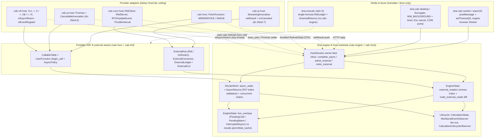

# Asynchronous and pushed values in cells: shared substrate and per-mechanism rules

Status: architecture design for epic `dc-26wtr`, task `dc-26wtr.2` (2026-11-23), reconciled with Excel measurements in `docs/research/async-mechanisms-excel.md` (`ww8/async-03`, `ww8/async-04-ui`, `ww8/async-05-display`, `ww8/async-06-cold`, `ww9/rtd-events`, `ww9/rtd-f9`, `ww9/rtd-product`, `ww10/af2`), `crates/calc-engine/tests/fixtures/excel-calc-probes/P07/README.md` (`P07-ui3-safe`, `P07-core-safe`, `save-ui`), and current `master`. Design document only; no code changes.

Companion documents:
- `docs/research/async-mechanisms-excel.md` — Windows Excel measurements for native XLL async (`ww8`, `ww10`) and COM RTD (`ww9`), plus the staged Office.js experiment setup.
- `docs/architecture/RECALC_CONTRACT.md` — command/pass/invocation identities, SliceV1 async completion (§3.4), observation fences (§5), supersession (§6), and save pinning (§8).
- `docs/architecture/API_FACES.md` — three external faces over one core and the embedded `calc-js-host` seam (§5.5).
- `docs/architecture/CODE_EXECUTION_POLICY.md` — shared `Off` / `Guarded` / `Unguarded` model and ten-capability vocabulary (`dc-8ovd`).
- `docs/architecture/ADDIN_SURROGATE.md` — per-session surrogate boundary for native add-ins (Stages 3–4, §8 async/RTD/unload).
- `docs/architecture/EVALUATOR_SUSPENSION.md` — operand-transactional evaluator suspension (`EvalContinuation`).

Honesty baseline: every claim of Excel parity in this document cites an executed measurement in `docs/research/async-mechanisms-excel.md`, `P07/README.md`, or `dc-snz.23.4`. Every unmeasured behaviour — including Office.js async (`Promise`) and streaming (`setResult`), whose Windows Excel catalog sideload was rejected by automatic review during `ww9` — is marked **Provisional** and linked to its follow-up measurement bead (`dc-26wtr.1.1`–`dc-26wtr.1.4`) under `dc-26wtr.1`.

---

## 1. Architectural model: one substrate, two causal primitives, four mechanisms

Four cell mechanisms deliver values asynchronously or push updates after initial entry:

1. **Native XLL asynchronous functions** (`>..X`, `>..X$`, `>..X!`, completing through `xlAsyncReturn`).
2. **Real-Time Data (RTD)** (`=RTD(progid, server, topic1, ...)` and XLL `xlfRtd`, backed by `IRtdServer` / `IRTDUpdateEvent`).
3. **Office.js asynchronous custom functions** (returning a `Promise`, optionally `cancelable: true` with `CancelableInvocation.onCanceled`).
4. **Office.js streaming custom functions** (`stream: true`, pushing values through `StreamingInvocation.setResult` and tearing down via `onCanceled`).

DNA Calc's built-in fetching functions (`WEBSERVICE` and `IMAGE` via `calc_func::FetchRoute`, `crates/calc-func/src/fetch.rs:499-585`) already run on the same continuation mechanism as (1) and (3).

### 1.1 Why two primitives inside one substrate

Measured Excel behaviour shows two distinct causal shapes that must not be collapsed into one another:

- **Primitive 1 — Suspended Evaluation Continuation (one-shot async return):** serves **XLL async** and **JS async** (plus built-in `FetchRoute`). A specific formula evaluation inside an open `CalcCommandId` runs its prefix once, enters the provider, and parks its `EvalContinuation` at `UserFunctionStep::Awaiting { request }` under an owner-issued `AsyncToken`. The command stays open until every awaited return arrives (or the command is cancelled or superseded). A valid return resumes the existing continuation without repeating the prefix (`ww8/async-03` row 2; `P07-ui3-safe`), executes the formula suffix, and schedules dependents in an `AsyncDependents` pass within the same command. `SheetCalculate` and `AfterCalculate` fire once after all chains finish (`ww8/async-03` row 3).
- **Primitive 2 — Sequenced External Topic Ledger (multi-shot push):** serves **RTD** and **JS streaming**. A formula does not stay parked across ticks. It connects or joins an external topic/stream key, reads the current value from an immutable `ExternalCut` (or a synchronous connect-time provisional value certified before publication), records `(ExternalKey, ExternalLease, sequence)` in `ResultStamp.reads.external_inputs`, and completes its evaluation. Subsequent pushes advance the immutable `ExternalLedger`, dirty only subscribed nodes via a reverse index (`external_readers`), and trigger a new recalculation command in `Automatic` mode (or hold dirty in `Manual` mode while the background server/stream continues updating the ledger; `ww9/rtd-events` rows 1, 3).

Collapsing Primitive 1 into Primitive 2 would break no-prefix-repeat, per-command `SheetCalculate`/`AfterCalculate` deferral across multiple chains, and the separation between live cancelled `#CALC!` and preserved numeric save caches (`P07-ui3-safe`, `save-ui`). Collapsing Primitive 2 into Primitive 1 would leave commands permanently open, prevent multi-cell topic sharing, and break Manual background refreshes and `CalculateFull` value retention (`ww9/rtd-events` rows 1–3).

### 1.2 What the one shared substrate owns

Both primitives converge onto one portable calculation and host substrate:



Shared invariants across all four mechanisms:
1. **Single owner mutation rule:** Only the session's owner lane mutates `EngineState`, `ExternalLedger`, `AsyncReturns`, `ModelRoot`, or `HostState`. Background threads, COM sinks, and browser Workers only deposit owned values into thread-safe/IPC queues and wake the owner.
2. **Monotonic, never-recycled identities:** `AsyncToken.id`, `ExternalLease`, `WorkbookInstanceId.incarnation`, `CalcCommandId`, `formula_generation`, and `CallableTable` generation never wrap or reuse old values. Stale returns and retired leases are tombstoned and rejected without side effects (`calc-engine/src/external.rs:15-128`, `calc-fml/src/rtd.rs:64-169`).
3. **Representation equality for duplicate checks:** Retransmissions match only under `CalcValue::representation_eq` (`-0.0` differs from `0.0`; cube member identity must match; `external.rs:10-12`, `rtd.rs:130`).
4. **Provenance before value (Honesty Rule 1):** Pending markers (`#BUSY!`, `#GETTING_DATA`), interrupted overlays (`#CALC!`), file caches (`FileCached`), and typed refusals (`NotModeled`) are never promoted to `Calculated`.
5. **One callable table and one dependency ceiling:** All four providers publish through `calc_fml::CallableTable` and `calc_func::UserFunction` / `ExternalConnector`. `calc-func`, `calc-fml`, `calc-js-host`, `calc-addin-host`, and `dna-onecalc` remain free of `calc-engine` and `calc-host` (`tools/xtask/architecture.json:47-96, 266-299`).

---

## 2. Measured Excel behaviour, current DNA Calc gaps, and per-mechanism rules

### 2.1 Side-by-side behavioural matrix

Citations: `A03` = `ww8/async-03`; `A04/A05` = `ww8/async-04-ui` & `ww8/async-05-display`; `P07` = `P07/README.md` (`P07-ui3-safe`, `P07-core-safe`, `save-ui`); `R09` = `ww9/rtd-events` & `ww9/rtd-f9`; `R23` = `dc-snz.23.4` (`rtd1/measure`). Unmeasured cells state the **Provisional** rule and name the owning follow-up measurement bead (`dc-26wtr.1.1`–`dc-26wtr.1.4`).

| Dimension | Native XLL async (`>..X`) | COM RTD (`=RTD()` / `xlfRtd`) | JS async (`Promise`) | JS streaming (`setResult`) |
|---|---|---|---|---|
| **Engine primitive** | Continuation (`AsyncToken`) | External topic ledger (`ExternalKey::Rtd`) | Continuation (`AsyncToken`) | External topic ledger (`ExternalKey::JsStream`) |
| **Identical-arg sharing across cells** | Per-cell invocation; each cell gets its own `AsyncHandle` (`A03`) | Shared: one `ConnectData` serves all matching `TopicKey` cells (`R09`, `R23`) | Per-cell invocation (**Provisional**, `dc-26wtr.1.3`) | Keyed by `(addin, fn, args, caller_opt)`; sharing vs per-cell **Provisional** (`dc-26wtr.1.4`) |
| **Cold display (no prior value)** | **Unmeasured** (`async-06-cold` finished after return; **Provisional:** `PendingCold(#N/A)` or blank pending `dc-26wtr.1.1`, never scored calculated) | Synchronous `ConnectData` initial value shown at once; `Empty` -> `0`, connect failure -> `#N/A` (`R09`, `R23`) | **Provisional:** `PendingCold(#BUSY!)` per Microsoft docs (`dc-26wtr.1.3`) | Sync `setResult` shown at once; if async before first `setResult`, **Provisional:** `PendingCold(#BUSY!)` (`dc-26wtr.1.4`) |
| **Warm display while pending / refreshing** | Holds previous calculated values (`20/21/42`); never `#GETTING_DATA` (`A05/complete.png`) | Holds previous value until refresh wave publishes (`R09` Auto & Manual) | **Provisional:** parameterized `PendingWarm` (`ShowMarker(#BUSY!)` vs `HoldPrevious`; `dc-26wtr.1.3`) | Holds last admitted `setResult` value until next push (`dc-26wtr.1.4`) |
| **Independent chains & dependent recalc** | Concurrent entry (`B1` & `B2` at same tick); independent pure/`NOW()` run before returns; fast chain's suffix (`D2`) runs before slow return (`B1`) (`A03`) | Only subscribers of the updated topic and their transitive dependents recalculate (`R09`) | Same concurrent chain scheduling as XLL async (**Provisional**, `dc-26wtr.1.3`) | Only subscribers of the pushed stream key and their transitive dependents recalculate (**Provisional**, `dc-26wtr.1.4`) |
| **`SheetCalculate` & `AfterCalculate`** | Once per command, after ALL async chains finish (`SheetCalculate` -> `AfterCalculate`; Automatic edit adds `-> SheetChange`) (`A03`) | Once per throttled refresh wave in Automatic (`SheetCalculate` -> `AfterCalculate` for `42`, then again for `44`); none while holding in Manual (`R09`) | Once per command after all Promises settle (**Provisional**, `dc-26wtr.1.3`) | Once per recalculation wave triggered by admitted `setResult` batch (**Provisional**, `dc-26wtr.1.4`) |
| **Native `xlEventRegister` (`1`/`2`)** | `CalculationEnded` absent on dirty COM `Calculate`, present on UI F9, `CalculateFull`, Automatic edit; Esc/overwrite/Ctrl+S fire `CalculationCanceled` then `CalculationEnded` before late return (`A03`, `P07`) | Does not apply directly (RTD is COM, though recalc waves still follow command lifecycle; Esc during RTD recalc **Unmeasured**, `dc-26wtr.1.2`) | Not applicable (JS has no `xlEventRegister`) | Not applicable (JS has no `xlEventRegister`) |
| **Clean `Calculate` (F9) vs `CalculateFull`** | Clean F9 re-enters ONLY volatile (`!`) async (`A03`); `CalculateFull` re-enters ordinary, `$`, and `!` async (`A03`) | Clean F9 publishes any dirty/queued refreshes; `CalculateFull` keeps settled RTD values without reconnecting (`R09`) | Clean F9 re-enters only `options.volatile`; `CalculateFull` re-enters all (**Provisional**, `dc-26wtr.1.3`) | Clean F9 publishes queued pushes; `CalculateFull` retention vs restart **Unmeasured** (**Provisional:** keep settled like RTD, `dc-26wtr.1.4`) |
| **Manual mode** | Formula entry computes live despite Manual; argument edit triggers zero async calls, holds old values, `CalculationState=2`; F9 computes and sets state `0` (`A03`) | Background `UpdateNotify`/`RefreshData` continues (`42`, `44`) while sheet keeps `1` and stale dependents; retarget shows new `44` with stale dependents; F9 updates all chains (`2 -> 0`) (`R09`) | Same Manual entry/edit/F9 rules as XLL async (**Provisional**, `dc-26wtr.1.3`) | **Provisional:** background `setResult` updates ledger & marks dirty while sheet holds prior value until F9 (`dc-26wtr.1.4`) |
| **Multithreaded calc (MTR)** | `>..X$` enters across worker pool (96 calls across 16 threads, MTR on) or main thread (MTR off); `>..X` & `>..X!` enter on main thread; `xlAsyncReturn` from any thread (`A03`) | COM `IRtdServer` calls strictly on owner STA; `IRTDUpdateEvent::UpdateNotify` agile/any thread (`R09`, `rtd_native.rs`); `xlfRtd` from `$` returns `xlretNotThreadSafe` (`128`) | QuickJS single-threaded on owner lane (or browser Worker on `wasm32`); Promises overlap concurrently without blocking pure calc threads | Stream callbacks run on JS isolate / browser Worker; `ExternalCut` is `Send + Sync` so pure dependents still parallelize |
| **Cancellation & post-cancel display** | Esc, overwrite+Undo, UI `Ctrl+S` cancel pending calc; live async cell & dependents show `#CALC!` (`Error2051`), `CalculationState=2`; late `xlAsyncReturn` ignored, suffix never runs (`A05`, `P07`) | Topic stays connected on unrelated edits; Esc during RTD recalc **Unmeasured** (`dc-26wtr.1.2`); disconnect only on subscriber removal/retarget/close (`R09`) | `CancelableInvocation.onCanceled` invoked on cancel/edit/close; late `resolve` ignored; post-cancel display **Provisional:** `#CALC!` (`dc-26wtr.1.3`) | `StreamingInvocation.onCanceled` invoked when last subscriber disconnects/retargets/closes; Esc/`CalculateFull` effect **Unmeasured** (`dc-26wtr.1.4`) |
| **Retarget / subscriber removal** | Formula edit/overwrite gets new `formula_generation`; revokes pending token; new formula evaluates anew (`P07`) | Removing 1 of 2 subscribers keeps topic alive; retarget connects NEW topic before disconnecting OLD; close disconnects & calls `ServerTerminate` (`R09`) | Formula edit revokes pending token & calls `onCanceled` if cancelable (`dc-26wtr.1.3`) | Post-publish diff starts NEW stream before calling `onCanceled` on OLD when refcount hits 0 (**Provisional**, `dc-26wtr.1.4`) |
| **Save (`CalculateBeforeSave=false`)** | Completed save writes calculated values, zero async entries (`A03`). Cancelled UI `Ctrl+S` writes **held prior numeric caches** (`41/42`, `90/91`), NOT live `#CALC!`, with `ca=1, calcCompleted=0, calcOnSave=0` (`P07`) | Writes settled/held values; zero reconnect during save (`R09`) | Same held-cache preservation policy as XLL async (**Provisional**, `dc-26wtr.1.3`) | Writes last published stream value (never transient `#BUSY!`; **Provisional**, `dc-26wtr.1.4`) |
| **Reopen in Manual** | Exposes saved values, `CalculationState=2`, zero async entries on open; explicit `Calculate` re-enters ONLY volatile async (NOT settled ordinary async) (`A03`) | Exposes saved `44` & dependents `54`/`162`; explicit `Calculate` reconnects (`ConnectData`) and shows `1`/`11`/`33` (`R09`) | Exposes saved values; clean F9 re-enters only `volatile` (**Provisional**, `dc-26wtr.1.3`) | Exposes saved values; explicit `Calculate` restarts stream (**Provisional**, `dc-26wtr.1.4`) |
| **Security policy (`Off` / `Guarded` / `Unguarded`)** | `Off`: not loaded. `Guarded`: **not available** (native code). `Unguarded`: allowed. | `Off`: disabled. `Guarded`: **not available** for native COM ProgIDs (`com.activate` refused). `Unguarded`: allowed. | `Off`: not loaded. `Guarded`: **allowed** under `ExecLimits` (mediated `fetch` denied). `Unguarded`: allowed. | `Off`: not loaded. `Guarded`: **allowed** under `ExecLimits` + stream queue caps. `Unguarded`: allowed. |

### 2.2 Per-mechanism rules and exact gaps in DNA Calc today

#### 2.2.1 Native XLL asynchronous functions (`dc-26wtr.4`, `dc-snz.23`)

**What Excel does (measured):**
- Registration flags distinguish ordinary async (`>..X`, main thread), thread-safe async (`>..X$`, worker pool when MTR on, main thread when MTR off), and volatile async (`>..X!`, main thread, re-entered on clean F9) (`ww8/async-03` rows 5–6).
- Multiple independent async chains enter concurrently in the same calculation command; independent pure and `NOW()` formulas execute before any return; a faster branch resumes its own continuation and evaluates its downstream dependents immediately without waiting for slower unrelated async calls (`ww8/async-03` row 2).
- Within a single formula containing two async call sites, site 2 enters with a distinct handle only after site 1 returns (`P07/README.md` `special`).
- `SheetCalculate` and `AfterCalculate` fire once after all chains in the command complete (`ww8/async-03` row 3).
- Native `xlEventRegister` fires `CalculationEnded` (1) on UI F9, `CalculateFull`, and Automatic edit, does not fire it on dirty COM `Application.Calculate`, and fires `CalculationCanceled` (2) followed by `CalculationEnded` (1) before late returns on UI Esc, overwrite+Undo, and UI `Ctrl+S` (`ww8/async-03` row 4; `P07-ui3-safe`; `save-ui`).
- Warm pending cells retain their previous displayed values (`20/21/42`, never `#GETTING_DATA`); cancelled async cells and their uncalculated dependents immediately paint `#CALC!` (`Error2051`) with `CalculationState = 2`, while Manual `Save(false)` persists the held prior numeric caches (`90/91`, `41/42`) with `ca="1"`, `calcCompleted="0"`, `calcOnSave="0"` (`ww8/async-05-display`; `P07-ui3-safe`; `save-ui`).
- Manual reopen of a completed workbook invokes nothing on open (`CalculationState = 2`), and explicit `Calculate` re-enters only volatile async calls (`ww8/async-03` row 7).

**Where current DNA Calc differs:**
1. **Observation-fence serialization (`crates/calc-engine/src/recalc.rs:1541-1566, 6647-6658`):** Non-`$` user calls create per-node fence segments, and `is_waiting_external()` stalls the entire calculation as soon as any node in `active_segment` enters `async_waits`. Two independent chains (`B1` slow, `B2` fast) cannot enter concurrently, and `D2` cannot run when `B2` returns early.
2. **Thread-safe async refused (`crates/calc-xll-host/src/invoke.rs:89-93`, `native.rs:1378-1383`, `worker.rs:30-33`):** `>..X$` returns a typed `dc-snz.23` refusal; `worker::Pool` is hard-clamped to `1..=4` threads instead of tracking MTR thread count, and `PoolCall` only runs synchronous `$` calls.
3. **Cancellation display and Esc route missing (`crates/calc-host/src/session.rs:667-685`, `project.rs`):** `cancel_calculation()` drops `work` without installing the live `#CALC!` overlay on interrupted async nodes + dependents, and no UI `SkinIntent::CancelCalculation` exists for Esc.
4. **`xlEventRegister` never invoked (`crates/calc-xll-host/src/callbacks.rs:780-796`, `native.rs:769`):** `State::events` records `(module_handle, 1|2) -> fn_addr` and nothing calls it on completion or cancellation.
5. **Late `xlAsyncReturn` status (`crates/calc-xll-host/src/callbacks.rs:524-526`):** Currently returns `INVALID_ASYNC` (`256`) on revoked/duplicate handles, whereas Excel 16.0.20527 returned status `0` with a zeroed output operand (`P07/README.md` line 50; verify exact late-return status and output bytes in `dc-26wtr.1.1`).
6. **COM blocking and `CalculationState` (`crates/calc-host/src/automation/mutation.rs:535-553`):** `WorkbookAutomation::mutate_pre` refuses `HostProgress::Waiting` instead of pumping COM `Application.Calculate` / Automatic edits until completion, and `_Application.CalculationState` is not registered.
7. **Reopen dirtiness (`crates/calc-engine/src/state.rs:762-765`):** `EngineState::new` marks every formula pending on open, so Manual reopen + `Calculate` would re-enter settled non-volatile async cells.

**Per-mechanism rules on the shared substrate:**
- `AsyncPolicy`: `kind = Continuation`, `concurrent_when_parked = true`, `warm_pending_display = HoldPrevious`, `cold_pending_display = Provisional (dc-26wtr.1.1)`, `cancel_display = LiveCalcErrorPreserveCache`, `cancel_notify = ModuleLifecycleEvent(CalculationCanceled + CalculationEnded)`.
- Three `xlAsyncReturn` completion timings all route through the same `AsyncToken` inbox: (a) **inline before entry stub returns** (the result is already in `Completion.result`, picked up by the next `take_async_returns()` drain without blocking), (b) **asynchronous during open calculation** (wakes owner via `WM_BACKGROUND` and resumes the parked continuation), and (c) **late after cancel, supersession, or close** (tombstone observes `async_return_observed = true`, ignores result without dereferencing the operand, and never resumes the suffix).
- `>..X$` routes entry stubs through `worker::Pool` (sized to `EngineState::threads`) when MTR is on and `!frame.owner_only()`, freeing the worker thread immediately once the stub returns `NativeReturn::Pending`; when MTR is off, `FormulaEntry`, or `Range.Calculate`, entry runs inline on the owner STA (`UserInvocationFrame::owner_only()`).

#### 2.2.2 COM Real-Time Data (`dc-26wtr.5`, building on `dc-snz.23` and `dc-snz.23.3`)

**What Excel does (measured):**
- One `TopicKey` (`progid` ASCII case-folded, empty local `server`, 1–253 exact `CONCAT`-coerced topic strings) serves every subscriber across `=RTD(...)` and XLL `xlfRtd`; `ConnectData` is called once (`ww9/rtd-events` row 1; `dc-snz.23.4`).
- `ConnectData`'s initial value displays immediately (`1`); empty coerces to `0.0`, connect failure to `#N/A`, `VARIANT` array to `#N/A` (`dc-snz.23.4`, `rtd_native.rs:484-492`).
- `UpdateNotify` triggers an immediate first `RefreshData` (`42`), then coalesces further notifications (`43`, `44`) under `Application.RTD.ThrottleInterval` (default `2,000 ms`, `ww9/rtd-events` row 1), firing `SheetCalculate` + `AfterCalculate` per refresh wave in Automatic.
- Removing one of two subscribers keeps the topic connected; retargeting the remaining subscriber connects the replacement topic (`ConnectData`) **before** disconnecting the old topic (`DisconnectData`); closing the workbook disconnects remaining topics and calls `ServerTerminate` (`ww9/rtd-events` row 2).
- In Manual mode, `UpdateNotify`/`RefreshData` continues refreshing the server (`42`, `44`) while the sheet holds `1` and dependents keep old values; retargeting evaluates the edited cell (`44`) leaving dependents stale; F9 (`Calculate`) updates both chains (`1 -> 44`, `45 -> 90`, `54 -> 162`, `CalculationState` `2 -> 0`); `CalculateFull` keeps settled values (`ww9/rtd-events` rows 3–4).
- Save and reopen in Manual displays saved `44`, `54`, `162` with zero server start on open; explicit `Calculate` reconnects (`ConnectData`) and displays `1`, `11`, `33` (`ww9/rtd-events` row 5).

**Where current DNA Calc differs:**
1. **Desktop live app never reconciles dropped/retargeted RTD subscriptions (`apps/dna-calc-desktop/src/app.rs:733-768`):** `app.rs` polls `addins.poll_rtd` and calls `server.update_rtd`, but never calls `begin_replacement` / `finish_replacement` / `reconcile_evaluation` on cell edits, clears, or workbook close (only the standalone harness `engine.rs:135-160` and OneCalc's `take_unread_rtd` do).
2. **RTD enabled unconditionally regardless of `MacroSecurity` (`apps/dna-calc-desktop/src/app.rs:888`):** `set.enable_rtd()` installs native COM `RtdClient` even in `Off` and `Guarded`, allowing arbitrary `CoCreateInstance` activation in violation of `CODE_EXECUTION_POLICY.md` §1.
3. **`Application.RTD` object not exposed in `WorkbookAutomation` (`crates/calc-com-host/src/rtd_native.rs:255`):** `throttle: 2000` is hard-coded; `Application.RTD.ThrottleInterval`, `RefreshData`, and `RestartServers` are absent.
4. **Managed XLL RTD replacement ordering & `GetNewValues` (`dc-snz.23` Round 14; `rtd_native.rs:330`):** Managed wrappers that cache RTD answers across cells still need exact connect-before-disconnect reconciliation without disconnecting prematurely, and `ConnectData` always passes `fresh = -1` without modelling `GetNewValues = FALSE` (unmeasured, `dc-26wtr.1.2`).
5. **Typed `RtdLedger` / `rtd_readers` hardcoded to `TopicKey` (`crates/calc-fml/src/rtd.rs`, `calc-engine/src/state.rs:350`):** Needs generalization to `ExternalKey` so JS streaming shares the identical ledger, reverse index, and reconciliation path.

**Per-mechanism rules on the shared substrate:**
- `ExternalPolicy`: `kind = TopicLedger`, `key = ExternalKey::Rtd(TopicKey)`, `shared_by_key = true`, `coalescing = ThrottleInterval(default 2000ms) + Heartbeat(15000ms)` in `RtdClient`, `reconcile = ConnectBeforeDisconnect` on post-publish diff, `reopen_manual_f9 = ReconnectAndRecalculate`, `calculate_full = KeepConnectedAndReadSettled`.

#### 2.2.3 Office.js asynchronous (`Promise`) custom functions (`dc-26wtr.6`)

**What Excel does:**
- **Not yet measured in Excel** (Office.js catalog sideload was rejected by automatic review during `ww9`; tracked in `dc-26wtr.1.3`).
- Per Microsoft's Office.js custom-functions specification (`functions.json`, `CustomFunctions.Invocation`, `CustomFunctions.CancelableInvocation`), a function returning a `Promise` runs asynchronously; when `"cancelable": true` is declared, Excel passes `invocation.onCanceled` (which the function assigns to a callback) and invokes it if the call is cancelled; errors are returned via `CustomFunctions.Error` or rejected Promises; optional `requiresAddress` / `requiresParameterAddresses` populate `invocation.address` / `invocation.parameterAddresses`; `volatile: true` marks volatile recalculation.

**Where current DNA Calc differs:**
1. **`calc-js-host` is synchronous-only today (`crates/calc-js-host/src/engine.rs:44-53`, `callable.rs:94-109`, `quickjs.rs:275-280`):** `JsEngine` exposes only `invoke_sync`; `options.cancelable` and any returned `Promise` emit `JsHostError::Deferred { owner: "dc-26wtr.6" }`; top-level async module evaluation also defers.
2. **No job draining or timer/fetch pump in shells:** Neither `dna-calc-desktop` nor `dna-calc-worker` pumps `JsEngine::drain_jobs(budget)` or delivers settled JS Promise results to `HostSession::complete_async`.
3. **No `engine-browser` Worker backend yet (`crates/calc-js-host/CONTRACT.md:12-13`):** On `wasm32`, `calc-js-host` compiles the adapter without an active JS runtime backend.

**Per-mechanism rules on the shared substrate (Provisional until `dc-26wtr.1.3`):**
- Uses **Primitive 1** (`UserFunction::begin_call` -> `UserFunctionStep::Awaiting { request }` -> `AsyncToken` -> `AsyncReturns` -> `HostSession::complete_async`), identical to XLL async.
- `JsEngine` gains `invoke_async`, `cancel(request)`, and `drain_jobs(budget)` (Section 4.2).
- `AsyncPolicy`: `kind = Continuation`, `concurrent_when_parked = true`, `cold_pending_display = PendingCold(WorksheetErrorCode::Busy)`, `warm_pending_display = Provisional (PendingWarm::ShowMarker(Busy) vs HoldPrevious, flipped by dc-26wtr.1.3)`, `cancel_display = Provisional (LiveCalcErrorPreserveCache, confirmed/adjusted by dc-26wtr.1.3)`, `cancel_notify = PerRequestCallback(JsEngine::cancel -> invocation.onCanceled)`.
- A rejected Promise carrying a `CustomFunctions.Error` maps to its `WorksheetErrorCode`; any other thrown/rejected value or timeout/OOM maps to `#VALUE!` plus a diagnostic (exact rejection mapping confirmed in `dc-26wtr.1.3` and `dc-17spk.22`).

#### 2.2.4 Office.js streaming (`setResult`) custom functions (`dc-26wtr.7`)

**What Excel does:**
- **Not yet measured in Excel** (tracked in `dc-26wtr.1.4`).
- Per Microsoft's Office.js custom-functions specification, a function with `"stream": true` (mutually exclusive with `"volatile": true`) receives a `CustomFunctions.StreamingInvocation` carrying `setResult(valueOrError)` and `onCanceled`. It returns `void` (not a `Promise`), calls `setResult` zero or more times over its lifetime (including matrix values that can spill), and receives `onCanceled` when Excel tears down the subscription.

**Where current DNA Calc differs:**
1. **Streaming deferred (`crates/calc-js-host/src/callable.rs:95-99`):** `options.stream` returns `JsHostError::Deferred { owner: "dc-26wtr.7" }`.
2. **Metadata validation gap (`crates/calc-js-host/src/metadata.rs:35-70`):** Does not yet reject the invalid combination `options.volatile && options.stream` (per Microsoft's `functions.json` schema; verify Excel's exact load/parse behaviour in `dc-26wtr.1.4`).
3. **Engine external ledger is RTD-typed (`crates/calc-fml/src/rtd.rs`):** Needs `ExternalKey::JsStream` and a host-level `CompositeExternalConnector` multiplexing RTD and JS streaming connectors into one `ExternalLedger`.

**Per-mechanism rules on the shared substrate (Provisional until `dc-26wtr.1.4`):**
- Uses **Primitive 2** (`ExternalKey::JsStream(JsStreamKey)` -> `ExternalConnector` -> `ExternalLedger` -> `external_readers` -> `HostSession::admit_external` / `retire_external`), identical to RTD.
- `JsStreamKey` carries `(addin_id, function_id, canonical_args, caller_scope: Option<CellKey>)`:
  - `caller_scope = Some(caller)` whenever `requires_address || requires_parameter_addresses` (or unconditionally if `dc-26wtr.1.4` measures per-cell streaming in Excel).
  - `caller_scope = None` when identical arguments share one stream (if `dc-26wtr.1.4` confirms stream sharing).
- If the JS start call invokes `invocation.setResult(v)` synchronously during `start_stream`, `ExternalConnection.provisional` returns `Some((1, v))` and is certified in-place via `RecordingConnector` + `adopt_connected_inputs` (`dc-snz.23.3`). If no synchronous `setResult` occurs, `provisional` is `None` and the cell displays `PendingCold(WorksheetErrorCode::Busy)` until sequence 1 arrives.
- Unlike RTD's `VARIANT` array -> `#N/A` rule, a matrix `setResult` on a `Dimensionality::Matrix` stream stores a `CalcValue::array(...)` in `ExternalLedger`, which flows through `calc-engine`'s ordinary dynamic-array spill placement and shrink/grow invalidation.
- Coalescing: per-tick latest-value coalescing in `calc-js-host`'s bounded stream inbox (adjusted if `dc-26wtr.1.4` measures a timer throttle in Excel).
- Teardown: post-publish subscription reconciliation calls `JsEngine::cancel(stream_lease)` -> `invocation.onCanceled()` (bounded by `ExecLimits`) and `retire_external`, strictly after any replacement stream starts (`ConnectBeforeDisconnect`).

---

## 3. Shared substrate design

### 3.1 Pending cell state, live overlays, and display projection

Today `EngineState::results` (`crates/calc-engine/src/results.rs`) holds only one `FormulaResult` per node, and `calc-host/src/project.rs` derives `ProjectedValue` from `results` plus `stale()`. That single slot cannot represent Excel's measured `P07-ui3-safe` / `save-ui` state where a cancelled async cell **simultaneously** shows live `#CALC!` (`Error2051`) to the grid, `Range.Value2`, and `Range.Text`, while preserving its last completed numeric cache (`90/91`, `41/42`) for Manual `Save(false)`.

**Design:** keep `EngineState::results` strictly as the committed historical result (backing `permitted_cache` and Manual save), and add two lightweight, transient layers:

1. **In-flight execution state (`RecalcWork::async_waits` + cold-stream tracking):** identifies every formula node currently awaiting an external return or initial stream push.
2. **Transient live overlay (`EngineState::live_overlays: BTreeMap<NodeId, LiveOverlay>`):** cleared automatically whenever a node publishes a new `FormulaResult`, is edited/replaced, or is retired.

```rust
#[derive(Clone, Copy, Debug, PartialEq, Eq)]
pub enum PendingDisplayPolicy {
    /// Warm cell holds its previous published value (measured: XLL async ww8/async-05).
    HoldPrevious,
    /// Cell shows a transient worksheet marker while awaiting (provisional: JS async/cold stream).
    ShowMarker(WorksheetErrorCode),
}

#[derive(Clone, Copy, Debug, PartialEq, Eq)]
pub enum LiveOverlay {
    /// Newly entered or uninitialized async/stream cell with no prior value yet.
    PendingCold(WorksheetErrorCode),
    /// Warm cell whose mechanism displays a transient marker while recalculating.
    PendingWarm(WorksheetErrorCode),
    /// Async cell or uncalculated dependent interrupted by Esc / overwrite / Ctrl+S (P07).
    /// Live reads see #CALC! (Error2051); EngineState::results keeps permitted_cache for save.
    InterruptedAsync,
}
```

**Projection & provenance rules (`crates/calc-host/src/project.rs`, `apps/dna-calc-worker/src/cells.rs`):**
- Extend `StaleCause` with:
  - `StaleCause::AwaitingExternal { marker: Option<WorksheetErrorCode> }` — formula has an active `async_waits` entry or cold stream; `StaleValue.last_value` retains the held previous value (displayed when `marker` is `None`, as in warm XLL async `ww8/async-05-display/complete.png`), while `marker` (`Some(#BUSY!)` or `Some(#GETTING_DATA)`) is displayed when configured for cold/JS states.
  - `StaleCause::InterruptedAsync` — formula (or its uncalculated dependent) was interrupted mid-async; the grid, `Range.Value2`, and `Range.Text` render `#CALC!` (`Error2051`), while provenance stays `ProjectedValue::Stale` (never `Calculated`) and `StaleValue.last_value` / `EngineState::permitted_cache` stays untouched for Manual `Save(false)`.
- **Application-level `CalculationState` (`HostState::calculation_state()`):**
  - `XlCalculationState::Calculating (1)` when `host.work.is_some()` (active or waiting on `async_waits`; exact in-flight value to be confirmed in `dc-26wtr.1.1`).
  - `XlCalculationState::Pending (2)` when `host.work.is_none()` and any of: `engine.needs_recalc(&model)`, `!engine.live_overlays.is_empty()`, `host.calculation_cancelled`, `host.last_failure.is_some()`, or the workbook was reopened in Manual with uncalculated volatile/RTD/dirty demand (`ww8/async-03` row 7, `ww9/rtd-f9`).
  - `XlCalculationState::Done (0)` otherwise (`ww8/async-03` row 1, `ww9/rtd-f9`).
  - Expose through `_Application.CalculationState` (`WorkbookAutomation`, `crates/calc-host/src/automation.rs`) and Office.js `ctx.application.calculationState`.

### 3.2 Unified completion queue and external-input inbox

Every asynchronous or pushed result enters the engine through one owner-lane inbox on `HostSession` / `Server`:

1. **One-shot completion path (`HostSession::complete_async`):**
   - Already validated end-to-end by `AsyncReturns::deliver` (`crates/calc-engine/src/external.rs:82-127`) and `RecalcWork::accept_async` (`crates/calc-engine/src/recalc.rs:6661-6746`): checks token existence, full identity equality, live command/destination/incarnation/generation/locus, callable generation, requirement version, read/fact/name stamps, non-`Missing` value, and `representation_eq` for duplicates.
   - Extend token lookup on shells so every provider (`XllAsync`, `JsAsync`, `Fetch`) uses a tagged request identity `(AsyncProviderKind, u64)` (avoiding numeric request-ID collisions between `XllHost`'s `NEXT_ASYNC`, `JsAddin`'s `next_request`, and `FetchRoute`'s `next`!).
   - Extend `AsyncReturns` / `RecalcWork::accept_async` with `AsyncProviderError` handling: a provider execution fault (JS unhandled throw/timeout, XLL unconvertible operand) resumes the continuation with an explicit worksheet error (`#VALUE!`) or typed refusal, rather than leaking a permanently parked `AsyncToken`.
2. **Sequenced push path (`HostSession::admit_external` / `retire_external`):**
   - Generalize `crates/calc-fml/src/rtd.rs` into a unified `external` module (re-exporting `rtd::*` aliases so existing callers stay unchanged):
     ```rust
     #[derive(Clone, Debug, PartialEq, Eq, PartialOrd, Ord, Hash)]
     pub enum ExternalKey {
         Rtd(TopicKey),
         JsStream(JsStreamKey),
     }
     #[derive(Clone, Debug, PartialEq, Eq, PartialOrd, Ord, Hash)]
     pub struct JsStreamKey {
         pub addin_id: String,
         pub function_id: String,
         /// Canonical argument representation preserving type, -0.0, and array shape.
         pub args_canonical: Vec<u8>,
         /// Present when requiresAddress / requiresParameterAddresses or per-cell policy applies.
         pub caller: Option<CellKey>,
     }
     ```
   - `ExternalLedger` (replacing `RtdLedger`) remains a pure persistent value (`Arc<BTreeMap<ExternalKey, ExternalEntry>>`, `Arc<BTreeSet<(ExternalKey, ExternalLease)>>`), `Send + Sync` as `ExternalCut`.
   - Provisional initial values returned synchronously during `ExternalConnector::connect` (RTD `ConnectData`, or a JS stream calling `setResult` synchronously on start) continue using `RecordingConnector` + `admit_connected_external()` + `work.adopt_connected_inputs(...)` (`crates/calc-host/src/recalc.rs:230-239`, `dc-snz.23.3`) so sequence 1 publishes immediately with zero double evaluation.
   - `EngineState::invalidate_external_key` (generalizing `invalidate_rtd_topic`, `crates/calc-engine/src/state.rs:712-760`) dirties ONLY nodes in `external_readers[&key]` whose current published `ResultStamp.reads.external_inputs` still names `key`, plus their transitive `dirty_closure`, and advances `contract.external_inputs` and `contract.external_versions`.
   - **Important subtlety for `volatile_input_version` (`crates/calc-engine/src/state.rs:756-759`):** Today `invalidate_rtd_topic` increments `self.volatile_input_version`, which forces every unrelated volatile formula (`NOW()`, `RAND()`) to re-evaluate on an RTD refresh even if it does not read the RTD topic (`recalc.rs:2995`). Verify in `dc-26wtr.1.2` whether Excel's RTD refresh wave recalculates unrelated `NOW()` cells or only the RTD topic's dependent closure; decouple `contract.external_inputs` from `volatile_input_version` if Excel leaves unrelated volatiles untouched.

### 3.3 Recalc scheduling, concurrent async chains, and subscription reconciliation

Four surgical changes in `calc-engine/src/recalc.rs` and `calc-host` align scheduling with the measured Excel traces:

1. **Non-fencing async continuations (`ww8/async-03` row 2):**
   - Today `begin_recalc` (`recalc.rs:1541-1566`) puts a serial observation fence around every non-`$` user call, and `is_waiting_external()` (`recalc.rs:6647-6658`) returns `true` whenever any node in `active_segment` is in `async_waits`.
   - Fix: add `UserFunction::allows_concurrent_async(&self) -> bool` (true for XLL `>..X` / `>..X$` / `>..X!`, JS `Promise`, and `FetchFunction`; false for synchronous macro-equivalent `#` and VBA functions that observe workbook caches).
   - A node whose only user calls have `allows_concurrent_async() == true` (and `cached_reads() == false`) does **not** create a blocking cross-cell observation fence while parked in `async_waits`. (Its synchronous entry stub still runs atomically on the owner STA or `$` worker pool.)
   - Update `RecalcWork::is_waiting_external()` to return `true` **only** when `!self.async_waits.is_empty()` AND **no** unblocked node remains runnable in `ready` or `order[next..]` (and no unblocked fence segment can advance).
   - When `B1` (`2100 ms`) parks in `async_waits`:
     - `next_node()` skips `B1`'s dependents (`C1`, `D1`, which wait on `B1` via `precedents` / `waits_on`) and continues advancing independent nodes: pure constants, `NOW()`, and `B2` (`800 ms`) all execute immediately (`B1` and `B2` enter in the same tick, matching `ww8/async-03` row 2).
     - When `B2`'s `xlAsyncReturn` arrives at 800 ms, `accept_async` moves `B2` into `ready`; the next `step()` resumes `B2`, stages `B2`, releases `D2` (`waits_on` -> `ready`), and evaluates `D2` immediately at 800 ms — **while `B1` is still parked in `async_waits`**!
     - `RecalcWork::remaining()` still counts `self.async_waits.len()`, so `finish()` (and therefore `CompletionReceipt`, `SheetCalculate`, `AfterCalculate`, and `CalculationEnded`) fires **once**, only after `B1`, `C1`, and `D1` all finish (`ww8/async-03` rows 2–3).
2. **Thread-safe XLL async (`>..X$`) under MTR (`ww8/async-03` row 6):**
   - `XllFunction::max_parallel_calls()` returns `state.threads` (when MTR on) for both synchronous `$` and asynchronous `X$` registrations.
   - When `!frame.owner_only()` and `state.threads > 1`, `XllFunction::begin_call` submits the `X$` entry stub to `worker::Pool` (sized to `state.threads`, removing the hard `clamp(1, 4)` in `worker.rs:33`). The worker runs `start_inline` with `XL_BIG_DATA` async handle and returns `NativeReturn::Pending(pending)` **immediately** upon the native stub's `void` return, releasing the worker thread back to the pool right away. `PoolCall` transitions to `UserFunctionStep::Awaiting { request }` and drops its worker channel.
   - Thus 96 cells of `=AsyncSafe(1000+ROW(), 120)` fan out across 16 worker threads (matching `ww8/async-03` `mtr-pool-full`) and all 96 park concurrently in `async_waits` without exhausting the worker pool.
   - When MTR is off (`state.threads == 1`), during `FormulaEntry`, or during `Range.Calculate` (`frame.owner_only() == true`), `X$` runs inline on the owner STA (`ww8/async-03` `mtr-off`).
3. **Post-publish external subscription reconciliation (`ww9/rtd-events` row 2; fixing desktop `app.rs` & `dc-snz.23`):**
   - `EngineState` maintains `node_external_reads: BTreeMap<NodeId, BTreeSet<(ExternalKey, ExternalLease)>>` updated atomically on every result publication and node retirement.
   - Whenever a calculation installs new results (or an edit retires/clears a formula node without recalculating it in Manual, e.g., overwriting with a literal), `HostState` computes per-node subscription deltas:
     - `added = new_reads - old_reads` (already connected during evaluation via `ExternalConnector::connect`)
     - `removed = old_reads - new_reads` (or all `old_reads` on node retirement or workbook close)
   - `HostState` records `ExternalReconciliation::Detach { caller, key, lease }` in a queue drained by the host (`HostSession::take_external_reconciliations()`).
   - The host passes each `Detach` to the owning connector (`RtdClient` or `JsAddin`), which decrements the subscriber set for `(key, lease)` and **only when subscribers reach zero** calls `DisconnectData` (and `ServerTerminate` when the server has zero topics) or `invocation.onCanceled()`, then calls `HostSession::retire_external(key, lease)`.
   - **Result:** For a retargeted RTD or JS streaming cell, `connect(new)` runs during evaluation and `Detach(old)` runs after publication — guaranteeing Excel's measured **connect-before-disconnect** order (`ww9/rtd-events` row 2) across desktop, worker, surrogate, and OneCalc alike!
4. **COM synchronous calculation pump (`ww8/async-03` rows 1–3):**
   - When an external COM caller invokes `Application.Calculate`, `CalculateFull`, or writes a cell in Automatic mode, `WorkbookAutomation::mutate_pre` (`crates/calc-host/src/automation/mutation.rs:527-553`) must not immediately fail with `NotModelled` on `HostProgress::Waiting`.
   - Instead, `AutomationHost` gains an optional `pump_waiting(&self, session: &mut HostSession) -> PumpOutcome` hook implemented by the desktop/surrogate host (pumping the STA message queue, draining `take_async_returns` / `drain_jobs` / `ThreadedFetch`, and advancing `HostSession` until `!session.has_unfinished_calculation()` or cancellation). Headless/in-memory hosts without a pump continue returning a typed refusal so tests never hang silently.
   - On completion, `HostSession` emits `SheetCalculate` -> `AfterCalculate` [-> `SheetChange` for Automatic edits] in Excel's exact measured order (`ww8/async-03` row 3).

### 3.4 Cancellation, interruption, and lifecycle events

A single cancellation path handles all five triggers consistently:

| Trigger | Continuation mechanisms (XLL async, JS async, Fetch) | Pushed-topic mechanisms (RTD, JS streaming) |
|---|---|---|
| **User Esc** (`SkinIntent::CancelCalculation`) | Revoke all active `AsyncToken`s; compute affected set = `async_waits` nodes + transitive uncalculated dependents in `work`; install `LiveOverlay::InterruptedAsync` (`#CALC!`); keep `EngineState::results` untouched; drop `work` (triggering provider cancel hooks); fire XLL `CalculationCanceled` (2) then `CalculationEnded` (1); set `CalculationState = Pending (2)` (`ww8/async-05`, `P07-ui3-safe`). | Abort current recalc pass if running; keep subscribed topics/streams connected (**Provisional** pending `dc-26wtr.1.2` / `dc-26wtr.1.4`). |
| **Live edit / overwrite / Undo during active calc** | Commit edit (new `formula_generation` on replaced/restored cells); revoke live `AsyncToken`s (`AsyncReturns::revoke` for superseded command); invoke provider cancel hooks (`onCanceled` for JS async; XLL `CalculationCanceled` + `CalculationEnded` on UI interrupt per `P07-ui3-safe`); supersede pure candidates via `supersede_recalc`. | Replaced formula connects new topic/stream during `FormulaEntry`/recalc; post-publish reconciliation detaches old subscription. Overwrite with literal/clear detaches immediately (Manual timing verified in `dc-26wtr.1.2`). |
| **UI `Ctrl+S` in Manual `Save(false)` while pending** | Cancel active async calculation first (identical to Esc: `CalculationCanceled` + `CalculationEnded`, live `#CALC!` overlay), then prepare save using `PreservePermittedCaches` from `EngineState::results` so held numeric caches (`41/42`) persist with `ca=1, calcCompleted=0, calcOnSave=0` (`P07/README.md` `save-ui`). | Save writes last published/permitted values without disconnecting topics (`ww9/rtd-events` row 5). |
| **Workbook close / reopen** | New `WorkbookInstanceId.incarnation` invalidates all prior tokens; cancel all active work; invoke provider cancel hooks. | Emit `Detach` for every live subscription in the closing workbook; disconnect all topics (`DisconnectData` + `ServerTerminate` for RTD; `onCanceled` for JS streams). |
| **Add-in unload / reload** | New `CallableTable` generation rejects returns with `AsyncRejection::ProviderChanged`; cancel tokens belonging to the unloaded provider. Native XLL DLLs stay resident until process/surrogate exit (`ADDIN_SURROGATE.md` §8, `dc-1nbp.25`). | Detach and retire all topics/streams owned by the unloaded provider; invoke `onCanceled` / `DisconnectData` + `ServerTerminate`. |

**Provider-side cancellation plumbing:**
- Add `fn cancel(&mut self)` (default no-op) or `Drop`-triggered cleanup on `UserFunctionInvocation`, plus explicit `AsyncCancelSink` notification so `JsAddin` invokes `JsEngine::cancel(request)` -> `invocation.onCanceled()` (bounded by `ExecLimits::time`) and discards any subsequent Promise settlement.
- Add a portable `CalculationLifecycleObserver` trait on `HostSession` (sibling to `WorkbookEventObserver`, keeping `calc-host` free of `calc-xll-host`!):
  - `fn calculation_canceled(&self)` -> `AddinHost` calls `XllHost::fire_event(2)` (`CalculationCanceled`).
  - `fn calculation_ended(&self, route: CalcTriggerRoute)` -> `AddinHost` calls `XllHost::fire_event(1)` (`CalculationEnded`) when `route` is UI F9, `CalculateFull`, Automatic edit, or post-cancel — and suppresses it on programmatic dirty COM `Application.Calculate` (`ww8/async-03` row 4; exact route matrix refined by `dc-26wtr.1.1`).
- In `calc-xll-host/src/callbacks.rs:524-526`: record the revoked/duplicate attempt (`async_return_observed = true`), never dereference the result operand for a revoked handle, and align the returned `xlret*` status and zeroed output operand with `dc-26wtr.1.1`'s measurement of Excel's late-return response.

### 3.5 Persistence: Save and Reopen

1. **Save (`CalculateBeforeSave = false`, Manual):**
   - `calc-host/src/save.rs:349-370` (`SaveCachePolicy::PreservePermittedCaches`) reads exclusively from `engine.permitted_cache(at)` (`EngineState::results`), **never** from `EngineState::live_overlays`.
   - Consequently, a cell showing live `#CALC!` after Esc or `Ctrl+S` writes its held historical numeric value (`90/91`, `41/42`) alongside `ca="1"`, `calcCompleted="0"`, `calcOnSave="0"` (`P07-ui3-safe`, `save-ui`).
   - A cold pending cell (no historical result in `EngineState::results`) omits `<v>` (never serializing transient `#BUSY!` or `#GETTING_DATA` as a calculated cache).
   - A completed async or RTD/streaming cell writes its calculated `<v>` normally (`ww8/async-03` row 7, `ww9/rtd-events` row 5).
2. **Save (`CalculateBeforeSave = true`):**
   - Uses `OrdinarySave` / `CalculatingSave` (`crates/calc-host/src/save_calculation.rs`), which already handles `CalculatedSaveProgress::Waiting` / `WaitingForLive` without duplicating in-flight effectful invocations; exact Excel save-wait vs cancel semantics are checked in `dc-26wtr.1.1` / `dc-26wtr.1.3`.
3. **Reopen (Manual vs Automatic):**
   - Opening a file creates a fresh `WorkbookInstanceId.incarnation`, loads `<v>` as `FormulaResult::FileCached` (never `Calculated`, preserving Honesty Rule 1), and invokes **zero** XLL async, RTD, or JS functions during open in Manual (`ww8/async-03` row 7, `ww9/rtd-events` row 5).
   - To match Excel's measured divergence on the first explicit `Calculate` after a Manual reopen — where clean non-volatile XLL async was **not** re-entered (`ww8/async-03` row 7), while volatile XLL async (`ww8/async-03` row 7) and RTD (`ww9/rtd-events` row 5) **were** re-entered/reconnected — `EngineState::new` separates:
     - **Provenance (`FileCached` vs `Calculated`):** unchanged — an uncalculated file cache always projects as `ProjectedValue::FileCached` and never scores as a calculated pass in corpus verdicts.
     - **Open recalc demand (`pending_on_open`):** when a workbook opens with `calcCompleted="1"` and `fullCalcOnLoad="0"`, non-volatile cells without `ca="1"` whose compiled plan does not call RTD, streaming, or volatile functions are marked `FileCached` without immediate dirty demand; volatile formulas, `ca="1"` cells, formulas missing `<v>`, and formulas calling RTD/streaming functions enter `pending` so explicit `Calculate` reconnects/recalculates them (and `CalculateFull` always forces every cell regardless).
     - Automatic reopen immediately runs a workbook recalculation of pending/volatile/RTD/streaming demand per Excel's open-recalc rules (`RECALC_CONTRACT.md` §8).

---

## 4. Crate placement, seams, and shell integration

### 4.1 Crate placement (preserving `tools/xtask/architecture.json`)

| Crate | Portability | Owns in this design | Must NEVER depend on |
|---|---|---|---|
| `calc-value` | `portable` | `WorksheetErrorCode::{Busy, GettingData, Calc, NA, Value}` (already present, `value.rs:21-50`); `CalcValue::representation_eq`. | Any other calc crate |
| `calc-func` | `portable` | `ExternalKey` (`Rtd(TopicKey) \| JsStream(JsStreamKey)`), `ExternalLease`, `ExternalEntry`, `ExternalRead`, `ExternalConnection`, `ExternalConnector` (with `connect` + `disconnect`), `ExternalCut`, `AsyncPolicy` on `UserFunction`, `UserFunctionInvocation::cancel` / `UserFunctionStep::Awaiting`. | `calc-fml`, `calc-engine`, `calc-host` |
| `calc-fml` | `portable` | Pure `external::ExternalLedger` + `external::admit` + `external::read_external` (generalizing `rtd.rs` with `rtd` re-exports); `EvalContinuation::pending_external` / `accept_external`. | `calc-engine`, `calc-host`, `calc-doc` |
| `calc-engine` | `portable` | `AsyncToken`, `AsyncReturns`, `EngineState::external_readers`, `node_external_reads`, `live_overlays`, `invalidate_external_key`, non-fencing concurrent `async_waits` scheduling in `recalc.rs`, `pending_on_open` demand separation, `permitted_cache` untouched by overlays. | `calc-doc`, `calc-host`, apps |
| `calc-host` | `portable` | `HostState` / `HostSession` owner-lane inbox (`complete_async`, `admit_external`, `retire_external`, `take_external_reconciliations`), `SkinIntent::CancelCalculation`, `StaleCause::{AwaitingExternal, InterruptedAsync}`, `calculation_state()`, `CalculationLifecycleObserver`, `WorkbookAutomation` (`Application.CalculationState`, `Application.RTD`, COM `pump_waiting` hook). | Native XLL / COM / JS crates |
| `calc-xll-host` | `native-only` | `>..X$` entry on `worker::Pool` (sized to MTR threads, immediate `Pending` return), `XllHost::fire_calculation_event(1\|2)` invoking `xlEventRegister` callbacks, `async_return` late-status alignment + wake signal to owner. | `calc-host`, `calc-engine` |
| `calc-com-host` | `native-only` | `RtdClient` / `NativeClient` implementing `ExternalConnector` for `ExternalKey::Rtd`, dynamic `ThrottleInterval` / `RefreshData` / `RestartServers` control, `GetNewValues` handling, STA-bound COM calls + agile `UpdateSink` wakeup. | `calc-host`, `calc-engine` |
| `calc-js-host` | `portable` (QuickJS native feature; `engine-browser` wasm32) | Extended `JsEngine` (`invoke_async`, `start_stream`, `cancel`, `drain_jobs`), `JsAddin` implementing `UserFunction::begin_call` (Promises) and `ExternalConnector` (streams), `CustomFunctions.CancelableInvocation` / `StreamingInvocation`, `metadata.rs` `!(volatile && stream)` validation, bounded stream queue. | `calc-host`, `calc-engine`, `calc-doc`, `calc-addin-host`, `calc-platform-desktop` |
| `calc-addin-host` | `native-only` | `AddinHost`: enforces `MacroSecurity` before enabling XLL or COM RTD (`Guarded`/`Off` refuse both; `Guarded` permits JS), builds `CompositeExternalConnector` (RTD + JS streams), drains XLL async + JS async + RTD + JS streams, forwards `CalculationLifecycleObserver` to `XllHost`. | `calc-host`, `calc-engine`, `calc-doc`, apps |
| `dna-calc-model` / `protocol` / `worker` | `portable` | `Intent::CancelCalculation` (Esc), `CellShown` / `Provenance` projection for `AwaitingExternal` & `InterruptedAsync`, `Server` owner inbox (`complete_async`, `admit_external`, `retire_external`, `drain_external_reconciliations`), wasm32 `worker.rs` `setTimeout(0)` + `engine-browser` Worker bridge. | `dna-calc` (UI), `dna-onecalc` |
| `dna-calc-desktop` (+ Surrogate) | `native-only` | `App::tick` + immediate `WM_BACKGROUND` wake from XLL `xlAsyncReturn` / RTD `UpdateNotify` / JS timers / `ThreadedFetch`; calls `take_external_reconciliations` after every command/advance/close; wires `MacroSecurity` into RTD admission; wires COM `pump_waiting`; surrogate carries `incarnation` in async/external tokens (`ADDIN_SURROGATE.md` §8). | `dna-onecalc` |
| `dna-onecalc` (+ desktop) | `portable` / `native-only` | Single-formula ValuesOnly host (`skin 0`): reuses `ExternalLedger`, `ExternalConnector`, `take_unread_external`, and `ExternalReturns` (`apps/dna-onecalc/src/session.rs:309-374`) for all four mechanisms with zero `calc-engine` / `calc-host` dependency. | `calc-engine`, `calc-host` |

### 4.2 Conceptual seam extensions

**`crates/calc-func/src/udf.rs` (portable):**
- Replace `RtdConnector` / `RtdCut` / `RtdRead` / `RtdEntry` / `RtdLease` with generalized `ExternalConnector` / `ExternalCut` / `ExternalRead` / `ExternalEntry` / `ExternalLease` over `ExternalKey` (keeping type aliases for `Rtd*` during migration).
- Add `ExternalConnector::detach(&self, key: &ExternalKey, lease: ExternalLease, caller: CellKey) -> Result<bool, String>` returning `true` when the last subscriber detached (triggering `retire_external`).
- Add `UserFunction::async_policy(&self) -> AsyncPolicy` describing:
  - `concurrent_when_parked: bool` (whether parked `Awaiting` releases the observation fence)
  - `cold_display: Option<WorksheetErrorCode>`
  - `warm_display: PendingDisplayPolicy`
  - `cancel_display: CancelDisplayPolicy`

**`crates/calc-js-host/src/engine.rs` (extending `API_FACES.md` §5.5):**
```rust
pub enum JsAsyncStart {
    /// Function returned synchronously (not a Promise).
    Immediate(CalcValue),
    /// Function returned a pending Promise tracked under `request`.
    Pending,
}

pub enum JsEvent {
    /// One-shot Promise settled (dc-26wtr.6).
    AsyncSettled { request: u64, result: Result<CalcValue, JsHostError> },
    /// Streaming setResult(val) push (dc-26wtr.7).
    StreamValue { lease: u64, value: CalcValue },
    /// Streaming function threw or hit limits.
    StreamFailed { lease: u64, error: JsHostError },
}

pub trait JsEngine: fmt::Debug {
    fn load_module(&mut self, id: &str, source: &str) -> Result<(), JsHostError>;
    fn register_functions(&mut self, metadata: &FunctionsMetadata) -> Result<(), JsHostError>;
    fn invoke_sync(&mut self, spec: &FunctionSpec, args: &[JsArgument], inv: &JsInvocation)
        -> Result<CalcValue, JsHostError>;
    fn invoke_async(&mut self, spec: &FunctionSpec, args: &[JsArgument], inv: &JsInvocation, request: u64)
        -> Result<JsAsyncStart, JsHostError>;
    fn start_stream(&mut self, spec: &FunctionSpec, args: &[JsArgument], inv: &JsInvocation, lease: u64)
        -> Result<Option<CalcValue>, JsHostError>;
    /// Fires invocation.onCanceled (bounded by ExecLimits) and discards future settlements/pushes.
    fn cancel_async(&mut self, request: u64);
    fn cancel_stream(&mut self, lease: u64);
    /// Drains pending Promise microtasks, due timers, and buffered stream pushes within budget.
    fn drain_events(&mut self, budget: ExecLimits) -> Result<Vec<JsEvent>, JsHostError>;
    /// True while any Promise job, timer, or host-mediated I/O is pending.
    fn has_pending_work(&self) -> bool;
}
```

### 4.3 Desktop, surrogate, and web shell driving loops

- **Windows desktop (`apps/dna-calc-desktop/src/app.rs`):**
  - Today `app.rs:156` drives work on an 8 ms `TICK_MS` timer. Add an immediate `PostMessage(WM_BACKGROUND)` wake whenever `xlAsyncReturn` deposits a result, `IRTDUpdateEvent::UpdateNotify` sets `dirty`, a JS timer/fetch completes, or `ThreadedFetch` finishes — eliminating up to 8 ms artificial latency while preserving bounded 6 ms frame slices (`app.rs:762`).
  - On each wake/tick: (1) drain XLL async returns -> `server.complete_async`; (2) drain JS `drain_events` -> `server.complete_async` / `server.admit_external`; (3) drain `ThreadedFetch` -> `server.complete_fetch`; (4) poll RTD (`addins.poll_rtd(evaluating)`) -> `server.admit_external`; (5) advance calculation within 6 ms slice; (6) drain `server.take_external_reconciliations()` -> detach dropped RTD/JS stream subscriptions and call `server.retire_external`; (7) flush tile/UI events.
  - Wire Esc on the active sheet while `has_unfinished_calculation()` to `Request::Intent(Intent::CancelCalculation)`.
- **Add-in Surrogate (`ADDIN_SURROGATE.md` Stages 3–4):**
  - `HostSession`, `AddinHost`, XLL host, COM STA, RTD client, and embedded QuickJS live inside the surrogate process; controller owns the visible window, WebView2 page, and durable commit journal.
  - Every `AsyncToken` and `ExternalLease` carries the surrogate `incarnation`; a surrogate crash drops all pending continuations and subscriptions, reports the unknown-outcome message (`ADDIN_SURROGATE.md` §6), and never auto-replays any XLL, RTD, or JS invocation.
  - Shared-runtime Office Add-ins (`dc-17spk.5`) run JS custom functions inside the task-pane webview/iframe, bridging `JsEngine` messages over the existing `dna-calc-protocol` channel into the exact same `Server` inbox.
- **Browser / `wasm32` (`apps/dna-calc-worker/src/worker.rs`):**
  - XLL async and COM RTD remain typed platform refusals (`wasm32` has no PE DLLs or Win32 COM).
  - `engine-browser` runs each JS add-in inside a dedicated sandboxed Web Worker (zero JS interpreter bytes in the wasm bundle). `worker.rs` communicates with the JS Worker via `postMessage` (never `Atomics.wait`), feeding settled Promises into `server.complete_async` and `setResult` messages into `server.admit_external`, then calling `schedule_calculation()` (`setTimeout(0)`).

---

## 5. Threading and concurrency model

| Execution lane | Thread ownership | Permitted operations | Prohibited operations |
|---|---|---|---|
| **Owner / STA lane** | Desktop UI/surrogate main STA thread; browser `dna-calc-worker` dedicated Worker | Mutate `ModelRoot`, `EngineState`, `HostState`, `ExternalLedger`, `AsyncReturns`; run XLL normal/`#`/`!` stubs and `xlEventRegister` callbacks; invoke COM `IRtdServer` (`ServerStart`, `ConnectData`, `RefreshData`, `Heartbeat`, `DisconnectData`, `ServerTerminate`); invoke QuickJS (`invoke_*`, `drain_events`, `cancel_*`); publish tiles and `WorkbookEventObserver` callbacks. | Blocking indefinitely on background network/timer waits (except bounded COM `pump_waiting`, which pumps messages and honours Esc/`IMessageFilter`). |
| **Pure engine level pool** (`recalc::parallel`, native) | `std::thread::scope` workers (`EngineState::threads`) | Evaluate pure formulas (no user calls) reading immutable `EvalShared` and `ExternalCut` (`Send + Sync`). | Calling any UDF, mutating `EngineState`, holding STA COM pointers. |
| **XLL `$` / `X$` worker pool** (`calc-xll-host::worker::Pool`, native Windows) | Pool of `EngineState::threads` threads when MTR on (bypassed to owner STA when MTR off / `FormulaEntry` / `Range.Calculate`) | Run `$` sync UDFs and `X$` async entry stubs; send read/worksheet callback requests to owner over channel; for `X$`, return `NativeReturn::Pending` immediately after entry stub returns, freeing the worker slot. | Calling `xlfRtd`, `xlEventRegister`, `xlc*` commands (`xlretNotThreadSafe` = `128`), or retaining `Rc`/`RefCell` from STA. |
| **Arbitrary provider background threads** | Add-in worker threads (XLL), COM out-of-proc/MTA callbacks (RTD), `ThreadedFetch` (`winhttp`), JS browser Worker / WebView2 | Call `xlAsyncReturn` (mutex deposit into `Completion` + `PostMessage` wake); call agile `IRTDUpdateEvent::UpdateNotify` (atomics only + wake); post `JsEvent` / `FetchReply` messages to owner inbox. | Touching `EngineState`, `ModelRoot`, `HostState`, `SheetMap`, or STA COM interfaces directly; dereferencing result operand on a revoked handle. |

Strict lock discipline: no `RefCell` borrow or mutex is ever held across a native XLL call, COM call, `IRtdServer` method, QuickJS execution, or `WorkbookEventObserver` callback.

---

## 6. Security and Guarded mode (`CODE_EXECUTION_POLICY.md`)

All four mechanisms obey the three-level execution policy (`Off`, `Guarded`, `Unguarded`) from `docs/architecture/CODE_EXECUTION_POLICY.md` and `crates/calc-macro-security`:

| Mechanism | `Off` | `Guarded` | `Unguarded` |
|---|---|---|---|
| **XLL async (`>..X`, `>..X$`, `>..X!`)** | Not loaded. | **Not available.** Native code cannot be mediated (`CODE_EXECUTION_POLICY.md` §1); XLLs never load in `Guarded`. | Loaded and executable; audited. |
| **COM RTD (`=RTD()`, `xlfRtd`)** | Disabled (`RtdConnector` not attached; `=RTD()` refuses / returns policy denial without `CoCreateInstance`). | **Not available for Windows COM ProgIDs.** Arbitrary `IRtdServer` ProgIDs are origin (d) native COM (`com.activate`), refused and audited. **Fixes current defect in `apps/dna-calc-desktop/src/app.rs:888`**, which currently attaches `RtdClient` unconditionally! Only an explicit host-offered pure-Rust connector (origin (b), e.g., test clock `dc-hul4`) could ever be permitted if opted in. | Enabled; every server activation audited. |
| **JS async (`Promise`)** | Not loaded before parsing (`calc-addin-host/src/js.rs:15-17`). | **Runs in `Guarded`** inside bounded `ExecLimits`: per-call & per-drain CPU interrupt (`time`), per-addin heap ceiling (`heap_bytes`), output byte cap, `max_pending_async` cap (default e.g. 1,024 per add-in), bounded `onCanceled` timeout (cannot hang Esc or close). Zero fs/process/COM/registry access; `fetch` routed through mediated host `network` capability (refused & audited in `Guarded` until per-workbook allow-list exists, `CODE_EXECUTION_POLICY.md` §5 Q3). | Same sandboxed JS runtime + resource limits; mediated `fetch` allowed & audited. |
| **JS streaming (`setResult`)** | Not loaded before parsing. | **Runs in `Guarded`** with all JS async bounds plus `max_active_streams` cap and bounded per-stream inbox (latest-value coalescing on burst overflow so a tight `setInterval(..., 0)` loop cannot OOM the host or starve UI input). | Same sandboxed JS runtime + resource limits; mediated `fetch` allowed & audited. |
| **Built-in `WEBSERVICE` / `IMAGE`** | Follows host fetch policy (`network` capability). | Mediated through host `network` capability (audited; refused unless allow-listed). | Allowed and audited. |

**Shared-runtime Office.js Guarded rule (`dc-17spk.5`):** When a JS custom function runs inside a shared-runtime task-pane webview/iframe, any nested `Excel.run` batch it emits passes through the exact same `descriptor/reach.json` check and audit sink as Face 1 (`API_FACES.md` §2.1, §5.4), and workbook-mutating batches during worksheet evaluation are refused unless measured Excel behaviour allows specific read-only calls.

---

## 7. Unmeasured Excel behaviours and follow-up beads for `dc-26wtr.3`

Every remaining unmeasured question from `docs/research/async-mechanisms-excel.md`, `P07/README.md`, and `dc-26wtr.1` is assigned to one of four Windows measurement beads created as children of `dc-26wtr.1` (blocking `dc-26wtr.4`–`dc-26wtr.7` respectively). `dc-26wtr.3` (test design) uses this table directly to separate **confirmed** scenarios (frozen against recorded Excel answers today) from **provisional** scenarios (harness built once, expected outputs frozen when each measurement bead lands).

| Follow-up bead | Blocks | Mechanism | Unmeasured Excel questions | Provisional design choice until measured |
|---|---|---|---|---|
| **`dc-26wtr.1.1`** | `dc-26wtr.4` (XLL async) | Native XLL async | (1) Cold first-display while newly entered `>..X` is genuinely in-flight (`async-06-cold` finished after return); (2) stable `Application.CalculationState` while non-cancelled async is in-flight (`1` vs `2`); (3) edit/move/overwrite applied genuinely before native release (isolating formula-generation revocation from edit-triggered cancel); (4) `Save(CalculateBeforeSave=true)` with async pending; (5) full `xlEventRegister` (`CalculationEnded`/`Canceled`) matrix across UI F9, COM `Calculate`, `CalculateFull`, `Worksheet.Calculate`, `Range.Calculate`, Automatic edit; (6) exact `xlAsyncReturn` status/output on late/duplicate calls, two-site cancel/error handling, and dynamic-array spill from `xlAsyncReturn`. | Cold cell projects `AwaitingExternal(None)` (blank/stale, never calculated); `CalculationState = 1` while `work.is_some()`; conservative SliceV1 revocation on all live edits; `Save(true)` waits on pending async; `CalculationEnded` suppressed only on programmatic dirty COM `Calculate`; late `xlAsyncReturn` ignored without dereferencing result operand. |
| **`dc-26wtr.1.2`** | `dc-26wtr.5` (RTD) | COM RTD | (1) Esc/edit interruption during an RTD-triggered recalc wave (display, `CalculationState`, topic retention); (2) Manual-mode subscriber removal (clearing/overwriting sole or 1 of 2 RTD cells with a constant: immediate `DisconnectData` vs deferred until `Calculate`); (3) non-default `Application.RTD.ThrottleInterval` (`0`, `-1` + `RefreshData`, custom ms; requires disposable-profile approval) and `RestartServers`; (4) `ConnectData` `GetNewValues=FALSE` vs `TRUE` on reopen with saved cache; (5) `UpdateNotify` arriving during an active recalc pass & whether RTD refresh recalculates unrelated `NOW()` cells; (6) `Heartbeat <= 0` and `IRTDUpdateEvent.Disconnect()` teardown/recovery. | Esc cancels recalc pass without disconnecting topics; literal overwrite/clear detaches on edit commit; default `ThrottleInterval = 2000 ms`, `GetNewValues = TRUE`; `UpdateNotify` during calc queues for next wave; `Heartbeat <= 0` / `Disconnect` retires server cleanly. |
| **`dc-26wtr.1.3`** | `dc-26wtr.6` (JS async) | Office.js `Promise` | Requires approved Office.js catalog sideload (`ww9` blocked by auto-review): (1) cold & warm pending display (`#BUSY!` vs `#GETTING_DATA` vs held value) in grid, `Range.Text`, `Range.Value2`, and `CalculationState`; (2) two independent chains (concurrent start, fast dependent before slow return, prefix-once, `SheetCalculate`/`AfterCalculate` timing); (3) exact `CancelableInvocation.onCanceled` triggers (Esc, arg edit, overwrite, overwrite+Undo, delete, `CalculateFull`, `Ctrl+S`, close), post-cancel display, and late `resolve` handling; (4) `volatile` vs non-volatile on F9/`CalculateFull`, `requiresAddress`/`requiresParameterAddresses`, `CustomFunctions.Error` & unhandled rejection mapping, matrix spills; (5) Manual vs Automatic and Save(false/true) + reopen. | Concurrent Primitive 1 continuation; `PendingCold(#BUSY!)` and configurable `PendingWarm`; `onCanceled` invoked on every revocation/cancel trigger; live `#CALC!` overlay with preserved save caches; non-volatile settled caches not re-entered on clean Manual reopen F9. |
| **`dc-26wtr.1.4`** | `dc-26wtr.7` (JS streaming) | Office.js `setResult` | Requires approved Office.js catalog sideload: (1) initial display before first `setResult` (cold vs warm; sync `setResult` during start vs delayed); (2) duplicate arguments across two cells (shared stream vs per-cell, with & without `requiresAddress`), removing 1 subscriber, retargeting other (start-before-`onCanceled` vs disconnect-first); (3) rapid `setResult` coalescing/throttling and dependent recalc + AppEvents cadence; (4) Manual mode (background `setResult` vs live sheet, F9, `CalculateFull` restart vs keep settled, Esc interruption); (5) dynamic-array streaming spills (grow/shrink), `setResult(Error)` recovery, and Save + Reopen in Manual/Automatic. | Primitive 2 `ExternalLedger` with `JsStreamKey` (policy-selectable sharing); sync `setResult` certified at seq 1, delayed shows `PendingCold(#BUSY!)`; per-tick coalescing; connect-before-disconnect (`onCanceled` at refcount 0); Manual holds sheet while updating ledger; `CalculateFull` keeps settled; Manual reopen restarts on F9. |

Related existing beads (not duplicated here):
- `dc-snz.23` — XLL host X5 strict managed RTD lifecycle/native traffic parity, remote RTD, and `MyAsyncResultType` ABI discrepancy.
- `dc-17spk.22` — Cross-face and cross-UDF differential parity harness (argument coercions, error edge cases across XLL/VBA/JS/Automation).
- `dc-hul4` — Clock RTD server for iterative models in Excel and DNA Calc.

---

## 8. Implementation sequencing (`dc-26wtr.3` through `dc-26wtr.9`)

1. **Test design (`dc-26wtr.3`):** Build one portable timeline-driven conformance harness replaying scripted timelines (entry, edits, returns, pushes, Esc, `Calculate`, `CalculateFull`, Manual/Automatic, save/reopen) against deterministic fake XLL async, fake RTD, and QuickJS fixtures on Linux, paired with Windows Excel replay fixtures. Lock assertions immediately for all confirmed XLL async (`ww8/async-03`, `ww8/async-04-ui`, `ww8/async-05-display`, `P07-ui3-safe`, `save-ui`) and RTD (`ww9/rtd-events`, `ww9/rtd-f9`, `dc-snz.23.4`) scenarios; tag unmeasured scenarios with `dc-26wtr.1.1`–`dc-26wtr.1.4` so their expectations freeze without changing harness code once Windows captures land.
2. **Shared substrate + XLL async (`dc-26wtr.4`):** Land non-fencing concurrent `async_waits` scheduling, `LiveOverlay::InterruptedAsync` + `StaleCause::{AwaitingExternal, InterruptedAsync}`, `SkinIntent::CancelCalculation` (Esc), `CalculationState`, `CalculationLifecycleObserver` -> `XllHost::fire_calculation_event`, `>..X$` on MTR-sized `worker::Pool`, COM `pump_waiting`, desktop `WM_BACKGROUND` wake, and clean-cache `pending_on_open` separation.
3. **Generalized external ledger + RTD (`dc-26wtr.5`):** Generalize `rtd` -> `external` (`ExternalKey`, `ExternalLedger`, `ExternalConnector::detach`), wire `node_external_reads` post-publish connect-before-disconnect reconciliation in `calc-engine`/`calc-host`/`Server`/`dna-calc-desktop`, fix `app.rs:888` to enforce `MacroSecurity` before enabling COM RTD, and expose `Application.RTD` (`ThrottleInterval`, `RefreshData`, `RestartServers`).
4. **JS async (`dc-26wtr.6`):** Extend `JsEngine` (`invoke_async`, `cancel_async`, `drain_events`), implement Promise & `CancelableInvocation.onCanceled` in `QuickJs` (and `engine-browser` Worker), plug into `UserFunction::begin_call` + `AsyncToken` + `HostSession::complete_async` with zero engine changes.
5. **JS streaming (`dc-26wtr.7`):** Extend `JsEngine` (`start_stream`, `cancel_stream`), enforce `!(volatile && stream)` in `metadata.rs`, implement `StreamingInvocation.setResult`/`onCanceled` + bounded coalescing inbox in `QuickJs` (and `engine-browser`), register `CompositeExternalConnector` for `ExternalKey::JsStream` with zero engine changes.
6. **Independent review and rework (`dc-26wtr.8`, `dc-26wtr.9`):** Bounded independent review comparing all four implementations against `docs/research/async-mechanisms-excel.md`, `dc-26wtr.1.1`–`dc-26wtr.1.4` recordings, and `dc-26wtr.3`'s parity suite; one rework pass if needed.
