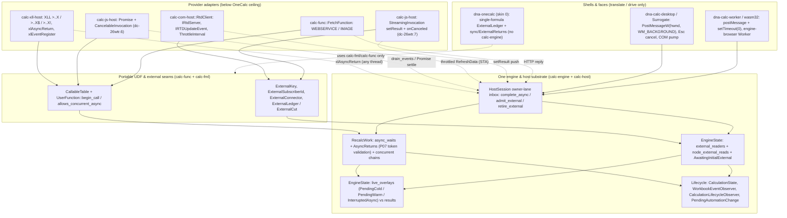

# Asynchronous and pushed values in cells: shared substrate and per-mechanism rules

Status: reworked architecture design for epic `dc-26wtr` (originally `dc-26wtr.2`, reworked in `dc-26wtr.10` on 2026-11-24 after independent review `rw2`, revised against `master` after `rw4` in `dc-26wtr.11`–`dc-26wtr.14`, and reconciled after `rw5` in `dc-26wtr.15` with `ww12` and `ww13` Excel recordings), aligned with Excel measurements in `docs/research/async-mechanisms-excel.md` (`ww8/async-03`, `ww8/async-04-ui`, `ww8/async-05-display`, `ww8/async-06-cold`, `ww9/rtd-events`, `ww9/rtd-f9`, `ww9/rtd-product`, `ww10/af2`, `ww11/office-js`, `ww12`, `ww13`), `crates/calc-engine/tests/fixtures/excel-calc-probes/P07/README.md` (`P07-ui3-safe`, `P07-core-safe`, `special`, `save-ui`), `dc-snz.23.4`, and current `master`. Design document only; no code changes.

Companion documents:
- `docs/architecture/ASYNC_PARITY_TEST_SUITE.md` — parity test suite design (`dc-26wtr.3`, extended in `dc-26wtr.11`–`dc-26wtr.15`): 60 scripted scenarios across XLL async, RTD, JS async, JS streaming, cross-mechanism interference, and security/unload/shell boundaries.
- `docs/research/async-mechanisms-excel.md` — Windows Excel measurements for native XLL async (`ww8`, `ww10`, `ww12`, `ww13`), COM RTD (`ww9`, `ww12`, `ww13`), Office.js custom functions (`ww11`, `ww12`), and mixed-provider runs (`ww12`), plus remaining experiment setup.
- `docs/architecture/RECALC_CONTRACT.md` — command/pass/invocation identities, SliceV1 async completion (§3.4), observation fences (§5), supersession (§6), and save semantics (§8).
- `docs/architecture/API_FACES.md` — external faces over one core and the embedded `calc-js-host` seam (§5.5).
- `docs/architecture/CODE_EXECUTION_POLICY.md` — shared `Off` / `Guarded` / `Unguarded` model and ten-capability vocabulary (`dc-8ovd`).
- `docs/architecture/ADDIN_SURROGATE.md` — per-session surrogate boundary for native add-ins (Stages 3–4, §8 async/RTD/unload).
- `docs/architecture/EVALUATOR_SUSPENSION.md` — operand-transactional evaluator suspension (`EvalContinuation`).

Honesty baseline: every claim of Excel parity in this document cites an executed measurement in `docs/research/async-mechanisms-excel.md`, `P07/README.md`, or `dc-snz.23.4`. Every unmeasured Excel behaviour is marked **Provisional** and owned by one of the five Windows measurement beads (`dc-26wtr.1.1`–`dc-26wtr.1.5`) under `dc-26wtr.1`. The engine does no more than Excel: no speculative non-Excel abstractions are added to core crates.

---

## 0. Independent review (`rw2`) disposition

All 11 findings from `rw2` were verified against current `master` source code and reconciled with `ww11/office-js`:

| # | Severity | Finding summary | Verification & disposition | Revised in | Measurement bead |
|---|---|---|---|---|---|
| 1 | P0 | Concurrent async & `>..X$` MTR scheduling break `calc-engine` (`precedents`, `UnscheduledRead`, `waits_on` cycle `keep`, `active_segment`, `parallel_reservations`) and `calc-xll-host` (ephemeral worker `State.pending_async`, fixed pool cap 4, static `parallel` with no runtime MTR toggle) | **Confirmed in full.** Fixed precedent/wait/fence scheduling, excluded `async_waits` from `parallel_reservations`, added `Request::PendingAsync` owner-STA handoff, and wired runtime MTR toggling. | §3.3.1, §3.3.2, §5 | `dc-26wtr.1.1` (partial-completion Esc, `Range.Calculate`/`Worksheet.Calculate` on `>..X`/`>..X$`) |
| 2 | P0 | RTD / JS streaming pushes bump `contract.external_inputs` + `volatile_input_version`, revoking `accept_async` and infinitely superseding/restarting active async `RecalcWork` (including Manual F9) | **Confirmed in full.** Pinned `RecalcWork` to its admission `ExternalCut`, decoupled `invalidate_external_key` from `volatile_input_version`, stopped unrelated external pushes from superseding open `work`, and reordered shell drain. | §2.2.2, §3.2, §4.3 | `dc-26wtr.1.5` (cross-mechanism push during in-flight async), `dc-26wtr.1.2` (unrelated `NOW()`) |
| 3 | P0 | Cold async-initial JS streaming (`provisional = None`) breaks under `ResultStamp`-based `invalidate_external_key` / `node_external_reads`, and `RtdReadError::Connect` rewrites all connect errors into `#N/A` | **Confirmed in full.** Added `AwaitingInitialExternal` subscription tracking (no fake `Calculated(#BUSY!)` in `results`), `node_external_reads`-based liveness, dependent `#BUSY!` propagation (`ww11`), and typed `ExternalConnectError`. | §2.2.4, §3.1, §3.2, §4.2 | `dc-26wtr.1.4` (sync vs delayed `setResult`, idle cold-stream `CalculationState`) |
| 4 | P0 | Manual live-edit cancellation contradicts `P07-ui3-safe` (left `work` alive -> auto-superseded; overwrite+Undo lost `90/91` in `orphans`/`entered`); Manual `FormulaEntry` unwired (`session.rs:1567`) and refused (`invoke.rs:84-87`) | **Confirmed in full.** Manual live edits cancel active async `work` directly without `supersede_recalc`; `Step::superseded_caches` preserves `90/91` across Undo; Manual `FormulaEntry` wired in `after_commit` via `begin_call` continuations. | §2.2.1, §3.3.4, §3.4 | `dc-26wtr.1.1` (in-flight edit before release, Automatic edit `CalculationCanceled`) |
| 5 | P0 | COM `pump_waiting` placed in `mutate_pre` runs after `after_commit` already called `refuse_automation_change` and dropped `SheetChange` (`ww8/async-03` row 3) | **Confirmed in full** (refined in `rw4` #2 / `dc-26wtr.12`). Split `after_commit` into a two-phase borrow-free completion protocol (`PendingAutomationChange` + `AutomationHost::pump_waiting` outside `with_session_mut` + `finish_automation_change`) so `RefCell<Server>` is released before STA pumping while still delivering `SheetCalculate -> AfterCalculate -> SheetChange`. | §3.3.4, §5 | — (measured in `ww8/async-03` row 3) |
| 6 | P1 | Post-publish `node_external_reads` reconciliation leaks on `apply_moves` (`CellKey` drift), aborted/cancelled retargets, incremental `publish_ready`, and omits `RtdService::reconcile_evaluation` (`xlfRtd`) | **Confirmed in full.** Keyed connector ownership by immutable `ExternalSubscriberId` (`NodeId`), tracked `connected_in_attempt` for abort/cancel cleanup, deferred `Detach` to command boundary, and retained `RtdService::reconcile_evaluation`. | §3.3.3, §4.2 | `dc-26wtr.1.2` (Manual disconnect timing) |
| 7 | P1 | Reopen `pending_on_open` fails under lazy binding, `set_callable_bindings` wipe, `FileCached` reader refusal (`recalc.rs:1932`), `save.rs:422` `cache_complete`, and XLL `xlfRtd` wrappers | **Confirmed in full.** Replaced with `open_clean_cache` surviving startup `set_callable_bindings`, `uses_imported_cache` boundary reads, honest `cache_complete`, and moved non-volatile-only + `xlfRtd` reopen nuances to measurements. | §3.5.3 | `dc-26wtr.1.1` (non-volatile-only reopen), `dc-26wtr.1.2` (`xlfRtd` XML `ca` & reopen), `dc-26wtr.1.4` (stream reopen) |
| 8 | P1 | `save.rs:349-351` skips `ArrayKind::Dynamic`, `session.rs:945` disables cache preservation in Auto, `begin_save_with_context` omits async cancel + `BeforeSave` order, `LiveOverlay` misses dependents/spills/`StaleValue` consumers/CVErr codes, and viewport `publish_ready` makes Esc scroll-dependent | **Confirmed in full.** Extended `PreservePermittedCaches` to dynamic arrays, defined `Save(false)` cancel hook, added unified `StaleValue::displayed_value()` + measured COM `CVErr` `2051`/`2043` across all consumers & spills (reconciled in `dc-26wtr.15`), and suppressed viewport-only `publish_ready` during active async waits while committing completed chains on Esc (`ww12/xll-escape`). | §3.1, §3.3.1, §3.5.1 | `dc-26wtr.1.1` (`BeforeSave` + `Cancel=True`, Auto Esc+Save, dynamic-array Esc+Save, ordinary `#CALC!` vs `#BUSY!` COM code check) |
| 9 | P1 | Unsupported Excel claims in `CalculationState` (idle cold stream, non-volatile-only reopen, throttled/`-1` RTD), mixed-workbook `xlEventRegister`, `app.rs:744-746` swallowing XLL `from_oper` refusals as `#VALUE!`, and `xlAsyncReturn` `xlbitDLLFree`/`SheetMap` | **Confirmed in full.** Scoped `CalculationState` strictly to measured facts + `ww11` (`2` while waiting -> `0`), added `CalcTriggerRoute::ExternalPush`, routed XLL `from_oper` refusals as `NotModeled` (Honesty Rule 2), and specified `xlAsyncReturn` `xltypeRef`/`xlbitDLLFree` handling. | §2.1, §3.1, §3.2, §3.4 | `dc-26wtr.1.1` (`xlbitDLLFree`, inline `xlAsyncReturn`, active `CalculationState`), `dc-26wtr.1.2` (RTD `CalculationState`), `dc-26wtr.1.4` (idle cold stream), `dc-26wtr.1.5` (mixed `xlEventRegister`) |
| 10 | P1 | Missing failure modes across RTD (1 dead server starving healthy servers, `self.closed = true`, `throttle: u64`, `RestartServers`), JS (no timers/`JsClock`, destructive `drain_events`, GC'd Promise hang, `StreamFailed`/`onCanceled` reentrancy, `#NAME?`/`#REF!`), unload/policy/`wasm32`/`PostThreadMessageW`/multi-`JsAddin` ID collisions | **Confirmed (one sub-item already fixed on `master`).** Verified commit `8e21a9a82` (`dc-17spk.25`) already fixed `#NAME?`/`#REF!` in `crates/calc-js-host/src/quickjs.rs:446-447`. Revised design fixes every remaining failure mode across RTD, JS, XLL/JS unload, `MacroSecurity` downgrade, `wasm32` Worker crash, `PostMessageW(hwnd)`, and globally unique async IDs. | §3.2, §3.4, §4.2, §4.3, §6 | `dc-26wtr.1.2` (`Disconnect()`/`Heartbeat<=0` display, `ThrottleInterval=-1`, `RestartServers`), `dc-26wtr.1.3` (never-resolving Promise), `dc-26wtr.1.4` (`setResult(Error)` recovery, `onCanceled` throws) |
| 11 | P2 | Speculative / non-Excel features pushed into core crates (`AsyncPolicy` on `calc_func::UserFunction`, premature `JsStreamKey` canonicalization/sharing, `CalculatingSave`/`PinnedSave` missing `rtd_connector`, `dc-17spk.5`/`dc-hul4` scope creep, `max_pending_async = 1024` in `Unguarded`, inaccurate OneCalc claim) | **Confirmed in full.** Removed display/cancel policy from `calc-func`, deferred `JsStreamKey` sharing until `dc-26wtr.1.4`, switched `Save(true)` to live `OrdinarySave`, removed `dc-17spk.5`/`dc-hul4` scope, restricted caps to `Guarded` typed refusals only, and scoped `dna-onecalc` accurately. | §1.2, §2.2.4, §3.5.2, §4.1, §4.2, §6 | `dc-26wtr.1.4` (stream sharing vs per-cell), `dc-26wtr.1.1` / `.1.3` (`Save(true)` while async pending) |

### 0.1 Independent review (`rw4`) disposition

Design defects against current `master` identified by `rw4` (`dc-26wtr.11`–`dc-26wtr.14`):

| Bead | `rw4` item | Severity | Finding summary | Verification & disposition | Revised in | Parity test |
|---|---|---|---|---|---|---|
| `dc-26wtr.11` | #1 | P0 | §3.2 pinned-cut publish aborts `finish()` with `InvalidCertificate` (and triggers `queue_certificate_repairs` refusal / `publish_ready` prefix abort) because `certificate_valid_at` checks live `state.contract.external_versions` instead of `work`'s pinned `ExternalCut`; naive `adopt_connected_inputs` would also import unrelated live pushes; newly connected subscribers lagging live versions need post-publish demand retention | **Confirmed in full against `master` (`recalc.rs:745-776, 2774-2783, 2933-2958, 3014-3046, 5438-5473`, `contract.rs:886-909, 1283-1333`).** Added `external_cut: Option<&dyn ExternalCut>` to `certificate_valid_at` (`Some(work.external_inputs)` in `finish`/`publish_ready`/`queue_certificate_repairs`; `None` -> live `external_versions` in `stale`/`validated_result`/`supersede_recalc`), scoped `adopt_connected_inputs` to merge only newly connected provisional tuples, and added post-publish live-lag demand retention for newly connected subscribers. | §3.2, §4.1, §8 | `XMC-06` |
| `dc-26wtr.12` | #2 | P0 | §3.3.4 `AutomationPump::pump_waiting(&mut HostSession)` inside `after_commit` pumps Win32 STA messages while `DesktopAutomationHost::with_session_mut` holds `RefCell<Server>` (`automation.rs:109-125`), causing `WM_TIMER`/`WM_BACKGROUND`/`WM_PAINT`/WebView2 handlers (`app.rs:323, 357, 432, 460, 622, 646, 652, 738, 750-764`) to panic with `BorrowMutError` and violating §5's lock discipline | **Confirmed in full against `master` (`apps/dna-calc-desktop/src/automation.rs:109-136`, `app.rs:322-769`, `crates/calc-host/src/automation/mutation.rs:63-89, 493-557`, `session.rs:1561-1603`, `apps/dna-calc-worker/src/workbook.rs:499-509`).** Replaced in-`after_commit` pumping with a two-phase borrow-free protocol (`dispatch_automation_deferred` -> drop `RefMut<Server>` -> `AutomationHost::pump_waiting()` -> re-borrow & `finish_automation_change`), added `automation_pumping` reentrancy guard, refused pumping inside `EVENT_SESSION`, and converted all `app.rs` STA handlers to `try_borrow`/`try_borrow_mut`. | §3.3.4, §4.1, §5, §8 | `XLL-12` |
| `dc-26wtr.13` | #8 | P1 | §3.3.1 `is_waiting_external()` / `next_node` unsafe when `work.waves != 0` or `!work.cyclic.is_empty()`: `interested_node` returns `None` (`recalc.rs:4388-4389`), causing `next_node` to fall through to `order[work.next..]` (`recalc.rs:4268-4278`) without checking `precedents`/`segments` or filtering `work.async_waits` (re-entering parked nodes, running dependents early, or entering `next_pass`/`next_wave`) | **Confirmed in full against `master` (`crates/calc-engine/src/recalc.rs:1578-1626, 4202-4310, 4375-4425, 4511-4520, 6234-6245, 6701-6712`).** Added `can_overlap_async() = segment_scheduling && waves == 0 && cyclic.is_empty()`, kept `is_waiting_external()` conservative (`!async_waits.is_empty()`) whenever `!can_overlap_async()`, filtered `work.async_waits` in `order[work.next..]` and `work.ready`, and guarded `next_pass`/`next_wave` against non-empty `async_waits`. | §3.3.1, §4.1, §8 | `XLL-17` |
| `dc-26wtr.14` | #10 | P2 | §3.4.1 specified `Step::superseded_caches` only for `Inverse::Edits` (omitting `Inverse::Restore` structural/text-source edits and `Undo -> Redo -> Undo`); §3.5.3 left unstated whether `=NOW()+B1` stamped `uses_imported_cache = true` may publish `FormulaResult::Calculated` without weakening Honesty Rule 1 | **Confirmed in full against `master` (`history.rs:56-77`, `session.rs:1652-1725`, `command.rs:1199-1234, 1333-1363`, `state.rs:1085-1124, 1202-1225, 1307-1399`, `read.rs:650-769, 1364-1408`, `recalc.rs:1899, 2793, 5758-5766`, `detached.rs:121-132`, `project.rs:340-367`, `automation.rs:1377-1391`, `save.rs:418-435`, `printing.rs:291-299`).** Extended `Step::superseded_caches` + `redo_caches` uniformly across `Inverse::Edits`, `Inverse::Restore`, and `Undo -> Redo -> Undo` (installed `without_stamp()` while remaining dirty/`pending`); routed `open_clean_cache` reads through `BoundarySnapshot` and specified exact `FormulaResult::Calculated` (`uses_imported_cache = true`) + `ProjectedValue::Stale` / `validated_result() == None` / `cache_complete == false` Honesty Rule 1 contract. | §3.4.1, §3.5.3, §4.1, §8 | `XLL-10`, `XLL-15` |

### 0.2 Independent review (`rw5`) & `ww12`/`ww13` measurement reconciliation (`dc-26wtr.15`)

Reconciled `ASYNC_IN_CELLS.md` and `ASYNC_PARITY_TEST_SUITE.md` against independent review `rw5` (findings 1–3) and the recorded Windows Excel 16.0.20625.20108 measurements in `docs/research/async-mechanisms-excel.md` (`ww12` lines 134–172; `ww13` lines 173–204):

| `rw5` item | Severity | Finding / measurement summary | Reconciliation & disposition | Revised in | Parity tests |
|---|---|---|---|---|---|
| #1 | High | Fabricated COM `CVErr` `2059` (`0x800A080B` = `-2146826229`) for `#BUSY!` contradicted measured `ww11` `-2146826237` (`0x800A0803` = **`2051`**); `P07` also recorded `Error 2051` for live cancelled XLL async `#CALC!` (`P07/ui-raw-results.tsv:923`, `P07/save-ui/raw-results.tsv`) | **Fixed in both docs.** Removed every occurrence of fabricated `2059` / `0x800A080B`. Mapped measured `#BUSY!` (`ww11`) and cancelled-async `#CALC!` (`P07`) to COM `VT_ERROR` `2051` (`0x800A0803` = `-2146826237`); changed `Range.Text` (`error_text` in `formula.rs:193-206`) to match directly on `WorksheetErrorCode` (`excel_spelling()`) instead of routing through `auto_value`'s CVErr integer (which would collapse `#CALC!` and `#BUSY!` when sharing `2051`); tracked Windows Excel verification of ordinary non-cancelled `#CALC!` vs `#BUSY!` (`2050` vs shared `2051`) in `dc-26wtr.1.1` and `dc-26wtr.1.3`. | §2.1, §2.2, §3.1, §4.1, §7, §8 | §2.2, `XLL-08`, `JSA-01`, `JSS-01`, §9.3 |
| #2 (contradictions + `ww12`/`ww13` confirmations) | High | Six expectations contradicted `ww12` (`RTD-08` healthy `RestartServers` did not reconnect; `XLL-09` fast `B2/C2` stayed `32/33` live and saved clean after partial Esc while slow `B1/C1` showed `#CALC!` and saved `31/32`; `RTD-10` unrelated `NOW()` changed on both Auto RTD refreshes; `JSA-05` Auto `SaveAs(true)` returned immediately while Promises still read `#BUSY!`, saving prior `1540/1640` & `1520/1620` with `ca="1"`; `JSS-04`/`JSS-05` Manual `CalculateFull` and post-reopen `Calculate` showed `#BUSY!` before `1571`, and Promise `CalculateFull` also showed `#BUSY!`), seven `ww12`-confirmed facts remained tagged `Provisional` (`XMC-04`, `XMC-01` XLL+RTD queuing, `XLL-11` `Worksheet`/`Range.Calculate`, `XLL-15` non-volatile-only reopen, `RTD-06(c)` Manual clear disconnect, `JSS-01(c)` standalone cold stream state `2 -> 0`, `JSS-03` duplicate stream attaching at `1561`, `XLL-04`/`XLL-13` duplicate/late `xlAsyncReturn` status `0` + zeroed output), plus `ww13` confirmations (Manual XLL `Save(true)` completes live `11/12` state `0`; inline `xlAsyncReturn` `67/68` and `xlbitDLLFree` `68/69` invoking `xlAutoFree12` synchronously on the same thread before status `0`; `ConnectData` `GetNewValues=TRUE` on first open vs `FALSE` on Manual reopen `Calculate`) | **Reconciled in full.** Replaced all six contradicted rules and flipped every `ww12`- and `ww13`-measured expectation to Confirmed: healthy `RestartServers` no-op; Esc commits already-completed independent chains while keeping viewport `publish_ready` suppressed; Automatic RTD wave runs `DirtyAndVolatile` (recalculating `NOW()` without `invalidate_external_key` bumping `volatile_input_version`); JS Promise Auto `SaveAs(true)` saves prior completed caches non-blockingly while Manual XLL `Save(true)` completes live via `OrdinarySave`; JS Promise/Stream `CalculateFull` and Stream reopen `Calculate` install `LiveOverlay::PendingWarm(Busy)`; `XllHost` fires `CalculationEnded` on `ExternalPush`; `xlAsyncReturn` returns status `0` + zeroed output on duplicate/late handles and invokes `xlAutoFree12` on the calling thread for `xlbitDLLFree`; `ConnectData` passes `GetNewValues=TRUE` on fresh entry and `FALSE` on reopen `Calculate`. | §2.1, §2.2, §3.1–§3.5, §4.1, §7, §8 | `XLL-04`, `09`, `11`, `13`–`15`, `RTD-05`, `06`, `08`, `10`, `JSA-04`, `05`, `08`, `JSS-01`, `03`–`05`, `XMC-01`, `04` |
| #3 | Medium | Unmeasured Excel assumptions labelled `Confirmed` or unqualified: `XLL-01` multi-cell `Range.Formula` (`B1:B2`) Manual `FormulaEntry` + `>..X$` `owner_only=true` thread placement (`ww8/async-03` tested single-cell only), and `JSA-03` asserting `onCanceled` without `options.cancelable: true` or a measurement | **Reclassified to Provisional.** Moved multi-cell Manual `FormulaEntry` & `>..X$` thread placement to `dc-26wtr.1.1` (`XLL-01` split into confirmed single-cell vs provisional multi-cell/`$`), and tagged `JSA-03` `onCanceled` delivery as `Provisional (dc-26wtr.1.3)` requiring `options.cancelable: true`. Audited all 60 scenarios so every row cites an executed measurement, an explicit engine/policy invariant, or a `dc-26wtr.1.x` bead. | §2.1, §3.3.4, §7 | `XLL-01`, `XLL-03`, `JSA-03`, §9.1, §10 |

---

## 1. Architectural model: one substrate, two causal primitives, four mechanisms

Four Excel cell mechanisms deliver values asynchronously or push updates after initial entry:

1. **Native XLL asynchronous functions** (`>..X`, `>..X$`, `>..X!`, completing through `xlAsyncReturn`).
2. **Real-Time Data (RTD)** (`=RTD(progid, server, topic1, ...)` and XLL `xlfRtd`, backed by `IRtdServer` / `IRTDUpdateEvent`).
3. **Office.js asynchronous custom functions** (returning a `Promise`, optionally `cancelable: true` with `CancelableInvocation.onCanceled`).
4. **Office.js streaming custom functions** (`stream: true`, pushing values through `StreamingInvocation.setResult` and tearing down via `onCanceled`).

DNA Calc's built-in fetching functions (`WEBSERVICE` and `IMAGE` via `calc_func::FetchRoute`, `crates/calc-func/src/fetch.rs:499-585`) run on the same continuation primitive as (1) and (3).

### 1.1 Why two primitives inside one substrate

Measured Excel behaviour shows two distinct causal shapes that must not be collapsed into one another:

- **Primitive 1 — Suspended Evaluation Continuation (one-shot async return):** serves **XLL async** and **JS async** (plus built-in `FetchRoute`). A specific formula evaluation inside an open `CalcCommandId` runs its prefix once, enters the provider, and parks its `EvalContinuation` at `UserFunctionStep::Awaiting { request }` under an owner-issued `AsyncToken`. The command stays open until every awaited return arrives (or the command is cancelled or superseded). A valid return resumes the existing continuation without repeating the prefix (`ww8/async-03` row 2; `P07-ui3-safe`), executes the formula suffix, and schedules dependents in an `AsyncDependents` pass within the same command. `SheetCalculate` and `AfterCalculate` fire once after all chains finish (`ww8/async-03` row 3).
- **Primitive 2 — Sequenced External Topic Ledger (multi-shot push):** serves **RTD** and **JS streaming**. A formula does not stay parked across ticks. It connects or joins an external key, reads the current value from an immutable `ExternalCut` (or a synchronous connect-time provisional value certified before publication, or records an `AwaitingInitialExternal` subscription if cold with no initial value), records its active `(ExternalKey, ExternalLease)` subscription in `EngineState::node_external_reads`, and finishes the command. Subsequent pushes advance the immutable `ExternalLedger`, dirty only subscribed nodes via `external_readers` without superseding unrelated in-flight Primitive 1 commands, and trigger a new recalculation wave in `Automatic` mode (or hold dirty in `Manual` mode while the background server/stream continues updating the ledger; `ww9/rtd-events` rows 1, 3; `ww11/office-js` rows 1, 5, 6).

Collapsing Primitive 1 into Primitive 2 would break no-prefix-repeat, per-command `SheetCalculate`/`AfterCalculate` deferral across multiple chains, and the separation between live cancelled `#CALC!` and preserved numeric save caches (`P07-ui3-safe`, `save-ui`). Collapsing Primitive 2 into Primitive 1 would leave commands permanently open, prevent multi-cell topic sharing, and break Manual background refreshes, `CalculateFull` value retention (`ww9/rtd-events` rows 1–3), and concurrent stream ticks while a Promise is pending (`ww11/office-js` row 1).

### 1.2 What the one shared substrate owns

Both primitives converge onto one portable calculation and host substrate:



Shared invariants across all four mechanisms:
1. **Single owner mutation rule:** Only the session's owner lane mutates `EngineState`, `ExternalLedger`, `AsyncReturns`, `ModelRoot`, or `HostState`. Background threads, COM sinks, and browser Workers only deposit owned values into thread-safe/IPC queues and wake the owner.
2. **Monotonic, never-recycled identities:** `AsyncToken.id`, `ExternalLease`, `ExternalSubscriberId`, `WorkbookInstanceId.incarnation`, `CalcCommandId`, `formula_generation`, and `CallableTable` generation never wrap or reuse old values. Stale returns and retired leases are tombstoned and rejected without side effects (`crates/calc-engine/src/external.rs:15-128`, `crates/calc-fml/src/rtd.rs:64-169`).
3. **Representation equality for duplicate checks:** Retransmissions match only under `CalcValue::representation_eq` (`-0.0` differs from `0.0`; cube member identity must match; `external.rs:10-12`, `rtd.rs:130`).
4. **Provenance before value (Honesty Rule 1):** Pending markers (`#BUSY!`, `#GETTING_DATA`), interrupted overlays (`#CALC!`), file caches (`FileCached`), and typed refusals (`NotModeled`) are never promoted to `Calculated` and never written into `EngineState::results` as calculated values.
5. **Typed refusals, never masked (Honesty Rule 2):** Unmodelled operands, policy denials (`MacroSecurity`), and Guarded resource caps propagate as typed `NotModeled` / policy refusals — never rewritten into `#VALUE!` or `#N/A`.
6. **One callable table and one dependency ceiling:** All four providers publish through `calc_fml::CallableTable` and `calc_func::UserFunction` / `ExternalConnector`. `calc-func`, `calc-fml`, `calc-js-host`, `calc-addin-host`, and `dna-onecalc` remain free of `calc-engine` and `calc-host` (`tools/xtask/architecture.json`). `calc-func` carries zero engine UI/display policy types.

---

## 2. Measured Excel behaviour, current DNA Calc gaps, and per-mechanism rules

### 2.1 Side-by-side behavioural matrix

Citations: `A03` = `ww8/async-03`; `A04/A05` = `ww8/async-04-ui` & `ww8/async-05-display`; `P07` = `P07/README.md` (`P07-ui3-safe`, `P07-core-safe`, `special`, `save-ui`); `R09` = `ww9/rtd-events` & `ww9/rtd-f9`; `R23` = `dc-snz.23.4` (`rtd1/measure`); `O11` = `ww11/office-js` (`docs/research/async-mechanisms-excel.md:115-132`); `W12` = `ww12` (`async-mechanisms-excel.md:134-172`); `W13` = `ww13` (`async-mechanisms-excel.md:173-204`). Unmeasured cells state the **Provisional** rule and name the owning measurement bead (`dc-26wtr.1.1`–`dc-26wtr.1.5`).

| Dimension | Native XLL async (`>..X`) | COM RTD (`=RTD()` / `xlfRtd`) | JS async (`Promise`) | JS streaming (`setResult`) |
|---|---|---|---|---|
| **Engine primitive** | Continuation (`AsyncToken`) | External topic ledger (`ExternalKey::Rtd`) | Continuation (`AsyncToken`) | External topic ledger (`ExternalKey::JsStream`) |
| **Identical-arg sharing across cells** | Per-cell invocation; each cell gets its own `AsyncHandle` (`A03`) | Shared: one `ConnectData` serves all matching `TopicKey` cells (`R09`, `R23`) | Two staggered cold identical-arg Promises both stay pending until `1510/1610` (`W12/office-js`); provider invocation count **Provisional** (`dc-26wtr.1.3`) | Duplicate added after first tick immediately shows current `1561` and advances together through `1566` (`W12/office-js`); overwriting 1 of 2 keeps the other streaming (`O11`); provider invocation count **Provisional** (`dc-26wtr.1.4`) |
| **Cold display (no prior value)** | **Unmeasured** (`async-06-cold`, `W12/xll-confirm`, `W13/xll` `PrintWindow` finished after return; **Provisional:** `PendingCold(None)` / blank stale, never calculated; `dc-26wtr.1.1`) | Synchronous `ConnectData` (`GetNewValues=TRUE` on first open: returning `TRUE` shows provisional `1`, `FALSE` gives `0`, `W13/rtd`); `Empty` -> `0`, unavailable server -> `#N/A` (`R09`, `R23`) | **`#BUSY!`** (`Value2` error `-2146826237` = `0x800A0803` = CVErr `2051`) on both the Promise cell and its dependent (`O11`) | **`#BUSY!`** (`-2146826237` = `0x800A0803` = CVErr `2051`) on both the stream cell and its dependent until first `setResult` (`O11`, `W12`); sync `setResult` during start **Provisional** (`dc-26wtr.1.4`) |
| **Warm display while pending / refreshing** | Holds previous calculated values (`20/21/42`); never `#GETTING_DATA` (`A05/complete.png`) | Holds previous value until refresh wave publishes (`R09` Auto & Manual) | **Holds previous values** (`40/140`, `50/150`) on warm edit (`O11`); **`CalculateFull` displays `#BUSY!` (`2051`) on cells & dependents until re-settled** (`W12/office-js`) | **Holds previous values** (`46/146`) on warm edit (`O11`); **Manual `CalculateFull` and post-reopen `Calculate` show `#BUSY!` (`2051`) before returning to `1571`** (`W12/office-js`) |
| **Independent chains & cross-mechanism overlap** | Concurrent entry (`B1` & `B2` at same tick); pure/`NOW()` run before returns; fast chain `D2` runs before slow `B1` (`A03`). Overlapping RTD `UpdateNotify` queues behind `xlAsyncReturn` and `RefreshData` follows in Auto & Manual with XLL returning once (`W12/mixed`). JS/XLL overlap **Provisional** (`dc-26wtr.1.5`). | Only subscribers of updated topic & transitive dependents recalculate (`R09`), AND **unrelated `=NOW()` changes with both Automatic RTD refreshes (`1 -> 42 -> 44`, `W12/rtd`)**. | Concurrent distinct-duration chains **Provisional** (`dc-26wtr.1.3`). Stream published `41..46` while Promise was still pending without starving Promise (`O11`; Manual & JS/RTD overlap `dc-26wtr.1.5`). | Only subscribers of pushed stream & transitive dependents recalculate (`O11`); publishes while Promise is pending (`O11`; Manual & JS/XLL overlap `dc-26wtr.1.5`). |
| **`SheetCalculate` & `AfterCalculate`** | Once per command after ALL chains finish (`SheetCalculate` -> `AfterCalculate`; Automatic edit adds `-> SheetChange`) (`A03`) | Once per throttled refresh wave in Automatic (`SheetCalculate` -> `AfterCalculate` for `42`, then `44`); none while holding in Manual (`R09`) | Once per command after all Promises settle (**Provisional**, `dc-26wtr.1.3`) | Once per recalculation wave triggered by admitted `setResult` batch (**Provisional**, `dc-26wtr.1.4`) |
| **`Application.CalculationState`** | `Done (0)` when settled, after `Worksheet.Calculate`, and on clean non-volatile-only Manual reopen (`A03`, `W12/xll-confirm`, `W12/xll-routes`); `Pending (2)` after Manual dirty edit, Esc/partial-Esc cancel, or `Range.Calculate` (`A03`, `A04`, `W12/xll-escape`, `W12/xll-routes`); stable active non-cancelled in-flight (`1` vs `2`) **Provisional** (`dc-26wtr.1.1`) | `Pending (2)` on Manual reopen (`W13/rtd-reopen`) and `Pending (2) -> Done (0)` across Manual F9 (`R09`); state during throttle window and under `ThrottleInterval = -1` **Provisional** (`dc-26wtr.1.2`) | **`Pending (2)` while cold waiting, `Done (0)` when settled** (`O11`); post-cancel state **Provisional** (`dc-26wtr.1.3`) | **`Pending (2)` while standalone cold stream waits (no Promise present), `Done (0)` on first tick** (`W12/office-js`, `O11`) |
| **Native `xlEventRegister` (`1`/`2`)** | `CalculationEnded` absent on dirty COM `Application.Calculate`, **`Worksheet.Calculate`, and `Range.Calculate`** (`>..X` & `>..X$`, `A03`, `W12/xll-confirm`, `W12/xll-routes`); present on UI F9, `CalculateFull`, Automatic edit; Esc/partial-Esc/overwrite/Ctrl+S fire `CalculationCanceled` then `CalculationEnded` before late return (`A03`, `P07`, `W12/xll-escape`; Auto cancel **Provisional**, `dc-26wtr.1.1`) | Mixed XLL+RTD workbook: **XLL `CalculationEnded` (1) fires on every displayed Automatic RTD refresh (`W12/mixed`)** | Not registered by JS; mixed XLL+JS Promise `CalculationEnded` **Provisional** (`dc-26wtr.1.5`) | Not registered by JS; mixed XLL+JS stream workbook: **XLL `CalculationEnded` (1) fires on every standalone JS stream tick (`W12/mixed`)** |
| **Clean `Calculate` (F9) vs `CalculateFull`** | Clean F9 re-enters ONLY volatile (`!`) async (`A03`, `W12/xll-routes`); `CalculateFull` re-enters ordinary, `$`, and `!` async (`A03`) | Clean F9 publishes any dirty/queued refreshes; `CalculateFull` keeps settled RTD values without reconnecting (`R09`) | Clean `Calculate` keeps settled non-volatile values (`1510/1610`); **`CalculateFull` shows `#BUSY!` on all cells & dependents until re-settled** (`W12/office-js`); `options.volatile` **Provisional** (`dc-26wtr.1.3`) | Clean F9 publishes queued pushes (`O11`); **Manual `CalculateFull` shows `#BUSY!` before returning to `1571`** (`W12/office-js`; Manual background retention **Provisional**, `dc-26wtr.1.4`) |
| **Manual mode** | Single-cell formula entry computes live despite Manual (`A03`; multi-cell `Range.Formula` & `>..X$` thread placement **Provisional**, `dc-26wtr.1.1`); arg edit triggers zero async calls, holds old values, `CalculationState=2`; F9 computes (`2 -> 0`) (`A03`) | Background `UpdateNotify`/`RefreshData` continues (`42`, `44`) while sheet keeps `1` and stale dependents; retarget shows `44` with stale dependents; F9 updates all chains (`2 -> 0`); `CalculateFull` keeps settled (`R09`); clearing last subscriber disconnects within 16 ms before `Calculate`; healthy `RestartServers` returns without reconnecting (`W12/rtd`) | Formula entry computes live (`#BUSY! -> 120`) with dependent stale (`210`); arg edit holds `100/200`; `Calculate` yields `110/210`; switch to Manual mid-call lets in-flight Promise finish (`O11`) | Formula entry computes live (`#BUSY! -> 121`) with dependent stale (`211`); arg edit holds `101/201`; `Calculate` yields `111/211` (no later ticks shown in Manual); switch to Manual holds `101/201` (`O11`) / `1571` (`W12`) |
| **Multithreaded calc (MTR)** | `>..X$` enters across worker pool (96 calls across 16 threads, MTR on) or main thread (MTR off); `>..X` & `>..X!` enter on main thread; `xlAsyncReturn` from any thread (`A03`) | COM `IRtdServer` calls strictly on owner STA; `IRTDUpdateEvent::UpdateNotify` agile/any thread (`R09`, `rtd_native.rs`); `xlfRtd` from `$` returns `xlretNotThreadSafe` (`128`) | QuickJS single-threaded on owner lane (or browser Worker on `wasm32`); Promises overlap concurrently without blocking pure calc threads | Stream callbacks run on JS isolate / browser Worker; `ExternalCut` is `Send + Sync` so pure dependents still parallelize |
| **Cancellation & post-cancel display** | Manual UI Esc, overwrite+Undo, `Ctrl+S` cancel pending calc with zero replacement entry; live cancelled async cell & dependents show `#CALC!` (`Error 2051`), `CalculationState=2`; late/duplicate `xlAsyncReturn` returns status `0` + zeroed output and is ignored (`A05`, `P07`, `W12/xll-duplicate-final`). **Partial-completion Esc (`W12/xll-escape`):** fast completed `B2/C2` hold `32/33` live & save clean while slow `B1/C1` show `#CALC!` & save prior `31/32` dirty. Auto Esc & ordinary `#CALC!` vs `#BUSY!` COM code check **Provisional** (`dc-26wtr.1.1`). | Overwriting 1 of 2 subscribers in Manual keeps topic; **clearing last subscriber disconnects within 16 ms before `Calculate`** (`W12/rtd`). Retarget/close disconnect (`R09`). Esc during RTD recalc **Provisional** (`dc-26wtr.1.2`). | Auto retarget/overwrite suppresses late `70`/`90` (`O11`); overwriting 1 of 2 identical pending Promises keeps `701/801` while sibling finishes `1520/1620`; clearing leaves blank & `100` (`W12/office-js`); `options.cancelable: true` `onCanceled` & post-cancel display **Provisional** (`dc-26wtr.1.3`). | Overwriting 1 of 2 cells holds `456/556` while 2nd streams (`O11`); `onCanceled` triggers & Esc effect **Provisional** (`dc-26wtr.1.4`). |
| **Retarget / subscriber removal** | Formula edit/overwrite gets new `formula_generation`; revokes pending token; Manual overwrite during F9 cancels with no replacement (`P07`); COM setter during F9 blocked until after callback (`W13/xll-edit`; pre-release edit/move `dc-26wtr.1.1`) | Removing 1 of 2 subscribers keeps topic alive (`R09`, `W12/rtd`); retarget connects NEW topic before disconnecting OLD; clearing last subscriber disconnects immediately even in Manual (`W12/rtd`); close disconnects & calls `ServerTerminate` (`R09`) | Auto retarget `7 -> 8` computes `80/180` without `70` (`O11`); `options.cancelable: true` `onCanceled` ordering **Provisional** (`dc-26wtr.1.3`) | Auto retarget `7 -> 8` yields `81..86` (`O11`); start-before-`onCanceled` order **Provisional** (`dc-26wtr.1.4`) |
| **Save (`CalculateBeforeSave=false` & `true`)** | Completed `Save(false)` writes calculated values, zero async entries (`A03`). Cancelled Manual UI `Ctrl+S` writes **held prior numeric caches** (`41/42`, `90/91`), NOT `#CALC!`, with `ca=1, calcCompleted=0, calcOnSave=0` (`P07`). Partial-Esc save keeps fast `32/33` clean & slow `31/32` dirty (`W12/xll-escape`). **Manual dirty `Save(true)` calls XLL, waits for `xlAsyncReturn`, returns settled `11/12` at state `0` (`W13/xll`).** `BeforeSave` + `Cancel=True`, Auto Esc+Save, dynamic-array Esc+Save, and `Save(true)` while async *already* in-flight **Provisional** (`dc-26wtr.1.1`). | Writes settled/held values; zero reconnect during save (`R09`) | Manual completed `Save(false)` writes `120/220` (`O11`). **Automatic `SaveAs(true)` while Promise is pending returns immediately with live `#BUSY!`, saving prior completed caches (`1540/1640`, `1520/1620`, `ca="1"`), while live cells later settle (`W12/office-js`).** Cold pending `<v>` omission & Manual `Save(true)` **Provisional** (`dc-26wtr.1.3`). | Manual `Save(false)` writes `121/221` (`O11`) / `1571/1671` with `ca="1"`, `calcCompleted="0"`, `calcOnSave="0"` (`W12/office-js`); cold pending save never writes `#BUSY!` (**Provisional**, `dc-26wtr.1.4`). |
| **Reopen in Manual** | Exposes saved values, zero async entries on open; `Calculate` re-enters ONLY volatile async (`A03`); **non-volatile-only clean Manual reopen holds `14/15` / `24/25` at `CalculationState=0` with zero entries on `Calculate` or F9 (`W12/xll-confirm`, `W12/xll-routes`)**. | Exposes saved `44/54/162` at state `2`; **`Calculate` reconnects passing `GetNewValues=FALSE` (`W13/rtd-reopen`)** (`R09`: `1/11/33`; `W13`: `42` after `RefreshData`, `44` on Auto). XLL `xlfRtd` wrapper XML `ca` & reopen **Provisional** (`dc-26wtr.1.2`). | Exposes saved `120/220`; held on `Calculate` AND on switching to Automatic (`O11`) | Exposes saved `121/221` / `1571/1671`; **post-reopen `Calculate` shows `#BUSY!` (`2051`) before returning to `1571` (`W12/office-js`; `O11` sampled settled `121/221`)**; switching to Automatic displays `1576` (87 ms) / `126/226` (`W12`, `O11`). |
| **Security policy (`Off` / `Guarded` / `Unguarded`)** | `Off`: not loaded. `Guarded`: **not available** (native code). `Unguarded`: allowed. | `Off`: disabled. `Guarded`: **not available** (`com.activate` typed policy refusal, NOT `#N/A`). `Unguarded`: allowed. | `Off`: not loaded. `Guarded`: **allowed** under `ExecLimits` + typed resource caps (`fetch` denied). `Unguarded`: allowed (no arbitrary pending-async cap). | `Off`: not loaded. `Guarded`: **allowed** under `ExecLimits` + typed stream caps. `Unguarded`: allowed. |

### 2.2 Per-mechanism rules and exact gaps in DNA Calc today

#### 2.2.1 Native XLL asynchronous functions (`dc-26wtr.4`, `dc-snz.23`)

**What Excel does (measured):**
- Registration flags distinguish ordinary async (`>..X`, main thread), thread-safe async (`>..X$`, worker pool when MTR on, main thread when MTR off), and volatile async (`>..X!`, main thread, re-entered on clean F9) (`ww8/async-03` rows 5–6).
- Multiple independent async chains enter concurrently in the same calculation command; independent pure and `NOW()` formulas execute before any return; a faster branch resumes its own continuation and evaluates its downstream dependents immediately without waiting for slower unrelated async calls (`ww8/async-03` row 2).
- Within a single formula containing two async call sites, site 2 enters with a distinct handle only after site 1 returns (`P07/README.md` `special`).
- `SheetCalculate` and `AfterCalculate` fire once after all chains in the command complete (`ww8/async-03` row 3); Automatic COM edits emit `SheetCalculate -> AfterCalculate -> SheetChange`.
- Native `xlEventRegister` fires `CalculationEnded` (1) on UI F9, `CalculateFull`, Automatic edit, and mixed-workbook Automatic RTD refreshes / JS stream ticks (`ww12/mixed`); does NOT fire it on dirty COM `Application.Calculate`, `Worksheet.Calculate`, or `Range.Calculate` (`>..X` & `>..X$`, where `Worksheet.Calculate` returns state `0` and `Range.Calculate` returns state `2`, `ww8/async-03` row 4, `ww12/xll-confirm`, `ww12/xll-routes`); and fires `CalculationCanceled` (2) followed by `CalculationEnded` (1) before late returns on Manual UI Esc, partial-completion Esc, overwrite+Undo, and UI `Ctrl+S` (`P07-ui3-safe`; `save-ui`; `ww12/xll-escape`).
- Warm pending cells retain their previous displayed values (`20/21/42`, never `#GETTING_DATA`); cancelled async cells and their uncalculated dependents immediately paint `#CALC!` (`Error 2051`) with `CalculationState = 2`, while Manual `Save(false)` persists the held prior numeric caches (`90/91`, `41/42`) with `ca="1"`, `calcCompleted="0"`, `calcOnSave="0"` (`ww8/async-05-display`; `P07-ui3-safe`; `save-ui`). On **partial-completion Esc** (`ww12/xll-escape`), fast completed chain `B2/C2` retains `32/33` live and saves `32/33` clean while slow `B1/C1` shows `#CALC!` through the late return and saves prior `31/32` dirty.
- In Manual mode, single-cell formula assignment evaluates the entered formula cell live while leaving dependents stale; editing an argument triggers zero async calls (`ww8/async-03` row 1; multi-cell `Range.Formula` and `>..X$` thread placement remain `dc-26wtr.1.1`). Overwriting + Undoing during Manual F9 cancels with zero replacement async entry, live `#CALC!`, and saved caches `90/91` (`P07-ui3-safe`). Manual dirty `Save(CalculateBeforeSave=true)` calls the XLL, waits for `xlAsyncReturn`, and returns settled `11/12` at state `0` (`ww13/xll`).
- Manual reopen of a completed workbook invokes nothing on open; explicit `Calculate` re-enters only volatile async calls (`ww8/async-03` row 7), and a non-volatile-only workbook holds `14/15` / `24/25` at `CalculationState = 0` with zero entries on `Calculate` or UI F9 (`ww12/xll-confirm`, `ww12/xll-routes`).
- `xlAsyncReturn` ABI: duplicate and post-Esc late calls return status `0` with a zeroed output operand (`ww12/xll-duplicate-final`); inline `xlAsyncReturn` inside the entry stub produces `67/68` (plain) and `68/69` (`xlbitDLLFree`), and for `xlbitDLLFree` Excel calls `xlAutoFree12` with the exact same operand pointer on the same thread before `xlAsyncReturn` returns status `0` (`ww13/xll-abi-traced`).

**Where current DNA Calc differs:**
1. **Observation-fence & concurrent-wait invariants (`crates/calc-engine/src/recalc.rs:1541-1575, 2055-2070, 4191-4248, 4293-4319, 4459-4468, 6182-6193, 6647-6658`):** Non-`$` user calls create per-node fences; `precedents` is empty unless `parallel == true`; static reads of a parked async cell fail with `RecalcFailure::UnscheduledRead`; deferring into `waits_on` hits cycle `keep()`; `parallel_reservations` counts parked `async_waits` against pool slots, refusing cells 17–96.
2. **Thread-safe async refused & worker `State` drops handles (`crates/calc-xll-host/src/invoke.rs:84-93`, `native.rs:1037-1044, 1378-1383`, `worker.rs:30-33, 211-232`):** `>..X$` is refused; `worker::Pool` is clamped to `1..=4`; `worker::submit` creates an ephemeral worker `State` whose `pending_async` drops on return; no runtime MTR toggle updates `worker::Pool` or `XllFunction::parallel`.
3. **Manual live-edit cancellation, Undo caches, and Manual `FormulaEntry` (`crates/calc-host/src/command.rs:1153`, `state.rs:511-516`, `recalc.rs:85-90`, `session.rs:1561-1585, 1652-1707`, `crates/calc-engine/src/state.rs:1155-1166, 1693`):** Manual edits leave `work` alive to be auto-superseded instead of cancelling; overwrite+Undo loses `90/91` via `orphans` + `entered`; Manual `FormulaEntry` is never dispatched in `after_commit` and is refused in `invoke.rs:84-87`.
4. **COM `after_commit` drops `SheetChange` (`crates/calc-host/src/session.rs:1585-1602`, `automation/mutation.rs:518-553`):** `after_commit` calls `refuse_automation_change` immediately on `HostProgress::Waiting` before `mutate_pre` ever regains control, and `_Application.CalculationState` is not registered.
5. **Cancellation display, Esc route, and `xlEventRegister` (`crates/calc-host/src/session.rs:667-685`, `project.rs`, `automation.rs:1351-1362`, `automation/formula.rs:193-206`, `crates/calc-xll-host/src/callbacks.rs:780-796`):** `cancel_calculation` installs no `#CALC!` overlay; `auto_value` lacks CVErr `2051` (measured on both cancelled `#CALC!` in `P07` and `#BUSY!` in `ww11`) and `error_text` routes through `auto_value` and falls through to `"#N/A"` instead of matching `WorksheetErrorCode` directly; no `SkinIntent::CancelCalculation` exists; `State::events` is never fired.
6. **XLL `xlAsyncReturn` operand refusals & ABI (`apps/dna-calc-desktop/src/app.rs:744-746`, `crates/calc-xll-host/src/callbacks.rs:524-530`):** `app.rs` silently turns `from_oper` refusals into `#VALUE!` (violating Honesty Rule 2); `callbacks.rs:524-526` returns `INVALID_ASYNC` (`256`) where Excel returned status `0` with zeroed output (`P07/README.md:50`, confirmed by `ww12/xll-duplicate-final`); `xlbitDLLFree` does not yet invoke `xlAutoFree12` on the calling thread (`ww13/xll-abi-traced`), and `xltypeRef` handling is missing.
7. **Reopen dirtiness (`crates/calc-engine/src/state.rs:668-705, 762-765`, `recalc.rs:1932`):** Every formula starts pending on open and `set_callable_bindings` dirties rebound callables.

**Per-mechanism rules on the shared substrate:**
- Continuation primitive (`AsyncToken`), `allows_concurrent_async() == true` (for `>..X`, `>..X$`, `>..X!`; `cached_reads() == false`), warm display holds previous value (`A05`), cold display provisional (`dc-26wtr.1.1`), cancellation commits already-completed independent chains (`ww12/xll-escape`) and installs `LiveOverlay::InterruptedAsync` (`#CALC!`) on incomplete chains while preserving `EngineState::results` (`P07`), module lifecycle notifications fire `CalculationCanceled` (2) + `CalculationEnded` (1).
- Three `xlAsyncReturn` timings route through the same `AsyncToken` inbox: (a) **inline before entry stub returns** (value deposited in `Completion.result`, `xlAutoFree12` invoked synchronously on the calling thread when `xlbitDLLFree` is set, drained on next `take_async_returns()` without blocking, `ww13/xll-abi-traced`), (b) **asynchronous during open calculation** (wakes owner via `PostMessageW(hwnd, WM_BACKGROUND, 0, 0)` and resumes continuation), and (c) **late/duplicate after completion, cancel, supersession, or close** (tombstone observes `async_return_observed = true`, ignores result without dereferencing `args[1]`, returns status `0` with zeroed output, never resumes suffix, `ww12/xll-duplicate-final`).

#### 2.2.2 COM Real-Time Data (`dc-26wtr.5`, building on `dc-snz.23` and `dc-snz.23.3`)

**What Excel does (measured):**
- One `TopicKey` (`progid` ASCII case-folded, empty local `server`, 1–253 exact `CONCAT`-coerced topic strings) serves every subscriber across `=RTD(...)` and XLL `xlfRtd`; `ConnectData` is called once (`ww9/rtd-events` row 1; `dc-snz.23.4`).
- On first open, `ConnectData` receives `GetNewValues = TRUE`: returning `TRUE` displays the provisional value (`1`), returning `FALSE` gives `0` (`ww13/rtd`); empty coerces to `0.0`, unavailable server to `#N/A`, `VARIANT` array to `#N/A` (`dc-snz.23.4`, `rtd_native.rs:484-492`).
- `UpdateNotify` triggers an immediate first `RefreshData` (`42`), then coalesces further notifications (`43`, `44`) under `Application.RTD.ThrottleInterval` (default `2,000 ms`, `ww9/rtd-events` row 1), firing `SheetCalculate` + `AfterCalculate` (and XLL `CalculationEnded`, `ww12/mixed`) per refresh wave in Automatic, AND **recalculating unrelated `=NOW()` cells on both refreshes** (`ww12/rtd`).
- Removing one of two subscribers keeps the topic connected (in both Auto and Manual, `ww9/rtd-events` row 2, `ww12/rtd`); clearing the last subscriber in Manual invokes `DisconnectData` and `ServerTerminate` within 16 ms before `Calculate` (`ww12/rtd`); retargeting the remaining subscriber connects the replacement topic (`ConnectData`) **before** disconnecting the old topic (`DisconnectData`); closing the workbook disconnects remaining topics and calls `ServerTerminate` (`ww9/rtd-events` row 2).
- In Manual mode, `UpdateNotify`/`RefreshData` continues refreshing (`42`, `44`) while the sheet holds `1` and dependents stay stale; retargeting evaluates the edited cell (`44`) leaving dependents stale; F9 updates all affected chains (`2 -> 0`); `CalculateFull` keeps settled values (`ww9/rtd-events` rows 3–4). Calling `Application.RTD.RestartServers` on a healthy server returns **without reconnecting** in both Manual and Automatic (`ww12/rtd`).
- Save and reopen in Manual displays saved `44`, `54`, `162` at `CalculationState = 2` with zero server start on open; explicit `Calculate` reconnects calling `ConnectData` with **`GetNewValues = FALSE`** (`ww13/rtd-reopen`; `ww9/rtd-events` row 5 showed `1/11/33` before background refreshes, `ww13/rtd-reopen` sampled `42` after `RefreshData` and `44` on switching to Automatic).
- In a mixed XLL+RTD workbook, `UpdateNotify` arriving during an XLL async call returns after `xlAsyncReturn` and `RefreshData` follows without revoking the XLL (`ww12/mixed`).

**Where current DNA Calc differs:**
1. **RTD pushes revoke in-flight async work & dirty unrelated volatiles (`crates/calc-engine/src/state.rs:751-759`, `recalc.rs:729-736, 6677`, `crates/calc-host/src/recalc.rs:88`):** `invalidate_rtd_topic` increments both `contract.external_inputs` and `volatile_input_version`, causing active async commands to supersede infinitely.
2. **Desktop live app never reconciles dropped/retargeted RTD subscriptions (`apps/dna-calc-desktop/src/app.rs:733-768`) and `RtdClient` keys callers by mutable `CellKey` (`crates/calc-com-host/src/rtd.rs:64, 95`):** Moving a cell via row/column insert (`apply_moves`) desyncs `Detach`; aborted retargets leak newly connected topics.
3. **RTD enabled unconditionally regardless of `MacroSecurity` (`apps/dna-calc-desktop/src/app.rs:888`), and `RtdReadError::Connect` turns all connect errors into `#N/A` (`crates/calc-fml/src/eval/run.rs:4967-4969`, `crates/calc-func/src/udf.rs:108`):** Violates `CODE_EXECUTION_POLICY.md` §1 and Honesty Rule 2.
4. **RTD server fault isolation & throttle limits (`crates/calc-com-host/src/rtd_native.rs:243, 302, 357-376, 442`, `apps/dna-calc-desktop/src/app.rs:751`):** First failed `Heartbeat`/`Disconnect` returns `Err(Disconnected)` without removing the dead server, starving all healthy servers while `app.rs` swallows the error with `.unwrap_or_default()`; `ServerTerminate` error sets `self.closed = true` globally; `throttle: u64` cannot represent `-1`; `Application.RTD` (`ThrottleInterval`, `RefreshData`, `RestartServers`) is not exposed.
5. **Typed `RtdLedger` / `rtd_readers` hardcoded to `TopicKey` (`crates/calc-fml/src/rtd.rs`, `crates/calc-engine/src/state.rs:350`):** Generalize to `ExternalKey` while keeping `RtdService::reconcile_evaluation` / `declarations` intact for managed XLL `xlfRtd` wrappers (`dc-snz.23`).

**Per-mechanism rules on the shared substrate:**
- External topic ledger (`ExternalKey::Rtd(TopicKey)`), shared across subscribers by `TopicKey`, STA-bound COM calls with agile `UpdateNotify` wake, `ThrottleInterval: i32` (default `2000`, `0` immediate, `-1` manual `RefreshData`), healthy `RestartServers` no-op (`ww12/rtd`), per-server fault isolation in `poll()`, command-boundary connect-before-disconnect reconciliation keyed by immutable `ExternalSubscriberId` (`NodeId`) with immediate Manual detach on last-subscriber clear (`ww12/rtd`), Automatic RTD wave executing `DirtyAndVolatile` (recalculating unrelated `=NOW()` without `invalidate_external_key` bumping `volatile_input_version`, `ww12/rtd`), `CalculateFull` keeps settled values, Manual reopen reconnects on `Calculate` with `GetNewValues = FALSE` (`ww13/rtd-reopen`; `xlfRtd` wrapper reopen verified in `dc-26wtr.1.2`).

#### 2.2.3 Office.js asynchronous (`Promise`) custom functions (`dc-26wtr.6`)

**What Excel does (measured in `ww11/office-js` & `ww12/office-js` + open gaps in `dc-26wtr.1.3`):**
- **Measured (`ww11/office-js` & `ww12/office-js`, Excel 16.0.20625.20108, JS-only runtime):**
  - Cold Automatic entry shows **`#BUSY!`** (`Value2` error `-2146826237` = `0x800A0803` = CVErr `2051`) on both the Promise cell and its dependent while waiting, with `CalculationState = 2`, transitioning to `40`/`140` and `CalculationState = 0` upon resolution (`ww11`).
  - Warm Automatic edit (`arg 4 -> 5`) **holds previous values (`40` and `140`)** until `50` and `150` resolve (never flashing `#BUSY!`, `ww11`).
  - Automatic argument retarget mid-flight (`7 -> 8`) holds `50/150` and resolves `80/180` with no late `70`; overwriting a pending Promise cell with literal `123` holds `123` and dependent `223` with no late `90` (`ww11`). Overwriting one of two identical pending Promises keeps `701/801` while the other completes (`1520/1620`), and clearing a pending Promise leaves blank and dependent `100` (`ww12`).
  - Switching to Manual mid-call allows the in-flight Promise to finish (`100/200`); Manual argument edit holds `100/200` until `Application.Calculate` (`110/210`, `ww11`).
  - Manual formula entry evaluates the new Promise cell live (`#BUSY! -> 120`) while its dependent stays stale (`210`) until `CalculateFull` (`220`, `ww11`). Clean `Calculate` keeps settled non-volatile Promises (`1510/1610`), while **`CalculateFull` puts all Promise cells and dependents back at `#BUSY!` (`2051`) until re-settled** (`ww12`).
  - Manual `Save(false)` and reopen displays `120/220` and holds those values on `Calculate` AND after switching to Automatic (`ww11`).
  - **Automatic `SaveAs(CalculateBeforeSave=true)` while Promises are pending returns immediately while Promise cells still read `#BUSY!`**, saving the **prior completed numeric caches (`1540/1640`, `1520/1620`) with `ca="1"`**, while the live cells later settle (`1570/1670`, `1550/1650`) (`ww12/office-js`).
- **Unmeasured (`dc-26wtr.1.3`):** `CancelableInvocation.onCanceled` (`options.cancelable: true`) exact trigger matrix and callback ordering on retarget/overwrite/clear/Esc/`CalculateFull`/`Ctrl+S`/close, Esc/overwrite+Undo post-cancel display (`#CALC!` vs `#BUSY!` vs held), distinct-duration two independent Promise chains & `SheetCalculate`/`AfterCalculate`, `requiresAddress`/`requiresParameterAddresses`, `volatile`, provider invocation sharing count, `Promise` rejection & `CustomFunctions.Error` codes, never-resolving `new Promise(() => {})`, matrix spills, cold pending `<v>` omission, Manual `Save(true)`, and COM `VT_ERROR` distinctness check between `#BUSY!` (`2051`) and ordinary `#CALC!`.

**Where current DNA Calc differs:**
1. **`calc-js-host` is synchronous-only (`crates/calc-js-host/src/engine.rs:44-53`, `callable.rs:94-109`, `quickjs.rs:301-306`):** `options.cancelable` and returned `Promise`s emit `JsHostError::Deferred { owner: "dc-26wtr.6" }`; top-level async module evaluation also defers.
2. **No timers, virtual clock, or non-destructive event drain (`crates/calc-js-host/src/quickjs.rs:16-68`):** `OFFICE_API` defines no `setTimeout`/`setInterval`/`clearTimeout`/`clearInterval` and no `JsClock` for deterministic replay tests. (Note: commit `8e21a9a82` / `dc-17spk.25` already fixed `#NAME?` and `#REF!` in `quickjs.rs:446-447`; async Promise rejection and streaming `setResult` must reuse `Bridge::returned_error`.)
3. **No shell pump, unload teardown, or `wasm32` Worker backend (`crates/calc-addin-host/src/host.rs:373-382`, `crates/calc-js-host/CONTRACT.md:12-13`):** `unload_js_addin` drops `JsEngine` without firing `onCanceled`; shells do not drain JS jobs or deliver `complete_async`; `wasm32` has no `engine-browser` Worker runtime yet.

**Per-mechanism rules on the shared substrate:**
- Uses **Primitive 1** (`UserFunction::begin_call` -> `UserFunctionStep::Awaiting { request }` -> `AsyncToken` -> `AsyncReturns` -> `HostSession::complete_async`), identical to XLL async.
- Cold pending display: `LiveOverlay::PendingCold(WorksheetErrorCode::Busy)` propagated to dependents (`ww11`); warm edit holds previous value (`ww11`); warm `CalculateFull` installs `LiveOverlay::PendingWarm(WorksheetErrorCode::Busy)` propagated to dependents until re-settled (`ww12`); Automatic `SaveAs(true)` while pending returns immediately writing prior permitted caches with `ca="1"` (`ww12`); cancellation invokes `JsEngine::cancel_async(request)` -> `invocation.onCanceled()` (when `options.cancelable: true`, bounded by `ExecLimits::time`, marking the request cancelled first) and installs `LiveOverlay::InterruptedAsync` (**Provisional**, `dc-26wtr.1.3`).
- Rejected `Promise` carrying `CustomFunctions.Error` maps via `Bridge::returned_error` to its `WorksheetErrorCode` (covering all 7 `CustomFunctions.ErrorCode` values); unhandled rejections map to `#VALUE!` + diagnostic (**Provisional**, `dc-26wtr.1.3` / `dc-17spk.22`).

#### 2.2.4 Office.js streaming (`setResult`) custom functions (`dc-26wtr.7`)

**What Excel does (measured in `ww11/office-js` & `ww12/office-js` + open gaps in `dc-26wtr.1.4`):**
- **Measured (`ww11/office-js` & `ww12/office-js`, Excel 16.0.20625.20108, JS-only runtime):**
  - Cold Automatic entry shows **`#BUSY!`** (`-2146826237` = `0x800A0803` = CVErr `2051`) on both the stream cell and its dependent until the first `setResult` arrives (`41/141`), then advances through `46/146`, **publishing while an unrelated Promise in the same sheet is still pending** (`ww11`). Even with **no Promise present**, a standalone cold delayed stream and its dependent read `#BUSY!` at **`CalculationState = 2`**, transitioning to **`0`** when the first tick appears (`ww12`).
  - Warm Automatic edit (`arg 4 -> 5`) **holds previous values (`46/146`)** until `51/151` arrive; retarget (`7 -> 8`) transitions from `71` to `81..86` (`ww11`).
  - Adding a duplicate stream formula after the first tick **immediately shows the current value (`1561`, no `#BUSY!`) and both cells advance together through `1566`** (`ww12`); overwriting one of two duplicate cells with literal `456` holds `456/556` while the second cell continues streaming `91..96` (`ww11`).
  - Switching to Manual holds `101/201` (`ww11`) / `1571` (`ww12`); Manual edit holds `101/201` until `Application.Calculate` (`111/211`, with no later ticks shown in Manual); Manual formula entry evaluates live (`#BUSY! -> 121`) leaving dependent stale (`211`) until `CalculateFull` (`221`, `ww11`). **Manual `CalculateFull` shows `#BUSY!` (`2051`) before returning to `1571`** (`ww12`).
  - Manual `Save(false)` writes `1571/1671` with `ca="1"`, `calcCompleted="0"`, `calcOnSave="0"` (`ww12`); reopen in Manual exposes saved caches (`121/221` / `1571/1671`), **post-reopen `Calculate` shows `#BUSY!` (`2051`) before returning to `1571`** (`ww12`; `ww11` sampled settled `121/221`), and switching to Automatic updates to `1576` (observed 87 ms after switching, `ww12`; `126/226` in `ww11`).
  - In a mixed XLL+JS stream workbook, each standalone JS stream tick coincides with an XLL `CalculationEnded` callback (`ww12/mixed`).
- **Unmeasured (`dc-26wtr.1.4`):** synchronous `setResult` during start vs delayed, whether two cells with identical arguments share one provider invocation or create two (with and without `requiresAddress`), retarget start-before-`onCanceled` ordering, rapid `setResult` coalescing/throttling & AppEvents cadence, Manual background `setResult` retention across clean `Calculate`, Esc interruption, matrix spills (grow/shrink), `setResult(CustomFunctions.Error)` followed by valid value recovery, `onCanceled` throwing or calling `setResult`, and cold pending save `<v>` omission.

**Where current DNA Calc differs:**
1. **Streaming deferred (`crates/calc-js-host/src/callable.rs:95-99`) and `metadata.rs:35-70` missing `!(volatile && stream)` check.**
2. **Cold async-initial streams break under RTD's `ResultStamp`-only Primitive 2 (`crates/calc-engine/src/state.rs:720-736`)** — fixed in §3.1 via `AwaitingInitialExternal` + `node_external_reads` liveness.
3. **`ExternalKey` is RTD-only today (`crates/calc-fml/src/rtd.rs`).**

**Per-mechanism rules on the shared substrate:**
- Uses **Primitive 2** (`ExternalKey::JsStream(...)` -> `ExternalConnector` -> `ExternalLedger` -> `external_readers` / `node_external_reads` -> `HostSession::admit_external` / `retire_external`).
- **No premature sharing/canonicalization design (Finding 11):** `ExternalKey::JsStream` stays opaque/minimal until `dc-26wtr.1.4` measures whether Excel shares streams across identical-argument cells or runs per-cell invocations. Do not pre-build custom binary argument canonicalizers or speculative sharing policy knobs before Excel is measured.
- Synchronous `setResult(v)` during `start_stream` returns `ExternalConnection.provisional = Some((1, v))` and is certified via `RecordingConnector` + `adopt_connected_inputs`; delayed first `setResult` returns `provisional = None` and enters `AwaitingInitialExternal(WorksheetErrorCode::Busy)` (§3.1).
- Matrix `setResult` on `Dimensionality::Matrix` stores `CalcValue::array(...)` in `ExternalLedger`, flowing through `calc-engine`'s ordinary dynamic-array spill placement.
- `setResult(new CustomFunctions.Error(code))` admits a normal `JsEvent::StreamValue { lease, value: CalcValue::error(code) }` (recoverable when a subsequent `setResult` pushes a normal value; verified in `dc-26wtr.1.4`).
- Teardown runs on command-boundary reconciliation via `ExternalConnector::detach` -> `JsEngine::cancel_stream(lease)` (marking cancelled BEFORE invoking bounded `onCanceled`, ignoring reentrant `setResult`, catching throws as diagnostics) + `HostSession::retire_external`.

---

## 3. Shared substrate design

### 3.1 Pending cell state, cold streams, `LiveOverlay`, and display projection

Today `EngineState::results` (`crates/calc-engine/src/results.rs`) holds only one `FormulaResult` per node, and `calc-host/src/project.rs` + all `StaleValue` consumers (`apps/dna-calc-worker/src/cells.rs:143-152`, `crates/calc-host/src/automation/formula.rs:128-132`, `crates/calc-host/src/automation.rs:1421-1425`) always display `last_value` / `file_cache`. That breaks both:
- `P07-ui3-safe` / `save-ui` (cancelled async shows live `#CALC!` / `Error2051` while preserving prior numeric `90/91` / `41/42` for Manual `Save(false)`), and
- `ww11/office-js` (cold Promise and cold async-initial JS stream show `#BUSY!` / `-2146826237` on BOTH the formula cell and its dependents without writing a fake `Calculated(#BUSY!)` into `EngineState::results`).

**Design:** keep `EngineState::results` strictly as the committed historical result (backing `permitted_cache` and Manual save; NEVER holding `#BUSY!`, `#GETTING_DATA`, or cancelled `#CALC!`), and add two transient engine layers:

1. **Cold-stream subscription state (`EngineState::awaiting_initial_external: BTreeMap<NodeId, WorksheetErrorCode>` + `Attempt::AwaitingInitialExternal`):**
   - When an evaluation reads a newly connected external stream whose `ExternalConnection.provisional` is `None` (no value admitted yet), the evaluator does **not** fabricate `#N/A` or `Calculated(#BUSY!)`. It returns `Attempt::AwaitingInitialExternal { reads: Vec<ExternalRead>, marker: WorksheetErrorCode::Busy }`.
   - When a dependent formula (`C1 = B1 + 1`) reads a cell `B1` staged or committed in `AwaitingInitialExternal(marker)`, the reader returns a non-failing `AwaitingInitialExternal(marker)` propagation so `C1` likewise stages `AwaitingInitialExternal(marker)` (recording its normal dependency edge on `B1`, with zero `UnscheduledRead` and zero `Calculated(#BUSY!)`).
   - On `finish()`:
     - `EngineState::results` is **untouched** for `AwaitingInitialExternal` nodes (cold cells remain `None` so save omits `<v>`; warm retargeted cells retain their historical cache).
     - `EngineState::node_external_reads` and `EngineState::external_readers` **ARE updated** from the node's `reads` (unlike today's `ResultStamp`-only check in `crates/calc-engine/src/state.rs:720-736`!).
     - `EngineState::live_overlays` installs `LiveOverlay::PendingCold(marker)` on both the stream anchor and its `AwaitingInitialExternal` dependents (or `PendingWarm` if a warm mechanism displays a marker).
   - When sequence 1 arrives via `admit_external(key, lease, 1, value)`:
     - `invalidate_external_key` checks liveness against `EngineState::node_external_reads` (NOT `results.of(node)`!), so the cold stream node is live and NEVER pruned as `gone`!
     - It dirties the stream node and its transitive dependent closure (`C1`). On the next calculation wave, the stream node reads `(lease, 1, value)` from `ExternalCut`, clears `awaiting_initial_external` and `live_overlays`, and publishes `FormulaResult::Calculated { value, ... }` (followed by `C1`).

2. **Transient live overlay (`EngineState::live_overlays: BTreeMap<NodeId, LiveOverlay>`):**
   - Cleared automatically whenever a node publishes a new `FormulaResult::Calculated`, is edited/replaced, or is retired.
   ```rust
   #[derive(Clone, Copy, Debug, PartialEq, Eq)]
   pub enum LiveOverlay {
       /// Cold async continuation or cold async-initial stream with no prior value yet (ww11: #BUSY!).
       PendingCold(WorksheetErrorCode),
       /// Warm cell whose mechanism displays a transient marker while recalculating (only if measured).
       PendingWarm(WorksheetErrorCode),
       /// Async cell or uncalculated dependent interrupted by Esc / Manual edit / Ctrl+S (P07: #CALC!).
       /// Live reads see #CALC! (Error2051); EngineState::results keeps permitted_cache for save.
       InterruptedAsync,
   }
   ```
   - **Overlay determination belongs in `calc-engine` / `calc-host`, NEVER in `calc-func` (Finding 11):** Driven directly by `CallableProvider` (`Xll`, `JavaScript`, built-in `Fetch`), the trigger route, and whether the node has a prior `results.of(node)`:
     - `JavaScript` cold (`results.of(node).is_none()`): `PendingCold(WorksheetErrorCode::Busy)` (`ww11`); warm edit: no overlay (holds previous value, `ww11`); warm **`CalculateFull`** (Promise & Stream) and **post-reopen Manual `Calculate`** (Stream): `PendingWarm(WorksheetErrorCode::Busy)` propagated to dependents until re-settled (`ww12/office-js`).
     - `Xll` cold: provisional `None` / blank stale (`dc-26wtr.1.1`); warm: no overlay (holds previous value, `ww8/async-05`).
     - Interrupted async (Esc / Manual live edit / Manual `Ctrl+S`): `InterruptedAsync` on `async_waits` nodes and their transitive uncalculated dependents in `work` (after committing any already-completed independent chains on Esc per `ww12/xll-escape`).
   - **Dependent propagation during active Continuation (`async_waits`):** While a cold `JavaScript` Promise cell `B1` (or a `CalculateFull`-restarted Promise cell) is parked in `async_waits` with `PendingCold(#BUSY!)` / `PendingWarm(#BUSY!)`, its transitive dependents in `work` (`C1`) also project `StaleCause::AwaitingExternal { marker: Some(Busy) }` (matching `ww11` row 1 and `ww12/office-js` where BOTH Promise and dependent showed `#BUSY!`), without mutating `C1`'s `results`.

**Projection, spill children, and consumer rules (Finding 8; reconciled in `dc-26wtr.15` / `rw5` #1):**
- Extend `StaleCause` (`crates/calc-host/src/project.rs:23`) with:
  - `StaleCause::AwaitingExternal { marker: Option<WorksheetErrorCode> }`
  - `StaleCause::InterruptedAsync`
- Add one authoritative method on `StaleValue`:
  ```rust
  impl StaleValue {
      /// Value displayed by UI grid, Range.Value2, and Range.Text while provenance stays Stale.
      pub fn displayed_value(&self) -> Option<CalcValue> {
          match self.cause {
              StaleCause::InterruptedAsync => Some(CalcValue::error(WorksheetErrorCode::Calc)),
              StaleCause::AwaitingExternal { marker: Some(code) } => Some(CalcValue::error(code)),
              _ => self
                  .last_value
                  .clone()
                  .or_else(|| self.file_cache.as_ref().map(|c| c.value().to_value())),
          }
      }
  }
  ```
- **Every `StaleValue` consumer MUST call `stale.displayed_value()`** (keeping provenance `Stale`, never `Calculated`):
  - UI grid: `apps/dna-calc-worker/src/cells.rs:143-152`.
  - Automation `Range.Text`: `crates/calc-host/src/automation/formula.rs:128-132`, AND change `error_text` (`formula.rs:193-206`) to match **directly on `CoreRef::Error(code)` -> `code.excel_spelling()`** (producing `"#GETTING_DATA"`, `"#CALC!"`, `"#BUSY!"`, etc., instead of routing through `auto_value`'s CVErr integer and falling through to `"#N/A"`!). Matching directly on `WorksheetErrorCode` is required because Excel returned the same COM `VT_ERROR` integer `2051` (`-2146826237` = `0x800A0803`) for BOTH `P07` cancelled-async `#CALC!` and `ww11` `#BUSY!`, whereas their displayed texts are distinct (`"#CALC!"` vs `"#BUSY!"`).
  - Automation `Range.Value2` / `Range.Value`: `crates/calc-host/src/automation.rs:1421-1425`, AND extend `auto_value` (`automation.rs:1354-1371`) to map `WorksheetErrorCode::Busy => 2051` (`ww11` measured `-2146826237` = `0x800A0803` = `low16 2051`; NEVER `2059` = `0x800A080B`) and cancelled-async `WorksheetErrorCode::Calc => 2051` (`P07-ui3-safe` / `P07/save-ui` measured `vt=10; Error 2051`) instead of refusing them as `not_modelled`! (Whether ordinary non-cancelled formula `#CALC!` such as `=FILTER(1,0)` shares `2051` or uses `2050` on Excel 16.0.20625.20108 is tracked for Windows verification in `dc-26wtr.1.1` / `dc-26wtr.1.3`.)
- **Spill children (`crates/calc-host/src/project.rs:437-458`):** In `filled_value`, inspect the anchor's `LiveOverlay` / `StaleCause` before returning `spill.value_at(at)`: if the anchor carries `InterruptedAsync` or `AwaitingExternal { marker: Some(code) }`, project the spill child with that same `StaleCause` (exact Excel spill-child display on Esc/pending verified in `dc-26wtr.1.1` / `.1.3` / `.1.4`).

**Application-level `CalculationState` (`HostState::calculation_state()`, Finding 9; reconciled in `dc-26wtr.15`):**
- Confirmed rules:
  - `XlCalculationState::Done (0)` when `host.work.is_none()`, `!engine.needs_recalc_for_excel(&model)`, `!host.calculation_cancelled`, `host.last_failure.is_none()`, no `InterruptedAsync` overlay stands, and no cold `AwaitingInitialExternal` stream is awaiting its first tick (`ww8/async-03` row 1, `ww9/rtd-f9`, `ww11` row 1, `ww12/xll-routes` clean non-volatile-only Manual reopen & `Worksheet.Calculate`, `ww12/office-js` first stream tick).
  - `XlCalculationState::Pending (2)` when:
    - `host.work.is_none()` and (`engine.needs_recalc_for_excel(&model)` || `host.calculation_cancelled` || `host.last_failure.is_some()` || any `InterruptedAsync` overlay stands || last call was `Range.Calculate` with `>..X`/`>..X$` per `ww12/xll-routes` || any standalone cold JS stream is in `AwaitingInitialExternal` per `ww12/office-js`) (`ww8/async-03`, `ww8/async-04-ui`, `P07-ui3-safe`, `ww9/rtd-f9`, `ww12/xll-escape`, `ww12/xll-routes`, `ww12/office-js`, `ww13/rtd-reopen`), OR
    - `host.work.is_some()` while waiting on a JS Promise (`ww11` row 1 explicitly measured `CalculationState = 2` while cold JS Promise was waiting).
- **Provisional rules:**
  - While an XLL async `work` is actively waiting (`1` `Calculating` vs `2` `Pending`): **Provisional** (`dc-26wtr.1.1`; default `Pending (2)` when `work.is_waiting_external()` and `Calculating (1)` while actively stepping, aligning with `ww11` until `dc-26wtr.1.1` measures XLL directly).
  - RTD during throttle window or `ThrottleInterval = -1`: **Provisional** (`dc-26wtr.1.2`).
- Expose through `_Application.CalculationState` (`crates/calc-host/src/automation.rs`).

### 3.2 Unified completion queue, external-input inbox, and non-revoking pinned cuts

Every asynchronous or pushed result enters the engine through one owner-lane inbox on `HostSession` / `Server`:

1. **One-shot completion path (`HostSession::complete_async` / `complete_async_result`):**
   - Validated by `AsyncReturns::deliver` (`crates/calc-engine/src/external.rs:82-127`) and `RecalcWork::accept_async` (`crates/calc-engine/src/recalc.rs:6661-6746`): checks token existence, full identity equality, destination, incarnation, generation, locus, callable generation, requirement version, read/fact/name stamps, non-`Missing` value, and `representation_eq` for duplicates.
   - **No request-ID collisions across multiple add-ins (Finding 10):** Never look up pending tokens by bare `request: u64` or `(AsyncProviderKind, u64)` alone (two `JsAddin` instances both allocate starting at `1`!). Resolve by `(token.provider: UserCallableIdentity, token.request: u64)` — `AsyncToken` already carries `provider: UserCallableIdentity` (`table, slot, generation`)! — or allocate `request: u64` from one host-global monotonic `AtomicU64` shared by `XllHost`, `JsAddin`, and `FetchRoute`.
   - **Typed operand / execution refusal path (Honesty Rule 2, Finding 9):** Replace `app.rs:744-746`'s `.unwrap_or_else(|_| CalcValue::error(Value))` with `AsyncCompletion`:
     ```rust
     pub enum AsyncCompletion {
         /// Valid worksheet value (including genuine worksheet errors like #VALUE!, #NAME?, #REF!).
         Value(CalcValue),
         /// Provider/operand refusal (e.g., XLL unmodelled OPER/xltypeRef, Guarded cap, JS OOM).
         /// Stages FormulaResult::NotModeled without disguising the refusal as #VALUE!.
         Refused(NotModeled),
     }
     ```
     `RecalcWork::accept_async` accepts `AsyncCompletion`, resuming the continuation on `Value(v)` and staging `FormulaResult::NotModeled` (releasing dependents cleanly without leaving a parked token) on `Refused(r)`.
2. **Sequenced push path (`HostSession::admit_external` / `retire_external`) and pinned-cut non-revocation (Finding 2):**
   - Generalize `crates/calc-fml/src/rtd.rs` into `external` (keeping `rtd::*` type aliases for backward compatibility) over:
     ```rust
     #[derive(Clone, Debug, PartialEq, Eq, PartialOrd, Ord, Hash)]
     pub enum ExternalKey {
         Rtd(TopicKey),
         /// Final shape (shared vs per-cell) locked after dc-26wtr.1.4 measures Excel.
         JsStream(JsStreamKey),
     }
     ```
   - `ExternalLedger` remains an immutable persistent value (`Arc<BTreeMap<ExternalKey, ExternalEntry>>`, `Arc<BTreeSet<(ExternalKey, ExternalLease)>>`), `Send + Sync` as `ExternalCut`.
   - **CRITICAL FIX FOR FINDING 2 & `rw4` #1 (`dc-26wtr.11`, no infinite async restart, no `InvalidCertificate` abort, no Manual F9 revocation):**
     - `EngineState::invalidate_external_key` (`crates/calc-engine/src/state.rs:717-765`):
       1. Checks liveness against `EngineState::node_external_reads` (keeping cold `AwaitingInitialExternal` nodes alive!).
       2. Dirties ONLY the subscribed nodes (`external_readers[&key]`) and their transitive `dirty_closure` (`self.pending.extend(roots)` and `self.contract.invalidate(dirty)`).
       3. Advances `self.contract.external_versions[key]` and `self.contract.external_inputs`.
       4. **Does NOT increment `self.volatile_input_version`!** Keeping `invalidate_external_key` decoupled from `volatile_input_version` guarantees an RTD/stream push never revokes an active async `RecalcWork` (`rw2` F2). Meanwhile, **`ww12/rtd` confirmed** that in Automatic mode an RTD refresh wave DOES recalculate unrelated `=NOW()` cells (`1 -> 42 -> 44`): when Automatic mode launches the RTD refresh wave as a new `EvalSelection::DirtyAndVolatile` command (`CalcTriggerRoute::ExternalPush`), `DirtyAndVolatile` naturally includes volatile nodes (`=NOW()`) for that wave without ever bumping `volatile_input_version` during another open `RecalcWork`.
     - **Active `RecalcWork` stays pinned to its own admission `ExternalCut`:**
       - `RecalcWork` holds its own immutable admission-time `ExternalLedger` cut (`external_inputs: Option<Rc<ExternalLedger>>`, exposed as `Option<&dyn ExternalCut>`).
       - Advancing `state.contract.external_inputs` from an external push (`admit_external` / `retire_external`) MUST NOT make `work.inputs_current(state)` or `work.live_inputs_current(state)` return `false`: remove `self.external_input_version == state.contract.external_inputs` from `RecalcWork::inputs_current` (`crates/calc-engine/src/recalc.rs:773-776`), keeping `linked_input_version`, `revision`, `generation`, `callables`, `environment`, and `volatile_input_version` (authored clock/random changes).
       - **Scoped provisional adoption (`recalc.rs:745-756`, `crates/calc-host/src/recalc.rs:238-245, 452-459`):** When a step connects a new external topic with a provisional value (`RecordingConnector`), `admit_connected_external()` admits those provisional tuples into live `host.external_inputs`, and `work.adopt_connected_inputs` merges **only those newly connected `(key, lease, sequence, value)` tuples** (via `calc_fml::external::admit`) into `work`'s own pinned `ExternalLedger` cut — NEVER replacing `work.external_inputs` wholesale with live `host.external_inputs` (which may already contain unrelated newer pushes that arrived while `work` was parked) and NEVER asserting `pinned.version() == state.contract.external_inputs`!
       - **Pinned-cut certificate validation (`crates/calc-engine/src/contract.rs:1283-1390`, `recalc.rs:2774-2783, 2941-2958, 5438-5473`):** Add `external_cut: Option<&dyn ExternalCut>` to `certificate_valid_at` (mirroring `cut: Option<&RequirementCut>`):
         - In `contract.rs:1321-1333`: when `external_cut` is `Some(cut)`, validate each `read` in `stamp.reads.external_inputs` against `cut.get(&read.key).filter(|entry| entry.lease == read.lease).map_or(0, |entry| entry.sequence) == read.sequence || provisional(read)`. When `external_cut` is `None` (called from `certificate_valid`, `contract.rs:1245-1262`), validate against live `state.contract.external_versions` (unchanged).
         - All three in-command validators — `finish()` (`recalc.rs:2943-2952`), `publish_ready()` (`recalc.rs:2774-2783`), and `queue_certificate_repairs()` (`recalc.rs:5438-5451`) — pass `work.external_inputs.as_deref()`. Therefore an RTD/JS-stream push for a key read during the same `RecalcWork` (e.g., `CalculateFull` or an Automatic/Manual wave containing both an RTD/stream cell and an async cell) NEVER aborts `finish()` with `Err(RecalcFailure::InvalidCertificate)`, NEVER aborts an observation-fence prefix flush in `publish_ready()`, and NEVER triggers `queue_certificate_repairs()` (`recalc.rs:5458-5473`) to refuse the `!pure` RTD/stream formula as `NotModeled`.
         - All post-publication and cross-command validators — `EngineState::stale()` (`state.rs:1102`), `EngineState::validated_result()` (`state.rs:1217`), and `supersede_recalc()` (`recalc.rs:1927`) — continue calling `certificate_valid(...)` (`external_cut = None`), validating against live `state.contract.external_versions` so any published node lagging behind a newer push immediately projects stale and is never reused as fresh.
       - **Selective `accept_async` validation (`recalc.rs:6731, 6764-6785`):** Check only `local.effects.external_inputs()` against live `state.contract.external_versions` (if the parked async node itself read a specific `ExternalKey` whose live version advanced, reject with `ArgumentsChanged`; an unrelated RTD/stream push NEVER revokes a parked `AsyncToken`).
       - **Post-publish demand retention in `finish()` (`recalc.rs:3014, 3039-3046`, `contract.rs:886-909`):**
         - For pre-existing subscribers whose read key advanced during `work`, `invalidate_external_key` already bumped `state.contract.requirement(node).required` and inserted them into `state.pending`; `state.contract.satisfy` (`contract.rs:889`) sees `stamp.certification.required != current.required` and leaves them unmet, and `stays` (`recalc.rs:3039-3046`) keeps them in `state.pending`.
         - For **newly connected subscribers** evaluated during `work` (not yet in `state.external_readers` when the newer push arrived while `work` was parked), `finish()` installs `node_external_reads`/`external_readers` first, then checks each published node's `stamp.reads.external_inputs` (and `AwaitingInitialExternal` reads) against live `state.contract.external_versions`: any node whose read `(key, lease, sequence)` already lags behind the live version is collected into `stale_external_roots`, invalidated via `state.contract.invalidate(dirty_closure(stale_external_roots))`, and inserted into `state.pending`.
         - Result: unrelated nodes publish fresh and clean; any node (pre-existing or newly connected) whose read key advanced during `work` publishes its pinned-cut value while remaining `pending` and unmet (`needs_recalc() == true`, `state.rs:878-885`), so Automatic mode immediately runs a follow-up wave for ONLY that key's subscribers and dependents after `work` finishes, while Manual mode leaves them dirty until the next F9 without interrupting the active Manual F9!
       - **Confirmed XLL+RTD queuing & remaining JS overlap (`ww12/mixed`, `dc-26wtr.1.5`):** `ww12/mixed` confirmed that for COM RTD + XLL async, `UpdateNotify` arriving during an XLL async call returns after `xlAsyncReturn` and `RefreshData` follows in both Automatic and Manual with the XLL returning once — matching our pinned-cut queued follow-up wave directly! Meanwhile `ww11` observed a JS stream publishing ticks while an unrelated JS Promise was still pending; once `dc-26wtr.1.5` completes the JS/XLL and JS/RTD overlap measurements, if Excel publishes independent JS stream waves *before* a slow async call completes, `calc-engine` can run an independent non-overlapping external-subscriber micro-wave without disturbing `work.async_waits`.
   - **Typed `ExternalConnectError` (Finding 3):** Replace `RtdReadError::Connect(String)` + `RTD_CONNECT_FAILED` string prefix (`crates/calc-fml/src/eval/run.rs:4967-4969`, `crates/calc-func/src/udf.rs:108`) with:
     ```rust
     #[derive(Clone, Debug, PartialEq, Eq)]
     pub enum ExternalConnectError {
         /// COM ProgID not registered / CoCreateInstance or ServerStart failed -> Excel #N/A for RTD.
         ServerUnavailable(String),
         /// MacroSecurity Off/Guarded denied activation -> typed policy refusal (NEVER #N/A).
         PolicyDenied { capability: &'static str, detail: String },
         /// JS stream start threw CustomFunctions.Error or runtime fault.
         ExecutionError { code: Option<WorksheetErrorCode>, detail: String },
         /// Unmodelled construct (e.g., remote RTD server, browser COM RTD) -> typed refusal.
         NotModelled { construct: &'static str, owner: &'static str },
     }
     ```
     Only `ExternalConnectError::ServerUnavailable` maps to `#N/A` in `read_rtd_call`; `PolicyDenied` and `NotModelled` always propagate as typed refusals (Honesty Rule 2); `ExecutionError` maps `Some(code)` to that worksheet error and `None` to `#VALUE!` + diagnostic (or refusal per `JsHostError`).

### 3.3 Recalc scheduling, concurrent async chains, MTR, subscription reconciliation, and COM pump

#### 3.3.1 Concurrent independent async chains without breaking engine invariants (Findings 1 & 8; `rw4` #8 / `dc-26wtr.13`)

All `calc-engine/src/recalc.rs` scheduling invariants (including spill rewaves `waves != 0` and circular references `!cyclic.is_empty()`) are fixed together as one coherent contract:

1. **Non-fencing async calls (`recalc.rs:1578-1618`):**
   - Add `UserFunction::allows_concurrent_async(&self) -> bool { false }` in `calc-func` (returning `true` for XLL `>..X`/`>..X$`/`>..X!`, JS `Promise`, and `FetchFunction`; `false` for `#` macro-equivalent, VBA, and synchronous non-`$` XLLs).
   - A node in `segment_scheduling` whose user calls all have `allows_concurrent_async() == true` and `cached_reads() == false` does **not** increment `segment` (it creates no cross-cell observation fence while parked). Its synchronous entry stub still runs atomically on the owner STA (or `$` worker pool). Any genuine observation fence (`#`/VBA) still increments `segment` and blocks later segments until the earlier segment (including its async calls) completes.
2. **Exact overlap predicate `can_overlap_async()` and static `precedents` (`recalc.rs:1622-1626, 4375-4425`):**
   - Define one shared predicate matching `interested_node`'s exact guard (`recalc.rs:4383, 4388-4389`):
     ```rust
     fn can_overlap_async(&self) -> bool {
         self.segment_scheduling && self.waves == 0 && self.cyclic.is_empty()
     }
     ```
   - Populate `work.precedents = scheduling_precedents(state, inputs, &order)` whenever `parallel` is true **or lazily on the first `Attempt::AwaitExternal`** (when `work.can_overlap_async() && work.precedents.is_empty()`), adding zero cost to workbooks without async calls.
   - Keep `interested_node` (`recalc.rs:4383-4392`) active whenever `work.can_overlap_async()` AND (`has_fences || !preferred.is_empty() || parallel.is_some() || completed_placement || !work.async_waits.is_empty()`).
   - In `interested_node` (`recalc.rs:4417-4424`): filter candidates to `!work.progress.is_evaluated(*node) && !work.waits_on.contains_key(node) && !work.async_waits.contains_key(node)` AND `work.precedents[node].all(|p| work.progress.is_evaluated(p))`.
3. **Dynamic reads of parked async producers (`recalc.rs:6234-6245`):**
   - Add helper `is_async_blocked(work, node) -> bool` returning `true` if `work.async_waits.contains_key(&node)` or walking `work.waits_on` from `node` reaches a key in `work.async_waits`.
   - In `recalc.rs:6239-6245`: guard `RecalcFailure::UnscheduledRead` with `&& !is_async_blocked(shared, on)` so a dynamic read (`INDIRECT`, `OFFSET`, spill collision) of an async-parked producer returns `Attempt::Waits { on, cell }` instead of failing the command!
4. **Cycle detection excludes async-blocked waiters (`recalc.rs:4243-4260, 4279-4300`):**
   - Before treating `waits_on` nodes as circular (`keep(...)` / `add_cyclic(...)`), partition `waits_on` into `async_blocked` (`is_async_blocked(work, n) == true`) and `truly_stuck` (`false`).
   - Only `truly_stuck` nodes enter cycle handling. `async_blocked` nodes remain parked in `waits_on` / `waiting[on]` until `on` finishes and `stage(on)` moves them back to `work.ready`.
5. **Exact `is_waiting_external()`, `active_segment()`, and `next_node` safety across rewaves & cycles (`recalc.rs:4202-4310, 4511-4520, 6701-6712`, `dc-26wtr.13` / `rw4` #8):**
   - **Conservative wait whenever `!self.can_overlap_async()`:** When `!self.segment_scheduling || self.waves != 0 || !self.cyclic.is_empty()` (covering `FormulaEntry`, iteration, data tables, volatile spills, **spill/repair rewaves `waves != 0`**, and **static or dynamically discovered cycles `!cyclic.is_empty()`**), `is_waiting_external()` MUST conservatively return `!self.async_waits.is_empty()`.
     - Because `interested_node` returns `None` whenever `waves != 0 || !cyclic.is_empty()` (`recalc.rs:4388-4389`), letting `is_waiting_external()` return `false` there would fall through to `order[work.next..]` without checking `precedents` or `segments`. With conservative `!self.async_waits.is_empty()`, `next_node` stops immediately at line `4204` (`if work.is_waiting_external() { return None; }`) — even if a dynamic cycle is discovered mid-wave-0 while an async node is already parked (on the next loop iteration `can_overlap_async()` becomes `false` and `next_node` immediately yields `Waiting` until `async_waits` drains).
   - **Overlapping wait when `self.can_overlap_async()` is `true`:**
     - `active_segment(work)` (`recalc.rs:4511-4520`) stays at the minimum segment containing any unevaluated node (excluding `semantic_waits`), so a genuine `#`/VBA fence in segment `s + 1` never executes ahead of an async node in segment `s`.
     - `is_waiting_external()` returns `true` iff `!self.async_waits.is_empty()` **AND** `interested_node` has no runnable candidate in `active_segment(work)` (every unevaluated node in `active_segment` is in `async_waits`, has an unevaluated static precedent in `work.precedents`, is in `waits_on` blocked on `async_waits`, or is awaiting a worker pool slot while all slots are active).
     - Thus whenever `!work.async_waits.is_empty()`, `next_node` either returns a verified runnable candidate from `interested_node` (`can_overlap_async() == true`) or stops at line `4204` (`Waiting`) — it **never** falls through from `interested_node == None` into `order[work.next..]`, `next_pass`, or `next_wave`.
   - **Defense-in-depth `async_waits` filters in `next_node` (`recalc.rs:4262-4278, 4301-4307`):**
     - Filter `|| work.async_waits.contains_key(&node)` in BOTH `work.order[work.next..]` (`recalc.rs:4271-4276`) AND `work.ready.pop_front()` (`recalc.rs:4262-4267`) so sequential fallback stepping can never re-enter a parked async node.
     - Guard `next_pass` (`recalc.rs:4301`) and `next_wave` (`recalc.rs:4304`) with `debug_assert!(work.async_waits.is_empty())` / `!work.async_waits.is_empty()` refusal so a new pass or wave never resets `work.order`/`work.next = 0` while an async continuation is parked.
   - **Trace check (`ww8/async-03` row 2):** `B1` (2100 ms) and `B2` (800 ms) both live in segment 0 (`can_overlap_async() == true`) with `C1`/`D1` depending on `B1` and `D2` depending on `B2`. `B1` parks -> `interested_node` skips `C1`/`D1` (precedent `B1` unevaluated), runs pure/`NOW()` and `B2` -> `B2` parks -> no runnable node in segment 0 -> `is_waiting_external() == true` -> `HostProgress::Waiting`. At 800 ms `B2` returns -> `B2` finishes and stages -> `interested_node` runs `D2` immediately -> waits again for `B1`. At 2100 ms `B1` returns -> `C1` runs -> `D1` runs -> `remaining() == 0` -> `finish()` publishes once and emits `SheetCalculate -> AfterCalculate` once!
6. **Scroll-independent `publish_ready` and partial-completion Esc commit (`ww12/xll-escape`, Finding 8):**
   - While `!work.async_waits.is_empty()` (or once any node in `work` has entered `async_waits`), suppress viewport-interest (`work.preferred`) commits in `publish_ready` (`recalc.rs:2714-2748`; deterministic observation-fence prefix flushes remain permitted) so publication is never scroll-dependent.
   - **Confirmed (`ww12/xll-escape`):** When Esc cancels an active `RecalcWork` after a fast independent chain (`B2/C2`) has already completed while a slow chain (`B1/C1`) is still parked in `async_waits`, `cancel_calculation` deterministically commits the already-evaluated completed chains (`B2/C2`, nodes neither in `async_waits` nor transitively dependent on `async_waits`) into `EngineState::results` as clean `Calculated` values (`32/33`, saved clean) BEFORE dropping `work`, while `B1/C1` install `LiveOverlay::InterruptedAsync` (`#CALC!`) and preserve their prior `EngineState::results` (`31/32`, saved dirty with `ca="1"`). Both on-screen and off-screen viewport configurations commit the exact same completed set (`32/33`) and `#CALC!` set (`B1/C1`).

#### 3.3.2 Thread-safe XLL async (`>..X$`) and runtime MTR toggling (Finding 1)

1. **`parallel_reservations` excludes parked `async_waits` (`crates/calc-engine/src/recalc.rs:4293-4319, 2055-2070`):**
   - In `parallel_reservations(state, work)`, skip every node present in `work.async_waits` (`!work.async_waits.contains_key(&node)`).
   - A `>..X$` node still executing its native entry stub on `worker::Pool` (`UserFunctionStep::Suspended`, not yet in `async_waits`) holds 1 pool slot; the moment the entry stub returns `Pending` and transitions to `UserFunctionStep::Awaiting`, `apply` moves it into `work.async_waits`, freeing its pool slot immediately. Thus 96 `>..X$` cells fan out 16-at-a-time across the pool and park all 96 concurrently in `async_waits` (`ww8/async-03` `mtr-pool-full`).
2. **Owner-STA async handle handoff from `worker::Pool` (`crates/calc-xll-host/src/worker.rs:211-232`):**
   - Do **not** insert `>..X$` async handles into the worker closure's ephemeral `State.pending_async` (which drops on return!).
   - Extend `worker::Request` with `Request::PendingAsync { key: usize, completion: Arc<Completion>, diagnostics: Vec<String> }` (pure `Send` payload; no `Rc` crosses threads).
   - Pass `async_continuations: bool` and the owner's `PostMessageW` wake handle into `worker::submit`. On the worker thread, `start_inline` registers `Arc<Completion>` in the process-global `ASYNCHRONOUS` map (before invoking the native stub, so even an inline `xlAsyncReturn` on the worker thread deposits cleanly into `completion.result`), invokes the native `>..X$` stub, and on `NativeReturn::Pending(pending)` sends `Request::PendingAsync` over the channel and returns immediately — freeing the worker thread.
   - On the owner STA, `PoolCall::resume` receives `Request::PendingAsync`, attaches the owner STA's `Rc<Registration>` lease, inserts `HeldPending { completion, registration }` into the **owner STA's** `self.state.borrow_mut().pending_async`, merges `diagnostics`, sets `self.finished = true`, drops the channel, and returns `UserFunctionStep::Awaiting { request: key as u64 }`.
   - If `PoolCall` is dropped (cancelled) while the worker stub is still mid-flight, the worker sees the dropped channel / entry cancellation flag and marks `completion.active = false` + registers the handle in a shared owner-side cancelled reaper list so module leases are never leaked and `reap_cancelled_async()` cleans it up once `xlAsyncReturn` settles.
3. **Dynamic MTR sizing & runtime toggle (`crates/calc-xll-host/src/worker.rs:33`, `native.rs:1037-1044`):**
   - Remove the hard `.clamp(1, 4)` in `worker::Pool::new()`; size the pool to `available_parallelism()` (or the configured thread count, up to `EngineState::threads`).
   - `calc-engine` sets `UserInvocationFrame::single_threaded = (state.threads() <= 1) || matches!(scope, CalcScope::Range(_))`, so switching MTR off (`set_threads(1)`) routes `>..X$` inline onto the owner STA immediately (`ww8/async-03` `mtr-off`).
   - Add `AddinHost::set_calculation_threads(n)` -> `XllHost::set_calculation_threads(n)` invoked whenever `HostSession::set_threads(n)` / `Application.MultiThreadedCalculation` changes: updates `XllHost`'s effective concurrency limit and pool thread count, with `XllFunction::max_parallel_calls()` reading the current effective limit (and `recalc.rs` clamping by `state.threads()`) so runtime MTR on/off toggles work without restarting the host.

#### 3.3.3 Subscription reconciliation without leaks (Finding 6)

1. **Immutable subscriber identity (`ExternalSubscriberId`):**
   - Replace mutable `CellKey` ownership in `ExternalConnector::connect` / `detach` and `RtdClient::topics[id].callers` / `connector_reads` (`crates/calc-com-host/src/rtd.rs:64, 95`) with an immutable `ExternalSubscriberId(u64)` (derived from `NodeId` for workbook formulas; `ExternalSubscriberId(0)` for OneCalc's single formula). `CellKey` is passed separately only when formatting an Office.js `invocation.address`.
   - When `apply_moves` (`crates/calc-engine/src/state.rs:1742`) shifts rows/columns, surviving formulas keep their `NodeId` (`ExternalSubscriberId`) with zero desync; deleted formulas retire their `NodeId` and emit `Detach` matching the exact subscriber ID!
2. **Attempt-level connection tracking (`connected_in_attempt`):**
   - Extend `RecordingConnector` (`crates/calc-host/src/recalc.rs:350-360`) to record every `(subscriber, key, lease)` passed to `ExternalConnector::connect` during `RecalcWork` (whether or not `provisional` was `Some`).
   - On **command cancel, failure, or supersession** (dropping `work` without `finish()`): emit `ExternalReconciliation::Detach` for every `(subscriber, key, lease)` in `connected_in_attempt` that is NOT already present for `subscriber` in committed `EngineState::node_external_reads`. Cancelled/failed retargets leak zero RTD topics and zero JS streams.
3. **Command-boundary `Detach` ONLY (never inside `publish_ready`):**
   - `EngineState::node_external_reads: BTreeMap<NodeId, BTreeSet<(ExternalKey, ExternalLease)>>` updates atomically on `finish()`, node retirement (overwrite with literal / clear / row delete), and workbook close — NEVER inside incremental `publish_ready()` (`recalc.rs:2662`).
   - At `finish()`: for every evaluated node, emit `Detach` for `(old_reads - new_reads) ∪ (connected_in_attempt_for_node - new_reads)`. Because every surviving/new subscriber in the command connected BEFORE `finish()` runs, if cell A drops topic T while cell B connects topic T in the same command, T's refcount never drops to 0, and retargeting always executes `ConnectData(new)` before `DisconnectData(old)` (`ww9/rtd-events` row 2).
4. **Preserve `RtdService::reconcile_evaluation` for managed XLL `xlfRtd` wrappers (`dc-snz.23`):**
   - Keep `declared: bool` on `ExternalConnector::connect`. For undeclared native `xlfRtd` calls (`declared = false`), `finish()` / `HostSession` continues to pass each completed node's surviving runtime `invocation_ids` (`ResultStamp.reads.invocations`) to `RtdService::reconcile_evaluation(providers, subscriber, invocations)` (`crates/calc-com-host/src/rtd.rs:274-302`) and invokes `begin_replacement` / `finish_replacement` on replacement edits, preserving `dc-snz.23` managed XLL wrapper parity.

#### 3.3.4 Borrow-free COM STA pump (`PendingAutomationChange` + `AutomationHost::pump_waiting`) and Manual `FormulaEntry` (Findings 4 & 5; `rw4` #2 / `dc-26wtr.12`)

1. **Two-phase borrow-free COM waiting protocol (`crates/calc-host/src/session.rs:1561-1603`, `crates/calc-host/src/automation.rs:42-89`, `crates/calc-host/src/automation/mutation.rs:63-89, 493-557`, `apps/dna-calc-desktop/src/automation.rs:109-136`, `apps/dna-calc-desktop/src/app.rs:322-769`, `apps/dna-calc-worker/src/workbook.rs:499-509`):**
   - **Why in-`after_commit` pumping breaks on `master` (`rw4` #2):** `DesktopAutomationHost::with_session_mut` (`apps/dna-calc-desktop/src/automation.rs:116-135`) holds `let mut server = server.try_borrow_mut()?` (or `session.try_borrow_mut()?` in `--engine` mode) across the entire `dispatch_from` / `after_commit` call. Pumping Win32 STA messages (`GetMessageW`/`DispatchMessageW`) while that `RefMut` is held allows `WM_TIMER` (`App::tick`, `app.rs:733-768`), `WM_BACKGROUND` (`App::fetched`, `app.rs:650-657`), `WM_PAINT`/WebView2 `on_message` (`App::request`, `app.rs:331-450`), `App::flush_events` (`app.rs:323`), `App::publish_workbook` (`app.rs:460`), `App::rebind_after_open` (`app.rs:622`), and `App::bind_sheets` (`app.rs:646`) to call `self.server.borrow()` / `borrow_mut()`, causing an immediate `BorrowMutError` panic and violating §5's lock discipline.
   - **Design — release `RefCell<Server>` / `RefCell<HostSession>` BEFORE pumping by splitting post-commit `SheetChange` delivery into a resumed completion phase:**
     ```rust
     pub struct PendingAutomationChange {
         committed: CommandReceipt,
         command: Option<CalcCommandId>,
     }

     pub enum PumpOutcome {
         /// Active calculation reached a terminal state (completed, cancelled, or failed).
         Settled,
         /// Host has no interactive STA pump or cannot pump in the current context.
         Unavailable(String),
     }

     // On calc_host::automation::AutomationHost (crates/calc-host/src/automation.rs:42-60):
     fn can_pump_waiting(&self) -> bool { false }
     /// Called ONLY when NO RefCell<Server> / RefCell<HostSession> borrow is held on the STA.
     /// Pumps STA messages and drains external provider completions in short, non-overlapping
     /// borrows until !session.has_unfinished_calculation() (or cancelled/failed).
     fn pump_waiting(&self) -> PumpOutcome {
         PumpOutcome::Unavailable("host has no interactive STA pump".into())
     }
     ```
   - **Exact three-phase sequence for Automatic COM edit (`ww8/async-03` row 3):**
     1. **Phase 1 — Commit & initial step (short `with_write` borrow, zero message pumping):**
        - `WorkbookAutomation::mutate_pre` (`mutation.rs:493-557`) checks `let can_pump = !EVENT_SESSION.is_set() && self.host.can_pump_waiting();` (inside a nested VBA/COM `EVENT_SESSION` callback at `mutation.rs:72-84`, the outer `EventLoan` borrow cannot be released, so `can_pump` is `false`).
        - Inside `self.with_write(|session| ...)`, calls `session.dispatch_automation_deferred(intent, can_pump)`:
          - Runs `commit_coordinates` and `after_commit` (`WorkBudget::UNLIMITED` in Automatic mode, or `EvalSelection::FormulaEntry` in Manual mode).
          - Synchronous fast path (`!has_unfinished_calculation()` and not `Waiting`/`Failed`/`Cancelled`): calls `self.notify_workbook_change(committed)` immediately and returns `pending = None` (zero behaviour change for synchronous COM calls).
          - Waiting path (`HostProgress::Waiting { .. }`): if `can_pump == false`, calls `self.refuse_automation_change(committed)` immediately and returns `pending = None` (headless tests and nested `EVENT_SESSION` writes refuse cleanly without hanging or panicking); if `can_pump == true`, skips `refuse_automation_change` and returns `pending = Some(PendingAutomationChange { committed, command })`.
        - Phase 1's `with_write` closure returns (`with_automation_session` at `workbook.rs:499-509` marks `self.changed = true` and clears view caches), **completely dropping `RefMut<Server>` / `RefMut<HostSession>`**.
     2. **Phase 2 — Borrow-free STA pump (outside `with_session_mut`):**
        - When Phase 1 ended in `HostProgress::Waiting` and `can_pump == true`, `mutate_pre` calls `self.host.pump_waiting()` with **zero `Server` or `HostSession` `RefCell` borrows held**.
        - On desktop (`DesktopAutomationHost`, supporting both `SessionAccess::Server` and `SessionAccess::Session`):
          - Sets an `automation_pumping: Cell<bool>` reentrancy guard (RAII reset on exit) so any reentrant COM **mutation** arriving while waiting returns `calc_host::automation::busy()` (preventing overlapping nested `PendingAutomationChange` commits), while non-mutating COM reads (such as polling `CalculationState`) borrow safely via `try_borrow()`.
          - Pumps Win32 STA messages (`WM_BACKGROUND`, `WM_TIMER`, `WM_PAINT`, COM/RTD wakes) with zero `RefCell` held across `GetMessageW`/`PeekMessageW`/`DispatchMessageW`.
          - On each wake/slice, drains `take_async_returns` / `drain_events` / `ThreadedFetch` outside the borrow, briefly acquires `server.try_borrow_mut()` ONLY to deliver `complete_async_result` and step `advance_calculation()`, drops the borrow before flushing UI tiles or pumping again, and stops once `!session.has_unfinished_calculation()`. When the last async return finishes, `advance_observed` (`session.rs:1760`) emits **`SheetCalculate` -> `AfterCalculate`**.
          - **Defense-in-depth `try_borrow` in `apps/dna-calc-desktop/src/app.rs`:** Convert every panicking `self.server.borrow()` / `borrow_mut()` in STA message handlers (`app.rs:323, 357, 432, 460, 622, 646, 652, 738, 750, 752, 761, 764`) to `try_borrow()` / `try_borrow_mut()` (matching `on_download_completed` at `app.rs:930, 939`), skipping/deferring cleanly if a borrow is transiently active. While `automation_pumping == true`, `App::request` queues mutating WebView2 page requests until the outer COM command finishes, EXCEPT `Intent::CancelCalculation` (Esc), which is dispatched immediately so user Esc cancels a waiting COM command cleanly (`P07-ui3-safe`).
     3. **Phase 3 — Resumed completion phase (short `with_write` re-acquisition):**
        - After `pump_waiting()` returns, `mutate_pre` briefly re-enters `self.with_write(|session| ...)`:
          - If `outcome == PumpOutcome::Settled` and the calculation completed cleanly (`!session.has_unfinished_calculation()`, `session.host().last_failure().is_none()`, `!session.host().calculation_cancelled()`): if `pending` is `Some(change)`, calls `session.finish_automation_change(change)` -> invokes `self.notify_workbook_change(&change.committed)`, delivering **`SheetChange` strictly AFTER `SheetCalculate` and `AfterCalculate`** (`ww8/async-03` row 3), calls `self.context_changed(session)`, and returns `Ok(AutoValue::Empty)`.
          - If cancelled (e.g., user Esc during Phase 2), failed, or still unfinished (`PumpOutcome::Unavailable`): if `pending` is `Some(change)`, calls `session.refuse_automation_change(&change.committed)`, and returns the typed `AutoError::not_modelled(...)` refusal.
   - COM `Application.Calculate`, `CalculateFull`, `Worksheet.Calculate`, and `Range.Calculate` (`mutation.rs:450-484`) use the exact same three-phase `mutate_pre` route with `pending = None` (Phase 1 starts/steps to `Waiting` and drops `RefMut<Server>`, Phase 2 pumps borrow-free until settled, Phase 3 verifies completion and updates `context_changed`).
2. **Wire Manual `FormulaEntry` (`crates/calc-host/src/session.rs:1561-1585`, `crates/calc-xll-host/src/invoke.rs:84-87`, Finding 4; `rw5` #3):**
   - In `HostSession::after_commit`, when `calc_mode == CalcMode::Manual` AND the transaction is an authored formula entry or formula replacement (`SkinIntent::Enter`, `EnterAll`, `Edit`, or Automation `Range.Formula` writing `CellInput::Formula` / `ArrayFormula` — **explicitly excluding `Undo` restoring a cancelled formula per `P07-ui3-safe`**):
     - Collect all entered/replaced formula cells `entered_cells`.
     - Dispatch a scoped `EvalSelection::FormulaEntry` calculation over `CalcScope::Range(entered_cells)`. Single-cell Manual formula entry is **Confirmed** (`ww8/async-03` row 1, `ww9/rtd-events` row 3, `ww11/office-js` row 7); generalizing `session.rs:1211` to multi-cell `Range.Formula` (`B1:B2`) Manual `FormulaEntry` and keeping `>..X$` on the owner STA (`UserInvocationFrame::with_formula_entry(true)`) during Manual `FormulaEntry` are **Provisional (`dc-26wtr.1.1`)** until measured on Excel.
     - `EvalSelection::FormulaEntry` evaluates ONLY the entered cells and leaves all downstream dependents stale — matching `ww8/async-03` row 1, `ww9/rtd-events` row 3, and `ww11/office-js` row 7.
     - For `CommandIngress::Automation`, `dispatch_automation_deferred` + `mutate_pre` uses the same borrow-free three-phase `AutomationHost::pump_waiting()` route so COM formula setup in Manual completes live without holding `RefCell<Server>` (`ww8/async-03` row 1).
     - `XllFunction::begin_call` (`crates/calc-xll-host/src/native.rs:1355`) already enters `asynchronous` calls under `frame.owner_only()` when `async_continuations == true`; update `invoke.rs:84-87` so its synchronous refusal applies only when `async_continuations == false`.

### 3.4 Cancellation, live edits, Undo cache preservation, failure modes, and lifecycle events

#### 3.4.1 Cancellation & live-edit matrix (Finding 4)

| Trigger | Continuation mechanisms (XLL async, JS async, Fetch) | Pushed-topic mechanisms (RTD, JS streaming) |
|---|---|---|
| **User Esc** (`SkinIntent::CancelCalculation`) | Revoke all active `AsyncToken`s; commit any already-evaluated independent chains in `work` whose dependencies completed before Esc (`ww12/xll-escape`: fast `B2/C2` keep `32/33` live and save clean); affected interrupted set = `async_waits` + transitive uncalculated dependents in `work`; install `LiveOverlay::InterruptedAsync` (`#CALC!`, `Error 2051`) on interrupted chains while keeping their prior `EngineState::results` untouched (`31/32` saved dirty); drop `work` (invoking provider cancel hooks & cleaning up `connected_in_attempt`); fire XLL `CalculationCanceled` (2) then `CalculationEnded` (1); set `calculation_cancelled = true`, `CalculationState = Pending (2)` (`ww8/async-05`, `P07-ui3-safe`, `ww12/xll-escape`). | Abort current recalc pass if running (cleaning up `connected_in_attempt`); keep committed topics/streams connected (**Provisional**, `dc-26wtr.1.2` / `dc-26wtr.1.4`). |
| **Live edit / overwrite / clear in `Manual` mode during active async `work` (`P07-ui3-safe`)** | **Cancel `work` immediately inside `commit_coordinates` (NEVER leave `work` alive for `supersede_recalc`!):** revoke live `AsyncToken`s; invoke provider cancel hooks (`onCanceled` when `options.cancelable: true`; XLL `CalculationCanceled` + `CalculationEnded` on UI ingress); install `LiveOverlay::InterruptedAsync` (`#CALC!`) on interrupted async nodes + uncalculated dependents (excluding cells just overwritten with a literal); drop `work`; set `calculation_cancelled = true`. Guard `has_pending_calculation()` (`host/src/state.rs:511`) and `step()` (`host/src/recalc.rs:85`) so Manual revision mismatch ALWAYS drops/cancels `work` rather than superseding! Zero replacement async entry on overwrite/arg-edit/Undo (`P07-ui3-safe`). (If the edit is a fresh non-Undo formula entry, `FormulaEntry` evaluates only the newly entered cell per §3.3.4.) | Overwriting 1 of 2 RTD subscribers keeps the topic; clearing the last subscriber retires the node and emits `Detach` (`DisconnectData` + `ServerTerminate`) immediately on commit before `Calculate` (**Confirmed**, `ww12/rtd`). Formula retarget evaluates new cell via `FormulaEntry`, connects new topic/stream before command-boundary `Detach` of old (`ww9/rtd-events` row 3). |
| **Live edit / overwrite in `Automatic` mode during active async `work`** | Commit edit (new `formula_generation`), revoke old `AsyncToken`s + invoke provider cancel hooks (`onCanceled`; XLL `CalculationCanceled` in Auto **Provisional**, `dc-26wtr.1.1`), clean up `connected_in_attempt`, and supersede into a fresh Automatic command (`ww11` rows 3–4). | Replaced formula connects new topic/stream in Automatic recalc; command-boundary `Detach` disconnects old (`ww9/rtd-events` row 2; `ww11` rows 3–4). Overwrite with literal/clear emits `Detach` immediately. |
| **Overwrite / structural edit + Undo / Redo in `Manual` mode (`P07-ui3-safe`, Finding 4; `rw4` #10 / `dc-26wtr.14`)** | On any forward edit (`edit_coordinates` at `session.rs:1506-1529` or `insert_template` at `session.rs:1620-1650`) that overwrites, clears, or deletes a formula cell holding `permitted_cache(at)` (e.g. `C1 = 90`, plus any held dynamic-array spill), `Step` (`crates/calc-host/src/history.rs:56-77`) snapshots `superseded_caches: BTreeMap<CellKey, FormulaResult>`, `redo_caches: BTreeMap<CellKey, FormulaResult>`, and `was_interrupted_async: bool` — uniformly for **both** `Inverse::Edits` (`touched(edits)` + affected arrays) **and** `Inverse::Restore` (formula cells removed by row/column/sheet deletes or overwritten in workbooks with `text_sources`, which `rebuilt_holding_results` at `state.rs:1307-1333` otherwise loses because deleted cells are absent from `self.nodes()`). In `HostSession::undo` (`session.rs:1652-1707`): (1) before applying `step.inverse`, snapshot `step.redo_caches` from live `permitted_cache(at)` of formula cells replaced/removed by `inverse`; (2) after `commit_coordinates` (`Inverse::Edits`) OR `command::restore` / `restore_package_source` (`Inverse::Restore`, `command.rs:1199-1234, 1333-1363`) recreates the nodes, **clone** (never consume!) each entry in `step.superseded_caches` onto its recreated `NodeId` in `EngineState::results` using `.without_stamp()` (when missing on the recreated node), clearing `entered` while keeping the node dirty/`pending` and unmet in `state.contract`; (3) restore `LiveOverlay::InterruptedAsync` (`#CALC!`) if `step.was_interrupted_async`, with **zero** `FormulaEntry` / replacement async entry (`P07-ui3-safe`). In `HostSession::redo` (`session.rs:1709-1725`): (1) before re-committing `step.forward` / `step.imported`, refresh `step.superseded_caches` from live pre-redo `permitted_cache(at)` (falling back to the retained entry if uncalculated since Undo) so repeated `Undo -> Redo -> Undo` cycles keep `90/91` intact and pick up newer caches if recalculated in between; (2) if active async `work` is open in Manual mode, cancel it identically to a Manual live edit; (3) after re-commit, clone any matching entry from `step.redo_caches` `.without_stamp()` onto recreated formula nodes (clearing `entered`, keeping nodes dirty/`pending`). Zero Honesty Rule 1 compromise: every restored cache lacks a stamp and stays `pending`/`required != satisfied` (`ProjectedValue::Stale`, `validated_result() == None`, saved in `dirty_caches` with `ca="1"`, `calcCompleted="0"`). | Undo or Redo restoring an RTD/JS-stream formula leaves the restored formula dirty until F9 (Manual) or reconnects on Automatic recalc. |
| **UI `Ctrl+S` in Manual `Save(false)` while pending (`save-ui`)** | Cancel active async `work` inside `begin_save_with_context` (same as Esc: `CalculationCanceled` + `CalculationEnded`, live `#CALC!` overlay, `EngineState::results` untouched), then save using `PreservePermittedCaches` so held numeric caches (`41/42`) persist with `ca="1"`, `calcCompleted="0"`, `calcOnSave="0"`. Ordering vs `BeforeSave` (and `Cancel = True`) **Provisional** (`dc-26wtr.1.1`). | Save writes last published/permitted values without disconnecting topics (`ww9/rtd-events` row 5). |
| **Workbook close / reopen** | New `WorkbookInstanceId.incarnation` invalidates all prior tokens; cancel all active work; invoke provider cancel hooks. | Emit `Detach` for every live subscription in the closing workbook (`DisconnectData` + `ServerTerminate` for RTD; `onCanceled` for JS streams). |

#### 3.4.2 Provider lifecycle hooks and `xlEventRegister` (Finding 9)

- Add `fn cancel(&mut self) {}` on `calc_func::UserFunctionInvocation` (invoked when `RecalcWork` cancels/drops an awaiting activation, plus explicit `AsyncCancelSink` for `JsAddin` -> `JsEngine::cancel_async(request)`).
- Add portable `CalculationLifecycleObserver` on `HostSession` (sibling to `WorkbookEventObserver`, keeping `calc-host` free of `calc-xll-host`):
  - `fn calculation_canceled(&self)` -> `AddinHost` calls `XllHost::fire_calculation_event(2)`.
  - `fn calculation_ended(&self, route: CalcTriggerRoute)` -> `AddinHost` calls `XllHost::fire_calculation_event(1)`.
  - `CalcTriggerRoute` distinguishes `UiCalculate`, `ComCalculate`, `WorksheetCalculate`, `RangeCalculate`, `CalculateFull`, `AutomaticEdit`, `PostCancel`, and **`ExternalPush`**:
    - `XllHost` fires `CalculationEnded (1)` on `UiCalculate`, `CalculateFull`, `AutomaticEdit`, `PostCancel`, and **`ExternalPush`** (confirmed by `ww12/mixed` for both Automatic RTD refresh waves and standalone JS stream ticks);
    - `XllHost` does **NOT** fire `CalculationEnded (1)` on dirty `ComCalculate`, `WorksheetCalculate`, or `RangeCalculate` (`ww8/async-03` row 4, `ww12/xll-confirm`, `ww12/xll-routes`).
- In `crates/calc-xll-host/src/callbacks.rs:524-530`:
  - On revoked/duplicate handle (**Confirmed**, `ww12/xll-duplicate-final`): record `async_return_observed = true`, NEVER dereference `args[1]`, and return status **`0`** (`SUCCESS`) with a **zeroed output operand** (`ResultWrite::ZeroAll`), replacing `INVALID_ASYNC` (`256`).
  - On live handle:
    - When `xlbitDLLFree` is set on `args[1]` (**Confirmed**, `ww13/xll-abi-traced`): convert the operand and invoke the owning module's `xlAutoFree12` with the exact same operand pointer on the calling thread synchronously BEFORE `xlAsyncReturn` returns status `0` (producing `68/69` in `ww13/xll-abi-traced`).
    - Reject `xltypeRef` / `xltypeSRef` / unmodelled `from_oper` operands (and provisionally `xlbitXLFree` pending `dc-26wtr.1.1`) with a typed `AsyncCompletion::Refused` (`ProjectedValue::NotModeled`, never silently passing `&SheetMap::default()` or masking as `#VALUE!`).

#### 3.4.3 Failure modes across RTD, JS, XLL, unload, policy downgrade, and `wasm32` (Finding 10)

1. **COM RTD (`crates/calc-com-host/src/rtd_native.rs`):**
   - **Throttle type:** change `NativeClient::throttle` from `u64` to `i32` (`-1` = manual `RefreshData` only, `0` = immediate, `> 0` = ms coalescing; reject `< -1`). Expose `Application.RTD.ThrottleInterval`, `RefreshData`, and `RestartServers` on `WorkbookAutomation`. **Confirmed (`ww12/rtd`):** `RestartServers` on a **healthy** server returns without tearing down or reconnecting in both Manual and Automatic (`RestartServers` on a faulted/disconnected server remains **Provisional**, `dc-26wtr.1.2`).
   - **Per-server fault isolation in `poll()` (`rtd_native.rs:357-376`):** Never abort the whole `poll()` loop on the first failed server! Iterate all servers; if server S has `alive == false` (`IRTDUpdateEvent::Disconnect()`), returns `Heartbeat <= 0`, or returns a fatal COM error from `RefreshData`, tear down and remove **only server S** from `self.servers`, collect S's orphaned topics into `PollReport { updates, disconnected_topics, diagnostics }`, and continue polling every healthy server.
   - **No global client poison on `ServerTerminate` failure (`rtd_native.rs:302, 442`):** If `server.stop()` returns an error while removing one server, record the diagnostic and remove that server — **never** set `self.closed = true` on `NativeClient`.
   - **No silent error swallowing (`apps/dna-calc-desktop/src/app.rs:751`):** Replace `.unwrap_or_default()` with explicit handling of `PollReport`: admit `updates`, retire `disconnected_topics` (exact Excel display on `Disconnect()` / `Heartbeat <= 0` verified in `dc-26wtr.1.2`), and surface `diagnostics`.
2. **JavaScript runtime (`crates/calc-js-host`):**
   - **Timers & virtual clock:** Add a portable timer queue (`setTimeout`, `clearTimeout`, `setInterval`, `clearInterval`) to `QuickJs` backed by a `JsClock` trait (`RealClock` in production, deterministic `VirtualClock` in `dc-26wtr.3` replay tests). Mediated `fetch` returns a Promise settled through the same event queue (denied in `Guarded` until allow-list exists).
   - **Non-destructive event drain:** `JsEngine::drain_events(&mut self, budget: ExecLimits) -> JsDrainReport` returns BOTH `events: Vec<JsEvent>` and `faults: Vec<JsFault>` (each carrying `target: Option<JsTarget>` = `AsyncRequest(u64) | StreamLease(u64) | Isolate` and `error: JsHostError`). One timed-out/throwing microtask NEVER discards sibling settlements or stream pushes!
   - **Never-settling / GC'd Promise detection (`new Promise(() => {})`):** Track outstanding `(request_id, WeakRef/handle)`. When an awaited Promise is garbage-collected or the isolate reaches quiescent `!has_pending_work()` with zero pending timers/microtasks/host-I/O that could ever resolve it, detect the stranded request (exact Excel behaviour — stay `#BUSY!` until Esc/edit vs fail `#VALUE!` — verified in `dc-26wtr.1.3`; in either case, cancellation/edit/close always reclaims the token with zero leak).
   - **`onCanceled` reentrancy & `StreamFailed` recoverability:** `cancel_async` / `cancel_stream` sets `cancelled = true` **before** calling `invocation.onCanceled()` (under bounded `ExecLimits::time`). Any exception thrown by `onCanceled()` is caught and recorded as a diagnostic without aborting sibling teardowns. Any reentrant `invocation.setResult(...)` call once `cancelled == true` is a strict no-op. `setResult(CustomFunctions.Error)` emits a normal recoverable `JsEvent::StreamValue(CalcValue::error(code))`; `JsEvent::StreamFailed` is reserved for unrecoverable isolate/OOM/Worker faults (exact Excel recovery verified in `dc-26wtr.1.4`).
   - **`CustomFunctions.ErrorCode` completeness:** Verified that commit `8e21a9a82` (`dc-17spk.25`) already fixed `#NAME?` and `#REF!` in `crates/calc-js-host/src/quickjs.rs:446-447`; Promise rejections and `setResult(Error)` MUST reuse `Bridge::returned_error` so all 7 codes work identically across sync, async, and streaming.
3. **Add-in unload & runtime `MacroSecurity` downgrade:**
   - **XLL unload (`crates/calc-xll-host/src/native.rs:1245-1256`):** Separate **logical unload** from **physical `FreeLibrary`**. Unloading module M immediately removes M's functions from `CallableTable` (bumping generation so pending tokens reject with `ProviderChanged`), marks M's active `pending_async` handles inactive, and disconnects RTD servers belonging **only to module M** (never blocking module M on module N's RTD server). Physical `FreeLibrary` still defers while any native handle of M has not physically returned (preserving `ADDIN_SURROGATE.md` §8 memory safety).
   - **JS unload (`crates/calc-addin-host/src/host.rs:373-382`):** Before dropping `JsAddin`, iterate every active async request and stream lease, invoke `cancel_async` / `cancel_stream` (running bounded `onCanceled`), collect retired `(ExternalKey, ExternalLease)` pairs for `HostSession::retire_external`, republish `CallableTable` (invalidating any pending tokens), and THEN drop `JsEngine`.
   - **Runtime `MacroSecurity` downgrade:**
     - `Unguarded -> Guarded`: disconnect & terminate all native COM RTD servers (`retire_external` for all COM RTD leases), detach COM `RtdConnector`, cancel active XLL async tokens, logically remove XLL/VBA from `CallableTable`, and keep JS add-ins active under `Guarded` `ExecLimits`.
     - `* -> Off`: additionally execute full JS unload teardown above and publish an empty `CallableTable`.
4. **`wasm32` dedicated JS Worker crash / timeout recovery (`apps/dna-calc-worker/src/worker.rs`):**
   - If the dedicated JS add-in Worker fires `onerror` or exceeds a watchdog execution budget (e.g. infinite `while (true) {}`), the workbook worker calls `js_worker.terminate()`, delivers `AsyncCompletion::Refused` (or timeout error) for every active Promise token of that add-in, emits `StreamFailed` + `retire_external` for every active stream of that add-in, surfaces a diagnostic, and allows clean explicit reload without auto-replaying side effects.

### 3.5 Persistence: Save and Reopen

1. **Save (`CalculateBeforeSave = false`, Finding 8):**
   - `crates/calc-host/src/save.rs:349-370` (`SaveCachePolicy::PreservePermittedCaches`) reads exclusively from `engine.permitted_cache(at)` (`EngineState::results`), **never** from `EngineState::live_overlays`.
   - **Extend to `ArrayKind::Dynamic` (`save.rs:349-351`):** Remove the blanket `definitions.array(at).is_none() && engine.spill(at).is_none()` exclusion for `ArrayKind::Dynamic` so spilling async/JS formulas authored as dynamic arrays (`session.rs:1445`) preserve their anchor `<v>` and held spill-area `<v>`s under `PreservePermittedCaches` (exact Excel dynamic-array Esc+Save behaviour verified in `dc-26wtr.1.1` / `.1.3`).
   - **Active async work on `Save(false)` (`session.rs:813-889`):** `begin_save_with_context` cancels active async `work` (matching `P07` `save-ui`: live `#CALC!`, held numeric caches `41/42` persisted with `ca="1"`, `calcCompleted="0"`, `calcOnSave="0"`). Exact ordering against `Workbook_BeforeSave` (and `Cancel = True`) is **Provisional** (`dc-26wtr.1.1`; provisional order: cancel active calc before `BeforeSave` so handlers never observe a half-open async command).
   - **Automatic-mode Esc + Save (`session.rs:945-950`):** Whether Excel preserves held prior caches after Esc + Save in Automatic mode is **Provisional** (`dc-26wtr.1.1`; provisional choice: also select `PreservePermittedCaches` when `host.calculation_cancelled` is true, adjusted when measured).
   - Cold pending cells (no historical result in `EngineState::results`) omit `<v>` — never serializing `#BUSY!` or `#GETTING_DATA` as a calculated cache.
2. **Save (`CalculateBeforeSave = true`, Finding 11; reconciled with `ww12` & `ww13` in `dc-26wtr.15`):**
   - **XLL async (`ww13/xll` Confirmed):** Manual dirty `Save(CalculateBeforeSave = true)` runs live **`OrdinarySave`** (`crates/calc-host/src/save_calculation.rs:450-650`) on the live `HostSession` WITH the live `ExternalConnector` (`rtd_connector`) attached, calls the XLL, waits cooperatively for `xlAsyncReturn`, and saves settled values (`11/12`, `CalculationState = 0`). (Saving with `CalculateBeforeSave = true` while an XLL async call is *already* in-flight remains **Provisional**, `dc-26wtr.1.1`.)
   - **JS Promise (`ww12/office-js` Confirmed):** Automatic `SaveAs(CalculateBeforeSave = true)` while JS Promises are pending **does NOT block** waiting for pending Promises — it returns immediately while live Promise cells still read `#BUSY!`, writes the **prior completed numeric caches** (`1540/1640`, `1520/1620`) with `ca="1"` (NEVER `#BUSY!`), and allows the live Promise cells to settle afterward (`1570/1670`, `1550/1650`). (Manual `Save(true)` on dirty/pending Promises and cold pending `<v>` omission remain **Provisional**, `dc-26wtr.1.3`.)
   - Do **not** route Excel `Save(true)` through `CalculatingSave` (`PinnedSave`, `crates/calc-engine/src/pinned.rs:29-46`), which `RECALC_CONTRACT.md` §8 notes is a separate DNA-only isolated save policy that omits `rtd_connector` and diverges from Excel's live-updating `Save(true)`.
3. **Reopen (Manual vs Automatic, Finding 7; `rw4` #10 / `dc-26wtr.14`; `ww12`/`ww13` in `dc-26wtr.15`):**
   - Opening a file creates a fresh `WorkbookInstanceId.incarnation`, loads `<v>` as `FormulaResult::FileCached` (never `Calculated`, preserving Honesty Rule 1), and invokes **zero** XLL async, RTD, or JS functions during open in Manual (`ww8/async-03` row 7, `ww9/rtd-events` row 5, `ww11/office-js` row 8, `ww12/xll-routes`, `ww13/rtd-reopen`).
   - **RTD & JS streaming reopen reconnection (`ww13/rtd-reopen`, `ww12/office-js`):**
     - **COM RTD (`ww13/rtd-reopen` Confirmed):** Reopens in Manual at `CalculationState = 2` with saved caches (`44`); explicit `Calculate` reconnects calling `ConnectData` with **`GetNewValues = FALSE`** (whereas initial fresh entry passes `GetNewValues = TRUE`, `ww13/rtd`).
     - **JS streaming (`ww12/office-js` Confirmed):** Manual save persists `1571/1671` with `ca="1"`, `calcCompleted="0"`, `calcOnSave="0"`; post-reopen Manual `Calculate` installs `LiveOverlay::PendingWarm(Busy)` (`#BUSY!`, `2051`) before returning to `1571`; switching to Automatic advances to `1576` (87 ms).
   - **Clean-cache persistence across lazy binding & `set_callable_bindings` (`crates/calc-engine/src/state.rs:668-711, 878-885, 1085-1124, 1202-1225`, `read.rs:650-769, 1364-1408`, `recalc.rs:1899, 2793, 5758-5766`, `detached.rs:121-132`, `project.rs:340-367`, `automation.rs:1377-1391`, `save.rs:349-370, 418-435`, `printing.rs:291-299`):**
     - Track `open_clean_cache: BTreeSet<NodeId>` for formulas loaded from a package with `calcCompleted="1"` and `fullCalcOnLoad="0"` whose XML carries a `<v>` cache and `ca != "1"`. Keep `open_clean_cache` nodes as `FormulaResult::FileCached` AND keep them in `EngineState::pending` (DNA Calc has NOT calculated them), while exposing `EngineState::needs_recalc_for_excel(inputs)` (used by `HostState::calculation_state()` and `EvalSelection::DirtyAndVolatile`) that excludes unmodified `open_clean_cache` nodes — matching both `ww8/async-03` row 7 (clean Manual `Calculate` re-enters only volatile async) and `ww12/xll-confirm` / `ww12/xll-routes` (non-volatile-only clean Manual reopen holds `CalculationState = 0` and clean `Calculate` / F9 enters 0).
     - Startup `set_callable_bindings` (before any authored edit or first calculation) rebinds `UnknownFunction` nodes **without evicting `open_clean_cache`** when the bound callable is **non-volatile, non-RTD, and non-streaming**; nodes binding to volatile functions, `=RTD()`, JS streaming functions, or XML `ca="1"` cells are evicted from `open_clean_cache` so the first `Calculate` evaluates/reconnects them.
     - **One `BoundarySnapshot` read path for `open_clean_cache` (`read.rs:650-769, 1364-1408`):** On `EvalSelection::DirtyAndVolatile` (clean Manual `Calculate`), nodes remaining in `open_clean_cache` are NOT scheduled for re-entry (`ww8/async-03` row 7, `ww11` row 8). For `CalcScope::Workbook` + `EvalSelection::DirtyAndVolatile`, `BoundarySnapshot::capture` (`read.rs:650-734`) pins unscheduled `open_clean_cache` nodes as `BoundaryValue { imported: true, source: Some(cache.source().clone()), ... }` (the same pin already used for out-of-scope `FileCached` reads), and `WorkbookReader::node_lookup` (`read.rs:1364-1408`) supplies `B1`'s imported value to `=NOW()+B1` strictly through that pin (no parallel `FileCached` backdoor in `node_lookup`).
     - **Explicit Honesty Rule 1 provenance rule for volatile/dirty formulas reading `open_clean_cache` (`=NOW()+B1`):**
       - **Engine result (`FormulaResult`):** YES — `=NOW()+B1` (`E1`) executed in this pass, so `calc-engine` may publish `FormulaResult::Calculated { value, calculation }` ONLY with mandatory qualification on its `ResultStamp` (`recalc.rs:5758-5766`): `stamp.reads.uses_imported_cache == true`, `stamp.reads.uses_boundary_cache == true`, `stamp.reads.boundary_caches` listing `B1`'s `SourcePart`, and `CompletionReceipt.coverage.imported_cached += 1`. `B1` itself remains `FormulaResult::FileCached` (never promoted to `FormulaResult::Calculated`).
       - **Projection, validation, and verdict scoring (zero Honesty Rule 1 weakening):** Because `B1` remains in `EngineState::pending`, `EngineState::stale(inputs)` (`state.rs:1085-1124`) includes `E1` via `dirty_closure`, so `calc-host/src/project.rs:361-363` projects `E1` as **`ProjectedValue::Stale`** carrying `last_value = Some(computed_value)` and `last_calculation` stamped `uses_imported_cache == true` (matching existing `crates/calc-host/tests/circular.rs:2806-2817`), displaying the computed value in UI/Automation via `StaleValue::displayed_value()` while NEVER projecting unqualified `ProjectedValue::Calculated`. Every existing qualification guard stays enforced: `EngineState::validated_result()` returns `None` (`state.rs:1211`), `publish_ready` skips early viewport publish (`recalc.rs:2793`), `supersede_recalc` refuses reuse (`recalc.rs:1899`), `DetachedReadPolicy::CurrentValues` marks `E1` qualified/not current (`detached.rs:123`), `printing.rs:295` refuses print preview, `automation.rs:1384` refuses strict file-project event reads, and `calc-verdict` / corpus scoring never counts `Stale` or `uses_imported_cache == true` as a calculated pass.
       - **`save.rs:418-435` (`cache_complete`):** Continues checking `dirty_caches.is_empty()` (`matches!(result, FormulaResult::FileCached(_))`, `save.rs:363`) and `open_clean_cache.is_empty()`, AND additionally requires every published `FormulaResult::Calculated` stamp to have `!stamp.reads.uses_imported_cache`, so an uncalculated reopened workbook (even after a volatile `=NOW()+B1` pass) never falsely claims `calcCompleted="1"`.
       - **`CalculateFull` (`EvalSelection::ForceAll`):** Ignores and clears `open_clean_cache`, evaluates both `B1` and `E1` fresh, and promotes both to unqualified `ProjectedValue::Calculated` with `uses_imported_cache == false` and `validated_result().is_some()`.
     - **Remaining reopen nuance:** XLL `xlfRtd` wrapper XML `ca` flag & F9 reconnection stays tracked in `dc-26wtr.1.2` (§7).

---

## 4. Crate placement, seams, and shell integration

### 4.1 Crate placement (preserving `tools/xtask/architecture.json`, Finding 11)

| Crate | Portability | Owns in this design | Must NEVER depend on |
|---|---|---|---|
| `calc-value` | `portable` | `WorksheetErrorCode::{Busy, GettingData, Calc, NA, Value, ...}` (`crates/calc-value/src/value.rs:21-50`); `CalcValue::representation_eq`. | Any other calc crate |
| `calc-func` | `portable` | `ExternalKey`, `ExternalSubscriberId`, `ExternalLease`, `ExternalEntry`, `ExternalRead`, `ExternalConnection`, `ExternalConnectError`, `ExternalConnector` (`connect` + `detach`), `ExternalCut`; `UserFunction::allows_concurrent_async` + `UserFunctionInvocation::cancel` (**NO UI/display policy types**). | `calc-fml`, `calc-engine`, `calc-host` |
| `calc-fml` | `portable` | Pure `external::ExternalLedger` + `admit` + `read_external` (generalizing `rtd.rs` with `rtd` re-exports); `EvalContinuation::pending_external` / `accept_external`; `AwaitingInitialExternal` propagation. | `calc-engine`, `calc-host`, `calc-doc` |
| `calc-engine` | `portable` | `AsyncToken`, `AsyncReturns`, `AsyncCompletion`, `EngineState::{external_readers, node_external_reads, awaiting_initial_external, live_overlays, open_clean_cache}`, `needs_recalc_for_excel`, `invalidate_external_key` (decoupled from `volatile_input_version`), pinned-cut `RecalcWork` + scoped `adopt_connected_inputs` + `certificate_valid_at(..., external_cut)` + post-publish live-lag demand retention, concurrent `async_waits` scheduling (`can_overlap_async`, conservative `is_waiting_external` for `waves != 0` / `!cyclic.is_empty()`, `order[work.next..]` & `ready` `async_waits` filtering, `precedents`, `waits_on` partition, `parallel_reservations` exclusion, viewport `publish_ready` suppression), `BoundarySnapshot`-pinned `open_clean_cache` reads stamped `uses_imported_cache = true`. | `calc-doc`, `calc-host`, apps |
| `calc-host` | `portable` | `HostState` / `HostSession` owner-lane inbox (`complete_async_result`, `admit_external`, `retire_external`, `take_external_reconciliations`, `connected_in_attempt` abort cleanup), Manual live-edit cancel + `Step::{superseded_caches, redo_caches}` Undo/Redo restore (`without_stamp()`, across `Inverse::Edits` & `Inverse::Restore`), partial-completion Esc commit of completed chains (`ww12/xll-escape`), Manual `FormulaEntry` in `after_commit`, two-phase borrow-free `PendingAutomationChange` + `dispatch_automation_deferred` / `finish_automation_change` + `AutomationHost::pump_waiting`, `SkinIntent::CancelCalculation`, `StaleCause::{AwaitingExternal, InterruptedAsync}` + `StaleValue::displayed_value()`, `calculation_state()`, `CalculationLifecycleObserver`, `PreservePermittedCaches` for dynamic arrays & `uses_imported_cache`-honest `cache_complete`, `OrdinarySave` for Manual XLL `Save(true)` vs non-blocking prior-cache save for pending JS Promise Auto `SaveAs(true)`, `WorkbookAutomation` (`CalculationState`, `Application.RTD`, CVErr `2051`/`2043` + direct `WorksheetErrorCode` `error_text`). | Native XLL / COM / JS crates |
| `calc-xll-host` | `native-only` | `>..X$` on un-clamped MTR-sized `worker::Pool` with `Request::PendingAsync` owner-STA handoff, `set_calculation_threads`, `XllHost::fire_calculation_event(1\|2)` (including `ExternalPush`, `ww12/mixed`), `async_return` duplicate/late status `0` + zeroed output (`ww12/xll-duplicate-final`), synchronous same-thread `xlAutoFree12` on `xlbitDLLFree` (`ww13/xll-abi-traced`), typed `from_oper`/`xltypeRef` refusals, logical vs physical `unload_module`, `PostMessageW(hwnd)` wake. | `calc-host`, `calc-engine` |
| `calc-com-host` | `native-only` | `RtdClient` / `NativeClient` keyed by `ExternalSubscriberId` (preserving `RtdService::reconcile_evaluation` for `xlfRtd`), `throttle: i32` (`-1`/`0`/`>0`), `RefreshData`/healthy-no-op `RestartServers` (`ww12/rtd`), per-server `poll()` fault isolation (`PollReport`, never global `self.closed = true`), `GetNewValues` (`TRUE` on initial entry / `FALSE` on Manual reopen `Calculate`, `ww13/rtd` & `ww13/rtd-reopen`), STA COM calls + agile `UpdateNotify` `PostMessageW(hwnd)` wake. | `calc-host`, `calc-engine` |
| `calc-js-host` | `portable` (QuickJS native; `engine-browser` wasm32) | Extended `JsEngine` (`invoke_async`, `start_stream`, `cancel_async`, `cancel_stream`, `drain_events -> JsDrainReport`, `has_pending_work`), `JsClock` + timers, `JsAddin` implementing `UserFunction::begin_call` (Promises) and `ExternalConnector` (streams), `CancelableInvocation` / `StreamingInvocation`, `metadata.rs` `!(volatile && stream)`, bounded stream queue, `Bridge::returned_error` reuse (`8e21a9a82`). | `calc-host`, `calc-engine`, `calc-doc`, `calc-addin-host`, `calc-platform-desktop` |
| `calc-addin-host` | `native-only` | `AddinHost`: enforces `MacroSecurity` at load and runtime downgrade (COM RTD refused in `Off`/`Guarded`), builds `CompositeExternalConnector`, routes `set_calculation_threads`, tears down JS add-ins with `onCanceled` + `retire_external` on unload/downgrade, forwards `CalculationLifecycleObserver` to `XllHost`, drains XLL + JS + RTD. | `calc-host`, `calc-engine`, `calc-doc`, apps |
| `dna-calc-model` / `protocol` / `worker` | `portable` | `Intent::CancelCalculation` (Esc), `cells.rs` using `StaleValue::displayed_value()`, `Server` owner inbox (`complete_async_result`, `admit_external`, `retire_external`, `drain_external_reconciliations`), wasm32 `worker.rs` `setTimeout(0)` + `engine-browser` Worker bridge with crash/timeout `terminate()` recovery. | `dna-calc` (UI), `dna-onecalc` |
| `dna-calc-desktop` (+ Surrogate) | `native-only` | `App::tick` + coalesced `PostMessageW(hwnd, WM_BACKGROUND, 0, 0)` wake (replacing `PostThreadMessageW`), `try_borrow`/`try_borrow_mut`-safe STA handlers (`app.rs`), ordered drain without `.unwrap_or_default()`, command-boundary `take_external_reconciliations`, `MacroSecurity`-checked RTD admission & downgrade teardown, borrow-free `DesktopAutomationHost::pump_waiting` with `automation_pumping` reentrancy guard, Esc wiring, surrogate `incarnation` tokens (`ADDIN_SURROGATE.md` §8). | `dna-onecalc` |
| `dna-onecalc` (+ desktop) | `portable` / `native-only` | Single-formula ValuesOnly host (`skin 0`, no `calc-engine`/`calc-host`): reuses `ExternalLedger`, `ExternalConnector`, `take_unread_external` (`apps/dna-onecalc/src/session.rs:309-374`) for RTD / JS streams; keeps its existing explicit single-formula controller for XLL async (`native.rs:1196`, synchronous wait route or explicit `ExternalReturns`), without claiming multi-chain `RecalcWork` scheduling or COM pumping. | `calc-engine`, `calc-host` |

### 4.2 Conceptual seam extensions

**`crates/calc-func/src/udf.rs` (portable — execution facts only, zero UI/display policy):**
- Generalize `Rtd*` to `External*` over `ExternalKey` and immutable `ExternalSubscriberId` (keeping `Rtd*` aliases during migration):
  ```rust
  #[derive(Clone, Copy, Debug, PartialEq, Eq, PartialOrd, Ord, Hash)]
  pub struct ExternalSubscriberId(pub u64);

  pub trait ExternalConnector: fmt::Debug {
      fn connect(
          &self,
          key: &ExternalKey,
          subscriber: ExternalSubscriberId,
          caller: CellKey,
          declared: bool,
      ) -> Result<ExternalConnection, ExternalConnectError>;
      /// Decrements subscriber refcount; returns true when refcount reached 0 (owner calls retire_external).
      fn detach(
          &self,
          key: &ExternalKey,
          lease: ExternalLease,
          subscriber: ExternalSubscriberId,
      ) -> Result<bool, String>;
      fn provisional_pending(&self, _key: &ExternalKey, _lease: ExternalLease, _sequence: u64) -> bool {
          false
      }
  }
  ```
- On `UserFunction`: add ONLY `fn allows_concurrent_async(&self) -> bool { false }`.
- On `UserFunctionInvocation`: add `fn cancel(&mut self) {}`.

**`crates/calc-js-host/src/engine.rs` (extending `API_FACES.md` §5.5, Findings 10 & 11):**
```rust
pub trait JsClock: fmt::Debug {
    fn now_ms(&self) -> u64;
}

pub enum JsAsyncStart {
    Immediate(CalcValue),
    Pending,
}

pub enum JsTarget {
    AsyncRequest(u64),
    StreamLease(u64),
    Isolate,
}

pub struct JsFault {
    pub target: Option<JsTarget>,
    pub error: JsHostError,
}

pub enum JsEvent {
    /// One-shot Promise settled (dc-26wtr.6).
    AsyncSettled { request: u64, result: Result<CalcValue, JsHostError> },
    /// Streaming setResult(valOrError) push (dc-26wtr.7).
    StreamValue { lease: u64, value: CalcValue },
    /// Unrecoverable stream/isolate fault (OOM, Worker crash).
    StreamFailed { lease: u64, error: JsHostError },
}

#[derive(Default)]
pub struct JsDrainReport {
    pub events: Vec<JsEvent>,
    pub faults: Vec<JsFault>,
}

pub trait JsEngine: fmt::Debug {
    fn load_module(&mut self, id: &str, source: &str) -> Result<(), JsHostError>;
    fn register_functions(&mut self, metadata: &FunctionsMetadata) -> Result<(), JsHostError>;
    fn invoke_sync(&mut self, spec: &FunctionSpec, args: &[JsArgument], inv: &JsInvocation)
        -> Result<CalcValue, JsHostError>;
    fn invoke_async(&mut self, spec: &FunctionSpec, args: &[JsArgument], inv: &JsInvocation, request: u64)
        -> Result<JsAsyncStart, JsHostError>;
    fn start_stream(&mut self, spec: &FunctionSpec, args: &[JsArgument], inv: &JsInvocation, lease: u64)
        -> Result<Option<CalcValue>, JsHostError>;
    /// Marks request/lease cancelled BEFORE calling invocation.onCanceled (bounded by ExecLimits).
    /// Catches throws as diagnostics and suppresses reentrant setResult / late settlements.
    fn cancel_async(&mut self, request: u64) -> Option<JsFault>;
    fn cancel_stream(&mut self, lease: u64) -> Option<JsFault>;
    /// Non-destructively drains due timers, Promise microtasks, and buffered stream pushes within budget.
    fn drain_events(&mut self, budget: ExecLimits) -> JsDrainReport;
    /// True while any Promise job, timer, or host-mediated I/O can still fire.
    fn has_pending_work(&self) -> bool;
}
```

### 4.3 Desktop, surrogate, and web shell driving loops

- **Windows desktop (`apps/dna-calc-desktop/src/app.rs`, `platform/calc-platform-desktop/src/background.rs`):**
  - Replace `PostThreadMessageW(thread, WM_BACKGROUND, 0, 0)` (`background.rs:46`, which drops wakes during Win32 modal loops such as menus, window drag, or file dialogs!) with coalesced `PostMessageW(hwnd, WM_BACKGROUND, 0, 0)` targeted at the app's frame/message-only `HWND`, guarded by an `AtomicBool` wake flag cleared on dispatch.
  - Trigger that wake immediately from XLL `xlAsyncReturn`, agile `IRTDUpdateEvent::UpdateNotify`, JS timers/fetch, and `ThreadedFetch` while retaining bounded 6 ms UI frame slices (`app.rs:762`).
  - **Ordered wake/tick drain (Findings 2, 6, 10):**
    1. Drain one-shot async completions first: XLL `take_async_returns` (`AsyncCompletion`), JS `drain_events` (`AsyncSettled` + `faults`), and `ThreadedFetch` -> `server.complete_async_result` (resolving tokens via `(provider, request)` / unique IDs).
    2. Advance calculation within the 6 ms slice (`server.advance_calculation()`).
    3. Poll pushed external sources: JS `StreamValue`/`StreamFailed` and RTD `addins.poll_rtd(evaluating)` -> inspect `PollReport` (never `.unwrap_or_default()`!), call `server.admit_external` for updates, `server.retire_external` for `disconnected_topics`, and log `diagnostics`. (Because pinned-cut `RecalcWork` does not supersede on unrelated external pushes, active async calls continue undisturbed while Automatic mode starts any needed push wave once the current command completes.)
    4. Drain command-boundary `server.take_external_reconciliations()` -> call `ExternalConnector::detach` / `RtdService::reconcile_evaluation` -> `server.retire_external` when last subscriber detaches.
    5. Flush tile/UI events.
  - Wire Esc on the active sheet while `has_unfinished_calculation()` to `Request::Intent(Intent::CancelCalculation)`.
- **Add-in Surrogate (`ADDIN_SURROGATE.md` Stages 3–4):**
  - `HostSession`, `AddinHost`, XLL host, COM STA, RTD client, and embedded QuickJS live inside the surrogate process; controller owns the visible window, WebView2 page, and durable commit journal.
  - Every `AsyncToken` and `ExternalLease` carries the surrogate `incarnation`; a surrogate crash drops all pending continuations and subscriptions, reports the unknown-outcome message (`ADDIN_SURROGATE.md` §6), and never auto-replays any XLL, RTD, or JS invocation. (Shared-runtime Office Add-ins with task-pane IPC remain a separate future epic under `dc-17spk.5` and are outside this design.)
- **Browser / `wasm32` (`apps/dna-calc-worker/src/worker.rs`):**
  - XLL async and COM RTD remain typed platform refusals (`wasm32` has no PE DLLs or Win32 COM).
  - `engine-browser` runs each JS add-in inside a dedicated sandboxed Web Worker (zero JS interpreter bytes in the wasm bundle). `worker.rs` exchanges structured messages via `postMessage` (never `Atomics.wait`), feeds settled Promises into `server.complete_async_result` and `setResult` messages into `server.admit_external`, handles Worker `onerror`/watchdog `terminate()` recovery (§3.4.3), and calls `schedule_calculation()` (`setTimeout(0)`).

---

## 5. Threading and concurrency model

| Execution lane | Thread ownership | Permitted operations | Prohibited operations |
|---|---|---|---|
| **Owner / STA lane** | Desktop UI/surrogate main STA thread; browser `dna-calc-worker` dedicated Worker | Mutate `ModelRoot`, `EngineState`, `HostState`, `ExternalLedger`, `AsyncReturns`; run XLL normal/`#`/`!` stubs and `xlEventRegister` callbacks; register `Request::PendingAsync` into `State.pending_async`; invoke COM `IRtdServer` (`ServerStart`, `ConnectData`, `RefreshData`, `Heartbeat`, `DisconnectData`, `ServerTerminate`); invoke QuickJS (`invoke_*`, `drain_events`, `cancel_*`); run borrow-free `AutomationHost::pump_waiting()` between short `Server`/`HostSession` borrows; publish tiles and `WorkbookEventObserver` callbacks. | Blocking indefinitely on background network/timer waits; holding a `RefCell<Server>` / `RefCell<HostSession>` borrow across `AutomationHost::pump_waiting()`, Win32 STA message dispatch, or external callbacks. |
| **Pure engine level pool** (`recalc::parallel`, native) | `std::thread::scope` workers (`EngineState::threads`) | Evaluate pure formulas (no user calls) reading immutable `EvalShared` and `ExternalCut` (`Send + Sync`). | Calling any UDF, mutating `EngineState`, holding STA COM pointers. |
| **XLL `$` / `X$` worker pool** (`calc-xll-host::worker::Pool`, native Windows) | Pool sized to `EngineState::threads` (no clamp at 4) when MTR on; bypassed to owner STA when `frame.owner_only()` (MTR off / `FormulaEntry` / `Range.Calculate`) | Run `$` sync UDFs and `X$` async entry stubs; send read/worksheet callbacks to owner over channel; for `X$`, send `Request::PendingAsync { key, completion, diagnostics }` immediately on stub return, releasing the worker slot. | Retaining `Rc`/`RefCell` from STA; keeping async handles in worker-local `State`; calling `xlfRtd`, `xlEventRegister`, `xlc*` commands (`xlretNotThreadSafe` = `128`). |
| **Arbitrary provider background threads** | Add-in worker threads (XLL), COM out-of-proc/MTA callbacks (RTD), `ThreadedFetch` (`winhttp`), JS browser Worker | Call `xlAsyncReturn` (mutex deposit into `Completion` + coalesced `PostMessageW(hwnd, WM_BACKGROUND, 0, 0)` wake); call agile `IRTDUpdateEvent::UpdateNotify` (atomics only + `PostMessageW` wake); post `JsEvent` / `FetchReply` messages to owner inbox. | Touching `EngineState`, `ModelRoot`, `HostState`, `SheetMap`, or STA COM interfaces directly; dereferencing `args[1]` on a revoked handle; calling `PostThreadMessageW`. |

Strict lock discipline: no `RefCell` borrow (`Server`, `HostSession`, or `AddinHost`) or mutex is ever held across Win32 STA message pumping (`GetMessageW`/`PeekMessageW`/`DispatchMessageW` inside `AutomationHost::pump_waiting()`), a native XLL call, a COM call, an `IRtdServer` method, QuickJS execution, or a `WorkbookEventObserver` callback. Every `App` STA handler in `apps/dna-calc-desktop/src/app.rs` uses `try_borrow()` / `try_borrow_mut()` for defense in depth.

---

## 6. Security and Guarded mode (`CODE_EXECUTION_POLICY.md`, Findings 10 & 11)

All four mechanisms obey the three-level execution policy (`Off`, `Guarded`, `Unguarded`) from `docs/architecture/CODE_EXECUTION_POLICY.md` and `crates/calc-macro-security`:

| Mechanism | `Off` | `Guarded` | `Unguarded` |
|---|---|---|---|
| **XLL async (`>..X`, `>..X$`, `>..X!`)** | Not loaded. | **Not available.** Native code cannot be mediated (`CODE_EXECUTION_POLICY.md` §1); XLLs never load in `Guarded`. | Loaded and executable; audited. |
| **COM RTD (`=RTD()`, `xlfRtd`)** | Disabled (`ExternalConnectError::PolicyDenied` typed refusal — never `#N/A`, zero `CoCreateInstance`). | **Not available for Windows COM ProgIDs.** Arbitrary `IRtdServer` ProgIDs are native COM (`com.activate`), returning `ExternalConnectError::PolicyDenied` (typed refusal, audited). **Fixes `apps/dna-calc-desktop/src/app.rs:888`**, which currently attaches `RtdClient` unconditionally. | Enabled; every server activation audited. |
| **JS async (`Promise`)** | Not loaded before parsing (`crates/calc-addin-host/src/js.rs:15-17`). | **Runs in `Guarded`** inside bounded `ExecLimits` + Guarded-only safety caps: per-call/per-drain CPU interrupt (`time`), per-addin heap ceiling (`heap_bytes`), output byte cap, `max_pending_async` cap (exceeding any cap produces a **typed refusal**, never silent truncation or `#VALUE!`), bounded `onCanceled` timeout. Zero fs/process/COM/registry access; `fetch` routed through mediated host `network` capability (refused & audited in `Guarded` until per-workbook allow-list exists). | Sandboxed JS runtime with **no arbitrary `max_pending_async` truncation cap** (valid large Excel workbooks are never refused on an artificial 1,024 limit); mediated `fetch` allowed & audited. |
| **JS streaming (`setResult`)** | Not loaded before parsing. | **Runs in `Guarded`** with all JS async bounds plus Guarded-only `max_active_streams` cap (typed refusal on overflow) and bounded per-stream latest-value coalescing inbox. | Sandboxed JS runtime with bounded latest-value coalescing and no arbitrary stream-count truncation; mediated `fetch` allowed & audited. |
| **Built-in `WEBSERVICE` / `IMAGE`** | Follows host fetch policy (`network` capability). | Mediated through host `network` capability (audited; refused unless allow-listed). | Allowed and audited. |

Runtime policy downgrades (`Unguarded -> Guarded`, `* -> Off`) immediately execute the teardown sequence in §3.4.3 (disconnecting COM RTD servers, revoking/cancelling active XLL/JS tokens and streams, and republishing `CallableTable`). Future host-offered pure-Rust RTD servers (`dc-hul4`) and shared-runtime task-pane IPC (`dc-17spk.5`) remain outside `dc-26wtr` and keep their own security specifications.

---

## 7. Unmeasured Excel behaviours and follow-up beads (`dc-26wtr.1.1`–`dc-26wtr.1.5`)

Every unmeasured Excel question from `docs/research/async-mechanisms-excel.md`, `P07/README.md`, `dc-26wtr.1`, and `rw2` is owned by one of five Windows measurement beads under `dc-26wtr.1`. `dc-26wtr.3` (test design) uses this table directly to separate **confirmed** scenarios (locked against recorded Excel answers today) from **provisional** scenarios (harness built once, expectations locked when each measurement bead lands).

| Follow-up bead | Blocks | Scope | Unmeasured Excel questions | Provisional choice until measured |
|---|---|---|---|---|
| **`dc-26wtr.1.1`** | `dc-26wtr.4` (XLL async) | Native XLL async | **Confirmed in `ww12`/`ww13`:** `Worksheet.Calculate` (state `0`) & `Range.Calculate` (state `2`) on `>..X`/`>..X$` absent `CalculationEnded`; non-volatile-only clean Manual reopen holding state `0` through `Calculate`/F9; partial-completion Esc keeping fast `B2/C2` (`32/33`) live & saved clean while slow `B1/C1` shows `#CALC!` & saves `31/32` dirty; duplicate/late `xlAsyncReturn` returning status `0` + zeroed output; Manual dirty `Save(true)` waiting for `xlAsyncReturn` (`11/12`, state `0`); inline `xlAsyncReturn` (`67/68`) and `xlbitDLLFree` (`68/69`) calling `xlAutoFree12` on the same thread before status `0`; COM setter blocking until after callback (`ww13/xll-edit`). **Still unmeasured:** (1) cold first-display while newly entered `>..X` is genuinely in-flight (`async-06-cold`, `ww12/xll-confirm`, `ww13/xll` `PrintWindow` finished after return); (2) stable active `CalculationState` (`1` vs `2`) while non-cancelled XLL async is waiting; (3) UI edit/move/overwrite applied genuinely before native release; (4) `Save(CalculateBeforeSave=true)` while an XLL async call is *already* in-flight; (5) Automatic live-edit `CalculationCanceled` (2) and Auto Esc + Save cache retention; (6) two-site cancel/error interactions and dynamic-array spill from `xlAsyncReturn` (plus Esc + Save cache & spill-child display); (7) UI `Ctrl+S` mid-async with `Workbook_BeforeSave` (including `Cancel=True`) order vs `CalculationCanceled`; (8) `xltypeRef`/`xltypeSRef`/`xlbitXLFree` on `xlAsyncReturn`; (9) **multi-cell `Range.Formula` (`B1:B2`) Manual `FormulaEntry` & `>..X$` thread placement (`owner_only=true` vs worker pool) during Manual `FormulaEntry`** (`rw5` #3, `XLL-01`); (10) **COM `VT_ERROR` code check for ordinary non-cancelled `#CALC!` (e.g. `=FILTER(1,0)`) vs cancelled-async `#CALC!` (`2051`) vs `#BUSY!` (`2051`)** (`rw5` #1). | Cold projects `AwaitingExternal(None)` (blank stale); active waiting `CalculationState = 2`; Manual live edits cancel without supersede; multi-cell `FormulaEntry` uses `owner_only=true`; `Save(false)` cancels before `BeforeSave`; `PreservePermittedCaches` applies on `calculation_cancelled` and dynamic arrays; `xltypeRef`/`xltypeSRef`/`xlbitXLFree` on `xlAsyncReturn` return typed refusal; `auto_value` maps cancelled `#CALC!` and `#BUSY!` to `2051` while `error_text` matches `WorksheetErrorCode` directly. |
| **`dc-26wtr.1.2`** | `dc-26wtr.5` (RTD) | COM RTD | **Confirmed in `ww12`/`ww13`:** Manual overwrite of 1 of 2 subscribers keeps topic while clearing last subscriber calls `DisconnectData` + `ServerTerminate` within 16 ms before `Calculate`; healthy `Application.RTD.RestartServers` returns without reconnecting in Manual & Automatic; unrelated `=NOW()` changes with both Automatic RTD refreshes (`1 -> 42 -> 44`); `ConnectData` passes `GetNewValues=TRUE` on first open (`FALSE` -> `0`, `TRUE` -> `1`) and `GetNewValues=FALSE` on Manual reopen `Calculate` (state `2`, saved `44`). **Still unmeasured:** (1) Esc/edit interruption during an RTD-triggered recalc wave (display, `CalculationState`, topic retention); (2) non-default `Application.RTD.ThrottleInterval` (`0`, `-1` + `RefreshData`, custom ms; needs disposable-profile approval) and `RestartServers` on a *faulted/disconnected* server; (3) `UpdateNotify` arriving during an active recalc pass; (4) `Heartbeat <= 0` and `IRTDUpdateEvent::Disconnect()` exact cell display & recovery (with a 2nd healthy server); (5) `CalculationState` during throttle window and under `ThrottleInterval = -1`; (6) XLL `xlfRtd` wrapper (`=X5.RtdValue()`) saved XML `ca` flag and Manual reopen + F9 reconnection. | Esc aborts recalc pass without disconnecting topics; default `ThrottleInterval = 2000 ms`, healthy `RestartServers` is a no-op; dead server isolated/retired while healthy servers continue; `xlfRtd` follows XML `ca` / reopen rules once measured. |
| **`dc-26wtr.1.3`** | `dc-26wtr.6` (JS async) | Office.js `Promise` | **Confirmed in `ww11`/`ww12`:** cold `#BUSY!` (`-2146826237` = `0x800A0803` = `2051`) on cell+dependent, `CalculationState=2 -> 0`, warm edit holds previous (`40/140`), Auto retarget/overwrite/1-of-2 overwrite/clear suppress late returns, staggered duplicate Promises pending until `1510/1610`, clean `Calculate` keeps values while `CalculateFull` re-shows `#BUSY!` until settled, Manual entry/edit/`Calculate`/`Save(false)`+reopen holding `120/220` on `Calculate` & Automatic, and Automatic `SaveAs(true)` while pending returning immediately with `#BUSY!` live & saving prior numeric caches (`1540/1640`, `1520/1620`, `ca="1"`). **Still unmeasured:** (1) **`CancelableInvocation.onCanceled` (`options.cancelable: true`)** triggers & ordering (retarget, overwrite, clear, Esc, overwrite+Undo, `CalculateFull`, `Ctrl+S` + `BeforeSave`/`Cancel=True`, close; `rw5` #3), post-cancel cell display, late `resolve` handling; (2) distinct-duration two independent Promise chains & `SheetCalculate`/`AfterCalculate` timing; (3) `options.volatile`, `requiresAddress`/`requiresParameterAddresses`, provider invocation sharing count; (4) `Promise` rejection & all 7 `CustomFunctions.Error` codes (including `#NAME?`/`#REF!`), unhandled rejection mapping, never-resolving `new Promise(() => {})`; (5) dynamic-array Promise spills & Esc+Save cache; (6) cold pending save `<v>` omission, Manual `Save(true)`, keyboard F9/Esc, and **same-sheet COM `Range.Value2` (`2051`) vs `Range.Text` check against ordinary `#CALC!`** (`rw5` #1). | Concurrent Primitive 1 continuation; cold `PendingCold(#BUSY!)` + `CalculateFull` `PendingWarm(#BUSY!)`; warm edit holds previous (`ww11`); Auto `SaveAs(true)` while pending writes prior caches non-blockingly (`ww12`); `onCanceled` called on every revocation/cancel when `options.cancelable: true`; provisional live `#CALC!` overlay on Esc with preserved save caches. |
| **`dc-26wtr.1.4`** | `dc-26wtr.7` (JS streaming) | Office.js `setResult` | **Confirmed in `ww11`/`ww12`:** cold `#BUSY!` (`-2146826237` = `0x800A0803` = `2051`) on cell+dependent, standalone cold stream `CalculationState = 2 -> 0` (no Promise present), warm edit holds previous (`46/146`), stream publishes alongside pending Promise, duplicate added after first tick immediately shows current `1561` & advances together through `1566`, overwriting 1 of 2 duplicate cells holds `456/556` while 2nd streams `91..96`, Manual switch/edit/`Calculate`/`FormulaEntry`, Manual `CalculateFull` & post-reopen `Calculate` show `#BUSY!` before returning to `1571`, Manual save writes `ca="1"`, `calcCompleted="0"`, `calcOnSave="0"`, Automatic reopen updates to `1576` (87 ms). **Still unmeasured:** (1) synchronous `setResult` during start vs delayed; (2) provider-side invocation sharing count (shared vs per-cell, with & without `requiresAddress`), retarget order (`start_stream` vs `onCanceled`), `onCanceled` throws or reentrant `setResult`; (3) rapid `setResult` coalescing/throttling and `SheetCalculate`/`AfterCalculate` cadence; (4) Manual background `setResult` ledger retention across clean `Calculate` and Esc interruption; (5) dynamic-array streaming spills (grow/shrink), `setResult(CustomFunctions.Error)` followed by valid `setResult` recovery vs uncaught error; (6) cold pending stream save `<v>` omission. | Primitive 2 `ExternalLedger` + `AwaitingInitialExternal(#BUSY!)` + `PendingWarm(#BUSY!)` on `CalculateFull`/reopen `Calculate` (`ww12`); defer provider-side `JsStreamKey` sharing design until measured; per-tick coalescing; command-boundary connect-before-disconnect (`onCanceled` at refcount 0); Manual holds sheet while updating ledger. |
| **`dc-26wtr.1.5`** | `dc-26wtr.4`–`.7` | Cross-mechanism interactions | **Confirmed in `ww12/mixed`:** (a) XLL `CalculationEnded (1)` fires on every displayed Automatic COM RTD refresh and every standalone JS stream tick; (b) overlapping COM RTD `UpdateNotify` during XLL async (`>..X`) returns after `xlAsyncReturn` and `RefreshData` follows in both Automatic and Manual with XLL returning once (`42 -> 44` Auto, `1` Manual). **Still unmeasured** (`ww12/mixed` & `ww13/office-js` lost JS function registration `#NAME?` in later mixed arms): (1) JS stream ticking during XLL async, COM RTD ticking during JS Promise, and Manual JS stream + Promise overlap; (2) mixed XLL + JS Promise `CalculationEnded`; (3) dependent RTD read inside an XLL async argument (`XMC-05`). | Active `RecalcWork` stays pinned to its admission `ExternalCut` (never revoking/restarting in-flight async tokens); XLL+RTD queues follow-up wave cleanly (`ww12/mixed`); `XllHost` fires `CalculationEnded` on `CalcTriggerRoute::ExternalPush` (`ww12/mixed`). |

Related existing beads (not duplicated here):
- `dc-snz.23` — XLL host X5 strict managed RTD lifecycle/native traffic parity, remote RTD, and `MyAsyncResultType` ABI discrepancy.
- `dc-17spk.22` — Cross-face and cross-UDF differential parity harness (argument coercions, error edge cases across XLL/VBA/JS/Automation).
- `dc-17spk.5` — Shared-runtime Office Add-ins / task-pane IPC (separate future scope).
- `dc-hul4` — Clock RTD server for iterative models (separate future scope).

---

## 8. Implementation sequencing (`dc-26wtr.3` through `dc-26wtr.9`)

1. **Test design (`dc-26wtr.3`, reconciled in `dc-26wtr.11`–`dc-26wtr.15`):** Build one portable timeline-driven conformance harness replaying scripted timelines (entry, edits, returns, pushes, Esc, overwrite+Undo, `Ctrl+S` + `BeforeSave`, `Calculate`, `CalculateFull`, Manual/Automatic, save/reopen, row/column moves, server faults, unload/downgrade) against deterministic fake XLL async, fake RTD, and `VirtualClock`-backed QuickJS fixtures on Linux, paired with Windows Excel replay fixtures. Lock assertions immediately for all confirmed XLL async (`ww8`, `P07`, `ww12`, `ww13`), COM RTD (`ww9`, `dc-snz.23.4`, `ww12`, `ww13`), Office.js (`ww11`, `ww12`), and mixed-provider (`ww12/mixed`) scenarios; tag remaining scenarios with `dc-26wtr.1.1`–`dc-26wtr.1.5` so expectations freeze cleanly once Windows captures land.
2. **Shared substrate + XLL async (`dc-26wtr.4`):** Land non-fencing concurrent `async_waits` scheduling (`can_overlap_async`, conservative `is_waiting_external` for `waves != 0` / `!cyclic.is_empty()`, `order[work.next..]` & `ready` `async_waits` filters, `precedents`, `waits_on` cycle partition, `active_segment`, `parallel_reservations` exclusion, viewport `publish_ready` suppression + partial-completion Esc commit of completed chains per `ww12/xll-escape`), `LiveOverlay` + `StaleValue::displayed_value()` + measured COM `CVErr` `2051`/`2043` + direct `WorksheetErrorCode` `error_text` across all consumers & spills, Manual live-edit cancel + `Step::{superseded_caches, redo_caches}` Undo/Redo restore across `Inverse::Edits` & `Inverse::Restore`, Manual `FormulaEntry`, `SkinIntent::CancelCalculation` (Esc), `CalculationState` (including `Worksheet.Calculate` `0`, `Range.Calculate` `2`, clean non-volatile reopen `0`), `CalculationLifecycleObserver` -> `XllHost::fire_calculation_event` (firing on `ExternalPush`, absent on dirty COM/`Worksheet`/`Range.Calculate`), `>..X$` on un-clamped MTR `worker::Pool` with `Request::PendingAsync` + runtime MTR toggle, two-phase borrow-free `PendingAutomationChange` + `AutomationHost::pump_waiting` + `app.rs` `try_borrow` STA handlers, `xlAsyncReturn` duplicate/late status `0` + zeroed output (`ww12/xll-duplicate-final`), synchronous same-thread `xlAutoFree12` on `xlbitDLLFree` (`ww13/xll-abi-traced`), `AsyncCompletion` typed refusals, `PostMessageW(hwnd, WM_BACKGROUND)`, `PreservePermittedCaches` for dynamic arrays, `OrdinarySave` for Manual XLL `Save(true)` (`ww13/xll`), and `BoundarySnapshot`-pinned `open_clean_cache` + `uses_imported_cache` Honesty Rule 1 provenance.
3. **Generalized external ledger + RTD (`dc-26wtr.5`):** Generalize `rtd` -> `external` (`ExternalKey`, `ExternalSubscriberId`, `ExternalConnectError`, `ExternalLedger`), decouple `invalidate_external_key` from `volatile_input_version` and pinned-cut `RecalcWork` (including `certificate_valid_at(..., external_cut)` across `finish`/`publish_ready`/`queue_certificate_repairs`, scoped `adopt_connected_inputs` merge, and post-publish live-lag demand retention for newly connected subscribers) while running Automatic RTD waves as `DirtyAndVolatile` (recalculating unrelated `=NOW()` per `ww12/rtd`), wire command-boundary `node_external_reads` + `connected_in_attempt` reconciliation (including immediate Manual last-subscriber disconnect per `ww12/rtd`) alongside `RtdService::reconcile_evaluation`, fix `rtd_native.rs` per-server fault isolation / `throttle: i32` / `ServerTerminate` non-poisoning / `GetNewValues` (`TRUE` on initial open, `FALSE` on Manual reopen `Calculate`, `ww13/rtd` & `ww13/rtd-reopen`), fix `app.rs:888` `MacroSecurity` + downgrade teardown + `PollReport` handling, and expose `Application.RTD` (with healthy `RestartServers` no-op per `ww12/rtd`).
4. **JS async (`dc-26wtr.6`):** Extend `JsEngine` (`invoke_async`, `cancel_async`, `drain_events -> JsDrainReport`, `has_pending_work`, `JsClock` + timers), implement Promise & `CancelableInvocation.onCanceled` + GC'd hang detection in `QuickJs` (and `engine-browser` Worker with crash/timeout recovery), wire globally unique request lookup + unload/downgrade `onCanceled` teardown, `LiveOverlay::PendingWarm(Busy)` on `CalculateFull` (`ww12/office-js`), non-blocking prior-cache Automatic `SaveAs(true)` while pending (`ww12/office-js`), and plug into `UserFunction::begin_call` + `AsyncToken` + `HostSession::complete_async_result`.
5. **JS streaming (`dc-26wtr.7`):** Implement `AwaitingInitialExternal` cold-stream state (`CalculationState = 2 -> 0`, `ww12/office-js`) + `PendingWarm(Busy)` on Manual `CalculateFull` and post-reopen `Calculate` (`ww12/office-js`) + dependent `#BUSY!` propagation, worksheet duplicate attachment at current value (`ww12/office-js`), extend `JsEngine` (`start_stream`, `cancel_stream`), enforce `!(volatile && stream)` in `metadata.rs`, implement `StreamingInvocation.setResult`/`onCanceled` + bounded coalescing inbox in `QuickJs` (and `engine-browser`), lock provider-side `JsStreamKey` shape from `dc-26wtr.1.4`, and register `CompositeExternalConnector` for `ExternalKey::JsStream`.
6. **Independent review and rework (`dc-26wtr.8`, `dc-26wtr.9`):** Bounded independent review comparing all four implementations against `docs/research/async-mechanisms-excel.md`, `dc-26wtr.1.1`–`dc-26wtr.1.5` recordings, and `dc-26wtr.3`'s parity suite; one rework pass if needed.
