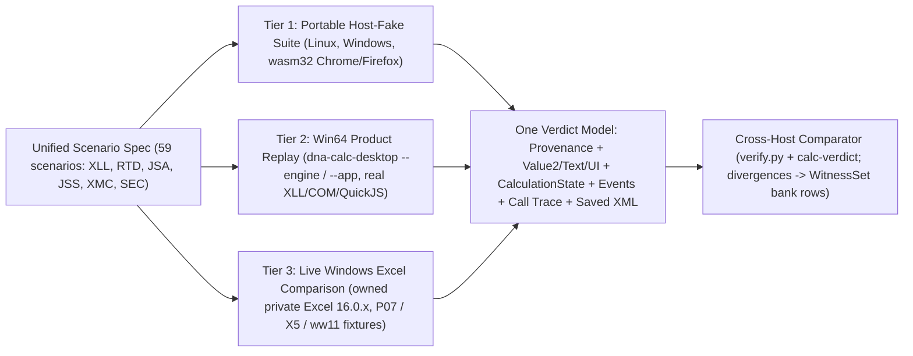

# Asynchronous and Pushed Values in Cells: Parity Test Suite Design

Status: parity test suite design for epic `dc-26wtr` (bead `dc-26wtr.3`, 2026-11-24; extended in `dc-26wtr.11`–`dc-26wtr.14` after independent review `rw4`). Derived from the reworked architecture in [`docs/architecture/ASYNC_IN_CELLS.md`](ASYNC_IN_CELLS.md) (`dc-26wtr.10` + `dc-26wtr.11`–`dc-26wtr.14`), the Windows Excel measurements in [`docs/research/async-mechanisms-excel.md`](../research/async-mechanisms-excel.md) (`ww8`, `ww9`, `ww10`, `ww11/office-js`, `ww12`), [`crates/calc-engine/tests/fixtures/excel-calc-probes/P07/README.md`](../../crates/calc-engine/tests/fixtures/excel-calc-probes/P07/README.md) (`P07-ui3-safe`, `P07-core-safe`, `P07/special`, `P07/save-ui`), `dc-snz.23.4` (`rtd1/measure`), all five required test-case groups carried from `rw2` onto `dc-26wtr.3`, and the four design-rework regressions from `rw4` (`dc-26wtr.11`–`dc-26wtr.14`). Design document only; no product or test code changes.

Companion documents:
- [`docs/architecture/ASYNC_IN_CELLS.md`](ASYNC_IN_CELLS.md) — shared engine/host substrate, two causal primitives, per-mechanism rules, and §7 provisional beads (`dc-26wtr.1.1`–`dc-26wtr.1.5`).
- [`docs/research/async-mechanisms-excel.md`](../research/async-mechanisms-excel.md) — recorded Windows Excel behaviour for XLL async (`ww8`, `ww10`), COM RTD (`ww9`), and Office.js (`ww11`).
- [`docs/architecture/RECALC_CONTRACT.md`](RECALC_CONTRACT.md) — SliceV1 async completion (§3.4), observation fences (§5), supersession (§6), and save semantics (§8).
- [`docs/architecture/CODE_EXECUTION_POLICY.md`](CODE_EXECUTION_POLICY.md) — `Off` / `Guarded` / `Unguarded` capability model (`dc-8ovd`).
- [`docs/architecture/ADDIN_SURROGATE.md`](ADDIN_SURROGATE.md) — per-session surrogate boundary, `incarnation` tokens, and unload safety (§6, §8).

Honesty rules for this suite:
1. **Confirmed vs Provisional separation:** Every scenario is tagged either **`Confirmed`** (citing an executed Excel recording that locks the assertion today) or **`Provisional (dc-26wtr.1.x)`** (citing the pending Windows measurement bead that will lock the Excel expectation). Suite summaries always report `Confirmed` and `Provisional` pass counts separately; an Excel measurement overrides any contradicting provisional expectation.
2. **Provenance before value:** Assertions always inspect `ProjectedValue` provenance alongside the displayed value. `#BUSY!`, `#CALC!`, and reopened `<v>` caches must assert `ProjectedValue::Stale` or `ProjectedValue::FileCached` — never `ProjectedValue::Calculated`.
3. **Typed refusals, never masked:** Policy denials (`MacroSecurity`), unmodelled XLL/RTD operands, Guarded resource caps, and `wasm32` native refusals must assert typed `NotModeled` / `PolicyDenied` — never `#VALUE!` or `#N/A` (except where Excel itself returns `#N/A`, such as an unregistered RTD ProgID).
4. **Test the application route:** Every scenario runs through `HostSession`, `WorkbookAutomation`, `Server` (`dna-calc-worker`), `AddinHost`, and `dna-calc-desktop` (`--engine` / `--app`) — never a parallel evaluator built only for tests.
5. **Excel divergences become bank rows:** Any live Excel comparison where DNA Calc differs from Excel (before or after a fix) records a `WitnessSet` JSON row under `bank-rows/` (owner ruling, 2026-11-21).

---

## 1. Suite Architecture: Three Tiers, One Scenario Model

To test the exact same timeline semantics across Linux development, browser `wasm32`, Win64 native execution, and live Excel without duplicating fixtures, the suite uses one scenario specification executed across three tiers that extend existing workspace harnesses.

### 1.1 Tier 1 — Portable Host-Fake Conformance Suite (Linux, Windows, `wasm32`)

Preserves `tools/xtask/architecture.json` (zero native dependencies in `calc-host` and `dna-calc-worker`; `dna-onecalc` stays free of `calc-engine` and `calc-host`):

| Planned test location (to add in `dc-26wtr.4`–`.7`) | Crate portability | Extends existing file | What it exercises |
|---|---|---|---|
| `crates/calc-host/tests/async_parity/` (registered in `crates/calc-host/tests/integration.rs`) | `portable` (native + `wasm32` Chrome/Firefox) | `crates/calc-engine/tests/fixtures/seven_cell_async.rs`, `crates/calc-host/tests/fetch.rs`, `crates/calc-host/tests/events.rs`, `crates/calc-host/tests/round_trip.rs` | Full shared substrate: `HostSession`, `WorkbookAutomation`, `SkinIntent`, `CommandIngress`, `WorkbookEventObserver`, `WorkbookEventHandler`, `CalculationLifecycleObserver`, `AutomationPump`, `SavePolicy`, `StaleValue::displayed_value()`, `FakeXllAsyncProvider`, `FakeRtdConnector`, `FakeJsEngine`. |
| `crates/calc-js-host/tests/async_conformance.rs` | `portable` (`engine-quickjs` native; future `engine-boa` / `engine-v8` / `engine-browser` run the same cases) | `crates/calc-js-host/tests/conformance.rs` | `JsEngine` trait contract: `VirtualClock` timers (`setTimeout`/`setInterval`/`clear*`), Promise settlement/rejection, all 7 `CustomFunctions.ErrorCode` values (`Bridge::returned_error`, `8e21a9a82`), `CancelableInvocation`/`StreamingInvocation` `onCanceled` cancel-first reentrancy, GC/quiescent `new Promise(() => {})` detection, `JsDrainReport` mid-drain timeout/OOM isolation, `!(volatile && stream)` metadata validation, Guarded vs Unguarded caps. |
| `apps/dna-calc-worker/tests/async_parity.rs` (registered in `apps/dna-calc-worker/tests/integration.rs`) | `portable` (native QuickJS via `calc-addin-host`; `wasm32` browser Worker) | `apps/dna-calc-worker/tests/js.rs`, `apps/dna-calc-worker/src/server.rs` (`contract_p07_*`), `apps/dna-calc-worker/src/cells.rs` | End-to-end `Server` + UI tile projection (`cells.rs` using `StaleValue::displayed_value()`), `Intent::CancelCalculation` (Esc), live QuickJS + `VirtualClock` Promises & streams, multi-`JsAddin` ID isolation, `MacroSecurity` static & runtime downgrade teardown, `wasm32` native refusals and dedicated JS Worker `onerror`/watchdog `terminate()` recovery. |
| `apps/dna-onecalc/tests/rtd.rs` (extended) | `portable` (native + `wasm32`) | `apps/dna-onecalc/tests/rtd.rs` | Skin-0 single-formula boundary: `ExternalLedger` / `ExternalConnector` / `take_unread_external` for RTD & JS streams without `calc-engine`/`calc-host`. |
| `crates/calc-xll-host` & `crates/calc-com-host` unit suites (`#[cfg(windows)]`) | `native-only` (`/// Native-only: ...`) | `crates/calc-xll-host/src/callbacks.rs`, `crates/calc-xll-host/src/worker.rs`, `crates/calc-com-host/src/rtd_native.rs` (`dna_rtd_test_attach_queued`) | `worker::Pool` `Request::PendingAsync` owner-STA handoff + >16 (96) `>..X$` calls + dynamic MTR thread count; `xlAsyncReturn` late/duplicate/`xlbitDLLFree`/`xltypeRef`; logical vs physical `unload_module`; `NativeClient` `throttle: i32` (`-1`/`0`/`2000`), per-server `poll()` fault isolation (`PollReport`, `ServerTerminate` non-poisoning), `GetNewValues`, `PostMessageW(hwnd, WM_BACKGROUND)`. |

Deterministic Tier 1 fakes (`crates/calc-host/tests/async_parity/fakes.rs`):
- **`FakeXllAsyncProvider`:** Registers `AsyncUI` (`>..X`), `AsyncSafe` (`>..X$`, `allows_concurrent_async = true`, respects `UserInvocationFrame::owner_only()`), `AsyncVolatile` (`>..X!`), `XBefore`/`XAfter`, `FenceMacro` (`#` observation fence), `AsyncInline` (delivers `AsyncCompletion` before stub return), `AsyncRefuseOper` (`AsyncCompletion::Refused`), `AsyncSpill` (returns 2D `CalcArray`), and `XllRtdWrap` (undeclared `declared = false` `xlfRtd` wrapper). Logs every `(site, cell, args, handle_id, thread_mode, prefix_count, suffix_count, cancel_count, xl_event)`.
- **`FakeRtdConnector`:** Implements `ExternalConnector` over `ExternalKey::Rtd(TopicKey)` keyed by immutable `ExternalSubscriberId`. Simulates multiple independent `IRtdServer` instances on a shared `VirtualClock`, enforcing `ThrottleInterval: i32` (`-1` manual `RefreshData` only, `0` immediate, `>0` coalescing window), `GetNewValues` (`true`/`false`), `ConnectData` provisional value (or `ExternalConnectError::{ServerUnavailable, PolicyDenied, NotModelled}`), per-server fault injection (`Disconnect()`, `Heartbeat <= 0`, `RefreshData` error, `ServerTerminate` error), and an ordered call log `(ServerStart, ConnectData, UpdateNotify, RefreshData, Heartbeat, DisconnectData, ServerTerminate)`.
- **`MockAutomationPump`:** Implements `calc_host::AutomationPump` directly on `&mut HostSession` without Win32 COM: advances `VirtualClock`, drains scripted fake completions into `session.complete_async_result`, and advances calculation inside `HostSession::after_commit` so Automatic COM edit event ordering (`SheetCalculate -> AfterCalculate -> SheetChange`) is tested deterministically on Linux and `wasm32`.
- **`VirtualClock` + real `QuickJs` (native) / `FakeJsEngine` (`wasm32` core):** `VirtualClock` implements `calc_js_host::JsClock` so `setTimeout`/`setInterval` timers fire at deterministic virtual ticks with zero `std::thread::sleep` flakiness.

### 1.2 Tier 2 — Win64 Product Replay Harness (Windows, no Excel needed to replay)

Extends `apps/dna-calc-desktop` (`--engine` in `apps/dna-calc-desktop/src/engine.rs`, `--app` in `apps/dna-calc-desktop/src/app.rs`, and `apps/dna-calc-desktop/tests/xll.rs`) rather than creating a second runner:
- **Timeline driver (`--engine --timeline <scenario.json>`):** Extends the existing `--cases <json>` loop in `apps/dna-calc-desktop/src/engine.rs` to execute multi-step scripted timelines (mode changes, `FormulaEntry`, edits, `Undo`, `Calculate`/`CalculateFull`/`Worksheet.Calculate`/`Range.Calculate`, MTR thread toggles, UI Esc, `Save(false)`/`Save(true)` + `BeforeSave`, reopen, `Application.RTD.*`, row/column insert/delete, add-in unload, `MacroSecurity` downgrade) and emit one structured JSON report per run.
- **Native fixtures reused and extended:**
  1. **XLL async:** Builds on `crates/calc-engine/tests/fixtures/excel-calc-probes/P07/native-async.cpp` (preserving `AsyncUI >BBX`, `AsyncSafe >BBX$`, `AsyncVolatile >BBX!`, `XBefore`, `XAfter`, `AsyncEcho`, `ProbeCalculationEnded`, `ProbeCalculationCanceled`) and `crates/calc-xll-fixture` (`MyAsync`, `MyAsyncUnsupportedAbi`), adding controlled exports for inline `xlAsyncReturn`, `xlbitDLLFree`/`xltypeRef` on `xlAsyncReturn`, and dynamic-array `xlAsyncReturn`.
  2. **COM RTD:** Builds on `crates/calc-xll-reference/native/owned.cpp` (`DNA_X5_RTD`, `X5.RtdValue()`, per-PID `DnaCalc.X5.<pid>`), adding a second independent ProgID (`DnaCalc.X5B.<pid>`) and fault triggers (`Disconnect()`, `Heartbeat <= 0`, `ServerTerminate` HRESULT error, `GetNewValues=FALSE`).
  3. **Office.js:** Loads the exact `functions.js` + `functions.json` from `ww11/office-js` (plus the extended cancelable/address/error/spill/stream-sharing fixture from `dc-26wtr.1.3`/`.1.4`) into `AddinHost` + QuickJS.
- **Desktop app-loop verification (`--app`):** Exercises `App::tick` (`apps/dna-calc-desktop/src/app.rs`), coalesced `PostMessageW(hwnd, WM_BACKGROUND)` wake across a Win32 modal loop, live COM `AutomationPump`, and WebView2 tile delivery on the real desktop shell.

### 1.3 Tier 3 — Live Windows Excel Comparison Harness (Windows + Excel 16.0.x)

Extends the three existing Excel capture routes (owned private desktop, zero-window guard on user desktop, owned-PID teardown, untouched Trust Center/security settings):
- **XLL async & mixed XLL+RTD/JS:** Extends `crates/calc-engine/tests/fixtures/excel-calc-probes/P07/` (`run-calculation-probe.ps1`, `ui-control.ps1`, `native-async.cpp`) and `crates/calc-xll-reference/` (`run.ps1`, `verify.py` four-directory traced/control verifier).
- **COM RTD:** Extends `crates/calc-xll-reference/` (`owned.cpp`, `run.ps1`, `verify.py --rtd-cases`) and the `ww9/rtd-events` / `ww9/rtd-f9` private-desktop runner. Any test modifying `Application.RTD.ThrottleInterval` uses a disposable Excel profile with owner approval and restores/removes only the fixture's `HKCU\Software\Classes` keys (`docs/research/async-mechanisms-excel.md:105-107`).
- **Office.js async & streaming:** Extends the `ww11/office-js` Trusted Add-in Catalog HTTPS fixture (JS-only runtime manifest v1.0.0.2+). Because the JS-only runtime did not deliver HTTP `/event` requests (`docs/research/async-mechanisms-excel.md:113,132`), `dc-26wtr.1.3`/`.1.4` fixtures record invocation IDs, addresses, cancellation order, and error recovery via observable cell values / shared JS state exposed to a readout custom function, alongside COM polling of `Range.Value2`, `Range.Text`, `Application.CalculationState`, and `AppEvents`.
- **Cross-host comparator:** Extends `crates/calc-xll-reference/verify.py` (with `calc-verdict` value/bit comparison) to diff Tier 2 (`dna-calc-desktop`) JSON timeline outputs against Tier 3 (Excel) captures cell-by-cell and event-by-event.

---

## 2. Scripted Timeline DSL and Unified Assertion Contract

### 2.1 Timeline Step Vocabulary

Every scenario in §3–§8 is authored as a deterministic sequence of steps (executed by `TimelineRunner` in Tier 1, `--engine --timeline` in Tier 2, and the matching PowerShell/COM/UI driver in Tier 3):

| Step category | Operations |
|---|---|
| **Setup & modes** | `SetCalcMode(Automatic \| Manual)`, `SetThreads(n)`, `SetMacroSecurity(Off \| Guarded \| Unguarded)`, `SetViewport(area)`, `LoadXll(fixture)`, `LoadJs(id, source, metadata)`, `AttachRtd(config)` |
| **Authoring & edits** | `EnterCell(ingress, cell, text)` (`UserInterface` \| `Automation`), `EnterRange(ingress, area, formulas)` (multi-cell `FormulaEntry`), `EditLiteral(ingress, cell, value)`, `Clear(ingress, area)`, `InsertRows(row, count)`, `InsertCols(col, count)`, `DeleteRows(row, count)`, `Undo` |
| **Calculation & cancel** | `Calculate(UiF9 \| ComCalculate)`, `CalculateFull`, `CalculateSheet(sheet)`, `CalculateRange(area)`, `CancelCalculation` (UI Esc), `StepBudget(n)` |
| **External events & time** | `AdvanceClock(ms)`, `DeliverXllReturn(handle_sel, AsyncCompletion)`, `RtdNotify(server, topic, val)`, `RtdSetThrottle(i32)`, `RtdRefreshData`, `RtdRestartServers`, `RtdFault(server, Disconnect \| HeartbeatZero \| RefreshErr \| TerminateErr)`, `DrainJs(ExecLimits)`, `TickShell` |
| **Persistence & lifecycle** | `Save { calc_before_save, before_save_action: Allow \| Cancel \| Edit(cell, val) }`, `Reopen { mode, reload_addins }`, `CloseWorkbook`, `UnloadXll(module)`, `UnloadJs(addin)`, `TerminateJsWorker(addin)` |
| **Checkpoints** | `AssertCells(...)`, `AssertEvents(...)`, `AssertCalcState(0 \| 1 \| 2)`, `AssertProviderTrace(...)`, `AssertSavedXml(...)`, `AssertNoLeaks` |

### 2.2 Uniform Assertion Dimensions Checked at Every Checkpoint

Every checkpoint verifies all six dimensions where applicable:
1. **Engine provenance & value (Honesty Rule 1):** `ProjectedValue::{Calculated, Stale(StaleCause), FileCached, NotModeled, Literal, Empty}` and exact IEEE-754 bits (`CalcValue::representation_eq`, distinguishing `-0.0` from `+0.0`).
2. **All three display consumers (rw2 Finding 8):**
   - `StaleValue::displayed_value()` (`crates/calc-host/src/project.rs`) — single source of truth;
   - UI grid tile (`apps/dna-calc-worker/src/cells.rs` `CellShown { text, provenance, spill_child }`);
   - Automation `Range.Value2` (`crates/calc-host/src/automation.rs` `auto_value`: CVErr `2043` `#GETTING_DATA`, `2051` `#CALC!`, `2059` `#BUSY!` / `-2146826237`);
   - Automation `Range.Text` (`crates/calc-host/src/automation/formula.rs` `error_text`: `"#GETTING_DATA"`, `"#CALC!"`, `"#BUSY!"`);
   - Spill-child projection (`filled_value` in `crates/calc-host/src/project.rs`).
3. **Application state:** `HostState::calculation_state()` / `_Application.CalculationState` (`0` = `xlDone`, `1` = `xlCalculating`, `2` = `xlPending`).
4. **Ordered event trace:** Exact sequence of `SheetCalculate`, `AfterCalculate`, `SheetChange`, `BeforeSave`, `AfterSave`, and native `xlEventRegister` (`CalculationEnded(route)`, `CalculationCanceled`).
5. **Provider & subscription accounting:** Exact entry/prefix/suffix/cancel counts, thread placement (STA vs worker thread count), RTD `ConnectData`/`RefreshData`/`DisconnectData`/`ServerTerminate` order, JS `invoke_async`/`start_stream`/`onCanceled`/`JsDrainReport` faults, and zero leaked `pending_async`, `ExternalSubscriberId`, or `connected_in_attempt` entries.
6. **Saved package XML (`.xlsx` ZIP inspection):** `<v>` presence/value (or explicit absence on cold pending cells), `<f ca="1">`, `<calcPr calcCompleted="0|1" calcOnSave="0|1" fullCalcOnLoad="0|1">`, and anchor + spill-area `<v>` caches for `ArrayKind::Dynamic`.

---

## 3. Native XLL Asynchronous Functions (`XLL-01` – `XLL-16`)

Owned by implementation bead `dc-26wtr.4` (building on `dc-snz.23`). Citations: `A03` = `ww8/async-03`; `A04/A05` = `ww8/async-04-ui` & `ww8/async-05-display`; `P07` = `P07/README.md` (`P07-ui3-safe`, `P07-core-safe`, `special`, `save-ui`).

| ID | Excel behaviour pinned | Status / Citation | Harnesses | Expected outcome |
|---|---|---|---|---|
| **XLL-01** | **Manual setup (`FormulaEntry`, single- & multi-cell), Manual dirty arg edit, and F9:** Entering an async formula (or multi-cell `Range.Formula` `B1:B2`) in Manual computes the entered cell(s) live on the owner STA while leaving dependents stale. Once seeded (`A1=10`, `B1/C1/D1=20/21/42`, `B2/D2=13/113`), editing `A1=11` triggers zero async entries, holds old values, sets `CalculationState=2`; subsequent `Calculate` yields `22/23/46` & `14/114` and `CalculationState=0`. | **Confirmed** (`A03` row 1; multi-cell `FormulaEntry` rw2 F4) | T1 (`calc-host` fake), T2 (`--engine --timeline`, `native-async.cpp`), T3 (`ww8/async-03` `manual-dirty`/`manual-edit`/`manual-dirty-calculate`) | `FormulaEntry` evaluates entered cell(s) live (`EvalSelection::FormulaEntry`, `owner_only=true`), dependents stay `Stale(20/21/42)`. Edit `A1=11`: `entries=0`, `SheetChange` only, `CalculationState=2`. `Calculate`: `Calculated` `22/23/46` & `14/114`, `CalculationState=0`. |
| **XLL-02** | **Two independent async chains + dynamic reader (`INDIRECT`/`OFFSET`) + no-prefix-repeat:** `B1=XBefore(A1)+AsyncUI(A1,2100)`, `C1=XAfter(B1+1)`, `D1=C1*2`; `B2=AsyncUI(A1+3,800)`, `D2=XAfter(B2+100)`; plus independent pure constant, `NOW()`, and dynamic `E1=INDIRECT("B1")+1`. Both async providers enter concurrently; pure & `NOW()` execute before either return; fast branch `B2 -> D2` (`113`) runs before slow `B1` returns; `B1` prefix runs once (`prefix=1, suffix=1`); `E1` parks in `waits_on` without `UnscheduledRead` or false cycle `keep()`; `SheetCalculate -> AfterCalculate` fire once after ALL chains finish. | **Confirmed** (`A03` rows 2–3; `P07-ui3-safe`; rw2 F1 `waits_on` / `UnscheduledRead`) | T1 (`calc-host` fake), T2 (`--engine --timeline`), T3 (`ww8/async-03` `manual-calculate`) | `B1` & `B2` enter before any return; pure/`NOW()` complete first; after `B2` returns, `D2=113` executes immediately while `B1` is parked; zero `RecalcFailure::UnscheduledRead` and zero circular `keep()` on `E1`; after `B1` returns, `C1=21`, `D1=42`, `E1=21`; `XBefore` count = 1; exactly one `SheetCalculate -> AfterCalculate` pair at end. |
| **XLL-03** | **Observation fence (`#`/VBA) ordering alongside concurrent async:** Segment 0 contains concurrent `B1`/`B2` async chains (`allows_concurrent_async=true, cached_reads=false`); segment 1 contains a `#` macro-equivalent or VBA observer peeking `B1`. Segment 1 must NOT execute ahead of segment 0's parked async calls. | **Confirmed** (`P08`, `ASYNC_IN_CELLS.md` §3.3.1, rw2 F1) | T1 (`calc-host` fake), T2 (`--engine --timeline` with `#` export) | `active_segment` remains at segment 0 until both `B1` and `B2` complete; `#`/VBA observer runs only in segment 1 and observes settled segment 0 values. |
| **XLL-04** | **Two async call sites in one formula & identical duplicate return:** Formula with two `AsyncEcho` call sites evaluates site 2 with a distinct handle only after site 1 returns (result `85`, dependent `86`). Delivering an identical duplicate `xlAsyncReturn` on the same handle does not repeat the suffix. | **Confirmed** (`P07/README.md` `special`); two-site cancel/error **Provisional (`dc-26wtr.1.1`)** | T1 (`calc-host` fake), T2 (`--engine --timeline`), T3 (`P07/special` + `dc-26wtr.1.1`) | Site 1 handle != Site 2 handle; site 2 enters strictly after site 1 return; `suffix=1` per site; duplicate return yields `AsyncDisposition::Duplicate` with zero extra suffix call; result `85`, dependent `86`. |
| **XLL-05** | **Volatility (`>..X`, `>..X$`, `>..X!`) on clean `Calculate` vs `CalculateFull`:** Clean `Calculate` on a seeded workbook invokes ONLY `AsyncVolatile (>..X!)` + `NOW()` (zero ordinary `>..X` or `>..X$` entries). `CalculateFull` re-enters all ordinary, `$`, `!`, and non-volatile constant formulas. | **Confirmed** (`A03` row 5) | T1 (`calc-host` fake), T2 (`--engine --timeline`), T3 (`ww8/async-03` `manual-clean`, `volatile-clean-1/2`) | Clean `Calculate`: `ordinary_entries=0`, `safe_entries=0`, `volatile_entries=1`, `now_entries=1`. `CalculateFull`: all five async cells + constant probe re-enter (`entries=5`). |
| **XLL-06** | **Thread-safe `>..X$` MTR fan-out (96 cells) & runtime MTR on/off toggle:** With MTR on (`threads=16`), 96 cells of `=AsyncSafe(1000+ROW(),120)` enter concurrently across >4 (up to 16) worker threads and park all 96 simultaneously without pool starvation (`parallel_reservations` excludes `async_waits`; worker `Request::PendingAsync` hands handles to owner STA), returning `1001..1096`. Runtime toggle `set_threads(1)` routes all `$` entries onto the owner STA (`single_threaded=true`); toggling back to `set_threads(16)` restores worker-pool fan-out without restarting host. | **Confirmed** (`A03` row 6 `mtr-on`, `mtr-off`, `mtr-pool-full`; rw2 F1) | T1 (`calc-host` fake, verifying `parallel_reservations` & `owner_only` across 96 cells), T2 (`calc-xll-host` + `--engine --timeline`, verifying real `worker::Pool` threads & `Request::PendingAsync`), T3 (`ww8/async-03` `mtr-pool-full`) | All 96 cells calculate `1001..1096` (`Calculated`, 0 refusals, 0 leaked handles). MTR on: worker thread IDs distinct from STA (>4 threads on >=8-core host). MTR off: all entries on STA thread ID. Runtime toggle succeeds without host reload. |
| **XLL-07** | **Warm & cold pending display and active `CalculationState`:** While a warm async cell is recalculating after F9, live display holds previous values (`20/21/42`) and NEVER shows `#GETTING_DATA`. Cold newly-entered async display while genuinely in-flight and stable non-cancelled active `CalculationState` (`1` vs `2`). | Warm **Confirmed** (`A05/complete.png`, `A03` row 8); Cold & active state **Provisional (`dc-26wtr.1.1`)** | T1 (`calc-host` + `dna-calc-worker` `cells.rs`), T2 (`--engine` + `--app`), T3 (`ww8/async-05` + `dc-26wtr.1.1` PrintWindow/COM) | Warm: UI `cells.rs`, `Range.Value2`, `Range.Text` all show `20/21/42` (`Provenance::Stale`, never `#GETTING_DATA`). Cold (provisional): `Stale(AwaitingExternal { marker: None })` (blank stale, never `Calculated`), `CalculationState=2` while waiting. |
| **XLL-08** | **UI F9 + Esc cancellation, live `#CALC!`, and ignored late return:** During Manual F9, pressing Esc (`SkinIntent::CancelCalculation`) cancels the active calculation before provider release: native `CalculationCanceled (2)` then `CalculationEnded (1)` fire before the late return; `B1:D1` immediately project `Stale(InterruptedAsync)` (`Range.Value2` = CVErr `2051`, `Range.Text` = `"#CALC!"`, UI `cells.rs` = `"#CALC!"` with `Provenance::Stale`); `CalculationState=2`; late `xlAsyncReturn` is rejected (`Revoked`) with zero suffix execution and held `EngineState::results` untouched. | **Confirmed** (`A04-ui`, `A05/escape.png`, `P07-ui3-safe`; rw2 F8) | T1 (`calc-host` + `dna-calc-worker`), T2 (`--engine --timeline`), T3 (`P07-ui3-safe`, `ww8/async-04-ui`/`05`) | Event order: `entry -> CalculationCanceled(2) -> CalculationEnded(1) -> late_return(ignored)`. `suffix=0`. All 3 display faces show `#CALC!` (`2051`) with `Provenance::Stale`. `CalculationState=2`. `permitted_cache` still holds prior numeric values. |
| **XLL-09** | **Partial-completion Esc (scroll-independent `publish_ready`):** Two independent chains (`B1` slow, `B2` fast). `B2` returns and `D2` evaluates while `B1` is still parked; then Esc is pressed. Run twice: once with `B2:D2` inside viewport (`preferred`) and once off-screen (`preferred` elsewhere). | **Provisional (`dc-26wtr.1.1`)** (scroll-independence invariant **Confirmed** per rw2 F8) | T1 (`calc-host` fake with 2 viewport configs), T2 (`--engine --timeline`), T3 (`dc-26wtr.1.1` item 7) | On-screen and off-screen runs produce **byte-identical** cell states, provenance, and saved caches (viewport `publish_ready` suppressed while `async_waits` non-empty). Provisional cell expectation: `B1:D1` `#CALC!`, `B2:D2` staged-not-published (`#CALC!` or retained per `dc-26wtr.1.1` measurement). |
| **XLL-10** | **Manual live edit, overwrite + Undo (`90/91`), and Automatic in-flight edit:** (a) Manual F9 interrupted by overwriting `C1` with `999` then `Ctrl+Z` (`Undo`): cancels `work` immediately (no `supersede_recalc`), fires `CalculationCanceled (2)` + `CalculationEnded (1)` before late return, zero replacement async entry, live `C1/D1` show `#CALC!` (`2051`), and `Step::superseded_caches` restores held `90/91` onto recreated node for save. (b) Manual arg edit or move genuinely before native release. (c) Automatic edit/overwrite mid-flight cancels old token and supersedes cleanly. | (a) **Confirmed** (`P07-ui3-safe`, rw2 F4); (b)–(c) **Provisional (`dc-26wtr.1.1`)** | T1 (`calc-host` fake), T2 (`--engine --timeline`), T3 (`P07-ui3-safe` + `dc-26wtr.1.1` item 3) | (a) `entries=1` (zero replacement entry), `suffix=0`, `CalculationCanceled -> CalculationEnded -> late_return(ignored)`, live `C1/D1` `Stale(InterruptedAsync)` (`#CALC!`), `Save(false)` persists `90/91` + restored formula text (`ca="1"`). (b)–(c) Zero late-value installation; Auto supersedes with fresh token. |
| **XLL-11** | **Native `xlEventRegister` (`1`/`2`) trigger-route matrix:** Verify `CalculationEnded (1)` is absent on dirty COM `Application.Calculate`, present on UI F9, `CalculateFull`, Automatic edit, and post-cancel (`CalculationCanceled (2)` then `CalculationEnded (1)`). Extend matrix to `Worksheet.Calculate`, `Range.Calculate` (on `>..X` and `>..X$`), and Automatic edit cancellation. | Dirty COM / UI F9 / Full / Auto edit / UI cancel **Confirmed** (`A03` row 4, `P07-ui3-safe`); `Worksheet.Calculate`, `Range.Calculate`, Auto cancel **Provisional (`dc-26wtr.1.1`)** | T1 (`calc-host` `CalculationLifecycleObserver`), T2 (`--engine --timeline` + `native-async.cpp`), T3 (`ww8/async-03` + `dc-26wtr.1.1` items 5, 10) | `CalculationLifecycleObserver` receives exact `CalcTriggerRoute` per trigger; `XllHost::fire_calculation_event(1\|2)` matches Excel's measured matrix (0 fires on dirty COM `Calculate`; 1 fire on UI F9, `CalculateFull`, Auto edit; `2 -> 1` on UI Esc/overwrite/Ctrl+S). |
| **XLL-12** | **Automatic COM edit synchronous pump (`AutomationPump` inside `after_commit`):** An automation client edits `A1` in Automatic mode while `B1:D1` & `B2:D2` contain async chains. `AutomationPump::pump_waiting(&mut HostSession)` runs inside `after_commit` before `notify_workbook_change`, delivering `SheetCalculate -> AfterCalculate -> SheetChange` in exact order with zero `RefCell` reentrancy. Headless call (`pump = None`) returns typed refusal without hanging. | **Confirmed** (`A03` row 3; rw2 F5) | T1 (`calc-host` `MockAutomationPump` + `pump=None`), T2 (`--app` / COM `WorkbookAutomation`), T3 (`ww8/async-03` `automatic-edit`) | With pump: event trace strictly `["SheetCalculate", "AfterCalculate", "SheetChange"]`, all cells `Calculated`, no `RefCell` panic. Without pump: returns typed automation refusal (never hangs, never drops `SheetChange` silently). |
| **XLL-13** | **`xlAsyncReturn` ABI & operand edge cases:** (a) Inline `xlAsyncReturn` invoked inside the native entry stub before stub return; (b) late/duplicate `xlAsyncReturn` never dereferences `args[1]` and matches Excel status/zeroed output; (c) `from_oper` refusal, `xltypeRef`/`xltypeSRef`, and `xlbitDLLFree` on `xlAsyncReturn` propagate as `AsyncCompletion::Refused` (`ProjectedValue::NotModeled`, Honesty Rule 2 — NEVER `#VALUE!`). | Refusal non-masking **Confirmed** (Honesty Rule 2, rw2 F9); inline return, late status, `xlbitDLLFree` (`xlAutoFree12`) **Provisional (`dc-26wtr.1.1`)** | T1 (`calc-host` `AsyncCompletion::Refused` + inline fake), T2 (`calc-xll-host` callbacks + `--engine` extended fixture), T3 (`dc-26wtr.1.1` items 6, 10) | (a) Inline completion drained via `take_async_returns()` without blocking, suffix runs once. (b) Revoked handle sets `async_return_observed=true`, does not dereference `args[1]` (tested with sentinel/null pointer). (c) Unmodelled operand stages `ProjectedValue::NotModeled` (never `#VALUE!`), surviving `IFERROR`. |
| **XLL-14** | **Save (`CalculateBeforeSave = false` & `true`), `BeforeSave` + `Cancel=True`, and Automatic Esc+Save:** (a) Completed `Save(false)` writes calculated values with zero async entries. (b) Manual UI `Ctrl+S` mid-async cancels before late return, shows live `#CALC!` (`2051`), writes held numeric caches `41/42` + edited `A1`, `ca="1"`, `calcCompleted="0"`, `calcOnSave="0"`, fires `BeforeSave` + `AfterSave`. (c) `BeforeSave` ordering vs `CalculationCanceled` (including `Cancel=True`). (d) Automatic Esc + `Save(false)` cache preservation. (e) `Save(true)` uses live `OrdinarySave` (not `PinnedSave`), cooperatively completing without duplicating active invocations. | (a)–(b) **Confirmed** (`A03` row 7, `P07/save-ui`); (c)–(e) **Provisional (`dc-26wtr.1.1`, rw2 F8/F11)** | T1 (`calc-host` fake), T2 (`--engine --timeline`), T3 (`P07/save-ui` + `dc-26wtr.1.1` items 4, 8) | (b) Saved ZIP has `<v>41</v>`, `<v>42</v>`, `<f ca="1">`, `calcCompleted="0"`, `calcOnSave="0"`, zero `#CALC!` in `<v>`. (c) Provisional: cancel precedes `BeforeSave`; `Cancel=True` aborts disk write while retaining cancel state. (d) Provisional: `PreservePermittedCaches` active when `calculation_cancelled=true`. (e) Live `OrdinarySave` completes cleanly with `entries=1`. |
| **XLL-15** | **Manual reopen, `open_clean_cache` across `set_callable_bindings`, and `=NOW()+B1` imported-cache read:** (a) Completed workbook with ordinary + volatile async reopens in Manual exposing saved caches (`FileCached`, zero async entries on open); startup `set_callable_bindings` preserves `open_clean_cache` for non-volatile async; explicit `Calculate` re-enters ONLY volatile async and `=NOW()+B1` reads `B1`'s imported cache with `uses_imported_cache=true` (zero unreadable refusal); `cache_complete` stays honest. (b) Reopen of non-volatile-only async workbook (`CalculationState` `0` vs `2` and F9). | (a) **Confirmed** (`A03` row 7; rw2 F7); (b) **Provisional (`dc-26wtr.1.1`)** | T1 (`calc-host` fake), T2 (`--engine --timeline`), T3 (`ww8/async-03` `reopen` + `dc-26wtr.1.1` item 9) | On open: `entries=0`, `B1` is `FileCached`. After `set_callable_bindings` + `Calculate`: `ordinary_entries=0`, `volatile_entries=1`, `=NOW()+B1` calculates with `stamp.reads.uses_imported_cache == true`, `save.rs` `cache_complete` does not falsely certify uncalculated imported caches. `CalculateFull` re-enters all. |
| **XLL-16** | **Dynamic-array XLL async spill, spill-child overlay, and Esc + Save cache preservation:** `xlAsyncReturn` delivers a 2x2 array spilling into `B1:C2` (authored as `ArrayKind::Dynamic`); dependent reads `C2`. Warm recalculation interrupted by Esc projects `Stale(InterruptedAsync)` (`#CALC!` / `2051`) on BOTH anchor `B1` and spill children `C1, B2, C2` across UI `cells.rs`, `Range.Value2`, and `Range.Text`; `Save(false)` preserves prior dynamic-array anchor + spill-child `<v>` caches under `PreservePermittedCaches` (`save.rs:349-351`). | **Provisional (`dc-26wtr.1.1`)** (`StaleValue::displayed_value()` & `PreservePermittedCaches` dynamic-array wiring per rw2 F8) | T1 (`calc-host` + `dna-calc-worker`), T2 (`--engine --timeline` extended fixture), T3 (`dc-26wtr.1.1` items 6, 8) | Before Esc: `B1:C2` `Calculated` 2x2 values. After Esc: anchor + all 3 spill children project `Stale(InterruptedAsync)` (`#CALC!`, CVErr `2051`). After `Save(false)`: ZIP retains prior numeric `<v>` for anchor + spill footprint, zero `#CALC!` in `<v>`. |

---

## 4. COM Real-Time Data (`RTD-01` – `RTD-11`)

Owned by implementation bead `dc-26wtr.5` (building on `dc-snz.23` and `dc-snz.23.3`). Citations: `R09` = `ww9/rtd-events` & `ww9/rtd-f9`; `R23` = `dc-snz.23.4` (`rtd1/measure`).

| ID | Excel behaviour pinned | Status / Citation | Harnesses | Expected outcome |
|---|---|---|---|---|
| **RTD-01** | **Topic identity, argument coercion, `=RTD()`/`xlfRtd` sharing, initial value, and remote refusal:** ProgID ASCII case-folding; omitted == empty local server; 1–253 exact `CONCAT`-coerced topic strings (`1` == `"1"`, `TRUE` == `"TRUE"`, `0.1+0.2` == `"0.3"`, `" t"` != `"t"`); `=RTD()` and XLL `xlfRtd` with equal args share one `ConnectData`; connect-time value `1` shows on first evaluation (single admission `1, 42` — not duplicate `1, 1, 42`); `Empty -> 0.0`, unregistered/numeric/empty ProgID or `VARIANT` array -> `#N/A` (zero `ConnectData` for invalid args); named remote server -> typed `ExternalConnectError::NotModelled` refusal (NEVER `#N/A`). | **Confirmed** (`R23` `dc-snz.23.4`, `dc-snz.23.3`, `R09` row 1) | T1 (`calc-host` `FakeRtdConnector`), T2 (`--engine --timeline` `owned.cpp` `DNA_X5_RTD`), T3 (`rtd1/measure`, `ww9/rtd-events`, `x5-rtd-typed-cases.json`) | Single `ConnectData` across `=RTD()` and `xlfRtd`; 1 initial admission (`seq=1, val=1`) without duplicate evaluation; exact `#N/A` vs typed `NotModelled` separation verified on all argument forms. |
| **RTD-02** | **Automatic two-subscriber sharing, 2,000 ms throttling, coalescing, and AppEvents:** Two cells subscribe to the same topic (`1`) with two levels of dependents (`+3 -> *2` and `+10 -> *3`). First `UpdateNotify` triggers immediate `RefreshData` (`42`) + `SheetCalculate -> AfterCalculate`. Rapid `43` and `44` notifications coalesce under `ThrottleInterval = 2,000 ms` into one `RefreshData` (`44`) ~2,000 ms later + one `SheetCalculate -> AfterCalculate`. Final chains: `45 -> 90` and `54 -> 162`. | **Confirmed** (`R09` row 1) | T1 (`calc-host` `FakeRtdConnector` + `VirtualClock`), T2 (`--engine --timeline`), T3 (`ww9/rtd-events`) | `ConnectData` count = 1; `RefreshData` count = 2 (`42`, then `44`; `43` coalesced); exactly 2 `SheetCalculate -> AfterCalculate` pairs; final `Calculated` values `44`, `45`, `90`, `54`, `162`. |
| **RTD-03** | **Subscriber removal, connect-before-disconnect retarget, conditional `=IF(A1, RTD(...), 0)`, and workbook close:** (a) Removing 1 of 2 subscribers keeps topic connected. (b) Retargeting the remaining subscriber connects NEW topic (`ConnectData`) strictly BEFORE disconnecting OLD topic (`DisconnectData`). (c) Toggling `=IF(A1, RTD(...), 0)` (`A1: TRUE -> FALSE -> TRUE`) detaches at command boundary when untaken and reconnects cleanly when retaken. (d) Closing the workbook disconnects remaining topics and invokes `ServerTerminate`. | (a), (b), (d) **Confirmed** (`R09` row 2); (c) **Confirmed** command-boundary reconciliation invariant (rw2 F6) | T1 (`calc-host` `FakeRtdConnector`), T2 (`--engine --timeline`), T3 (`ww9/rtd-events`) | Call log asserts `DisconnectData` count = 0 after first removal; on retarget `idx(ConnectData(new)) < idx(DisconnectData(old))`; `IF` false branch detaches topic (`subscriptions=0`); close calls `DisconnectData` then `ServerTerminate` (`subscriptions=0`). |
| **RTD-04** | **Manual mode background refresh, retarget (`FormulaEntry`), native F9, and `CalculateFull`:** In Manual mode, `UpdateNotify`/`RefreshData` continues refreshing (`42`, `44`) in the background ledger while both topic cells keep showing `1` and dependents hold `2/4` and `11/33` (zero `SheetCalculate`/`AfterCalculate`). Retargeting evaluates the edited cell live (`44` via `FormulaEntry`) while dependents stay stale. Native F9 updates both chains (`44`, `45/90`, `54/162`) and moves `CalculationState` `2 -> 0`. `CalculateFull` keeps settled values with zero `ConnectData`/`DisconnectData`. | **Confirmed** (`R09` rows 3–4, `ww9/rtd-f9`) | T1 (`calc-host` `FakeRtdConnector`), T2 (`--engine --timeline`), T3 (`ww9/rtd-events`, `ww9/rtd-f9`) | During Manual pushes: 0 AppEvents, sheet retains `1`, `2/4`, `11/33`. After retarget: edited cell `44`, dependents stale. After F9: `44`, `45/90`, `54/162`, `CalculationState=0`. After `CalculateFull`: `ConnectData` delta = 0, settled values retained. |
| **RTD-05** | **Save & reopen in Manual (`=RTD()` + XLL `xlfRtd` wrapper + `GetNewValues`):** (a) Saving and reopening in Manual shows saved `44/54/162` (`FileCached`, zero `ServerStart`/`ConnectData` on open); explicit `Calculate` reconnects (`ConnectData`), displays `1/11/33`, then background server refreshes `42`/`44` while sheet holds `1` until next `Calculate`. (b) XLL `xlfRtd` wrapper (`=X5.RtdValue()`) saved XML `ca` flag and Manual reopen + F9 reconnection. (c) `ConnectData` `GetNewValues=FALSE` vs `TRUE` on reopen with saved cache. | (a) **Confirmed** (`R09` row 5); (b)–(c) **Provisional (`dc-26wtr.1.2`, rw2 F7)** | T1 (`calc-host` `FakeRtdConnector`), T2 (`--engine --timeline` + `owned.cpp`), T3 (`ww9/rtd-events` + `dc-26wtr.1.2` items 4, 8) | (a) On open: `ServerStart=0`, `FileCached` `44/54/162`. On `Calculate`: `ConnectData=1`, `Calculated` `1/11/33`, subsequent pushes held in ledger until next `Calculate`. (b)–(c) Provisional: `GetNewValues=TRUE` default; `xlfRtd` XML `ca` & reopen locked after `dc-26wtr.1.2`. |
| **RTD-06** | **Structural move (`apply_moves`) + clear/overwrite & cancelled retarget zero-leak:** (a) Insert rows/columns above an RTD cell (`apply_moves` shifts `CellKey` `B2 -> B5` while `NodeId`/`ExternalSubscriberId` stays immutable), push an update (cell `B5` receives it), then overwrite/clear `B5` with a literal — `Detach` matches the exact `ExternalSubscriberId` with zero leaked topics. (b) Cancel or fail a retarget mid-command — `connected_in_attempt` emits `Detach` for the uncommitted new topic while keeping the committed old topic alive. (c) Manual-mode literal overwrite/clear disconnect timing (immediate vs deferred to `Calculate`). | Zero-leak `ExternalSubscriberId` & `connected_in_attempt` **Confirmed** engine invariant (rw2 F6); (c) Manual disconnect timing **Provisional (`dc-26wtr.1.2`)** | T1 (`calc-host` `FakeRtdConnector`), T2 (`--engine --timeline` + `RtdClient`), T3 (`dc-26wtr.1.2` item 2) | After move + push: `B5` updates cleanly. After clear: `subscriptions=0`, `DisconnectData` called once, zero orphaned `ExternalSubscriberId`s. After cancelled retarget: new topic detached (`DisconnectData`), old topic still subscribed. |
| **RTD-07** | **Managed XLL `xlfRtd` reconciliation (`RtdService::reconcile_evaluation`) & `$` thread-safety denial:** (a) Undeclared (`declared=false`) native `xlfRtd` calls inside an XLL UDF reconcile strictly via surviving runtime `invocation_ids` (`ResultStamp.reads.invocations`) and `begin_replacement`/`finish_replacement` (preserving `dc-snz.23` parity under generalized `ExternalKey`). (b) Calling `xlfRtd` from a `$` thread-safe worker returns `xlretNotThreadSafe` (`128`). | **Confirmed** (`dc-snz.23`, `apps/dna-calc-desktop/tests/xll.rs`, `ASYNC_IN_CELLS.md` §2.1 & §3.3.3, rw2 F6) | T1 (`calc-host` fake `declared=false`), T2 (`--engine --timeline` `x5-rtd-native-cases.json` + worker `$` fixture), T3 (`crates/calc-xll-reference` R7) | Undeclared XLL wrapper keeps topic alive while runtime invocation survives, disconnects on replacement/untaken branch; `$` worker `xlfRtd` returns status `128`. |
| **RTD-08** | **`Application.RTD` (`ThrottleInterval = -1 / 0 / custom`, `RefreshData`, `RestartServers`) & throttle-window `CalculationState`:** Verify `throttle: i32` accepts `-1` (suppresses automatic refresh until explicit `Application.RTD.RefreshData`), `0` (immediate uncoalesced delivery), and custom ms (e.g., `500`), rejecting `< -1`. Verify `Application.RTD.RestartServers` in Automatic vs Manual and `CalculationState` between `UpdateNotify` and `RefreshData` (and under `-1`). | `throttle: i32` API & non-negative/manual bounds **Confirmed** (rw2 F10); exact Excel `RestartServers` & throttle-window `CalculationState` **Provisional (`dc-26wtr.1.2`)** | T1 (`calc-host` `WorkbookAutomation` + `FakeRtdConnector`), T2 (`calc-com-host` `NativeClient` + `--engine`), T3 (`dc-26wtr.1.2` items 3, 7, disposable profile) | `ThrottleInterval=-1`: `UpdateNotify` triggers 0 `RefreshData` until `Application.RTD.RefreshData()` is called. `ThrottleInterval=0`: every tick refreshes without 2,000 ms wait. `ThrottleInterval=-2`: automation error. `RestartServers` tears down and reconnects active servers cleanly. |
| **RTD-09** | **2-server fault isolation (`Disconnect()`, `Heartbeat <= 0`, `RefreshData` error, `ServerTerminate` error):** Workbook subscribes to Server 1 (`S1`) and Server 2 (`S2`). Inject each fault into `S1` while `S2` continues emitting updates: `S1` calls `IRTDUpdateEvent::Disconnect()`, returns `Heartbeat <= 0`, returns COM error on `RefreshData`, or fails `ServerTerminate`. `NativeClient::poll()` must tear down and remove ONLY `S1`, return `PollReport { updates, disconnected_topics, diagnostics }` (never global `self.closed = true`, never `.unwrap_or_default()`), while `S2` continues updating all its cells. | Fault isolation & non-poisoning **Confirmed** invariant (rw2 F10); exact Excel cell display & recovery for `S1` cells **Provisional (`dc-26wtr.1.2`)** | T1 (`calc-host` 2-server `FakeRtdConnector`), T2 (`calc-com-host` `NativeClient` unit test + `--engine` 2-ProgID fixture), T3 (`dc-26wtr.1.2` item 6) | `S2` cells receive all subsequent updates with zero interruption; `PollReport.diagnostics` non-empty; `PollReport.disconnected_topics` contains only `S1`'s leases; `NativeClient.closed == false`; `S1` cells reflect measured Excel state once `dc-26wtr.1.2` lands. |
| **RTD-10** | **Esc interruption during RTD recalc wave, mid-pass `UpdateNotify`, and unrelated `NOW()`:** (a) Esc during an RTD-triggered recalc wave aborts the current pass (`connected_in_attempt` cleaned) without disconnecting committed topics. (b) `UpdateNotify` arriving while a recalc pass is running does not lose the update. (c) Verify whether an RTD refresh wave recalculates an unrelated `=NOW()` cell on the same sheet. | **Provisional (`dc-26wtr.1.2`)** (no-lost-update & decoupled `volatile_input_version` per rw2 F2) | T1 (`calc-host` `FakeRtdConnector`), T2 (`--engine --timeline`), T3 (`dc-26wtr.1.2` items 1, 5) | (a) Committed topics stay connected; aborted pass cleans uncommitted connections. (b) Next wave delivers the queued update. (c) Provisional: unrelated `NOW()` is NOT forced dirty by `invalidate_external_key` (adjusted via explicit wave flag only if `dc-26wtr.1.2` measures Excel recalculating it). |
| **RTD-11** | **External ledger sequence validation & `representation_eq` (`-0.0` vs `+0.0`):** Delivering `-0.0` after `+0.0` on a new sequence advances the ledger and dirties subscribers (bit-exact `CalcValue::representation_eq`); duplicate `(seq, identical bits)` returns `Duplicate`; older sequence returns `StaleSequence`; seq 0 returns `InvalidValue`; retired lease returns `Retired`. | **Confirmed** (owner bit-match rule; `crates/calc-engine/src/external.rs:10-12`, `apps/dna-onecalc/tests/rtd.rs`) | T1 (`calc-host` + `calc-fml` + `dna-onecalc`), T2 (`--engine`) | `-0.0_f64.to_bits()` (`0x8000_0000_0000_0000`) replaces `+0.0` and propagates to dependents; `Duplicate`/`StaleSequence`/`InvalidValue`/`Retired` dispositions match exactly. |

---

## 5. Office.js Asynchronous (`Promise`) Custom Functions (`JSA-01` – `JSA-11`)

Owned by implementation bead `dc-26wtr.6` (building on `dc-17spk.6`). Citations: `O11` = `ww11/office-js` (`docs/research/async-mechanisms-excel.md:115-132`).

| ID | Excel behaviour pinned | Status / Citation | Harnesses | Expected outcome |
|---|---|---|---|---|
| **JSA-01** | **Cold Automatic entry (`#BUSY!` on Promise + dependent, `CalculationState 2 -> 0`):** Entering `=DNACALCASYNC.PROMISE(4)` and dependent `=B1+100` in Automatic shows `#BUSY!` (`Value2` CVErr `2059` / `-2146826237`, `Text` `"#BUSY!"`, UI `cells.rs` `"#BUSY!"` with `Provenance::Stale`) on BOTH cells while pending — never writing a fake `Calculated(#BUSY!)` into `EngineState::results` — with `CalculationState = 2`. On resolution: `40` and `140` (`Calculated`) and `CalculationState = 0`. | **Confirmed** (`O11` row 1; rw2 F3, F8, F9) | T1 (`calc-host` fake + `dna-calc-worker` QuickJS/`VirtualClock` + `cells.rs`), T2 (`--engine --timeline` `ww11` JS fixture), T3 (`ww11/office-js`) | Pending: both cells `ProjectedValue::Stale(AwaitingExternal { marker: Some(Busy) })`, `EngineState::results` empty (`None`), `Value2` = CVErr `2059`, `Text` = `"#BUSY!"`, `CalculationState = 2`. Settled: `Calculated` `40`/`140`, `CalculationState = 0`. |
| **JSA-02** | **Warm Automatic edit (`arg 4 -> 5` holds previous values):** Editing the argument of a settled Promise cell (`4 -> 5`) holds previous `40` and `140` (never flashing `#BUSY!`) until `50` and `150` settle. | **Confirmed** (`O11` row 2) | T1 (`calc-host` + `dna-calc-worker` QuickJS), T2 (`--engine --timeline`), T3 (`ww11/office-js`) | While pending: `Stale` displaying `40`/`140` across UI `cells.rs`, `Value2`, `Text` (zero `#BUSY!` flash). Settled: `Calculated` `50`/`150`. |
| **JSA-03** | **Automatic retarget (`7 -> 8` mid-flight) & literal overwrite (`123`):** (a) Replacing `arg 7` with `8` mid-flight holds `50/150` and settles `80/180` with no late `70`. (b) Overwriting a pending `arg 9` Promise cell with literal `123` holds `123/223` with no late `90`. | Value/suppression **Confirmed** (`O11` rows 3–4); `onCanceled` callback ordering **Provisional (`dc-26wtr.1.3`)** | T1 (`calc-host` + `dna-calc-worker` QuickJS), T2 (`--engine --timeline`), T3 (`ww11/office-js` + `dc-26wtr.1.3` item 1) | Late `70` and `90` resolutions rejected (`Revoked`); final values strictly `80/180` and `123/223`; `onCanceled` invoked for cancelled requests `7` and `9`. |
| **JSA-04** | **Manual mode switch, edit, `Calculate`, `FormulaEntry`, and `CalculateFull`:** (a) Switching Automatic -> Manual mid-call lets the in-flight Promise finish (`100/200`). (b) Manual arg edit (`10 -> 11`) leaves `100/200` visible until `Application.Calculate` yields `110/210`. (c) Manual formula entry evaluates entered Promise live (`#BUSY! -> 120`) while dependent stays stale (`210`) until `CalculateFull` yields `220`. | **Confirmed** (`O11` rows 5–7) | T1 (`calc-host` + `dna-calc-worker` QuickJS), T2 (`--engine --timeline`), T3 (`ww11/office-js`) | (a) In-flight settles `100/200`. (b) Edit triggers 0 JS calls; `Calculate` yields `110/210`. (c) `FormulaEntry` shows `#BUSY!` then `120` while dependent stays `Stale(210)`; `CalculateFull` updates dependent to `Calculated(220)`. |
| **JSA-05** | **Manual `Save(false)` & reopen, cold save cache omission, and `Save(true)`:** (a) Manual `Save(false)` of settled `120/220` and reopen shows `120/220` (`FileCached`, zero JS invocation on open) and holds `120/220` on `Calculate` AND after switching to Automatic. (b) Saving while a cold Promise is pending omits `<v>` (never writes `#BUSY!`). (c) `Save(true)` uses live `OrdinarySave` (not `PinnedSave`). | (a) **Confirmed** (`O11` row 8); (b)–(c) pending save & `Save(true)` **Provisional (`dc-26wtr.1.3`, rw2 F11)** | T1 (`calc-host` + `dna-calc-worker` QuickJS), T2 (`--engine --timeline`), T3 (`ww11/office-js` + `dc-26wtr.1.3` item 6) | (a) Reopen: `invoke_async=0`, `FileCached` `120/220`; held after `Calculate` and after `SetCalcMode(Automatic)`. (b) Saved XML omits `<v>` on cold pending cell. (c) `Save(true)` runs live `OrdinarySave` and completes without duplicating invocation. |
| **JSA-06** | **Two independent Promise chains & AppEvents cadence:** Slow Promise chain (`B1 -> C1 -> D1`) and fast Promise chain (`B2 -> D2`) enter concurrently; fast dependent `D2` executes before slow `B1` resolves; prefix runs once; `SheetCalculate -> AfterCalculate` fire once after both Promises settle. | **Provisional (`dc-26wtr.1.3`)** (matches Primitive 1 contract from `A03`) | T1 (`calc-host` + `dna-calc-worker` QuickJS/`VirtualClock`), T2 (`--engine --timeline`), T3 (`dc-26wtr.1.3` item 2) | Both Promises start before either settles; `D2` evaluates at fast tick before slow tick; `prefix=1`; single `SheetCalculate -> AfterCalculate` after both finish. |
| **JSA-07** | **`CancelableInvocation.onCanceled` trigger matrix, Esc, overwrite+Undo, `Ctrl+S` + `BeforeSave`/`Cancel=True`, and cancel-first reentrancy:** Test `onCanceled` delivery across Esc, arg edit, overwrite, overwrite+Undo, delete, `CalculateFull`, `Ctrl+S` (with `BeforeSave` & `Cancel=True`), workbook close, and add-in unload. Verify `cancelled=true` is marked BEFORE invoking bounded `onCanceled`, throwing `onCanceled` produces a diagnostic without aborting sibling cancellations, and late `resolve` is dropped. | Runtime cancel-first & throw-isolation **Confirmed** invariant (rw2 F10); Excel trigger matrix & post-cancel display (`#CALC!` vs `#BUSY!` vs held) **Provisional (`dc-26wtr.1.3`)** | T1 (`calc-js-host` + `calc-host` + `dna-calc-worker`), T2 (`--engine --timeline`), T3 (`dc-26wtr.1.3` item 1) | Every cancellation trigger invokes `onCanceled` at most once under `ExecLimits::time`; throwing `onCanceled` does not stop sibling cancel callbacks; late `resolve` ignored; provisional post-cancel display `Stale(InterruptedAsync)` (`#CALC!`) with held save caches. |
| **JSA-08** | **Metadata options (`volatile`, `requiresAddress`, `requiresParameterAddresses`, duplicate-arg invocation):** Clean `Calculate` re-enters ONLY `options.volatile: true` Promises; `CalculateFull` re-enters all; `invocation.address` and `invocation.parameterAddresses` preserve Excel sheet quoting (e.g., `'L''été'!H1`, `'L''été'!D4:E5`); two cells with identical arguments check per-cell vs shared invocation. | Sheet quoting **Confirmed** (`conformance.rs:411`); async volatility & sharing **Provisional (`dc-26wtr.1.3`)** | T1 (`calc-js-host` + `dna-calc-worker`), T2 (`--engine --timeline`), T3 (`dc-26wtr.1.3` item 3) | Clean F9: `non_volatile_calls=0`, `volatile_calls=1`. `CalculateFull`: all re-enter. Address strings match Excel quoting. Duplicate-arg invocation count locked after `dc-26wtr.1.3`. |
| **JSA-09** | **Promise rejections, all 7 `CustomFunctions.ErrorCode` values, and never-resolving `new Promise(() => {})`:** (a) Rejecting or resolving with `new CustomFunctions.Error(code)` maps all 7 codes (`#NULL!`, `#DIV/0!`, `#VALUE!`, `#REF!`, `#NAME?`, `#NUM!`, `#N/A`, reusing `Bridge::returned_error` fixed in `8e21a9a82`). (b) Unhandled `Promise.reject(new Error("boom"))`. (c) Never-resolving `new Promise(() => {})` (GC'd Promise / quiescent isolate with zero pending timers/microtasks/I/O) is detected without hanging or leaking tokens on Esc/edit/close. | 7 error codes (`8e21a9a82`) & leak-free hang detection **Confirmed** (rw2 F10); Excel unhandled rejection & never-resolving display **Provisional (`dc-26wtr.1.3`)** | T1 (`calc-js-host` QuickJS + `dna-calc-worker`), T2 (`--engine --timeline`), T3 (`dc-26wtr.1.3` item 4) | All 7 error codes produce exact `WorksheetErrorCode` (`Calculated`). Unhandled rejection produces `#VALUE!` + diagnostic (provisional). Never-resolving Promise: detected when GC'd / quiescent; Esc/edit/close reclaims token with 0 leaks. |
| **JSA-10** | **Dynamic-array Promise spill & Esc + Save cache retention:** Async `Dimensionality::Matrix` function resolves to a 2x2 array spilling into `B1:C2`; subsequent warm recalc cancelled by Esc projects `#CALC!` (`2051`) across anchor + spill children while `Save(false)` preserves prior dynamic-array `<v>` caches under `PreservePermittedCaches`. | **Provisional (`dc-26wtr.1.3`)** (`PreservePermittedCaches` & spill overlay per rw2 F8) | T1 (`calc-host` + `dna-calc-worker`), T2 (`--engine --timeline`), T3 (`dc-26wtr.1.3` item 5) | Settled: `B1:C2` `Calculated` 2x2 values. After Esc: anchor + spill children `Stale(InterruptedAsync)` (`#CALC!`, CVErr `2051`). After `Save(false)`: ZIP keeps prior 2x2 numeric `<v>` caches. |
| **JSA-11** | **`VirtualClock` timers, `JsDrainReport` mid-drain fault isolation, and multi-`JsAddin` ID isolation:** (a) `setTimeout`/`clearTimeout`/`setInterval` execute deterministically on `VirtualClock`. (b) Two Promises settle in one `drain_events` pass; Promise 1 hits timeout or OOM mid-drain -> `JsDrainReport` records `JsFault { target: Some(AsyncRequest(id1)), error }` AND still delivers `JsEvent::AsyncSettled` for Promise 2 (and sibling stream ticks) without dropping them. (c) Two independent `JsAddin` instances both allocate local request ID `1` concurrently -> host resolves each via `(UserCallableIdentity, request)` / host-global ID with zero cross-delivery. | **Confirmed** runtime/host safety invariants (rw2 F10) | T1 (`calc-js-host` QuickJS + `dna-calc-worker`), T2 (`--engine --timeline`) | (a) Exact firing at virtual ms ticks; cleared timers never fire. (b) Sibling Promise 2 settles (`Calculated`) while Promise 1 surfaces targeted fault/refusal. (c) Both `JsAddin` cells receive their own distinct values with zero collision. |

---

## 6. Office.js Streaming (`setResult`) Custom Functions (`JSS-01` – `JSS-08`)

Owned by implementation bead `dc-26wtr.7` (building on `dc-17spk.6` and `dc-26wtr.5`). Citations: `O11` = `ww11/office-js` (`docs/research/async-mechanisms-excel.md:115-132`).

| ID | Excel behaviour pinned | Status / Citation | Harnesses | Expected outcome |
|---|---|---|---|---|
| **JSS-01** | **Cold async-initial stream (`AwaitingInitialExternal`), dependent `#BUSY!`, seq 1 wake, and sync-initial vs idle `CalculationState`:** (a) Entering a cold delayed stream (`provisional = None`) + dependent `C1=B1+1` stages `Attempt::AwaitingInitialExternal(Busy)`: `EngineState::results` stays `None` (no fake `Calculated(#BUSY!)`), `node_external_reads` & `external_readers` record the lease, and BOTH cells project `Stale(AwaitingExternal { marker: Some(Busy) })` (`Value2` CVErr `2059` / `-2146826237`, `Text` `"#BUSY!"`, UI `cells.rs` `"#BUSY!"` with `Provenance::Stale`). When seq 1 arrives via `admit_external`, `invalidate_external_key` checks `node_external_reads` (NEVER pruning as `gone`), dirties `B1` & `C1`, clears `live_overlays`, and publishes `41/141..46/146` (`Calculated`). (b) Synchronous `setResult(v)` inside `start_stream` (`provisional = Some((1, v))`). (c) Idle cold-stream `CalculationState` (`0` vs `2` with no Promise pending). | (a) **Confirmed** (`O11` row 1; rw2 F3); (b)–(c) **Provisional (`dc-26wtr.1.4`)** | T1 (`calc-host` + `dna-calc-worker` QuickJS/`VirtualClock` + `cells.rs`), T2 (`--engine --timeline` `ww11` JS fixture), T3 (`ww11/office-js` + `dc-26wtr.1.4` item 1) | (a) Cold: `results.of(B1) == None`, `results.of(C1) == None`, both project `Stale(#BUSY!)` across all 3 display consumers; seq 1..6 arrive cleanly (`41/141..46/146`, `Calculated`). (b) Sync `setResult` adopts `provisional` on seq 1 without `#BUSY!`. (c) Idle cold stream tracked apart from `InterruptedAsync`, locked after `dc-26wtr.1.4`. |
| **JSS-02** | **Warm Automatic edit (`arg 4 -> 5`) & retarget (`arg 7 -> 8`):** Editing `4 -> 5` holds previous `46/146` (no `#BUSY!` flash) until `51/151..56/156` arrive. Retargeting `7 -> 8` transitions from `71` to `81..86`. Retarget callback ordering (new `start_stream` before old `onCanceled`). | Value transitions **Confirmed** (`O11` rows 2–3); start-before-`onCanceled` ordering **Provisional (`dc-26wtr.1.4`)** | T1 (`calc-host` + `dna-calc-worker` QuickJS), T2 (`--engine --timeline`), T3 (`ww11/office-js` + `dc-26wtr.1.4` item 2) | Warm edit holds `46/146` (`Stale`) until `51/151` publish; retarget ends at `86/186` with zero late `72..76`; provisional order: `start_stream(new)` before `onCanceled(old)` at command boundary. |
| **JSS-03** | **Two duplicate stream cells, overwrite of 1 subscriber, and sharing vs per-cell:** Two cells hold `=DNACALCASYNC.STREAM(9)`. Overwriting cell 1 with literal `456` holds `456/556` while cell 2 continues streaming `91..96`. Whether two identical-arg cells share one invocation or create two (with and without `requiresAddress`) locks `JsStreamKey`'s final shape. | Overwrite survival **Confirmed** (`O11` row 4); sharing vs per-cell **Provisional (`dc-26wtr.1.4`, rw2 F11)** | T1 (`calc-host` + `dna-calc-worker` QuickJS), T2 (`--engine --timeline`), T3 (`ww11/office-js` + `dc-26wtr.1.4` item 2) | Cell 1 + dependent hold `456/556`; cell 2 reaches `96/196`; `JsStreamKey` sharing/per-cell invocation count locked once `dc-26wtr.1.4` measures Excel. |
| **JSS-04** | **Manual mode switch, edit, `Calculate`, `FormulaEntry`, and `CalculateFull`:** (a) Switching to Manual holds `101/201`. (b) Manual edit holds `101/201` until `Calculate` yields `111/211` (no later ticks shown in Manual). (c) Manual formula entry evaluates live (`#BUSY! -> 121`) leaving dependent stale (`211`) until `CalculateFull` yields `221`. (d) Manual background `setResult` retention & `CalculateFull` keep-settled vs restart. | (a)–(c) **Confirmed** (`O11` rows 5–7); (d) **Provisional (`dc-26wtr.1.4`)** | T1 (`calc-host` + `dna-calc-worker` QuickJS), T2 (`--engine --timeline`), T3 (`ww11/office-js` + `dc-26wtr.1.4` item 4) | (a)–(c) Exact match with `ww11` rows 5–7; zero unrequested UI redraws during Manual ticks; `FormulaEntry` leaves dependent at `211` until `CalculateFull` (`221`). (d) Provisional: ledger retains latest push in Manual; `CalculateFull` keeps settled. |
| **JSS-05** | **Manual `Save(false)` & reopen and cold pending save omission:** (a) Saved workbook reopens in Manual displaying `121/221` (`FileCached`, zero `start_stream` on open), holds `121/221` on `Calculate`, and updates to `126/226` after switching to Automatic. (b) Saving a cold pending stream omits `<v>` (never writes `#BUSY!`). (c) Exact Manual reopen `Calculate` vs Automatic restart timing. | (a) **Confirmed** (`O11` row 8); (b)–(c) **Provisional (`dc-26wtr.1.4`)** | T1 (`calc-host` + `dna-calc-worker` QuickJS), T2 (`--engine --timeline`), T3 (`ww11/office-js` + `dc-26wtr.1.4` item 6) | (a) Open: `start_stream=0`, `FileCached` `121/221`; held on `Calculate`; after `SetCalcMode(Automatic)`: `Calculated` `126/226`. (b) Cold pending cell omits `<v>` in saved XML. |
| **JSS-06** | **Dynamic-array streaming spills (grow/shrink) & `setResult(CustomFunctions.Error)` recovery vs `StreamFailed`:** (a) `Dimensionality::Matrix` stream pushes `[[1]]` -> `[[1,2],[3,4]]` -> `[[10,20]]` (verifying spill growth, dependent updates, and cleanup of shrunk cells `B2:C2`). (b) `setResult(new CustomFunctions.Error(code))` for all 7 error codes (including `#NAME?` & `#REF!`, `8e21a9a82`) admits a normal `JsEvent::StreamValue(CalcValue::error(code))` followed by `setResult(99)` recovering cleanly without retiring the lease. (c) Isolate OOM / Worker crash emits `JsEvent::StreamFailed` and retires the lease. | Error code mapping (`8e21a9a82`) & `StreamValue` vs `StreamFailed` separation **Confirmed** (rw2 F10); Excel spill & error recovery **Provisional (`dc-26wtr.1.4`)** | T1 (`calc-js-host` + `calc-host` + `dna-calc-worker`), T2 (`--engine --timeline`), T3 (`dc-26wtr.1.4` item 5) | (a) Spill footprint tracks `1x1 -> 2x2 -> 1x2` cleanly with zero stale orphan cells. (b) Each of 7 error codes publishes as `Calculated(Error)` and next valid `setResult(99)` restores `99` on the same lease. (c) Unrecoverable fault retires lease and surfaces diagnostic. |
| **JSS-07** | **Rapid `setResult` coalescing, AppEvents cadence, Esc interruption, and `!(volatile && stream)` validation:** (a) Burst of 100 rapid `setResult` pushes within one drain/coalescing window bounds memory and publishes latest value cleanly with `SheetCalculate -> AfterCalculate` per admitted batch. (b) Esc during a stream-triggered recalc wave aborts current pass without cancelling committed stream. (c) `FunctionsMetadata::parse` rejects `options: { volatile: true, stream: true }` at load time (`metadata.rs:35-70`). | (c) **Confirmed** Office.js schema rule (`ASYNC_IN_CELLS.md` §2.2.4); (a)–(b) **Provisional (`dc-26wtr.1.4`)** | T1 (`calc-js-host` + `calc-host` + `dna-calc-worker`), T2 (`--engine --timeline`), T3 (`dc-26wtr.1.4` items 3, 4) | (a) Bounded coalescing queue never grows unbounded; latest value published. (b) Esc keeps committed stream alive (provisional). (c) `FunctionsMetadata::parse` returns typed metadata error on `volatile && stream`. |
| **JSS-08** | **Subscription lifecycle (`apply_moves`, `connected_in_attempt`, `=IF(...)` toggle) & `onCanceled` reentrancy:** (a) Insert rows/columns above streaming cell (`apply_moves` shifts `CellKey`, keeps `ExternalSubscriberId`), push update to moved cell, then clear -> `onCanceled` runs once, 0 leaked streams. (b) Cancelled/failed retarget leaks 0 streams (`connected_in_attempt`). (c) `=IF(A1, Stream(...), 0)` toggles stream off/on cleanly at command boundary. (d) `onCanceled` throwing an exception or reentrantly calling `invocation.setResult(999)` after `cancelled=true` is caught/ignored without crashing or admitting `999`. | Zero-leak `ExternalSubscriberId` & cancel-first reentrancy **Confirmed** invariants (rw2 F6, F10); Excel `onCanceled` throw/reentrancy **Provisional (`dc-26wtr.1.4`)** | T1 (`calc-js-host` + `calc-host` + `dna-calc-worker`), T2 (`--engine --timeline`), T3 (`dc-26wtr.1.4` item 2) | (a)–(c) Zero leaked streams; `onCanceled` called once on final detach. (d) `cancelled=true` set before `onCanceled`; reentrant `setResult(999)` is a strict no-op; throw recorded in `JsFault` without aborting sibling teardowns. |

---

## 7. Cross-Mechanism Interference (`XMC-01` – `XMC-06`)

Owned by implementation beads `dc-26wtr.4`–`.7` and measurement bead `dc-26wtr.1.5` (directly addressing rw2 Findings 2 and 9, and rw4 Finding 1 / `dc-26wtr.11`).

| ID | Excel behaviour pinned | Status / Citation | Harnesses | Expected outcome |
|---|---|---|---|---|
| **XMC-01** | **1 Hz COM RTD ticking during a 2 s XLL async (`>..X`) — Automatic & Manual:** Workbook contains `B1=XBefore(A1)+AsyncUI(A1,2000)` (`C1=XAfter(B1+1)`) and unrelated `F1=RTD(progid,,"tick")` (`G1=F1+10`) ticking every 1,000 ms (or 3 ticks during the 2 s window). Verify RTD pushes NEVER bump `volatile_input_version`, NEVER revoke `B1`'s `AsyncToken`, and NEVER cause infinite supersession/restart of `B1` in either Automatic or Manual (`F9`). `B1` completes with `prefix=1, suffix=1`; `F1/G1` update cleanly in Automatic and stay dirty until next `F9` in Manual. | Zero revocation / pinned `ExternalCut` **Confirmed** engine invariant (rw2 F2); exact Excel interleaved vs queued wave timing **Provisional (`dc-26wtr.1.5`)** | T1 (`calc-host` `FakeXllAsyncProvider` + `FakeRtdConnector`), T2 (`--engine --timeline` XLL + RTD), T3 (`dc-26wtr.1.5` item 1) | `B1` `entries=1`, `prefix=1`, `suffix=1`, `AsyncDisposition::Accepted` (0 revocations/restarts). `RecalcWork::inputs_current` stays `true` across RTD `admit_external`. Automatic: `F1/G1` publish latest tick cleanly. Manual: active F9 completes `B1/C1` undisturbed; `F1/G1` stay pending until next F9. |
| **XMC-02** | **1 Hz JS stream ticking during a 2 s JS `Promise` — Automatic & Manual:** Workbook contains `=DNACALCASYNC.PROMISE(4)` (`C1=B1+100`) and `=DNACALCASYNC.STREAM(4)` (`G1=F1+100`). Stream pushes `41..46` while Promise is still pending. Verify zero revocation/restart of the Promise in both Automatic and Manual; Promise resolves `40/140` and stream reaches `46/146`. | Automatic non-starvation & stream publishing during pending Promise **Confirmed** (`O11` row 1); Manual interleaving & exact wave order **Provisional (`dc-26wtr.1.5`)** | T1 (`calc-host` + `dna-calc-worker` QuickJS/`VirtualClock`), T2 (`--engine --timeline` `ww11` JS fixture), T3 (`ww11/office-js` + `dc-26wtr.1.5` item 1) | Zero revocation of Promise token; Promise `entries=1`, resolves `40/140`; stream ticks `41..46` admitted without discarding Promise completions (`JsDrainReport` delivers both). |
| **XMC-03** | **Cross-provider symmetry (JS stream ticking during XLL async; COM RTD ticking during JS Promise):** Verifies that Primitive 1 (XLL or JS Promise) and Primitive 2 (COM RTD or JS stream) obey the exact same pinned-cut non-revocation contract regardless of provider pairing. | Zero-revocation invariant **Confirmed** (rw2 F2); exact Excel interleaving **Provisional (`dc-26wtr.1.5`)** | T1 (`calc-host` fakes), T2 (`--engine --timeline` mixed fixtures), T3 (`dc-26wtr.1.5` item 1) | Both pairings complete the in-flight Primitive 1 call with `entries=1, prefix=1, suffix=1` and zero revocations, while Primitive 2 updates only its own subscriber closure. |
| **XMC-04** | **Mixed-workbook `xlEventRegister` (`CalculationEnded=1`) on RTD / JS stream waves:** Workbook loads an XLL that registers `CalculationEnded (1)` alongside COM RTD or JS streaming formulas (with no XLL formula dirty). Trigger an RTD refresh wave and a JS stream push wave in Automatic mode. | **Provisional (`dc-26wtr.1.5` item 2, rw2 F9)** | T1 (`calc-host` `CalculationLifecycleObserver` `CalcTriggerRoute::ExternalPush`), T2 (`--engine --timeline` mixed XLL+RTD / XLL+JS), T3 (`dc-26wtr.1.5` item 2) | `CalculationLifecycleObserver::calculation_ended` receives `CalcTriggerRoute::ExternalPush`; whether `XllHost` fires `CalculationEnded (1)` on `ExternalPush` matches `dc-26wtr.1.5` once measured. |
| **XMC-05** | **Dependent vs unrelated external key during active async (`local.effects.external_inputs`):** Cell `B1 = AsyncUI(RTD(progid,,"dep"), 2000)` reads topic `"dep"`; sibling `B2 = AsyncUI(A1, 2000)` reads no RTD topic. While both are parked, `"dep"` pushes a new value. Verify ONLY `B1`'s token detects `ArgumentsChanged` via `local.effects.external_inputs()`, while unrelated `B2` completes normally (`Accepted`). | **Confirmed** pinned-cut selectivity invariant (`ASYNC_IN_CELLS.md` §3.2, rw2 F2); Excel interaction **Provisional (`dc-26wtr.1.5`)** | T1 (`calc-host` fakes), T2 (`--engine --timeline`), T3 (`dc-26wtr.1.5`) | `B2` completes with `AsyncDisposition::Accepted` (zero restart); `B1` rejects stale-input token cleanly (`ArgumentsChanged`) and recomputes with the new `"dep"` value in Automatic (or stays pending in Manual). |
| **XMC-06** | **Pinned-cut `finish()`, `queue_certificate_repairs()`, `publish_ready()`, scoped `adopt_connected_inputs`, and newly connected subscriber lag (`dc-26wtr.11` / `rw4` #1):** (a) Run `CalculateFull` (and an Automatic/Manual wave) scheduling BOTH an RTD/JS-stream cell `F1` (`G1 = F1 + 10`) AND a slow async cell `B1` in one `RecalcWork`; while `B1` is parked, push a newer sequence for `F1`'s key. Verify `finish()` and `queue_certificate_repairs()` validate `F1`'s `stamp.reads.external_inputs` against `work`'s pinned `ExternalCut` (never aborting with `InvalidCertificate` and never refusing `!pure` `F1` as `NotModeled`), publish `B1` clean and `F1`/`G1` at pinned cut, and leave `F1`/`G1` pending/unmet so Automatic runs a targeted follow-up wave for `F1`/`G1` only while Manual holds `F1`/`G1` dirty until next F9. (b) Repeat with a **brand-new** `F1` connected during `work` (absent from `external_readers` before `finish()`): after `finish()` registers `external_readers`, live-lag detection still keeps `F1` in `state.pending` (`needs_recalc() == true`). (c) After `F1`'s key advances while `B1` is parked, have another cell `F2` in the same `work` connect a new topic with a provisional value: verify `adopt_connected_inputs` merges ONLY `F2`'s tuple into `work`'s pinned cut without pulling in `F1`'s newer push and breaking `F1`'s certificate. (d) Repeat with an observation-fence prefix flush (`publish_ready`) containing `F1` ahead of `B1`. | **Confirmed** engine pinned-cut certificate invariant (`ASYNC_IN_CELLS.md` §3.2, `dc-26wtr.11` / `rw4` #1) | T1 (`calc-host` `FakeXllAsyncProvider` + `FakeRtdConnector` + `FakeJsEngine`), T2 (`--engine --timeline` mixed XLL+RTD) | Zero `RecalcFailure::InvalidCertificate`; zero `NotModeled` repair refusal on `F1`; `B1` publishes clean (`Calculated`, `entries=1`); `F1` (both pre-existing and newly connected) stays in `state.pending` with `needs_recalc() == true` and `validated_result() == None` until the follow-up wave/F9 updates `F1`/`G1` to the newer sequence; `F2` connects cleanly without poisoning `F1`'s pinned cut. |

---

## 8. Security Policy, Add-in Unload, Platform/Shell & OneCalc Boundaries (`SEC-01` – `SEC-07`)

Owned by `dc-26wtr.4`–`.7` (with `CODE_EXECUTION_POLICY.md` / `dc-8ovd` and `ADDIN_SURROGATE.md`).

| ID | Behaviour / invariant pinned | Status / Citation | Harnesses | Expected outcome |
|---|---|---|---|---|
| **SEC-01** | **Static `MacroSecurity` (`Off` / `Guarded` / `Unguarded`) across all 4 mechanisms:** (a) `Off`: XLL & JS refuse to load before parsing; `=RTD()` returns typed `ExternalConnectError::PolicyDenied` refusal (NEVER `#N/A`, zero `CoCreateInstance`). (b) `Guarded`: XLL refused; `=RTD()` returns typed `PolicyDenied` (`com.activate`, fixing `app.rs:888`, NEVER `#N/A`); JS async & streaming run under `ExecLimits` + Guarded-only caps (`max_pending_async`, `max_active_streams` overflow -> typed `NotModeled`/policy refusal, NEVER silent truncation or `#VALUE!`), `fetch` denied & audited. (c) `Unguarded`: all 4 allowed; JS runs **>1,024** (e.g., 1,200) concurrent pending Promises without hitting an artificial cap (`Finding 11`). | **Confirmed** (`CODE_EXECUTION_POLICY.md`, `ASYNC_IN_CELLS.md` §6, rw2 F3/F10/F11) | T1 (`calc-host` + `calc-js-host` + `dna-calc-worker`), T2 (`dna-calc-desktop` `--macros off\|guarded\|unguarded` in `tests/xll.rs`) | Exact policy matrix enforced; zero `#N/A` masking of `PolicyDenied`; zero `#VALUE!` masking of Guarded caps; 1,200 pending Promises succeed in `Unguarded`. |
| **SEC-02** | **Runtime `MacroSecurity` downgrade mid-flight (`Unguarded -> Guarded` and `* -> Off`):** Start active XLL async, COM RTD, JS Promise, and JS stream in `Unguarded`. (a) Downgrade `Unguarded -> Guarded`: COM RTD servers immediately disconnect & `retire_external`, COM `RtdConnector` detaches, active XLL async tokens revoke/cancel, XLL removed from `CallableTable`; JS Promise and JS stream stay alive under `Guarded` limits. (b) Downgrade `Guarded -> Off`: JS `onCanceled` runs bounded on every active Promise and stream, all stream leases call `retire_external`, and `CallableTable` empties. | **Confirmed** (`ASYNC_IN_CELLS.md` §3.4.3 & §6, rw2 F10) | T1 (`dna-calc-worker` + `calc-host` fakes), T2 (`--engine --timeline` / `--app`) | Zero leaked COM servers, XLL tokens, or JS streams; subsequent `=RTD()` evaluates as `PolicyDenied`; late XLL/JS completions rejected cleanly. |
| **SEC-03** | **XLL logical vs physical unload (`module M` vs `module N`):** Load XLL `M` (with an active in-flight async handle and an RTD server) and XLL `N` (with a separate active RTD server). Unload `M` mid-flight: `M`'s functions leave `CallableTable` immediately (generation bumped -> pending tokens reject with `ProviderChanged`), `M`'s `pending_async` marked inactive, ONLY `M`'s RTD server disconnects (`N`'s RTD server keeps running undisturbed), and physical `FreeLibrary(M)` defers until `M`'s native thread returns from `xlAsyncReturn` (zero use-after-free). | **Confirmed** (`ADDIN_SURROGATE.md` §8, `ASYNC_IN_CELLS.md` §3.4.3, rw2 F10) | T1 (`calc-host` logical unload fake), T2 (`calc-xll-host` native test + `--engine --timeline`) | `N`'s RTD cells keep receiving updates; `M`'s functions become `#NAME?`; late `xlAsyncReturn` from `M` safely completes without crash and triggers deferred `FreeLibrary(M)`. |
| **SEC-04** | **JS add-in unload mid-flight:** Unload a `JsAddin` while it has active Promises and active streams (`crates/calc-addin-host/src/host.rs:373-382`). Before dropping `JsEngine`, `unload_js_addin` invokes bounded `cancel_async`/`cancel_stream` (`onCanceled`), emits `retire_external` for all stream leases, republishes `CallableTable`, and drops `JsEngine`. | **Confirmed** (`ASYNC_IN_CELLS.md` §3.4.3, rw2 F10) | T1 (`dna-calc-worker` QuickJS), T2 (`--engine --timeline`) | Every active Promise and stream receives `onCanceled` once; all leases retired; calling unloaded function recalculates to `#NAME?`; zero panics or leaks. |
| **SEC-05** | **`wasm32` platform refusals & dedicated JS Worker crash/timeout recovery:** (a) On `wasm32`, XLL async and COM RTD return typed `NotModeled` platform refusals. (b) In `dna-calc-worker`, simulate JS Worker `onerror` and watchdog timeout (`while (true) {}`) while Promises and streams are active -> workbook worker calls `js_worker.terminate()`, delivers `AsyncCompletion::Refused` to every active Promise token, emits `StreamFailed` + `retire_external` for every active stream, surfaces diagnostic, and supports clean explicit reload without auto-replaying side effects. | **Confirmed** (`ASYNC_IN_CELLS.md` §3.4.3 & §4.3, rw2 F10) | T1 (`dna-calc-worker` mock Worker on native + real headless Chrome/Firefox `wasm32` tests in `cargo xtask sweep`) | Active Promise cells receive typed refusal (zero permanent `#BUSY!` hang); active streams retire cleanly; explicit reload succeeds with `auto_replayed_calls == 0`. |
| **SEC-06** | **Desktop `PostMessageW(hwnd, WM_BACKGROUND)` modal-loop wake & Surrogate crash recovery:** (a) Background XLL `xlAsyncReturn` and agile RTD `UpdateNotify` wake `App::tick` via coalesced `PostMessageW(hwnd, WM_BACKGROUND)` even when a Win32 modal loop is active (fixing `PostThreadMessageW` drops in `platform/calc-platform-desktop/src/background.rs:46`). (b) Surrogate process termination mid-async/RTD drops all incarnation-tagged tokens and leases, reports unknown outcome (`ADDIN_SURROGATE.md` §6), and never auto-replays. | **Confirmed** (`ADDIN_SURROGATE.md` §6 & §8, `ASYNC_IN_CELLS.md` §4.3, rw2 F10) | T1 (surrogate `incarnation` reset test in `calc-host`), T2 (`calc-platform-desktop` + `dna-calc-desktop` Windows tests) | Coalesced `AtomicBool` wake delivers completion after modal loop exit with zero dropped messages; surrogate restart uses `incarnation + 1`, rejecting all prior tokens with `0` auto-replays. |
| **SEC-07** | **OneCalc (`dna-onecalc`, skin 0) single-formula boundary & dependency ceiling:** Verify `dna-onecalc` evaluates single-formula RTD and JS streaming via `ExternalLedger` / `ExternalConnector` / `take_unread_external` (`apps/dna-onecalc/src/session.rs:309-374`), stays strictly free of `calc-engine`/`calc-host` (`tools/xtask/architecture.json`), and keeps single-formula XLL async on its explicit controller (`native.rs:1196`). | **Confirmed** (`ASYNC_IN_CELLS.md` §4.1, rw2 F11, `tools/xtask/architecture.json`) | T1 (`apps/dna-onecalc/tests/rtd.rs` native + `wasm32`; `cargo xtask sweep` dependency ceiling) | Single-formula RTD & JS stream connect, update, retarget, and retire cleanly in `dna-onecalc` on native and `wasm32`; `architecture.json` ceiling passes. |

---

## 9. Traceability Matrices

### 9.1 Provisional Measurement Beads (`dc-26wtr.1.1` – `dc-26wtr.1.5`) -> Suite Scenarios

Every `Provisional` scenario in this suite is owned by one of the five Windows measurement beads. When a bead closes with recorded Excel evidence, only the listed scenarios update their expectations (if Excel differed from the provisional rule) and flip from `Provisional` to `Confirmed`:

| Measurement bead | Blocks | Provisional scenarios governed | Excel evidence required to freeze |
|---|---|---|---|
| **`dc-26wtr.1.1`** | `dc-26wtr.4` | `XLL-04` (two-site cancel/error), `XLL-07` (cold display, active `CalculationState`), `XLL-09` (partial-completion Esc), `XLL-10` (in-flight edit/move, Auto cancel), `XLL-11` (`Worksheet`/`Range.Calculate`, Auto cancel), `XLL-13` (inline return, late status, `xlbitDLLFree`/`xltypeRef`), `XLL-14` (`BeforeSave` + `Cancel=True`, Auto Esc+Save, `Save(true)`), `XLL-15` (non-volatile-only reopen), `XLL-16` (dynamic-array spill + Esc/Save) | Owned private Excel `P07` + extended `native-async.cpp` runs (PrintWindow cold capture, COM polling, native trace TSV, saved `.xlsx` ZIP inspection). |
| **`dc-26wtr.1.2`** | `dc-26wtr.5` | `RTD-05` (`xlfRtd` XML `ca`/reopen, `GetNewValues`), `RTD-06` (Manual clear disconnect timing), `RTD-08` (`ThrottleInterval` `0`/`-1`/custom, `RestartServers`, throttle-window `CalculationState`), `RTD-09` (`Disconnect()`/`Heartbeat<=0` display & recovery), `RTD-10` (Esc during RTD recalc, mid-pass `UpdateNotify`, unrelated `NOW()`) | Owned private Excel `owned.cpp` (`DNA_X5_RTD` + 2nd ProgID) runs; disposable profile for `ThrottleInterval`; ordered `rtd.tsv` + `events.tsv` + saved `.xlsx`. |
| **`dc-26wtr.1.3`** | `dc-26wtr.6` | `JSA-03` (`onCanceled` order), `JSA-05` (pending save & `Save(true)`), `JSA-06` (2 chains + AppEvents), `JSA-07` (`onCanceled` matrix, Esc, overwrite+Undo, `Ctrl+S`), `JSA-08` (`volatile`, `requiresAddress`, sharing), `JSA-09` (unhandled rejection, `new Promise(() => {})`), `JSA-10` (dynamic-array spill + Esc/Save) | Owned private Excel `ww11` extended JS-only catalog fixture (cancelable + address + observable state readout) + COM `Value2`/`Text`/`CalculationState`/`AppEvents` + saved `.xlsx`. |
| **`dc-26wtr.1.4`** | `dc-26wtr.7` | `JSS-01` (sync `setResult`, idle cold `CalculationState`), `JSS-02` (retarget order), `JSS-03` (duplicate sharing vs per-cell, `JsStreamKey`), `JSS-04` (Manual background retention, `CalculateFull` keep vs restart), `JSS-05` (cold save, reopen restart timing), `JSS-06` (spill grow/shrink, `setResult(Error)` recovery), `JSS-07` (rapid coalescing, AppEvents, Esc), `JSS-08` (`onCanceled` throw/reentrancy) | Owned private Excel `ww11` extended JS-only catalog streaming fixture (observable invocation counter + error/matrix arms) + COM polling + saved `.xlsx`. |
| **`dc-26wtr.1.5`** | `dc-26wtr.4`–`.7` | `XMC-01` (RTD during XLL async), `XMC-02` (Manual JS stream during Promise), `XMC-03` (cross-pair symmetry), `XMC-04` (mixed XLL + RTD/JS `xlEventRegister`), `XMC-05` (dependent RTD read in async) | Owned private Excel mixed workbook loading `native-async.cpp` XLL + `DNA_X5_RTD` + `ww11` JS add-in simultaneously; native trace + `rtd.tsv` + `events.tsv`. |

### 9.2 Implementation Beads (`dc-26wtr.4` – `dc-26wtr.9`) -> Required Green Scenarios

| Bead | Scenarios to land and turn green | Verification commands |
|---|---|---|
| **`dc-26wtr.4`** (Shared substrate + XLL async) | `XLL-01`–`XLL-16`, `XMC-01` (with fake RTD), `XMC-04` (route wiring), `XMC-05`, `XMC-06` (pinned-cut `finish`/`publish_ready`/`queue_certificate_repairs`), `SEC-01` (XLL), `SEC-02` (XLL), `SEC-03`, `SEC-06`, `SEC-07` (XLL ceiling) | Linux: `cargo xtask check --dependents` (runs `calc-host` & `dna-calc-worker` Tier 1 tests + `wasm32` compile). Windows: `cargo test -p calc-xll-host -p dna-calc-desktop` (Tier 2) + `verify.py` against `ww8`/`P07`/`dc-26wtr.1.1` (Tier 3). |
| **`dc-26wtr.5`** (External ledger + RTD) | `RTD-01`–`RTD-11`, `XMC-01` (real RTD), `XMC-04` (XLL+RTD), `XMC-05`, `XMC-06` (real RTD + scoped `adopt_connected_inputs`), `SEC-01` (RTD `PolicyDenied`), `SEC-02` (RTD downgrade), `SEC-07` (OneCalc RTD) | Linux: `cargo xtask check --dependents`. Windows: `cargo test -p calc-com-host -p calc-addin-host -p dna-calc-desktop` + `verify.py --rtd-cases` against `ww9`/`dc-26wtr.1.2`/`dc-26wtr.1.5`. |
| **`dc-26wtr.6`** (JS async `Promise`) | `JSA-01`–`JSA-11`, `XMC-02` (Promise side), `XMC-03` (RTD + Promise), `SEC-01` (JS async Guarded/Unguarded), `SEC-02` (JS downgrade), `SEC-04` (JS unload), `SEC-05` (`wasm32` Worker) | Linux: `cargo xtask check --dependents` (`calc-js-host` `async_conformance` + `dna-calc-worker` QuickJS/`VirtualClock`). Windows: Tier 2 `--engine --timeline` + Tier 3 `ww11`/`dc-26wtr.1.3` + `cargo xtask sweep` (Chrome/Firefox `wasm32`). |
| **`dc-26wtr.7`** (JS streaming `setResult`) | `JSS-01`–`JSS-08`, `XMC-02` (full stream + Promise), `XMC-03` (stream + XLL async), `XMC-04` (XLL + JS stream), `XMC-06` (JS stream pinned-cut), `SEC-01`–`SEC-02` (JS stream), `SEC-04`, `SEC-05`, `SEC-07` (OneCalc JS stream) | Linux: `cargo xtask check --dependents`. Windows: Tier 2 `--engine --timeline` + Tier 3 `ww11`/`dc-26wtr.1.4`/`dc-26wtr.1.5` + `cargo xtask sweep` (Chrome/Firefox `wasm32`). |
| **`dc-26wtr.8` / `.9`** (Independent review & rework) | Full 59-scenario audit across Tier 1 (Linux + `wasm32`), Tier 2 (Win64 `--engine` & `--app`), and Tier 3 (live Excel recordings) | Full `cargo xtask sweep` on Windows + Linux `cargo xtask check --all` + `verify.py` cross-host summary (reporting `Confirmed` and `Provisional` totals separately; 0 unowned provisional tags remaining). |

### 9.3 Coverage Check Against All `rw2` Required Test Cases (`dc-26wtr.3` Comment) and `rw4` Design Regressions (`dc-26wtr.11`–`.14`)

| Review / group | Exact requirement | Covered by |
|---|---|---|
| **1. Cross-mechanism interference (`rw2` + `rw4` #1)** | 1 Hz RTD or JS stream ticking during 2 s XLL async / JS Promise (Auto & Manual, zero revocation/infinite restart, pinned `ExternalCut`); same-`RecalcWork` RTD/stream cell + async cell (`CalculateFull`, newly connected subscriber live-lag retention, scoped `adopt_connected_inputs`, `publish_ready` prefix, zero `InvalidCertificate` / repair refusal, `dc-26wtr.11`); mixed XLL + RTD/JS `xlEventRegister` (`CalculationEnded`) | `XMC-01`, `XMC-02`, `XMC-03`, `XMC-04`, `XMC-05`, `XMC-06` |
| **2. Concurrent async & MTR** | Two independent chains (`B1` slow, `B2` fast -> `D2` runs before `B1` returns, `SheetCalculate`/`AfterCalculate` once, zero `UnscheduledRead` / false circular `keep`); >16 (96) `>..X$` calls with MTR on/off runtime toggle (`parallel_reservations` excludes `async_waits`, worker `Request::PendingAsync`); Esc mid-calc after `B2`/`D2` complete on-screen & off-screen (scroll-independent `publish_ready`); inline `xlAsyncReturn`; typed refusal (not `#VALUE!`) on XLL `from_oper` / `xltypeRef` / `xlbitDLLFree` | `XLL-02`, `XLL-03`, `XLL-06`, `XLL-09`, `XLL-13`, `JSA-06` |
| **3. Cold/warm display & spills** | Cold async-initial JS stream (`provisional=None`, `AwaitingInitialExternal`, no fake `Calculated(#BUSY!)` in `results`) + dependent `C1=B1+1` -> seq 1 push -> spill grow/shrink -> `setResult(CustomFunctions.Error)` -> recovery; dynamic-array async cell cancelled + saved (`PreservePermittedCaches` + spill-child `LiveOverlay`); `Range.Value2` (CVErr `2051`/`2059`/`2043`), `Range.Text`, and UI grid `cells.rs` all using `StaleValue::displayed_value()` | `XLL-07`, `XLL-08`, `XLL-16`, `JSA-01`, `JSA-02`, `JSA-10`, `JSS-01`, `JSS-02`, `JSS-06`, §2.2 |
| **4. Manual entry, edits, undo, save & reopen** | Manual formula entry & RTD retarget (single- & multi-cell `FormulaEntry`, dependents stale); Manual F9 interrupted by Esc, overwrite+Undo (zero replacement async entry, live `#CALC!`, saved caches `90/91` restored via `Step::superseded_caches`), and `Ctrl+S` (`BeforeSave` + `Cancel=True`); Automatic Esc + save; `Save(true)` via live `OrdinarySave` (not `PinnedSave`); Manual reopen + F9 with (a) non-volatile async only, (b) volatile async + `=NOW()+B1` imported-cache read, (c) `=RTD()`, (d) XLL `xlfRtd` wrapper, (e) JS Promise & Stream (`ww11`) | `XLL-01`, `XLL-08`, `XLL-10`, `XLL-14`, `XLL-15`, `RTD-04`, `RTD-05`, `JSA-04`, `JSA-05`, `JSA-07`, `JSS-04`, `JSS-05` |
| **5. Subscription lifecycle & failures** | Row/col insert (`apply_moves`) moving RTD/stream cell then clearing (`ExternalSubscriberId` prevents leak); cancelled/failed retarget leaks zero servers/streams (`connected_in_attempt`); conditional `=IF(A1, RTD(...), 0)` toggle; 2-server RTD (`Disconnect()`, `Heartbeat<=0`, failed `ServerTerminate` while server 2 keeps updating); `ThrottleInterval = -1/0/custom` & `RestartServers`; JS `new Promise(() => {})` hang detection; mid-drain timeout/OOM via `JsDrainReport` without dropping siblings; `VirtualClock` timers; `onCanceled` throwing or calling `setResult`; all 7 `CustomFunctions.Error` codes including `#NAME?`/`#REF!` (`8e21a9a82`); multi-`JsAddin` ID isolation; XLL/JS unload & runtime `MacroSecurity` downgrade (`Unguarded->Guarded->Off`, `PolicyDenied` not `#N/A`); `wasm32` Worker crash/terminate recovery; COM Automatic edit `SheetCalculate -> AfterCalculate -> SheetChange` via `AutomationPump` inside `after_commit` | `RTD-03`, `RTD-06`, `RTD-07`, `RTD-08`, `RTD-09`, `JSA-07`, `JSA-09`, `JSA-11`, `JSS-06`, `JSS-08`, `XLL-12`, `SEC-01`, `SEC-02`, `SEC-03`, `SEC-04`, `SEC-05`, `SEC-06` |

---

## 10. Scenario Inventory Summary

| Mechanism / Group | Scenarios | Confirmed (locked today) | Partially confirmed + provisional sub-cases | Fully provisional (`dc-26wtr.1.x`) | Owning implementation bead(s) |
|---|---:|---:|---:|---:|---|
| Native XLL async (`XLL-*`) | 16 | 7 (`XLL-01`–`03`, `05`–`06`, `08`, `12`) | 8 (`XLL-04`, `07`, `09`–`11`, `13`–`15`) | 1 (`XLL-16`) | `dc-26wtr.4` |
| COM RTD (`RTD-*`) | 11 | 6 (`RTD-01`–`04`, `07`, `11`) | 4 (`RTD-05`, `06`, `08`, `09`) | 1 (`RTD-10`) | `dc-26wtr.5` |
| Office.js async `Promise` (`JSA-*`) | 11 | 4 (`JSA-01`, `02`, `04`, `11`) | 5 (`JSA-03`, `05`, `07`, `08`, `09`) | 2 (`JSA-06`, `10`) | `dc-26wtr.6` |
| Office.js streaming `setResult` (`JSS-*`) | 8 | 0 (pure) | 8 (`JSS-01`–`08`, all anchor confirmed `ww11` or invariant rows + `dc-26wtr.1.4` sub-cases) | 0 | `dc-26wtr.7` |
| Cross-mechanism (`XMC-*`) | 6 | 1 (`XMC-06`) | 4 (`XMC-01`–`03`, `05`) | 1 (`XMC-04`) | `dc-26wtr.4`–`.7` |
| Security, unload, shell & OneCalc (`SEC-*`) | 7 | 7 (`SEC-01`–`07`, policy/safety/ceiling invariants) | 0 | 0 | `dc-26wtr.4`–`.7` |
| **Total** | **59** | **25** | **29** | **5** | `dc-26wtr.4`–`.9` |
