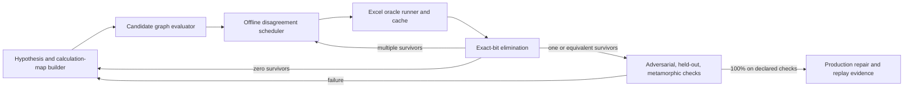

# Question for GPT-6 Pro: symbolic search for Excel's exact numerical programs

You are advising a clean-room project (DNA Calc) that re-implements Excel's worksheet functions so
that every result is bit-for-bit identical to Excel's, including where Excel is numerically
imprecise. Everything you need is below; the appendices are the project's own documents.

## The problem

For each function where we still differ (PMT, GAMMA, GAMMA.DIST, BINOM.DIST mass, POISSON.DIST
mass, NORM.S.DIST, ERF/ERFC families, BESSEL*, inverse distributions and others), we want to find
the program Excel actually runs: domain guards and branches, the expression tree and operation
association, the precision model of every operation (Excel's legacy kernels run on x87 with 64-bit
significands, and the observable result depends on where 80-bit intermediates are stored to
double), exact constants and how they are loaded, iteration seeds/steps/stopping rules, and
special-value handling. We assume Excel's code is straightforward human-written code (C, perhaps
some assembly), adapted from published methods (Cody, Cephes, A&S, Numerical Recipes-era
algorithms, TOMS, NSWC), not machine-generated.

Constraints: strictly clean-room. Allowed: public mathematics and published algorithms, permissive
public code as candidate families, and black-box observations of Excel through its public
interfaces (we can request fresh readings of any inputs on Windows Excel; a reading round is cheap,
a few hundred inputs per round). Forbidden: disassembly, decompilation or any inspection of Excel's
binaries; Microsoft source; Numerical Recipes, R nmath and glibc code may only inform through an
analyst's written specification (see RESEARCH_SOURCES).

Data: about 3.87 million recorded Excel answers across functions (inputs as exact binary64 bits,
outputs as exact bits), with build/platform/CPU recorded. Measured fact: on AMD, Excel's LN/EXP/COS
follow the CPU's hardware x87 result exactly, so Excel uses x87 instructions for these.

What went wrong: earlier rounds optimised toward a higher count of matching answers, which
produced fitted bounds, coefficients, cutoffs and error-based switches between candidate
implementations. Those were fix-up tables; they have just been reverted (Appendix D lists what was
kept as identified program elements and what was reverted; the pass rate over recorded answers fell
from 93.3% to 83.4%). The owner's position: measuring match ratio and using it as an optimisation
signal fails in nearly all interesting cases; we need symbolic search over candidate program trees,
and possibly, as cutting-edge work, symbolic machine learning over those trees.

## What we ask

1. **Search design.** How should the space of candidate programs be represented and enumerated
   (grammar of expression DAGs, association, precision/store annotations per node, constant
   representations, branch structures, iteration schemes) so that it stays tractable? How to
   bound and order it so the plausible human-written programs are tried first?
2. **Exact elimination.** How to use recorded answers as hard constraints rather than scores:
   per-witness exact rounding intervals, interval/affine arithmetic over candidate families,
   SMT or bit-precise reasoning where useful, "first-kill" elimination, certificates that a target
   is unreachable by a whole family, and how to localise which sub-expression a failing witness
   implicates. What is the strongest practical method for x87-with-stores semantics?
3. **Choosing witnesses.** Active learning: given several surviving programs, how to choose the
   cheapest fresh Excel inputs that split them (distinguishing inputs), and how to avoid
   overfitting to the recorded sample. How many readings per round, and how to design the questions.
4. **Structure discovery from data.** What signatures in the error structure (ULP error patterns
   along input lattices, branch-point detection, catastrophic-cancellation fingerprints, store-point
   fingerprints, exponent-lattice reachability) best reveal branch points, intermediate precision
   and the algorithm family, before any search?
5. **Symbolic learning.** Is program synthesis / symbolic regression / e-graph (equality saturation)
   based search a sensible next step for this, and how would you set it up so that it returns
   exact programs rather than approximations? Name concrete techniques and tools (and their
   licences) that fit a Rust code base.
6. **Critique the plan** in Appendix A (our first proposed search: PMT's finite discount combine,
   39,366 bounded programs) and the methodology in Appendix C. What is missing, what is wrong, what
   would you do in the first three four-hour rounds on one Linux machine (AMD EPYC, many cores)?
7. **Organisation.** Where should candidate programs, precision models and witnesses live relative
   to the product library (we keep research out of the product; a function enters the product only
   with its identified program and witnesses)? What should a per-function status record contain?

Be concrete and technical. Where you are unsure, say so and propose the experiment that would
settle it.

---

# Appendix A: SYMBOLIC_SEARCH.md (current plan)

# Search for Excel's calculation programs

Owner direction, 2026-10-31; dc-j9k and dc-ymjf.4. This is a plan, not a search result.
The target is Excel's program: its operations, constants, branches and stores.
A better match count does not identify it. No fitted coefficients, residual cutoffs,
answer tables or switches chosen by disagreement belong in the implementation.
Published methods remain generic fallbacks until Excel's actual program is identified.

## Inputs and execution on this machine

- dna-firehorse: Linux x86_64, AMD family 23/model 1 under KVM, 16 logical CPUs,
  62 GiB RAM. Hardware x87 and the existing `soft-x87` backend are available.
  Excel/COM is on the Windows machine; this host can replay recorded answers.
- Freeze DnaCalc revision, source diff, CPU, compiler, numeric mode and evidence revision.
  Reuse `cargo xtask witness judge --bank full --trace <outside-repo>/application.jsonl`.
  `OxFunc-Evidence` at `0df452ec` supplies the bank; preserve input bits, omissions,
  argument types, selected result element, expected outcome, source and environment.
- Extend xtask's existing witness loader and calc-verdict encodings, rather than building
  another importer or oracle. Never ingest predictions or synthetic values as Excel answers.
  Retain disagreements by environment; missing, refused and unread rows remain failures.
- Candidate programs are research data interpreted outside the application path. A retained
  program must ultimately replace the existing calc-func kernel and run through `invoke`.

## Representation and elimination

Use a typed DAG: argument, published constant, arithmetic, elementary-function call,
explicit store, predicate, branch, fold and, later, recurrence/solver nodes.
Each arithmetic node specifies strict binary64 or an x87 precision/control word;
extended values remain extended until an explicit binary64 store or final publication.
Distinguish sharing an intermediate from recomputing it, and FMA from separate operations.
Constants carry their published source and loading rule: binary64 bits, extended ROM,
or an explicitly specified derivation. Do not optimize their bits against answer counts.
Branches require a mathematical/domain condition or independently distinguished exact
transition; a convenient boundary between regions where two approximations win is insufficient.

Enumerate a bounded grammar by size, association, instruction and store placement.
Do not apply real-number rewrites as floating-point identities: they generate alternatives.
Hash serialized programs, but check equality before deduplication. Prediction-vector equality
on a finite discovery set permits shared evaluation, not a claim of global equivalence.
For continuous nodes retain the full extended value and its precision/provenance tag.
Reject a candidate on its first exact-bit, kind, error, sign-of-zero or shape contradiction.
Persist the program, first killing witness and both outcomes; never rescue it by error size.
Zero survivors means the grammar or a frozen substrate is wrong: report the missing axis.
Multiple survivors call for inputs where their predictions differ, with exact controls and
adjacent-value probes around independently suspected branches. Freeze questions/predictions
before answers, then use the existing `witness read --inputs` route on Windows and cache them.
Hold discovery, fresh validation and previously assumed substrate controls separately.
Existing round-3/4 validation groups have been inspected and are not fresh validation.

## OxFunc material to adapt

Read-only source: [OxFunc 05196c39](https://github.com/DnaCalc/OxFunc/tree/05196c394f5400eb329c79b01b4a8d2bac7c228b).
The method is in `docs/SMART_SEARCH_AND_ACTIVE_LEARNING_LOOP.md`; the constraints are in
`docs/function-lane/W109_WALL_CLUES_LEDGER.md`. Read only permitted sources under
`RESEARCH_SOURCES.md`; no `smart-fuzzer/work` third-party source is needed.
Under `smart-fuzzer/tools/calc_graph_racer/` the reusable pieces are:

| Existing piece | Adaptation |
|---|---|
| `src/dsl.rs` | Serialized DAG, exact constants, control words, stores, predicates, folds, hashes. |
| `src/enumerate.rs` | Ordered association trees, store masks (16-node cap), model assignments (100k cap). |
| `src/eval.rs` | Binary64/Ext80 value flow and lazy branches; bind to DnaCalc's current Fpu interface. |
| `src/scheduler.rs`, `src/main.rs` | `race`, `distinguish`, `eliminate`, survivor files and first-kill records. |
| `src/bin/optree_foundation.rs`, `optree_search.rs` | Size-indexed value-vector banks and root interval joins for PMT's expm1 block. |
| `score_pmt_em_invert.rs` | PMT decomposition plumbing; use rounding preimages instead of a rounded inverse. |

The wall ledger records conflicting/stale hypotheses as well as useful constraints;
its percentage leaders and fitted coefficient proposals are not identified programs.
Do not port `score.rs`'s match/ULP ranking as a selection rule. `eliminate` currently skips
unparseable expectations: replace that with explicit unsupported/failed accounting.
Its witness schema lacks general typed outcomes, environment identity and selected elements.
`eval.rs` depends on OxFunc's `research-x87` API; adapt to current cleared DnaCalc operations,
never copy the old numeric substrate. Some transcendental nodes publish binary64 regardless
of the store flag, so continuous-entry variants need explicit semantics and parity tests.
The op-tree tool's approximate join windows and two-tree coverage mining are not proofs;
replace windows with exact rational rounding intervals, including ties and open endpoints.
Missing: a DnaCalc research interface for private Fpu operations, a bounded/checkpointed
enumeration command within xtask, canonical typed outcome adapters and reusable exact interval
joins. No SMT solver, global expression-tree enumerator or loop VM is installed by this plan.

## First four-hour round: PMT's final combine

Scope: the finite discount arm, excluding zero rates, nonfinite exponentials and exact
opposing balances. Freeze the current log1p/expm1 outputs as leaves; do not refit them.
The earlier certificate found 734 targets unreachable by any binary64 quotient followed by
the existing stored-PC64 product among 250,730 discount rows; a 54-bit quotient was sufficient
for those gaps, which does not identify Excel's precision. Include these witnesses first.
This round therefore admits a resident PC64 quotient through the final product, rather than
repeating searches that force every quotient to binary64. Keep growth-arm controls separate.

1. Minutes 0–60: adapt the minimal arithmetic DAG/evaluator and witness inputs; prove strict,
   stored-PC64 and continuous-PC64 semantics against the current native/software operations.
2. Minutes 60–105: build two numerator trees, `PV+FV*(1+em)` and `(PV+FV)+FV*em`, with
   `tf=1+r*type`; three combines, `((N/em)/tf)*r`, `(N*r)/(em*tf)` and `(N/tf)*(r/em)`.
   Eight arithmetic sites with three models each give at most `2*3*3^8 = 39,366` programs.
   Constants are exactly 0/1; there are no learned thresholds or coefficients.
3. Minutes 105–180: stream exact elimination on 32 discriminating discovery rows, then all
   recorded scoped rows. Use at most eight workers and 4 GiB total, with checkpointed IDs.
   Deduplicate verified identical vectors; record resource truncation as incomplete coverage.
4. Minutes 180–240: replay survivors with the software backend and all recorded PMT controls;
   export at most 64 diverse disagreement questions for Windows if several remain. If none
   remain, retain their first kills and investigate the frozen expm1/numerator scope next round.

Deliver the grammar hash, coverage, survivor/kill records, exact interval certificates and
unanswered questions on the bead. Even a surviving graph remains a scoped hypothesis until
independent probes distinguish it. No search, port of the racer, or Excel run starts here.

# Appendix B: RESEARCH_SOURCES.md (source tiers)

# Sources for algorithm research and function implementation

What an agent may read, use or port when working out how Excel computes a function, and how
facts from restricted sources may reach an implementation. It applies to calc-func work, the
smart-fuzzer and every research work unit (dc-ymjf.4). Copyright protects how code is written
(text, structure, comments); it does not protect algorithms, mathematical facts, published
coefficient tables or what Excel observably does.

## Source tiers

| Tier | Sources | Use |
|---|---|---|
| 1. Free to read | Abramowitz & Stegun (US government work), DLMF, Hart et al. *Computer Approximations*, Cody's and other published papers, Intel SDM and IEEE 754, textbooks' mathematics, Excel's own outputs (captures, witness banks, COM probes) | Anyone, including clean-room implementers. Cite the source. |
| 2. Permissive code | Boost.Math (BSL-1.0), fdlibm / FreeBSD msun / openlibm, Arm optimized-routines (MIT), AMD libm and AOCL-LibM (MIT), CORE-MATH, SciPy cdflib (public domain), SLATEC and Fullerton's FNLIB (US government, public domain), Cody's SPECFUN (netlib) | Read, and port with the notice its licence asks for; add the ledger entry (`migration/licence-ledger.json`) and the notice (`deploy/notices`). Search SLATEC and SPECFUN first: they are public-domain code from the same literature Excel's 1990s functions plausibly drew on. |
| 3. Facts only | Numerical Recipes, R nmath, glibc libm, ACM TOMS code other than what calc-func already keeps | Never copied, ported or kept in our repositories. Only an analyst (below) reads them, and only facts leave. |
| 4. Not used | Microsoft's NT/CRT source (leaked), disassembly or decompilation of Excel or Microsoft runtime DLLs | Nobody reads or uses them. Calling a DLL and measuring its outputs is black-box measurement and is fine. |

The ACM TOMS 654/708 (incomplete gamma and beta) and AS 241 code already in calc-func stays, with
its source comment, and may be changed like our own.

## Two roles for tier 3

1. **Analyst** (may read tier 3): writes a specification of facts, with no code in it: the method
   family and its published origin (for example "A&S 9.4.1-9.4.6 polynomials; Miller's backward
   recurrence above order 2"), thresholds and constants as numbers, and hypotheses to test
   against Excel. Every claim names a tier-1 or tier-2 source or an Excel measurement. No
   variable names, control structure, comments or text from the restricted source.
2. **Check**: someone other than the analyst reads the specification for anything that reads like
   code and strikes it.
3. **Implementer** (never reads tier 3, nor the code being replaced or its history): works from
   the specification, tiers 1 and 2, and Excel's answers.

An agent takes one role per work unit. A unit's file names the role and the banned paths.

## Guiding the smart-fuzzer

- Seed candidate searches from tiers 1 and 2: method families, published coefficient sets (A&S,
  Hart, Cody, Boost, SLATEC), parameter grids; rank candidates by their fit to the witness banks.
- Learn the rest from Excel as a black box: where the error pattern changes (branch points),
  constants by lattice search, tie mining and double-rounding probes for the precision of
  intermediates (as "The Last Bit" did for EXP and LN).
- Every result carries a provenance line: the sources read (by tier), the model and the machine.
  A candidate without it does not land.

# Appendix C: SMART_SEARCH_AND_ACTIVE_LEARNING_LOOP.md (methodology from the predecessor project)

# Excel Discrepancy Smart Search And Active-Learning Loop

Status: `active_methodology`

Last updated: `2026-08-09`

Purpose: define the durable clean-room method for identifying the exact
calculation graph behind an Excel-observable result and converting that
identification into a bit-exact OxFunc repair with replayable evidence.

This document consolidates the discrepancy-reconciliation strategy, the W108
floating-point research, the W109 calculation-graph campaign, and the lessons
from successful and failed promotion attempts. It is a methodology document,
not a current discrepancy list. Current rows and their maturity remain in
[OXFUNC_EXCEL_DISCREPANCY_CATALOG.md](OXFUNC_EXCEL_DISCREPANCY_CATALOG.md).

## 1. Objective

For each discrepancy, identify the smallest plausible program that predicts
Excel's observable result over the declared version profile. "Program" means
more than a mathematical formula. It includes:

1. domain guards, coercions, branches, and special cases;
2. the algebraic expression tree and operation association;
3. the precision and instruction model used by each operation;
4. the locations where extended intermediates are stored and rounded;
5. exact constants and how they are loaded or derived;
6. accumulation direction and publication boundaries;
7. iterative method, seed, step, stopping rule, and published iterate;
8. error, type, sign-of-zero, overflow, underflow, and subnormal behavior.

The target is Excel's published behavior, not the mathematically nearest or
most accurate result. An analytically superior result that differs from Excel
is still an OxFunc discrepancy.

## 2. Governing Constraints

The work is strictly clean-room. Allowed inputs are public specifications,
published research, public implementations used as candidate families, and
reproducible black-box observations through Excel's public interfaces.
Disassembly, decompilation, binary inspection, dumping, or other inspection of
Excel or Microsoft-shipped binary internals is prohibited. When a search
reaches a wall, the next move is a better behavioral probe or a wider public
candidate family, never binary archaeology.

Every result is profile-scoped along both required version axes:

1. Excel application version, build, channel, architecture, and CPU-relevant
   execution profile;
2. workbook Compatibility Version.

Locale, date system, and host context are recorded whenever they can affect the
surface. A model identified on one profile is a strong hypothesis for another
profile, not evidence for it.

## 3. Reframe: Discrepancies Are Model-Identification Problems

The productive question is not "how can OxFunc become more accurate?" It is:

> Which calculation graph, executed under which historical floating-point
> model, produces exactly these Excel bits?

This reframing matters because a small result difference can come from very
different causes:

- a different algebraic identity;
- the same identity with a different association tree;
- one binary64 store barrier in a legacy x87 path;
- an x87 ROM constant instead of a binary64 source constant;
- forward rather than reverse accumulation;
- a branch threshold one representable value away;
- a solver returning an intermediate iterate rather than the nearest root;
- a dedicated legacy kernel rather than composition of worksheet-visible
  functions.

ULP distance helps describe a symptom. It does not identify a mechanism.

## 4. The Four-Part Search System



### 4.1 Excel oracle runner

The oracle runner evaluates typed inputs in live Excel, captures the typed
outcome, and records exact result bits. It must:

1. place every numeric input through `Range.Value2` and reference that cell
   from the formula;
2. preserve exact input bits in the case record;
3. capture numeric bits, worksheet error, value kind, shape, and sign of zero;
4. record Excel build, architecture, Compatibility Version, locale/profile,
   and the runner version;
5. batch calls to amortize workbook and recalculation overhead;
6. distinguish a function result from a harness, bind, or host failure.

Formula decimal literals are not a valid exact-input transport. Excel may
parse a long decimal to a neighboring binary64 value, creating a false
discrepancy. The binding rule and witness are in
[`smart-fuzzer/planning/EXCEL_RUNNER_PLUMBING_NOTE.md`](../smart-fuzzer/planning/EXCEL_RUNNER_PLUMBING_NOTE.md).

### 4.2 Persistent oracle cache

An Excel observation is expensive and must be reusable. Cache keys include at
least:

- function and surface identity;
- exact scalar and array argument bits, types, omissions, and ordering;
- result element when an array result is observed cell by cell;
- build/profile and CPU-relevant axis;
- Compatibility Version and other material context.

The current implementation is
[`smart-fuzzer/tools/OracleCache.psm1`](../smart-fuzzer/tools/OracleCache.psm1),
with build-sharded JSONL data. A cache hit prevents needless Excel work, but a
fresh live sign-off is still required before retiring a discrepancy.

Excel may be queried as much as the investigation needs. Information-guided
selection is an iteration-speed strategy, not an artificial evidence limit:
local candidates can be evaluated millions of times per live batch, and large
Excel batteries remain appropriate for validation, boundary mapping, and
sign-off.

### 4.3 Candidate calculation-graph evaluator

Candidates are data, not one-off source edits. The W109 DSL under
[`smart-fuzzer/tools/calc_graph_racer/`](../smart-fuzzer/tools/calc_graph_racer/)
supports expression graphs with per-node execution models. The conceptual
vocabulary should include:

- strict IEEE binary64 operations;
- x87 extended temporaries under explicit precision-control settings;
- explicit binary64 store barriers and double-rounding publication;
- raw historical instruction candidates where clean-room probes justify them;
- exact-bit binary64 constants and x87 ROM constants;
- branches and exact threshold constants;
- sum, product, and fold order;
- per-step-stored legacy accumulation;
- reusable identified substrates such as Excel's `POWER`, `EXP`, `LN`, and
  trig graphs;
- iterative nodes or a solver VM for recurrence and root-finding schedules.

Useful notation in evidence documents:

- `RN53(x)`: round a real or extended value to binary64;
- `RN64(x)`: round to the x87 64-bit-significand extended model;
- `DR(x) = RN53(RN64(x))`: legacy double-rounded store publication;
- `bits(x)`: the exact IEEE-754 binary64 bit pattern;
- `nextUp(x)` / `nextDown(x)`: adjacent representable values.

### 4.4 Experiment scheduler

The scheduler evaluates all surviving candidates cheaply over a large local
probe pool. It ranks probes by how strongly candidates disagree, then asks
Excel only the highest-information questions. The current W109 scheduler uses
the number of distinct predicted bit patterns; stronger schedulers may use:

1. expected entropy of the candidate partition;
2. worst-case survivor count;
3. balanced split quality;
4. novelty of branch, exponent, cancellation, or type bucket;
5. evaluation cost and risk of an unobservable/harness-invalid result;
6. coverage of model axes not previously separated;
7. cross-row leverage when a shared substrate is being identified.

## 5. The Calculation Map

Before searching a row, write a compact calculation map. It prevents blind
parameter sweeps and makes missing axes visible. At minimum it records:

| Field | Question |
|---|---|
| Surface | Which functions, aliases, branches, and result elements share the discrepancy? |
| Current graph | What exact graph does OxFunc execute today? |
| Structural hypotheses | Which identities, decompositions, recurrences, or public algorithm families are plausible? |
| Numeric model | Strict binary64, x87 continuous, stored x87, mixed model, or other published-era documented API behavior? |
| Constants | Binary64 bits, decimal conversion, reciprocal form, ROM constant, fitted table entry, or derived value? |
| Stores | Which intermediate assignments may publish to binary64? |
| Branches | What thresholds or predicates could divide the input domain? |
| Accumulation | Direction, grouping, compensation, and per-step storage? |
| Solver | Forward kernel, coordinate system, seed, perturbation, update, tolerance, cap, and publication rule? |
| Discriminators | Which constructed probes separate these hypotheses? |
| Evidence split | Which cases are discovery, adversarial, held-out, metamorphic, and live sign-off? |

The campaign seed map is
[`docs/function-lane/DISCREPANCY_CALCULATION_MAP.csv`](function-lane/DISCREPANCY_CALCULATION_MAP.csv).
It is a hypothesis surface, not an implementation or parity claim.

## 6. Search Dimensions, In Increasing Cost

Search should be layered. Do not begin by fitting thousands of coefficients if
a two-operation association change explains the bits.

### 6.1 Surface and structure

First determine guards, special cases, result kind, and broad identity:

- direct formula versus transformed formula;
- recurrence versus closed form;
- dedicated kernel versus composition through another substrate;
- symmetry and complement routing;
- integer-exponent or half-exponent dispatch;
- array traversal and result publication shape.

### 6.2 Association and reuse

Enumerate expression trees over the same operands. Also distinguish recomputing
an expression from storing and reusing it. TBILLYIELD was resolved by an
association difference, while YIELDMAT required identifying both grouping and
reuse of an intermediate.

### 6.3 Precision and store placement

For every meaningful node or block, consider:

- strict binary64;
- extended continuous evaluation;
- extended evaluation followed by a binary64 store;
- per-operation or per-loop-step store;
- mixed execution where a transcendental is extended but surrounding
  arithmetic is strict;
- precision-control choices when a public historical model supports them.

Store masks grow exponentially. Search them blockwise first, use beam search or
branch-and-bound, and only exhaust individual-node masks after constructed
probes have localized the sensitive block.

### 6.4 Instruction and constant choice

Candidates may differ in:

- `log`, `log1p`, `exp`, `expm1`, `pow`, or direct x87 instruction chains;
- `sqrt` dispatch versus `exp(y*ln(x))`;
- `FPREM` versus `FPREM1` reduction;
- table constants, exact bit constants, reciprocals, and x87 ROM constants;
- multiply-by-reciprocal versus divide;
- fused versus unfused or historical compiler-style sequences, where the
  platform model makes those candidates plausible.

Use public implementations as candidate generators, never as authority for
Excel. A public algorithm that matches many rows is still only a hypothesis
until independent Excel probes identify it.

### 6.5 Branch thresholds

Once different models win in different regions, search for a piecewise graph.
Use powers of two, adjacent binary64 values, and binary search to locate the
switch. Then probe both sides with inputs designed to make candidate bodies
diverge. A threshold is not identified merely because a fitted piecewise model
scores well; its predicate and exact constant need direct evidence.

### 6.6 Iteration and publication schedules

For iterative functions, the schedule is part of the function. Search:

- coordinate system and residual definition;
- seed and secondary seed;
- Newton, finite-difference Newton, secant, bisection, or hybrid update;
- perturbation direction and magnitude;
- derivative evaluation and store staging;
- residual versus step stopping predicate;
- strict versus non-strict comparison;
- iteration cap;
- last, stepped, previous, endpoint, midpoint, or best-residual publication.

## 7. Probe Design: Constructed Inputs Discover

Random inputs are useful for validation and coverage. Constructed inputs are
usually much better for identification.

### 7.1 Exact-arithmetic controls

Choose powers of two, small integers, exact ratios, exact roots, and cases where
most operations are exact in binary. This removes irrelevant rounding sites
and leaves one candidate operation observable.

### 7.2 Adjacent-value ladders

Probe `x`, `nextUp(x)`, and `nextDown(x)`, then wider ULP ladders. These expose
branch boundaries, rounding thresholds, solver basins, and discontinuities in
published iterates.

### 7.3 Double-rounding windows

Search cheaply offline for inputs where strict binary64 and an extended-then-
stored candidate differ. Ask Excel only those inputs. These windows were
decisive in the W109 NPER and XNPV searches.

### 7.4 Metamorphic transforms

Apply transformations that preserve the mathematical result but change an
implementation-sensitive path:

- reverse or permute input rows;
- scale all cash flows or observations;
- translate regression coordinates;
- split one term into two same-date or equal-value terms;
- add trailing zeros;
- exchange complementary probabilities;
- use sign symmetry, reciprocal identities, or aliases;
- reorder a matrix or apply exactly reversible row/column scaling.

If Excel's bits change, the transform identifies order, staging, or branch
dependence. If they do not, it eliminates entire candidate families.

### 7.5 Identity decomposition and intermediate isolation

Evaluate worksheet-visible pieces in separate cells and compare both:

1. the direct function;
2. a worksheet identity composed from published intermediates;
3. local candidates with intermediates continuous;
4. local candidates with those intermediates explicitly stored.

Agreement with the worksheet decomposition can identify a reused substrate, as
with XNPV and `POWER`. Disagreement is equally valuable: GROWTH showed that it
does not simply compose worksheet regression and `EXP` in the obvious way.

### 7.6 Implied intermediate and constant recovery

Choose inputs that allow an unknown factor or intermediate to be back-solved
from Excel's final bits. Repeating the recovery at several exact powers of two
can separate a stored binary64 constant from a direction-specific reciprocal or
extended constant. This is especially useful for unit conversions and simple
financial formulas.

### 7.7 Cancellation amplifiers

Construct cases where large terms nearly cancel. Tiny differences in operation
order or store placement then become large differences in the residual or
published root. Use these only after the broad graph is known; otherwise many
wrong models can appear to fit by accidental compensation.

### 7.8 Branch and domain probes

Probe zero, signed zero, subnormals, exact threshold values, adjacent values,
infinities only where the host accepts them, and both sides of every documented
or suspected domain guard. Capture error codes and value kinds, not only
numeric outputs.

## 8. Corpus Partitioning

Never search and sign off on the same undifferentiated corpus.

1. **Seed/reconnaissance set**: known discrepancies and compact controls.
2. **Discovery set**: may guide model choice, fitting, store-mask selection,
   and threshold search.
3. **Adversarial set**: generated specifically at double-rounding windows,
   branch edges, cancellation regions, and model disagreement points.
4. **Held-out set**: generated independently and never inspected during model
   selection. It detects compensation and overfitting.
5. **Metamorphic set**: paired or grouped cases whose mathematical relation is
   known and whose bit behavior diagnoses the implementation path.
6. **Doubt set**: periodically re-tests facts treated as settled, especially
   cache plumbing, shared substrates, and previously identified staging.
7. **Error/guard set**: non-numeric lanes and exact boundary behavior.
8. **Live sign-off set**: a fresh Excel sweep immediately before catalog
   retirement, including prior witnesses and independent coverage.

If a candidate family was tuned after observing the held-out set, that set is
no longer held out. Generate a fresh one.

## 9. The Active-Learning Loop

### 9.1 Step 1: triage and minimize

Confirm the mismatch through exact-input plumbing. Classify structural versus
numeric drift, minimize the witness without destroying the mismatch, and add
stable cases to the discrepancy evidence.

### 9.2 Step 2: build the hypothesis space

Write the current OxFunc graph and enumerate plausible alternatives by layers.
Reuse already identified substrates before inventing new primitives. Assign a
stable id and graph hash to each candidate so negative results remain durable.

### 9.3 Step 3: take free eliminations

Race every candidate against all cached witnesses and decomposition probes.
Remove exact-bit failures immediately. Structural mismatches outrank numeric
scores: a candidate returning the wrong kind or error is not "close."

### 9.4 Step 4: generate a large local probe pool

Generate thousands or millions of valid inputs locally. Bias the pool toward:

- candidate disagreement;
- exact controls and double-rounding windows;
- branch and exponent buckets;
- cancellation and conditioning buckets;
- metamorphic companions;
- underrepresented semantic or type lanes.

No Excel calls are required in this step.

### 9.5 Step 5: select the next Excel batch

Partition candidates by their predicted result for each probe. Rank probes by
information value and choose a diverse batch rather than many near-duplicates.
Include a few controls and doubt probes to detect runner or model regressions.

### 9.6 Step 6: query Excel once and cache

Evaluate the selected batch through typed cell references, persist exact
answers and profile metadata, and make the batch replayable. Do not manually
copy decimal display values into evidence.

### 9.7 Step 7: eliminate and diagnose

Kill every candidate that misses any answered case. Record its hash, the first
killing witness, expected bits, actual bits, and the model description in the
append-only elimination evidence and the ruled-out ledger.

- **Many survivors**: generate a pool focused on where those survivors differ.
- **Equivalent survivors**: try to find any input in the valid domain where
  they differ. If none exists because the axis is observationally irrelevant,
  record the equivalence and choose the simplest representative.
- **Zero survivors**: do not select the least-wrong model. The space is missing
  an axis. Inspect the first-kill patterns, extend structure/precision/branch/
  constant/schedule vocabulary, and replay all cached answers offline.

### 9.8 Step 8: validate without adapting

Freeze the candidate. Run adversarial, held-out, metamorphic, error/guard, and
wide random sweeps. A failure returns the row to hypothesis construction. Do
not patch isolated failures with unexplained ULP nudges.

### 9.9 Step 9: promote and sign off

Implement the identified graph in the shared substrate or function kernel,
add compact in-crate regression pins, replay the full corpus, perform a fresh
live Excel sign-off, update the calculation map and ruled-out ledger, and only
then remove the row from the live discrepancy catalog under the repository's
OPERATIONS closure rules.

The loop in pseudocode:

```text
survivors = generate_candidates(calculation_map)
answers   = cached_seed_and_recon_answers()

repeat:
    survivors = exact_bit_eliminate(survivors, answers)

    if survivors is empty:
        missing_axis = diagnose_first_kill_patterns(answers)
        survivors = extend_candidate_space(missing_axis)
        continue

    if survivors has one member or one proven-equivalent class:
        freeze_model(survivors)
        if independent_gates_are_all_exact(survivors):
            promote_with_replay_evidence(survivors)
            break
        survivors = extend_from_gate_failure(survivors)
        continue

    pool  = generate_constructed_probe_pool(survivors)
    batch = select_high_information_diverse_probes(pool, survivors)
    fresh = query_excel_through_value2_and_cache(batch)
    answers += fresh
```

## 10. Candidate Scoring

Use exact elimination whenever possible. For diagnostics and ranking, score
lexicographically:

1. fewest structural mismatches;
2. most exact-bit matches;
3. lowest maximum ULP distance;
4. lowest total or distributional residual, used only as a diagnostic;
5. lowest graph complexity;
6. stability across independent corpus partitions.

Average ULP must not be the primary objective. A model can achieve a better
average by compensating for two wrong operations, while the correct structural
model has a recognizable one-sided residual from one remaining primitive.

For fitted kernels, examine the residual as data:

- sign pattern by interval;
- exponent- or mantissa-correlated bands;
- discontinuities at suspected branch points;
- response to exact-zero anchors;
- scaling of error near roots or poles;
- whether one operation-tree change removes a deterministic residual pattern.

## 11. Fast Search Techniques

### 11.1 Enumerative graph search

Enumerate small expression trees, association variants, store masks, constant
choices, and known substrate nodes. Canonicalize commutative expressions and
deduplicate candidates by graph hash and observed prediction vector.

### 11.2 Beam search

For a large store-placement or operation-tree space, retain a diverse beam
based on exact count, worst miss, residual signature, and structural novelty.
Validate beam winners on a separate discovery subset before narrowing again.

### 11.3 Equality saturation or e-graph generation

Use algebraic rewrite rules to generate equivalent mathematical forms, then
attach execution models and store boundaries. This is a systematic way to
search reassociation without hand-writing every formula.

### 11.4 Constraint-guided constant recovery

Each Excel output constrains an unknown constant or coefficient to an interval
that rounds to the observed binary64 result. Intersect constraints from many
exact-control probes before nonlinear fitting. Search exact bit patterns or
small neighborhoods only after the feasible interval is narrow.

### 11.5 Residual-driven structural recovery

When a public algorithm family is close but not exact, avoid immediately
re-fitting coefficients. First test operation tree, centering, argument
reduction, precision, and publication. Coefficient fitting before the graph is
identified often absorbs the wrong operation staging and fails held-out.

### 11.6 Cross-row substrate search

Prefer probes that identify a primitive used by several rows: `EXP`, `LN`,
`POWER`, trig reduction, `GAMMALN`, incomplete gamma/beta, regression sums,
matrix elimination, day-count schedules, or a solver VM. A shared-substrate
repair has much higher leverage than a surface-specific patch.

### 11.7 Tooling palette

Use the tool that makes each layer fastest while keeping evidence reproducible:

- Rust or C for exact bit control, instruction microprobes, fast candidate
  evaluation, and production-shaped experiments;
- arbitrary-precision libraries for correctly rounded controls and for finding
  narrow rounding or cancellation windows;
- exact rationals and symbolic algebra for identity generation, simplification,
  exact-zero anchors, and back-solving intermediates;
- interval arithmetic or SMT/constraint tools for narrowing constants,
  thresholds, and coefficient bit ranges;
- numerical optimization for proposing coefficient families, followed by
  exact-bit and fresh-held-out rejection rather than fit-score acceptance;
- Python, R, or notebooks for residual plots, clustering, corpus analysis, and
  generating probe pools;
- batched Excel automation for oracle acquisition;
- documented public C APIs of published-era runtimes as candidate or control
  observations where provenance is clean and the API is public.

Tool agreement is not Excel evidence. Every winning implementation remains a
candidate until live Excel behavior identifies it, and no tool may be used to
inspect proprietary binary internals.

## 12. Family-Specific Playbooks

### 12.1 Closed-form and conversion functions

Start with all association trees, multiply-versus-divide choices, reciprocal
constants, and store points. Use exact powers of two to recover implied factors.
These are the best candidates for quick, decisive calculation-graph searches.

### 12.2 Transcendentals and trig

Search instruction family, argument reduction, ROM constants, quadrant/parity
dispatch, reciprocal staging, tiny-input branches, and final store. Large
arguments amplify reduction differences; tiny arguments expose special cases.
The W108/W109 x87 results are reusable substrates, not a license to assume all
functions use one global x87 graph.

### 12.3 Piecewise elementary functions

Map the domain densely enough to identify regions where candidate rankings
change. Bisect boundaries at the binary64 level. Search each body independently,
then test symmetry, sign, and boundary publication. The failed single-graph
ATANH attempt is the canonical warning: a candidate that matched 297/368 cases
still regressed 71 and was correctly rejected.

### 12.4 Special functions and distributions

Separate wrapper staging from the core approximation:

1. identify complement, symmetry, and scaling rules;
2. isolate exact parameter slices such as integers and half-integers;
3. identify branch families and thresholds;
4. race public algorithms under several operation models;
5. use direct CDF probes before reconstructing an inverse solver;
6. reconstruct inverse iteration only after the forward kernel is stable.

### 12.5 Regression and matrix functions

Use row reversal, translation, scaling, exact-linear data, pivot-forcing
matrices, and ill-conditioned cases. Separate the statistic or factorization
from the downstream distribution/publication function. For matrices, compare
entire result arrays and retain element coordinates in the cache key.

### 12.6 Financial schedules and recurrences

Separate date schedule/day count, discount-power substrate, cash-flow formula,
recurrence order, and accumulation/publication. Compare direct aggregate
functions with sums of individually published schedule rows. Probe type 0/1,
coupon boundaries, month ends, leap days, and exact par cases.

### 12.7 Root solvers

Identify the forward pricing, balance, or NPV kernel first. Then reconstruct
the solver as a trace-producing state machine. For each iteration record:

- current coordinate and published binary64 bits;
- function and derivative/finite-difference evaluations;
- step size and direction;
- proposed next point;
- bracket or endpoint state;
- stop predicate values;
- which iterate would be returned.

Use guess sweeps, one-step ladders around a known root, exact-root problems,
cash-flow scaling, adjacent target prices, and deliberately difficult basins.
Jointly score related functions when they plausibly share a solver family, but
allow their coordinates or publication rules to differ. Large ULP root errors
often reflect a different iteration path rather than a low-quality forward
kernel.

## 13. What The Existing Campaign Has Demonstrated

These examples justify the method and define reusable lessons:

- **TBILLYIELD**: exhaustive association search identified
  `((100-price)/price)*(360/days)`; the repair passed 2,156/2,156 live cases.
- **XNPV**: a 480-candidate search reached zero survivors, revealing missing
  integer-`POWER` dispatch and per-step-stored x87 accumulation axes. After
  extending the model, the identified graph passed 1,530 numeric and 175 error
  sign-off rows.
- **NPER**: high-information double-rounding-window probes separated strict
  and x87 spill-loop variants and pinned branch behavior.
- **Trig**: constructed large-argument and quadrant probes identified the
  reduction, ROM-constant, parity/quadrant, and reciprocal-publication graphs;
  all six functions passed the 5,425-case sign-off corpus.
- **ATANH**: a seemingly strong x87 half-log candidate failed the expanded
  corpus. This established the mandatory non-regression and held-out rule.
- **RATE/IRR and PMT-family work**: solver and cancellation lanes show why a
  high training score is not identification. Forward-kernel staging, solver
  schedule, and published iterate must be isolated rather than jointly fitted.

Detailed evidence remains in W109 function-lane reports and
[`docs/worksets/W109_ACTIVE_MODEL_DISCOVERY_CALC_GRAPH_SEARCH.md`](worksets/W109_ACTIVE_MODEL_DISCOVERY_CALC_GRAPH_SEARCH.md).

## 14. Failure Modes And Countermeasures

| Failure mode | Countermeasure |
|---|---|
| Decimal formula text changes the input | Use `Range.Value2`; store exact input bits. |
| A candidate wins by compensating errors | Inspect residual signatures and require fresh held-out exactness. |
| One identity is assumed globally | Search piecewise regions and exact thresholds. |
| The least-wrong candidate is selected after all candidates fail | Treat zero survivors as proof of a missing axis. |
| Random fuzzing produces many redundant Excel calls | Select offline where survivors disagree; cache every answer. |
| Store masks explode combinatorially | Localize sensitive blocks, then beam-search or exhaust only those blocks. |
| Coefficients absorb the wrong operation graph | Identify structure and staging before fitting constants. |
| Forward kernel and solver are fitted together | Pin the forward kernel independently, then trace the solver. |
| A discovery corpus is reused as validation | Maintain adversarial, held-out, metamorphic, doubt, and fresh sign-off sets. |
| A shared substrate is assumed from one surface | Re-probe through independent inheritors and decomposition identities. |
| A result is mathematically better than Excel | Match Excel and record the Excel imprecision witness. |
| Negative experiments are lost | Hash candidates and append killing witnesses to the ruled-out ledger. |
| Current status drifts from evidence | Update catalog, calculation map, bug stream, and sign-off record together. |

## 15. Per-Row Artifact Contract

Each active search should leave:

1. stable discrepancy id and minimized exact-input witnesses;
2. current calculation map;
3. candidate-space generator or persisted candidate JSON;
4. cached Excel answers with full profile metadata;
5. surviving-candidate state and append-only elimination records;
6. ruled-out ledger entries with graph hash and killing witness;
7. discovery/adversarial/held-out/metamorphic partition labels;
8. an identification report explaining the exact graph and alternatives;
9. production regression pins and a full-corpus replay verifier;
10. a fresh live sign-off record;
11. synchronized discrepancy catalog and bug-stream status.

High-volume passing cases can remain compact structured artifacts. Human prose
should focus on minimized failures, decisive discriminators, killed model
families, promotion rationale, and remaining uncertainty.

## 16. Search Prioritization

All discrepancies remain bugs, but search order should maximize expected
information and cross-row leverage. A useful priority score combines:

1. structural severity, then numeric magnitude and affected domain size;
2. probability that a bounded search can discriminate the current models;
3. number of downstream rows sharing the suspected substrate;
4. availability of exact controls and observable decompositions;
5. cost of generating and evaluating candidates;
6. risk that the lane is blocked on an unidentified primitive;
7. regression risk and difficulty of building a convincing held-out check.

In practice:

- take cheap association, constant, guard, and publication wins first;
- identify shared numeric substrates before their inheritors;
- pin forward kernels before inverse solvers;
- use solver and custom special-function walls when the machinery developed
  there will transfer across several rows;
- periodically re-sweep the catalog after a shared primitive lands.

## 17. Promotion And Closure Discipline

A promising candidate is not a repair. Promotion requires:

1. one identified graph or a documented observationally equivalent class;
2. 100% exact behavior on the declared discovery, adversarial, held-out,
   metamorphic, guard, and fresh live sign-off checks;
3. no unexplained regression in the function's broader existing corpus;
4. production implementation through the appropriate shared substrate;
5. deterministic in-crate pins and replay tooling;
6. updated evidence, ruled-out ledger, catalog, bug stream, and version scope;
7. the Pre-Closure Verification Checklist in `OPERATIONS.md` Section 12;
8. the Completion Claim Self-Audit in `OPERATIONS.md` Section 14.

If any semantic lane remains open, status stays `in_progress` and reporting
uses `scope_partial`, `target_partial`, or `partial` as appropriate. Locale and
alternate-version validation remain explicit orthogonal lanes unless included
in the declared search scope.

## 18. Operational Checklist For The Next Search Round

1. Read the current catalog row, bug stream, calculation map, and ruled-out
   candidates.
2. Confirm exact-input Excel plumbing and reproduce the canonical witnesses.
3. Minimize and classify the mismatch.
4. Draw the current OxFunc graph, including every store and helper call.
5. Enumerate the smallest plausible model axes.
6. Take free eliminations against the oracle cache.
7. Construct a large local pool rich in disagreement and edge windows.
8. Query one diverse, high-information Excel batch.
9. Append eliminations; diagnose zero-survivor events as missing axes.
10. Repeat until one model or equivalent class survives.
11. Freeze it and run fresh independent checks without adapting.
12. Promote only after exact sign-off and repository closure checks.

The central habit is simple: make every Excel question discriminate explicit
models, and make every answer permanently reduce the search space.

# Appendix D: numerical inventory after reverting fits (2026-10-31)

Owner correction inventory, 2026-10-31 (dc-j9k). Scope: b0e7b3b bulk numerical import through b952767 and the inherited round-4 working tree; incoming master through dd2d82c was checked for numerical changes (none). All 97 later non-merge source commits were screened (96 in the frozen baseline plus incoming UDF metadata); the 56 rows below split numerical program changes from semantic/metadata/test-only changes. Category a identifies a program element or a published method, not proof that an entire Excel function is identified. Category b uses sampled output agreement to choose a coefficient, cutoff or alternative body. Old restricted/deleted implementations and their code history were not read or restored. Current permitted replacements were inspected.

Count column: effects of this whole rollback on the same frozen full bank, grouped by function; overlapping historical commits are not separately additive. A retained element has zero direct rollback effect even if a shared body changes its caller. No per-commit counterfactual score was manufactured.

| Commit | Function | Kind and basis | Disposition | Count change |
|---|---|---|---|---|
| b0e7b3b | GAMMALN B2 | b: LM-refitted coefficients imported in bulk | removed; published SPECFUN P2/Q2 | GAMMALN family -132 combined with subset removal |
| b0878cc | GAMMA / GAMMALN / ERFC / inverse normal | a/b: published bodies plus seed tables, allowlists, ERFC fit and inverse-region selection | a retained; b removed | family totals below; not separable per commit |
| c82c1d0 | regression baseline | a: published normal-equations method | superseded by bf5472b | 0 direct rollback |
| 87976af | financial baseline | a: published annuity and root methods | retained except later fitted changes | 0 direct rollback |
| 34ea583 | POWER and ^ | a: integer/power-chain dispatch and stores | retained | 0 direct rollback |
| 1687491 | SKEW, Z.TEST, GEOMEAN | a: operation association; product/root method | retained; GEOMEAN superseded by 0ab2535 | 0 direct rollback |
| e0a5b8b | dates and database functions | a: calendar/day-count and arithmetic port | retained | 0 direct rollback |
| db6dbf7 | arithmetic and folds | a: PC64 arithmetic then binary64 stores | retained | 0 direct rollback |
| bf5472b | LINEST/LOGEST/TREND/GROWTH | a: centred pivoted Householder QR and publication | retained | 0 direct rollback |
| 6c614fc | AMOR*, DISC, INTRATE, RECEIVED, PRICEDISC | a: operation order and actual/actual year | retained | 0 direct rollback |
| 427e3e4 | IPMT/PPMT/YIELDDISC | a: backward annuity and grouped year ratio | retained | 0 direct rollback |
| 9557cfe | variance and standard-deviation families | b: one/two-pass switch fitted to a loose cancellation bracket at 1% | removed; original two-pass method | VAR/STDEV direct family -3729 |
| 0ab2535 | GEOMEAN | a: root in resident x87 | retained | 0 direct rollback |
| 4647ad6 | PERCENTRANK forms | a: decimal-place truncation | retained | 0 direct rollback |
| e2f6061 | TRIMMEAN | a: original input accumulation order after selection | retained | 0 direct rollback |
| 9c48f15 | MOD/MROUND/ATAN2/CEILING/FLOOR | a: remainder/multiply/order and directly measured domain predicate | retained | 0 direct rollback |
| 98046b0 | software x87 and GAMMALN stores | a: explicit precision, control word and store model | retained | 0 direct rollback |
| adf6780 | CRT pow callers | a: published Arm pow/configuration; current provenance corrected by 7ade800 | current permitted implementation retained | 0 direct rollback |
| ece3e30 | LINEST/LOGEST statistics and rank | a/b: QR-derived statistics; fitted COLLINEAR=4.5e-13 | statistics retained; fitted rank test removed; exact-zero elimination remains | 0 full-bank change; corpus counted separately |
| 0f411cb | CRT log/log10/exp callers | a: current published AMD routines and operation order | current permitted implementation retained | 0 direct rollback |
| db30f10 | CRT trig/hyperbolic/atan2/hypot callers | a: current published AMD routines and operation order | current permitted implementation retained | 0 direct rollback |
| ad7b366 | CUMIPMT/CUMPRINC | a: shared PMT/PPMT route and accumulation | retained | 0 direct rollback |
| 8703647 | arithmetic underflow and related admission | a: explicit subnormal publication and surface rules | retained | 0 direct rollback |
| cbe24a1 | RATE/YIELD/ODDFYIELD | a: Newton/bisection schedules to binary64 convergence | retained; no comparison of approximation bodies | 0 direct rollback |
| eb28d21 | RRI and error propagation | a: exact sign/domain predicates | retained | 0 direct rollback |
| 7ade800 | EXP/LN/POW substrate provenance | a: published Arm source replacement; no fitted coefficient introduced | current permitted source retained; removed source not read | 0 direct rollback |
| bf8ab31 | CRT library contracts | a: published AMD tables, FMA placements and operation order | retained; removed source not read | 0 direct rollback |
| 98daf86 | INT/decimal rounding/QUOTIENT and endpoints | a: decimal-15 reading, integer boundary and explicit operation order | retained | 0 direct rollback |
| 5540392 | Bessel J/Y and I recurrence | a/b: A&S polynomials/recurrences; Excel-fitted J/Y coefficients/phases and recurrence constants | A&S I0/I1/K0/K1 retained; fitted parts, I_LIMIT and phase cutoff removed; libm and defining I_n series | BESSELI -1030; BESSELJ -793; BESSELY absent from full bank, included in corpus |
| 141f446 | EXP/LN/LOG10/root/binomial exponent chains | a: documented x87 instruction graph | retained; removed source not read | 0 direct rollback |
| 7e7f1ac | discrete distributions | a: published Loader saddle-point and incomplete-gamma methods | retained; removed source not read | 0 direct rollback |
| 617bc56 | IRR | a: bounded ordered-float plateau exploration; 64-bit representation bound | retained | 0 direct rollback |
| 766a0df | ATANH/COMBIN/COMBINA/EXPON/GAMMA.DIST | a: measured admission, internal expm1 graph and PC64 stores | retained | 0 direct rollback |
| c411598 | ERFC/GAUSS/GAMMA.DIST/IRR/PMT/MOD/GAMMALN/rounding | a: admission/flush, shape-one log normalizer, nonzero derivative and stores | retained | 0 direct rollback |
| 4a96776 | GAMMA.DIST CDF | a: final series product stored from PC64 | retained | 0 direct rollback |
| 90b3fa3 | PMT/MOD | a: final product store; binary-power divisor dispatch of raw underflow | retained | 0 direct rollback |
| 7b79331 | lognormal aliases | a: internal CRT logarithm rather than worksheet LN | retained | 0 direct rollback; later caller changes belong to ERFC rollback |
| 6b83980 | tiny ERF and GAUSS | b: data-derived P0/Q0 and unestablished 1e-8 cutoff | removed; store constraints retained as clues | ERF.PRECISE -364549 and GAUSS -651, combined with later ERF fits |
| 6b229e4 | two-cashflow IRR | a: q-space secant/Newton method, exact two-flow condition and fixpoint | retained as scoped program hypothesis | 0 direct rollback |
| 4c44a60 | MOD | b: 2^26/2^-1026 bounds and reversed adjustment chosen from answer agreement | removed | MOD -4974 |
| c677e0b | BINOM.DIST | a: CRT logarithm in normalizer | retained | 0 direct rollback |
| 7ae9012 | small ERF | b: fitted rational coefficients and 0.01 cutoff | removed | included in combined ERF-family count above |
| 9708d03 | small ERF | a/b: stores inside the fitted rational | fitted body removed; store distinctions retained as clues | included in combined ERF-family count above |
| e908063 | binomial/negative-binomial/beta | a: PC64 product/carry, exact equality branch, published 15-digit NSWC constant | retained | 0 direct rollback |
| 4f145a3 | beta and F callers | a: exact existing-branch equality at 2 and 0.375 | retained | 0 direct rollback |
| df1215e | GAMMA | b: two fitted Lanczos coefficients | already withdrawn by 17e42ce; published coefficients remain | 0 this round; historical +2 then -2 |
| 17e42ce | ERFC and PMT | a/b: PMT quotient store; ERFC fitted residual bound 2^-48 | PMT retained; ERFC fit removed | ERFC and normal/lognormal caller totals below |
| 0f2cc3d | GAMMA/PDF and ERFC | b: 16/32-ULP body selection and fitted 2^-49 ERFC bound | removed; public-method provenance retained | GAMMA combined -1175; GAMMA.DIST combined -5596 |
| 2546388 | GAMMA reflection | a/b: reduced reflection candidate selected by disagreement bound | bound-driven dispatch removed; reduction remains a research clue | included in combined GAMMA count |
| 1e636dd | ERFC and normal tails | b: fitted 2^-50 residual bound | removed | ERFC -59; ERFC.PRECISE -100; caller totals below |
| 8db35cb | GAMMA | b: positive library disagreement bound 8 ULP | removed | included in combined GAMMA count |
| cbdbb7f | PMT, ERFC, Gamma contexts | a/b: exact opposing-balance identity; square store/context refinements inside fits | PMT retained; fitted wrappers removed | PMT 0; other effects included in family totals |
| 480481e | GAMMA.DIST CDF | b: shape-2/3 residual correction with fitted strict 2^-51 bound | removed; final PC64 product retained | included in GAMMA.DIST -5596 |
| 2335ccb | Poisson count one | a: published exponential series with analytically derived 2^-27 error bound | retained; no Excel algorithm identification claimed | 0 direct rollback; historical three gains are one semantic input |
| 71b5de2 | PMT | a: finite-overflow rearrangement under exact balance identity | retained; extra controls are mathematical, not Excel | 0 direct rollback |
| uncommitted round 4 | small GAMMA | b: published Taylor series selected by fitted 4-ULP disagreement | removed; patch and coefficients archived | included in combined GAMMA -1175; before includes its +471 |

Additional retained measurement repairs: b820677 (call/result identity, decoding and duplicate lineage) and 485c4b6 (GROWTH prediction-column layout) change the interpretation of recorded calls, not numerical kernels. Their exact metadata conditions are category a; rollback count change 0. Evidence-only source-external commits and capture refreshes were screened separately; no numerical kernel changes were found. 5a9348b adds UDF volatility contract fields, with no arithmetic change.

Other source commits screened (semantic, text/layout, catalogue, licensing metadata, representation, UDF or tests; no fitted numerical kernel change):
db130aa dc-nzpw: IS functions, TYPE, N, NA and ERROR.TYPE as calc-func family 10
058ef2d dc-51ka: INDIRECT text resolved to references through calc_fml
60f54b2 dc-xrxb: file-prefix metadata in calc_func and load-origin compile in calc_fml
7c6677d dc-8dq: file prefixes and Excel's prefix capture for the math family
636d26d dc-mzk: arrays, lifting, reference operators, names, LET and LAMBDA in calc_fml
015f25b dc-ip6: text functions, IFS and SWITCH, and F2's catalogue rows
f44df1f dc-ip6: the calculation environment and host facts through calc-fml, the engine and the host
755fe42 dc-ip6: BAHTTEXT, and 182 F2 rows in the catalogue oracle
770f227 dc-728: dynamic-array functions and the LAMBDA helpers
6d8a7f0 dc-q4y: editor assistance in calc-fml and function help text in calc-func
77b2f75 dc-q4y: OneCalc calculates with a date system, locale and clock; numbers shown as a cell shows them; a smaller bundle
64ca039 dc-m3u: structured references, 3-D references, external refusals, relative names, #NAME? calls, measured legacy places
165ee30 calc-func: rename locale and host-fact identifiers the token check reads as the old reference language
c8c779e dc-ns0: calc-func's MSVC-libm witnesses run on MSVC only; SQRTPI's off-Windows ULP filed as dc-sbo
46540d0 dc-j9k: retag stale owner names in refusals and test notes to the current packages
a55c79c dc-uar: ENCODEURL percent-encodes UTF-8 as Excel does
65214a6 dc-msg: calc-func: run the unit and F1-F3 tests in Chrome and Firefox
84864bb dc-uar: TEXT with fraction codes and with decimal places of seconds
bea7a7e dc-10y: cycles, iteration from stored values, data tables and iteration in the capture, 3-D and legacy-place tables, workbook-qualified INDIRECT, typed entry under a locale
0f9f15d dc-uar: TEXT with literals among grouped digits and among decimal places
6ab91ef dc-6au: function results dc-10y's 3-D and legacy-place sheets exposed, measured in Excel
dd0990c dc-09v: calc-func: cell_text, a cell's value under its number format
702a265 dc-09v: number format colors ([Red]) through calc-func's format sections
3ea199e dc-09v: palette colors, #### for formatted numbers too wide, text overflow
79b7b06 dc-b1l: TEXT writes a group separator beside a literal as Excel does
3381257 dc-6yw: ROW() and COLUMN() without a reference give the caller's row and column
372914d dc-dxm: compact value type step 1 in calc-func and calc-host: every match on a value's core goes through CoreRef
9528e60 dc-96l.6, dc-96l.1: provenance scan in cargo xtask check; the licence ledger in migration/
f358423 dc-96l.5: help.rs descriptions are our own; Microsoft's text replaced
903e693 dc-zsn.1: text compares and sorts beyond ASCII as Excel does: the UCA's root order with Windows' measured departures
2c9f613 dc-fl2: LEN and MID count UTF-16 code units, and CONCATENATE cuts at 32,767, as Excel does
ccf2ea6 dc-o9r, dc-b1l, dc-h9u: legacy formulas intersect TRANSPOSE's and TYPE's references and lift GROUPBY's and PIVOTBY's arrays everywhere
bcf7861 dc-h9u: PIVOTBY subtotals across several fields, function values saved as _xleta., catalogue rows for the legacy places
3f47990 dc-zsn.2: text compares over every UTF-16 code unit as Excel does; dc-zsn.3: the byte functions under en-ZA
3f7a3d5 dc-ylr: an external reference is a reference to the link's cached sheet; names, typed book names and .xlsb
5917aaa dc-96l.5: help.rs keeps Microsoft's official descriptions, attributed with their source
d42d235 dc-96l: source comments for the TOMS 654/708 and AS 241 code, which stays
7eaa840 dc-h9u: a GROUPBY or PIVOTBY cell holds its LAMBDA's array; PIVOTBY column subtotals beside several values; ROWS(GROUPBY(range)) saved ordinary; dc-ylr: INDIRECT naming another workbook is #REF!
0e373c6 dc-b1l: arrays of references from OFFSET and INDIRECT; aggregate functions below an array place in legacy formulas
66c5861 dc-ymjf.2: pin measured hardware-x87 results by CPUID vendor
379d51f dc-snz.3: evaluate VBA value UDFs through engine-free OneCalc
f1f8b44 dc-snz.5 retain VBA UDF state and use native JIT sessions

Full-bank per-function effects (same answers and identities):
[
  {
    "function": "BESSELI",
    "rows": 1236,
    "before": 1230,
    "after": 200,
    "delta": -1030
  },
  {
    "function": "BESSELJ",
    "rows": 794,
    "before": 793,
    "after": 0,
    "delta": -793
  },
  {
    "function": "CHIDIST",
    "rows": 388,
    "before": 239,
    "after": 234,
    "delta": -5
  },
  {
    "function": "ERF.PRECISE",
    "rows": 618437,
    "before": 617129,
    "after": 252580,
    "delta": -364549
  },
  {
    "function": "ERFC",
    "rows": 544,
    "before": 184,
    "after": 125,
    "delta": -59
  },
  {
    "function": "ERFC.PRECISE",
    "rows": 1863,
    "before": 834,
    "after": 734,
    "delta": -100
  },
  {
    "function": "GAMMA",
    "rows": 12506,
    "before": 1611,
    "after": 436,
    "delta": -1175
  },
  {
    "function": "GAMMA.DIST",
    "rows": 77975,
    "before": 28808,
    "after": 23212,
    "delta": -5596
  },
  {
    "function": "GAMMALN",
    "rows": 4525,
    "before": 2015,
    "after": 1999,
    "delta": -16
  },
  {
    "function": "GAMMALN.PRECISE",
    "rows": 14278,
    "before": 10309,
    "after": 10193,
    "delta": -116
  },
  {
    "function": "GAUSS",
    "rows": 9728,
    "before": 9220,
    "after": 8569,
    "delta": -651
  },
  {
    "function": "LOGNORM.DIST",
    "rows": 6304,
    "before": 2578,
    "after": 2440,
    "delta": -138
  },
  {
    "function": "LOGNORMDIST",
    "rows": 3299,
    "before": 799,
    "after": 666,
    "delta": -133
  },
  {
    "function": "MOD",
    "rows": 152432,
    "before": 152432,
    "after": 147458,
    "delta": -4974
  },
  {
    "function": "NORM.DIST",
    "rows": 24246,
    "before": 23965,
    "after": 23913,
    "delta": -52
  },
  {
    "function": "NORM.S.DIST",
    "rows": 27473,
    "before": 14522,
    "after": 13757,
    "delta": -765
  },
  {
    "function": "NORMDIST",
    "rows": 3005,
    "before": 2719,
    "after": 2703,
    "delta": -16
  },
  {
    "function": "STDEV",
    "rows": 1212,
    "before": 1181,
    "after": 944,
    "delta": -237
  },
  {
    "function": "STDEV.P",
    "rows": 1211,
    "before": 1190,
    "after": 919,
    "delta": -271
  },
  {
    "function": "STDEV.S",
    "rows": 1212,
    "before": 1178,
    "after": 950,
    "delta": -228
  },
  {
    "function": "STDEVA",
    "rows": 1210,
    "before": 1181,
    "after": 949,
    "delta": -232
  },
  {
    "function": "STDEVP",
    "rows": 1212,
    "before": 1182,
    "after": 936,
    "delta": -246
  },
  {
    "function": "STDEVPA",
    "rows": 1212,
    "before": 1181,
    "after": 926,
    "delta": -255
  },
  {
    "function": "VAR",
    "rows": 1212,
    "before": 1171,
    "after": 800,
    "delta": -371
  },
  {
    "function": "VAR.P",
    "rows": 1212,
    "before": 1155,
    "after": 770,
    "delta": -385
  },
  {
    "function": "VAR.S",
    "rows": 1313,
    "before": 1262,
    "after": 910,
    "delta": -352
  },
  {
    "function": "VARA",
    "rows": 1211,
    "before": 1173,
    "after": 792,
    "delta": -381
  },
  {
    "function": "VARP",
    "rows": 1210,
    "before": 1161,
    "after": 791,
    "delta": -370
  },
  {
    "function": "VARPA",
    "rows": 1212,
    "before": 1167,
    "after": 766,
    "delta": -401
  }
]

# Appendix E: W109 wall clues ledger (earlier campaign's per-function clues)

# W109 wall-clues ledger

A running trail of clues and instruments for the parked op-graph walls,
collected en route through other lanes (started 2026-07-18, four-lane sweep).
Read together with W109_CAMPAIGN_RESUME_20260718.md (wall definitions and
designed probes). Add to this file whenever a lane surfaces something a wall
will want; date every entry.

## Wall 1 — chain-microdetail ±1 (series r / exp idealization class)

- **2026-07-18 (lane 1):** two fresh banked class members, both on the plain
  exp path (no series involvement):
  - `b24W-b2-0340`: WEIBULL cdf, x bits `4018222d34979553` (x≈6.03338,
    α=2, β=2, t≈9.10041): Excel's internal `exp(−9.10040519235115…)` is
    **+1 ULP above our chain** (published cdf 1 below all staging
    candidates). Args and expected bits in `answers-b24-weibull.json`.
  - `b28-3838`: WEIBULL cdf, args x=`3fc3d9d7eab87363` α=`401dd48b49e40d40`
    β=`3fd1feab7fc34ab8` (t≈0.0117): production −2 ULP. Only miss in 6,000.
  - Class rate stays ~0.01–0.02% across every corpus (1/17,300 b24-weibull;
    1/6,000 b28; 3/30k POISSON; 4/18k expm1). The rows are argument-stable
    (deterministic), scattered, and NOT correlated with the F2XM1 fraction
    bins we binned earlier — worth re-binning against the reduction
    residue `f = t·log2e − round(t·log2e)` with the new rows added.
- **Instrument:** `x87_serve` op server + `x87client.py` (lane 1) makes
  op-by-op chain dissection scriptable from Python — apply to agentQ_diag7's
  seven rows without hand-built Rust harnesses.

## Wall 2 — ln-amplification at a≥3 (GAMMA.DIST series)

- **2026-07-18 (lane 1):** WEIBULL/EXPON proved the closed-form bodies form
  their products as **x87 double-rounded ops** (RN64 then RN53 spill). The
  b26 a·L staging race assumed a plain product; a DR product `RN53(RN64(a·L))`
  is a one-line re-race on the banked b26 rows (x87client makes this
  minutes). If the gamma series body is (even partially) the legacy x87
  class, the a-growth of the worst-case (4→7→10) could be DR-accumulation,
  not L-delivery.
- Caveat the other way: GRATIO itself was proven plain-SSE2 by structure
  racing — the two body classes COEXIST in the 2010 rewrite (lane-1 big
  picture). Which class owns the `t1 = a·L − y` site is now a live question
  rather than settled background.

## Wall 3 — erf 190-path (C10r plateau, 2^Ez grid source)

- **2026-07-18 (lane 7): b33 CROSSING SWEEP — the wall resolves into
  per-window integer-ULP term corrections.** Whole windows land bit-exact
  under a single term nudge (A1w1 `M+1` 60/60; A2w1 `b1+1` 58/60; A3w2
  `M−2` 56/60): every window has a CONSTANT argument offset of
  ±(1–4)·2⁻⁵³. Same-anchor consistency separates lf-side (A1: both
  windows −1·2⁻⁵³) from bd0-side (A3/A4: p-varying) realizations; the
  chain is exonerated with POSITIVE evidence (staircases reproduce exactly
  under one correction). stirlerr is inert (ulps ~2⁻⁶² — below
  resolution). **Endgame = integer-ULP linear system**: ~10 short windows
  per anchor overdetermine the per-class term corrections; then match the
  solved values against published bd0/lf realizations. Template:
  `lane7_b33*.py` + answers-b33. Slow-walk windows need near-mode p
  (design note: ulps/step ran 3–1,066, target 5–50).
- **2026-07-18 (lane 6d): EXACT-CONSTRAINT REFRAME (user directive) — the
  wall's information budget stated precisely.** Single reads carry no
  information below publication granularity (decode floor ≡ output
  granularity in argument space); match-rate deltas in the 32–36% band
  were phase, not signal. Pair search RUN AND RETIRED BY ARITHMETIC
  (zero pairs ≤64 ulp64 in b29; the p-dial is 2^8 too coarse to design
  collisions). **The right instrument is the b33 boundary-crossing sweep**
  (erf tooth-law bisection with a KNOWN argument model — first time both
  sides of the equation are available): p-ulp sweeps for fixed (k,n),
  each published-staircase transition = one exact inequality pinning
  CHAIN(arg) to a known boundary within one p-step; anchors spanning
  |arg| 10–600 separate argument-side (low |arg|) from chain-side
  (high |arg|) deviations. Full design in the lane-6d note section —
  execute as the next session's opening move.
- **2026-07-18 (lane 6c): joint solve — flagship hypotheses refuted;
  status sharpened.** x²-spill (erf), M-as-tbyte and every lf composition
  (BINOM), and the c-vs-reduction-fraction chain-error map (all-rows) are
  ALL refuted. With the argument families CLOSED (lc/lf doubles + exact
  subtract), the residual ±1 publication scatter is chain/publication-side
  — but note the epistemic correction: windowed-76% was weak evidence
  (any monotone chain windows); the true discriminators are the no-window
  classes (confirmed = visible-level term classes) and correction-map
  structure on ARGUMENT-CERTAIN rows. Next: (i) c(f) map on
  argument-certain subsets of BOTH corpora (same map ⇒ chain-side);
  (ii) cross-corpus exact-argument pairs (<1 ulp64 apart) — their
  published values must agree under ANY deterministic chain, the cleanest
  litmus; (iii) ±300 narrow-interval solve with joint term nudges.
- **2026-07-18 (lane 6b): MERGE CONFIRMED — walls 3 and the BINOM blocker
  are ONE.** The erf j-scan (`check_erf190 <dir> jscan`, dev corpus only,
  b9heldout untouched) reproduces the BINOM signature number-for-number:
  windowed 76.5% (BINOM 76%), no-window 23.5% (= the j-pipeline park-phase
  visible class), centers median-0 with ±240-ulp64 sub-double scatter.
  The unified wall: **sub-double argument composition at extended-entry
  exp sites** (how 32-bit codegen forms `a·ln_ext(x)` / `lc − 0.5·lf` at
  64-bit before the chain) + a per-site ~24% visible-level term class.
  One unknown, two corpora, one instrument (the narrow-interval solver).
- **2026-07-18 (lane 6): THE CHAIN IS EXONERATED — the wall is
  ARGUMENT-SIDE.** The j-interval scan on the b29 oracle pairs proves the
  composed extended-entry fFEXP chain reproduces Excel bit-for-bit given
  the right 64-bit argument (consistent interval for 76% of rows; the rest
  are known ±1-term rows). What is unknown is the argument's sub-double
  content (below the decode floor): single-source lf hypotheses all
  rejected by the narrow-interval solver; a second source correlates with
  EXTREME p. **Re-read the erf C10r plateau as argument-delivery detail,
  not chain realization — run the same j-scan on b9heldout with C10r's
  argument model to confirm the merge.** Method: `lane6_jscan/solver.py`
  (the narrow-interval solver is the reusable instrument); server ops
  `lnext` (hardware extended fyl2x as hi+lo) + `cexpext2`.
- **2026-07-18 (lane 5): THE WALL GAINED A DIRECT ORACLE.** BINOM's
  dbinom_raw argument staging is now identified to publication-noise level
  (82.5% of decodable b29 rows at d≈0.00), and the end-to-end blocker is
  the SAME primitive as this wall: the fFEXP chain entered with an
  EXTENDED argument. The ~500 correct-argument b29 rows are
  (arg_ext64, published_bits) pairs — attack the extended-entry chain
  realization on THESE (argument exactly known!) instead of erf's
  never-recovered arguments. Tooling: `cexpext2 hi lo` server op runs the
  current composed chain from an exact 64-bit argument; it agrees with
  Excel only ~45% on correct-arg rows — enumerate reduction/publication
  micro-variants (f2xm1 argument handling, rndint mode, store order)
  against these pairs. A win here closes BOTH the erf plateau AND BINOM
  (and presumably NEGBINOM + the POISSON small-λ side).

- **2026-07-18 (lane 1):** no direct new probe, but two transferable facts:
  (i) association ORDER is recoverable and matters — the WEIBULL pdf race
  was stuck at 805/1200 until the tree enumeration found division-first;
  the erf polynomial-evaluation candidates were enumerated over staging
  variants but (check the agentJ ledger) possibly not over association
  orders of the rational's numerator/denominator combine.
  (ii) mixed spill masks (some intermediates extended, some spilled) are
  REAL in this codebase — round-6 style tree×mask enumeration via mpmath
  is cheap and exhaustive; the erf chain-floor question ("parked vs
  register-continuous") is exactly a mask question.
- b9heldout (256 rows) remains the reserved unraced promotion check.
- **2026-08-30 (ERFC F-body firehorse):** the 96h store-mask campaign
  exhausted all six R1m 26-bit PQR+t cubes (402,653,184 configs) on the
  NSWC mid_cut=1.5 bar graph. Ceiling moved **3332 → 3336 / 7741**, still
  max 7 ULP, still 0 pin hits. Extra R-Horner spills (`mask=0x0048000`)
  are a +4-row wiggle, not the body. Constraint: missing per-stage stores
  on published NSWC DERFC0 are not the identity.
- **2026-08-31:** `R1/z0/r0` finished unchanged. R4 (AA/BB 19-bit, all
  six axes), R2 (Cody 16-bit, all six), and R0aabb (AA/BB/E ±1 ULP, best
  2924/7741) added **zero** leaders. NSWC/Cody store-site and last-bit
  are exhausted. Next object is F itself via implied `Q/excel_exp(−z²)`.
- **2026-08-31 implied-F packets:** Cephes erfce, fdlibm F, NSWC CC/DD,
  A&S 7.1.14 CF, Gautschi CF. None is the body. NSWC still leads mid
  (2388/7741 max 7). CF A&S leads tail exact (1283/5934) with the same
  189 ULP ceiling. fdlibm split-exp F ≈ libm on tail (wrong staging).
- **2026-08-31 F_or w-oracle:** `excel_exp(-RN53(RN64(z·z)))` vs native
  `z*z` changes 3/13687 implied-F values (max 190 ULP, tail). Pins
  identical. Split `excel_exp(-z)*excel_exp(-z)` is dead. The 7 ULP mid
  ceiling is an F-form object, not a missing square-store.
- **2026-08-31 residual hist:** 2389 exact + 3414 at 1 ULP on mid NSWC
  (75% ≤1 ULP); one row at 7 ULP. Oscillatory comb (2142 sign switches).
  Piecewise NSWC/CF at 1.6 → 3699 exact. CF tail saturates at n=21.
  Next: CF x87 store-mask campaign on firehorse.
- **2026-08-31 residual cluster + complementary Lentz:** the lone mid 7-ULP
  row is `z=1.1842387490730035` (the G-F3 direct/implied conflict z).
  Residual sign flips across the published NSWC x=2 cut (PQR high, AA/BB
  low). ULP≥4 clusters in `[0.77,1.06]`. Sweep: the 7-ULP row is implied-Q
  (`direct=0`); direct ERFC.PRECISE mid max is 4 ULP. x87 NSWC F with PQR
  cut 1.5 / AABB to 4 is the new constraint (**2939**/7741 mid, 4182
  all-exact), not an identity. CF `n*` is spread, not a truncation law.
  Firehorse: backward-CF store-masks (12 vCPU) plus even-odd/Lentz C/D
  store-masks (4 vCPU). No more NSWC PQR 26-bit cubes.
- **2026-09-01 compose:** x87 A&S CF (backward or even-odd) is +5 tail vs
  native at the n=24 plateau (1288). Extra exacts are implied-Q only.
  Best constraint: x87 NSWC PQR@1.5/AABB@4 on mid (2939) plus x87 CCDD
  until 6.2 then x87 even-odd on tail (1298) → **4237** all-exact. Not an
  identity; pins still inexact. x87 CCDD-alone loses to native CCDD.
- **2026-09-01 sites:** on that mid graph, every 1-ULP leftover is
  `nextafter` of F. PQR named-site cube best is mask 0; AABB +3; R-step
  +5. Direct pin z=2.125 still 4 ULP. Do not spend more named-store bits
  on this graph.
- **2026-09-01 leftover packets:** 941 x87-cut misses are native-NSWC
  exact (rounding trade, union 3880/7741). 2164 leftover have no named
  exact. t-formula does not hit leftover PQR. `CF/gaut/n12b2` cube
  finished with no leader move.
- **2026-09-01 selector:** native-vs-x87 PQR union 1803/3475 is not a z/t
  LSB or z-cut rule; always-x87 (1318) beats every cheap predicate.
  AABB neither still 2304/4266. Do not land a per-row rounding pick.
- **2026-09-01 direct leftover:** merged leftover is implied-Q. Direct mid
  misses vs x87-cut are 144 rows, max 4 ULP; 63 have no named exact.
  Pin z=2.125 is one of two 4-ULP direct rows. The 7-ULP merged ceiling
  is not an ERFC.PRECISE wall.
- **2026-09-01 direct Cody x87:** 85/226 mid, +3 over x87-NSWC, pins still
  inexact. `CF/as714/n12b2` cube finished with no HIT.
- **2026-09-01 AABB E0 ±1:** E0−1 improves pins 2.125/1.875 but loses 25
  direct mid exacts. 3.75 ±1 is the same trade. n20/n21 CF cubes finished
  on the named x87 plateau; no HIT.
- **2026-09-01 MATH77 F_or:** Chebyshev F leads named tail (1437/5946) and
  all-exact (4260), still not an identity. Mid still x87-NSWC (2939).
  n21 cube done; n24 Gautschi in progress at named-plateau chunk_best.
- **2026-09-01 MATH77 F correction:** the 1437/4260 scores used MATH77 Q
  over `w_rn53` (mixed exp). True F=`derfc1/y` is mid 2665 tail 1261, behind
  x87 NSWC mid and x87 CF tail. Retract the Chebyshev-leader claim.
- **2026-09-01 firehorse cube check:** `CF/gaut/n12b2` finished 2^24 with
  no new HIT. Leaders still R0 piecewise (mid 2416 `piece/cut=1.6`, tail
  1294 `piece/cut=5.6`). Region now `CF/as714/n12b2` (~20%). Lentz still
  `evenodd/as714/n12b2` (~22%), HIT_TAIL 1288 at mask=0. Constraint, not
  an identity. Snapshots in `w109-erfc-fbody-campaign/` and
  `w109-erfc-lentz-campaign/`.
- **2026-09-01 firehorse cube check 2:** also finished `CF/as714/n12b2`,
  `CF/gaut/n16`, `CF/as714/n16`, `CF/gaut/n20`. No new HIT; leaders still
  2416/1294. Region now `CF/as714/n20` (~71%). Lentz still
  `evenodd/as714/n12b2` (~43%), HIT_TAIL 1288 at mask=0.
- **2026-09-01 firehorse cube check 3:** finished `CF/as714/n20` and
  `CF/gaut/n21`. No new HIT; leaders still 2416/1294. Region now
  `CF/as714/n21` (~83%). Lentz still `evenodd/as714/n12b2` (~49%),
  HIT_TAIL 1288 at mask=0. Next fbody cubes are the two n24 2^24 stores.
- **2026-09-01 firehorse cube check 4:** finished `CF/as714/n21`. No new
  HIT; leaders still 2416/1294. Region now `CF/gaut/n24` (~22%). Lentz
  still `evenodd/as714/n12b2` (~56%), HIT_TAIL 1288 at mask=0. Remaining
  fbody: `CF/gaut/n24` then `CF/as714/n24`.
- **2026-09-02 firehorse cube check 5:** finished `CF/gaut/n24`. No new
  HIT; leaders still 2416/1294. Region now `CF/as714/n24` (~16%). Lentz
  still `evenodd/as714/n12b2` (~84%), HIT_TAIL 1288 at mask=0. Remaining
  fbody: `CF/as714/n24` (last cube).
- **2026-09-02 firehorse cube check 6:** finished `evenodd/as714/n12b2`
  and `evenodd/as714/n16`. No new HIT; HIT_TAIL still 1288 at mask=0
  (nonempty even-odd stores did not beat named x87). Lentz now
  `lentz/gaut/n12b2` (~3%). fbody still `CF/as714/n24` (~75%).
- **2026-09-02 firehorse cube check 7:** finished `CF/as714/n24`; all
  selected fbody CF cubes done (`exit-regions`). No new HIT; leaders
  still 2416/1294. Lentz still `lentz/gaut/n12b2` (~21%), HIT_TAIL 1288
  at mask=0. fbody not restarted (same launcher would re-exit).
- **2026-09-02 firehorse cube check 8:** finished `lentz/gaut/n12b2`. No new
  HIT; HIT_TAIL still 1288 at mask=0 (nonempty Lentz gaut n=12 stores did
  not beat named x87 even-odd). Lentz now `mlentz/gaut/n12b2` (~9%), 12
  threads, 42.57/96h. fbody still `exit-regions`; not restarted (same
  launcher would re-exit).
- **2026-09-04 firehorse cube check 9:** finished `mlentz/gaut/n12b2`. No new
  HIT; HIT_TAIL still 1288 at mask=0 (nonempty modified-Lentz gaut n=12
  stores did not beat named x87 even-odd). Lentz now `lentz/as714/n12b2`
  (~13%), 12 threads, 52.55/96h. fbody still `exit-regions`; not restarted
  (same launcher would re-exit).
- **2026-09-03 firehorse cube check 10:** skipped duplicate `mlentz/as714/n12b2`;
  leftover n16 cubes finished with no HIT. `lentz/gaut/n21` then moved
  HIT_TAIL 1288 → 1298 (`mask=0002588`) → **1316** (`mask=0142180`). That
  21-bit cube is done. Lentz now `lentz/as714/n21` (~3%), 12 threads,
  62.59/96h, alive. Mid still 2389 `nswc_derfc0`. Constraint, not an
  identity; do not land. fbody still `exit-regions`; not restarted (same
  launcher would re-exit).
- **2026-09-03 firehorse cube check 11:** packed n24 is live. Lentz now
  `lentz/gaut/n24` (~10% of 2^24, chunk `0x01a8000`), 12 threads,
  66.63/120h. HIT_TAIL still 1316 at mask `0142180`. chunk_best_tail=1239.
  Mid still 2389 `nswc_derfc0`. Constraint, not an identity; do not land.
  fbody still `exit-regions`; not restarted (same launcher would re-exit).

## Wall 4 — bgrat body op-graph

- **2026-07-18 (lane 1):** the falsified bgrat families were "53-bit per-op
  DR" and "register-resident" — but the WEIBULL pdf shows the actual bodies
  use **specific C-source association orders** (division first) under
  per-op DR, and that getting the ORDER wrong while the op class is right
  still costs ~25% of rows at ±1. Recommend: re-enumerate the bgrat body
  candidates as expression TREES (round-6 method, `lane1_pdf_round6.py` as
  the template) over the shared-z group-intersection corpus before
  declaring the family dead.
- If bgrat forms powers `x^a`/`(1−x)^b` anywhere via pow, the site is now
  known: `excel_pow_chain` (DR product, no shortcuts) — earlier races used
  idealized pow models at some stages.

## Wall 5 — GAMMALN b1/b2 coefficients

- **2026-07-18 (lane 4, agent-S + b32 fresh check): B2 RE-LANDED as
  fully-continuous x87 with LM-refit coefficients** (fresh b32: 549 vs
  518 / 1,200; noise floor 1.077 vs 1.113; B2 and B4 are now the SAME
  op-graph class — architecturally coherent). B1 confirmed AT ITS WALL:
  published-1967 plain double is the held-out optimum of the entire
  (d,s,e,fma,recip)×association staging family; misses reach −3.4 ULP
  pre-round (not coefficient-fixable). What remains is outside the family:
  next probes = two-step argument reductions, non-minimax (re-weighted
  Remez) coefficient family, outer 2-op mask after e/e/e refit
  (agentS_results.md §7).
- Method clues banked: (i) CVP pre-round distances need mp.prec≈200 —
  dps-15 catastrophically cancels and fakes integer clustering; (ii) the
  gn2 fit was held2-contaminated (agentL fit_sets excluded only `held-`) —
  always exclude EVERY held set by prefix; (iii) the fresh-corpus rule
  worked exactly as designed: a formally-check-passing candidate whose
  selection touched held-out LOST on never-probed rows (505 < 518).

## Wall — internal extended lgamma (G3-02)

- **2026-07-18 (lane 2): NEW MEASUREMENT WINDOW.** BINOM.DIST general-k is
  (leading hypothesis) `exp-chain(lnΓ_int(n+1) − lnΓ_int(k+1) −
  lnΓ_int(n−k+1) + k·lnp + (n−k)·lnq)` — the implied-argument decode of a
  BINOM pmf row reads a THREE-LGAMMA linear combination to ~0.02
  ULP-of-argument. Same integers recur across rows ⇒ overdetermined
  systems solve for per-integer internal-lgamma values bit-for-bit.
  Banked: b29 corpora + `lane2_binom_implied*.py` (the decode machinery).
  Every simpler lnC realization is REFUTED at the exact-bit level
  (see the lane-2 note section) — the ±2-ULP(arg) bell with uniform
  fractional part is the wall's own fingerprint.

## Wall 6/7/8 — POISSON k≥1, distribution pow, BETA.DIST probes

- **2026-07-18 (lane 1): wall 7 (distribution pow staging) is CLOSED** —
  `excel_pow_chain` landed, b27D 113/113, WEIBULL/EXPON signed off at
  99.983%/100.000% held-out. The POWER wrapper owns the 0.5→sqrt shortcut;
  the CRT pow underneath is the pure chain (story-grade: the shortcut is
  Excel's, not the C runtime's).
- ~~For wall 6 (POISSON k≥1 product staging): predicted x87-DR~~ —
  **superseded by lane 2 (2026-07-18)**: POISSON pmf is TWO routes (k=1 =
  extended-composed direct product, exact at large λ; k≥2 = Loader
  saddle-point dpois, bit-exact at λ ≳ 14; small-λ staging + branch
  structure open). The old "direct product proven / 21% unexplained"
  verdict was a route-blind-window artifact — withdrawn. See the lane-2
  note section for the full refutation ledger.
- BINOM cdf(0) ≡ pmf(0) bit-identical 1000/1000 (b24BT) — k=0 shares the
  pmf fast path, no bratio at k=0.
- Loader's dbinom x==0 branch is `(p < 0.1) ? -bd0(n,nq) - np : n·log(q)` —
  **SETTLED (b29b): Excel DOES flip below p=0.1** (bd0-form 383/400) — the
  Loader-control-flow smoking gun. 16 neither-rows = bd0-series/compose
  sub-staging, part of the bounded general-k enumeration.
- **2026-07-18 (lane 3): wall 8 first half CLOSED** — Excel has no
  integer-shape BETA.DIST special path (b30); A/B bounds staging broadly
  confirmed. Both OxFunc-side integer fast paths (gamma cdf, beta cdf)
  REMOVED from production.
- **GAMMA.DIST pdf MEASURED (b31, 4,750 rows banked) — new named wall:
  the closed-form-pdf extended-composition body class.** Triage REFUTED at
  the exact-bit level: production log-composed (16.1%), direct separate-pows
  (18%), ratio forms (22%), and R's dgamma-via-dpois structure (20% — NOT
  R's dgamma, unlike POISSON which IS Loader at k≥2). The sharpest read:
  a=1 (pdf = e^{−x/β}/β) fits the **reciprocal-based EXPON-style staging**
  (λ=1/β then λ·exp(−λx)) at 42.3% with a TIGHT ±1–2 residual — the same
  signature as POISSON k=1's extended-composed product (C4 class, ~70%).
  Hypothesis: POISSON small-λ, POISSON k=1, GAMMA.DIST pdf (and predictably
  CHISQ.DIST/BETA.DIST pdfs) share ONE legacy x87 body class whose
  extended-vs-spilled composition pattern is the single remaining unknown —
  crack it once, land it four times. Instruments ready: x87_serve
  mulex/mulee/pmfk ops + the b24/b31 banked corpora. Fractional-a b31F rows
  (1,000) additionally read the internal lgamma through stirlerr's
  non-integer branch if the dgamma road ever reopens.

- **2026-09-12 (local 12h last-bit, live Excel 16.0 build 20326/CV2 Value2):**
  - ERF/ERFC complement law on a fresh 2049-row signed grid: for `x>0`,
    `x<0.5` ⇒ `ERFC=1-ERF` (256/256 and 1031/1031 dense); `x>=0.5` ⇒
    `ERF=1-ERFC` (769/769). ERF is odd 100%. `ERFC(-x)=2-ERFC(x)` is exact
    1024/1024. Worksheet `EXP(-z*z)` matches identified `excel_exp` 1065/1065.
    Landing the wrapper against the current inexact bodies *regresses*
    (ERFC wrap 1264/2049 vs production 1320/2049; ERF `1-erfc` 1361 vs 1499).
    Do not land complement until the primary body is exact.
  - Firehorse Lentz `lentz/as714/n24 /mask=0400000` tail **1324**/bar 1283.
    Mid still `nswc_derfc0` 2389. Constraint, not identity. Pins inexact.
  - PRICE: Excel PRICE is 1 ULP above a worksheet `POWER` reconstruction on
    all 29 replica misses (private kernel, not worksheet POWER+SUM).
    Kahan/Neumaier/pairwise/Horner/geom all worse than the 571/600 native
    loop. `coup*(a/e)` is 571/600 vs production `(coup*a)/e` 564/600 on that
    corpus but is a corpus trade, not a universal graph.
  - Small-z ERF: 1800 NSWC/fdlibm store graphs, best 410/1031 (fdlibm x87
    continuous), max 3 ULP. Not an identity. libm::erf 405/1033.
  - GAMMALN Stirling `x>=8`: worksheet LN + x87 DR q/final-add is 1709/1711
    (two known 1-ULP rows). Landed as in-progress kernel; G3-02 remains open.
  - GAMMA positive integers: reverse native product matches live Excel
    `n=1..=88` (build 20326). Forward product breaks at 26. Reverse first
    miss at 89. Landed `1..=88` only; `n>=89` and non-integers remain open.
    `GAMMA != EXP(published GAMMALN)` on high-band integers (e.g. 8, 10).
    Half-integers `0.5..=15.5` match `(2n-1)!!/2^n * GAMMA(0.5)` seed
    `0x3ffc5bf891b4ef6b`. First miss 16.5. Worksheet `GAMMA` reflection
    `Γ(x)Γ(1-x)` vs `PI()/SIN(PI()*x)` is not bit-exact (typically 1–2 ULP).
  - GAMMALN B1 `[0.7,1.5)` live 512-row grid build 20326: production 124/512
    max 1182 (near-zero bit-distance at the Γ=1 zero). Still an op-graph wall.
  - PMT `answers-pmt-em.json`: production 10801/13752; `|tau|<1` 9649/12402.
    Invert-the-published-PMT implied `em` vs `excel_expm1_internal` is only
    7721/12402 — combine rounding pollutes the implied helper. Not a decode.
  - GAMMALN B2 `[1.5,4)` live 256-row build 20326: production 95/256 max 51.
    Composed `x<0.7`: 208/256 max 2. Worksheet LN instead of CRT log is only
    +1 exact (209/256); not landed. NEGBINOM.DIST(f,s,p,FALSE) vs
    `BINOM.DIST(f,f+s-1,1-p,FALSE)*p` is 3/10 — not an identity.
  - GAMMA half-integers: closed form through 15.5; live recurrence
    `GAMMA(x)==(x-1)*GAMMA(x-1)` is exact for `16.5..=19.5` (4/4) and
    first misses at 20.5 (1 ULP). Landed `16.5..=19.5` only.
  - GAMMA integers `89..=170`: vs reverse `FACT(n-1)` 4/82 (n=117,120,122,124),
    max 8 ULP, mean 4.6; vs worksheet `EXP(GAMMALN(n))` 0/82 max 979 ULP.
    Native product variants: best `blk4_rev` 15/82; x87 block-4 PC64
    store-between 16/82 max 27 ULP. Not an identity.
  - GAMMA tiny-x: `GAMMA(x)==1/x` on admitted `0 < x <= 1e-16` (decade grid
    plus 27-point neighborhood). Positive subnormals `#NUM!`. First miss
    `2e-16` (1 ULP). Landed that slice only.
  - HYPGEOM.DIST PMF is not worksheet COMBIN. Microsoft example
    `HYPGEOM.DIST(1,5,4,10,FALSE)=0x3fce79e79e79e79b` vs COMBIN `(C*C)/C` and
    `C*(C/C)` both `0x3fce79e79e79e79e` (3 ULP). Modest 20-row live grid
    0/20 vs both associations. Private kernel. (An earlier 9/9 was invalid:
    PowerShell `$n`/`$N` alias destroyed the population argument.)
  - MULTINOMIAL(a,b) is not COMBIN(a+b,a) (0/19, typically 1–many ULP).
  - POISSON k>=2 sqrt/div restage on b24 (k=1,2,3): production
    `exp/sqrt(2πx)` 2377/7998; x87_div / excel_sqrt / split-sqrt all 2377/7998
    (no gain); recip forms 1819/7998 worse. k=1 log-composed 1087/3999 still
    leads `λ*e^{-λ}` 1027. Sqrt staging remains a wall.
  - PRICE replica 29-miss accumulator race: worksheet-term native/Kahan/
    Neumaier/pairwise/reverse all 0/29 vs Excel. `nextup(sum+red-accr)` is
    only 16/29. Confirms private coupon-sum kernel, not a +1 ULP publication
    bump of the worksheet POWER reconstruction.
  - GAMMA peel-down `GAMMA(x)==GAMMA(x+1)/x` on a clean 128-row mixed grid
    is 93/128 max 17 ULP (typical miss 1 ULP). Not an identity; do not land
    a general peel.
  - PPMT+IPMT vs PMT on 15 live rows is 9/15 max 1 ULP. Not an identity.
  - GAMMA quarter-integers: recurrence from `GAMMA(0.25)` / `GAMMA(0.75)`
    is exact for `n=0..=5` (12/12 live). First miss 6.25/6.75. Landed that
    slice. Third-integer recurrence `n+1/3` was 7/21 max 8 ULP — not landed.
  - GAMMA odd eighths: `n+1/8` and `n+3/8` exact n=0..=3; `n+5/8` n=0..=2;
    `n+7/8` seed only. Landed those ranges.
  - GAMMA sixths: `n+1/6` recurrence 2/7 with n=1 already 1 ULP; `n+5/6`
    n=1 already 1 ULP (then scattered exacts). Not a contiguous seed
    family. Not landed.
  - GAMMA negative halves: `GAMMA(-0.5)` is 1 ULP from `-2*GAMMA(0.5)`.
    Peel `GAMMA(-1.5)=GAMMA(-0.5)/(-1.5)` is exact; `-2.5` already misses.
    Landed `-0.5` and `-1.5` only.
  - HYPGEOM.DIST PMF on a 20-row live modest grid: production choose_direct
    1/20 max 16 ULP; COMBIN `(C*C)/C` and `C*(C/C)` native/x87 0/20 max 14.
    Private kernel, close to COMBIN but not the worksheet graph.
  - CUMIPMT vs worksheet SUM of IPMT over the range is 2/8 max 6 ULP on a
    live 8-row grid (build 20326). Not an identity.
  - CUMPRINC vs worksheet SUM of PPMT is 3/8 max 3 ULP. Not an identity.
  - GAMMALN(n) vs LN(FACT(n-1)) for n=2..40 is 21/39 max 2 ULP. Not an
    identity; integer GAMMALN is the piecewise kernel, not LN of FACT.
  - GAMMA(n) vs EXP(LN(FACT(n-1))) for n=89..120 is 0/32 max 245 ULP,
    worse than reverse FACT (mean ~4.6 ULP). n>=89 is a product-rounding
    wall, not an exp/ln composition.
  - PDURATION is split worksheet LN `(LN(fv)-LN(pv))/LN(1+rate)` 80/80, not
    fused `LN(fv/pv)/LN(1+rate)` (20/80). Landed.
  - POISSON k=1 `excel_exp(-λ + excel_ln(λ))` is 1088/3999 vs native-ln
    1087/3999 (+1 exact). Not landed.
  - GEOMEAN vs EXP(AVERAGE(LN)) is 2/3 (third row 3 ULP). vs POWER 1/3.
    Not an identity.
  - GAMMA odd sixteenths in (0,1): live-pinned seeds; `GAMMA(1/16)` is 1 ULP
    from the generic path. Landed seeds only; recurrence not claimed.
  - F.DIST CDF vs worksheet BETA.DIST(d1*x/(d1*x+d2), d1/2, d2/2, TRUE) is
    2/3 with a 1 ULP miss. Argument construction rounding; not an identity.
  - T.DIST.2T vs F.DIST.RT(t^2,1,df) is 2/3 (one 2 ULP miss). Not an identity.
  - CONFIDENCE.T vs T.INV(1-α/2,n-1)*σ/√n associations: best `t*(σ/√n)` is
    3/6. Private kernel.
  - PMT(fv=0,type=0) vs worksheet `-pv*rate/(1-POWER(1+rate,-nper))` is 0/4
    max 4 ULP. Private kernel, not worksheet POWER annuity.
  - NPER(RATE(nper,pmt,pv), pmt, pv) is hundreds of ULP from nper (536 and
    156 on two live rows). RATE does not invert the published NPER graph.
  - NPV(IRR(cf), cf[1:])+cf0 is exact 0 on 2/5 live streams; the other three
    leave tiny nonzero residuals. IRR does not invert worksheet NPV.
  - F.INV vs worksheet `(d2/d1)*BETA.INV(p,d1/2,d2/2)/(1-BETA.INV)` is
    27/105 max 6317 ULP on a 15×7 live grid (build 20326). Nearby
    associations 25–29/105. Not an identity. FINV=F.INV.RT is 105/105
    (legacy alias). F.INV.RT vs F.INV(1-p) is 79/105 max 16 ULP.
  - T.INV.2T vs SQRT(F.INV.RT(p,1,df)) is 55/144. vs
    SQRT(df*(1/BETA.INV(p,df/2,0.5)-1)) is 135/135 for integer df>=2
    (worksheet BETA.INV) but production BETA.INV last-bit still blocks
    landing that composition (first miss T.INV.2T(0.02,2) 2 ULP).
  - T.INV.2T(p,1)=1/TAN(PI()*p/2) 9/9. T.INV(p,1)=T.INV.2T(2*(1-p),1).
    Landed the Cauchy df=1 slice.
  - T.INV.2T(p,2) closed forms best `SQRT(2*(1-p)*(1-p)/(p*(2-p)))` 6/9
    max 2 ULP. BETA.INV(p,1,0.5) vs `1-(1-p)^2` 3/9. Not identities.
  - GAMMA fifths recurrence n=1 already 1 ULP (2/11, 4/11, 6/11, 5/11).
    Landed (0,1) seeds only. Odd tenths in (0,1) also seed-only
    (`GAMMA(1/10)` 3 ULP from generic). Sevenths and 1/12,5/12,7/12,11/12
    likewise seed-only (`GAMMA(1/7)` 2 ULP from generic). Thirds and
    remaining ninths seed-only (`GAMMA(1/3)` 6 ULP from generic). Selected
    x in (-1,0) with exact worksheet peel are seed-only; IEEE
    GAMMA(2/3)/(-1/3) is 1 ULP from GAMMA(-1/3). GAMMALN=LN(GAMMA) exact
    at 1/5, 1/3, 1/7 (4/14 of a seed grid including 1/2); other seeds
    1–13 ULP.
  - ERF=ERF.PRECISE and ERFC=ERFC.PRECISE 16/16 on a signed z-grid
    (build 20326). ERFC=1-ERF 6/16 (only small |z|).
  - BETA.INV(p,1,b) vs 1-POWER(1-p,1/b) 23/42 max 96 ULP. Not an
    integer-shape inverse fast path.
  - LOGNORM.INV(p,m,s)=EXP(NORMSINV(p)*s+m) 27/27 and
    EXP(m+s*NORMSINV) 27/27; LOGINV alias 7/7. Production
    excel_exp(m+s*inv) is 1 ULP off the 0.1/0/1 pin (NORMSINV
    residual). Not landed.
  - NORMSINV=NORM.S.INV=NORM.INV(p,0,1) 9/9. Oddness
    NORMSINV(1-p)=-NORMSINV(p) 8/9 (p=0.05 is 5 ULP). T.INV(p,1e8)
    is not NORMSINV (1/9).
  - GAMMA.INV(p,1,scale) vs -scale*LN(1-p) 5/7 max 5 ULP. Exponential
    inverse is not the published GAMMA.INV a=1 graph.
  - GAMMA(n) vs (n-1)*GAMMA(n-1) for n=88..110 is 4/23 (scattered
    exacts at 91,92,94,95). Not a peel extension of the n=1..88 reverse
    product. FACT(n-1) 1/23.
  - PMT small-tau live 20326 grid (rate 1e-4..0.05, nper 12/24/60,
    pv=-1000, type=0): production is 1 ULP off the first pin
    PMT(1e-4,12,-1000). |tau|<1 helper remains a wall.
  - BETA.INV(p,a,1) vs POWER(p,1/a) 19/28 max 6 ULP. Not an identity.
  - GAMMALN B1 band production vs live 20326 capture 124/512 max 1182
    ULP. B1 coefficient wall unchanged.
  - GAMMA.DIST(x,1,1,TRUE) vs 1-EXP(-x) 5/6 (x=0.1 is 4 ULP). Not an
    identity.
  - ERF.PRECISE small-z live 20326 capture: production/libm 405/1033
    max 3 ULP. ERFC production 746/1033 max 3. NSWC native 55/1033.
    F-body still a constraint, not an identity.
  - TANH=SINH/COSH 8/8. EXP form 5/8. libm tanh 1 ULP off TANH(0.5).
    Landed the worksheet ratio.
  - SECH=1/COSH 5/5 and CSCH=1/SINH 5/5 (production already that
    graph; pinned). COTH vs COSH/SINH 5/9 max 1 ULP; COTH=1/TANH
    28/28 including COTH(800)=1. Landed 1/TANH.
  - ACOT vs PI()/2-ATAN 7/10 max 13 ULP (x=2 is 1 ULP). ACOT=ATAN2(x,1)
    28/28 including subnormal x and 1e300. Landed C atan2(1,x).
  - NORMSDIST(-1) live 20326 is 1 ULP from production (catalog G3-07
    leftover ERFC body). Aliases NORM.S.DIST/NORM.DIST(*,0,1,TRUE) 6/6.
  - BINOM.DIST(n,n,p,FALSE) vs POWER(p,n) 3/9 (only p=0.5). Not an
    identity.
  - ACOS vs PI()-ASIN is the wrong complement (0/9). ACOS=PI()/2-ASIN
    34/34 including the 0.75 ATAN2 miss. ATAN2 forms 11/14 max 1 ULP.
    libm acos is 1 ULP off ACOS(0.5). Landed PI()/2-ASIN.
  - T.DIST(x,1,FALSE)=1/(PI()*(1+x*x)) 20/20. Split 1/PI()/(1+x*x)
    12/20; 1/(PI()+PI()*x*x) 18/20. T.DIST CDF Cauchy 0.5+ATAN/PI
    6/9 max 4 ULP. T.DIST df=2 closed forms not identities.
  - CHISQ.DIST.RT(x,4) vs EXP(-x/2)*(1+x/2) 7/9 max 1 ULP. df=6
    Poisson polynomial 7/9. Not identities.
  - BETA.DIST(x,1,2,TRUE) vs 1-(1-x)^2 15/18 max 8 ULP on a wider
    grid (first miss x=0.01). BETA.DIST(x,2,1) vs x^2 12/18.
    BETA.DIST(x,1,1) vs x 14/18. Not integer-shape fast paths.
  - ATAN2 Range.Value2 inject flushes subnormals, 1e-308, and
    double.Epsilon to +0 before the formula runs. Apparent ATAN2
    DAZ evidence on those rows is an injection artifact. Overflow
    #NUM! at ATAN2(1e-200,1e109) still holds on normals.
  - F.DIST.RT(x,2,d2) vs POWER(d2/(d2+2x),d2/2) 3/9 max 2 ULP.
  - CONFIDENCE.NORM vs NORMSINV(1-α/2)*σ/SQRT(n) 3/6 max 1 ULP.
    CONFIDENCE alias 6/6.
  - BINOM.DIST(0,n,p,FALSE) vs POWER(1-p,n) 1/9 max 5 ULP.
  - T.DIST.RT(x,1) vs 0.5-ATAN(x)/PI() 4/9. vs ACOT/PI() 5/9.
  - POISSON PMF recurrence P(k-1)*λ/k 9/20 max 3 ULP. k=1
    EXP(LN(λ)-λ) 7/10. FACT/POWER forms 8/20.
  - TAN vs SIN/COS 3/10 max 1 ULP. COT=1/TAN 10/10 (production
    already x87 recip of TAN; pinned).
  - BINOM vs COMBIN*POWER*POWER 1/8 max 9 ULP.
  - T.DIST.2T vs 2*T.DIST.RT 15/15 across df=1..60. Production
    already uses that association; leftover is the RT/bratio
    body (T.DIST.2T(1,1) production 9 ULP from Excel).
  - T.DIST.RT(x,1)=T.DIST(-x,1,TRUE) 8/8. CDF complement
    1-T.DIST is 2/8. CHISQ.DIST.RT vs 1-CHISQ.DIST df=1 2/8.
  - LOG10 vs LOG(x,10) 3/7. vs LN/LN(10) 3/7.
  - RRI vs POWER(fv/pv,1/nper)-1 5/6 max 4 ULP.
  - WEIBULL.DIST(x,1,b) vs EXPON.DIST(x,1/b) CDF 6/7 PDF 6/7.
  - PERMUT vs FACT(n)/FACT(n-k) 6/8 max 1 ULP on a FACT-rounding
    grid (known non-identity; production is the x87 product).
  - GAMMA.DIST integer pdf vs EXP*POWER/FACT 0/6. CDF vs
    1-POISSON.DIST(a-1,x,TRUE) 4/6.
  - ERF.PRECISE(z)=GAMMA.DIST(z*z,0.5,1,TRUE) 7/7 and
    ERFC.PRECISE(z)=CHISQ.DIST.RT(2*z*z,1) 7/7. Circular with
    the identified a=0.5/df=1 ERF/ERFC dispatch; not a new body.
  - NORM.DIST vs NORMSDIST((x-m)/s) 9/9 (production already
    that compose; leftover NORMSDIST(-1) is the ERFC body).
  - GAMMA(n+0.5) stepwise recurrence first miss 20.5 (1 ULP).
    Product-first (0.5*...* (n-0.5))*GAMMA(0.5) is 172/172 through
    171.5 including 20.5; GAMMA(172.5)=#NUM!. Landed.
  - NEGBINOM PMF vs COMBIN*POWER 1/8; vs BINOM*p 2/8.
  - SEC=1/COS 8/8 and CSC=1/SIN 8/8 (production already those
    graphs).
  - GAMMA(n+1/4) product-first contiguous through 9.25 (n=0..=9);
    first miss 10.25. Landed. GAMMA(n+3/4) product-first misses
    2.75; keep recurrence n=0..=5.
  - GAMMA odd eighths product-first: n+1/8, n+3/8, n+5/8 through
    n=9; n+7/8 misses 1.875. Landed the three extending families.
  - GAMMA odd sixteenths product-first from (0,1) seeds: 1/16 n<=9,
    5/16 n<=4, 9/16 n<=10, 13/16 n<=5. Other four miss at n=1.
  - GAMMA product-first from remaining (0,1) seeds: 1/12 and 5/12
    n<=1, 7/12 n<=3, 1/7 n<=2, 3/10 n<=1. 11/12 and other tenths/
    sevenths miss at n=1.
  - GAMMA 1/13 product-first n<=2; 1/5 n<=1. 1/11, 1/17, 1/9 miss n=1.
  - GAMMA elevenths product-first: 2/11,3/11,6/11 n<=1; 4/11 n<=2;
    7/11,9/11,10/11 n<=3. 1/11,5/11,8/11 miss n=1.
  - GAMMA thirteenths product-first: 2/13 n<=3, 3/13 n<=2, 4/13 n<=1,
    6/13 n<=3, 7/13 n<=4, 9/13 n<=4, 11/13 n<=1. 5/13,8/13,10/13,12/13
    miss n=1.
  - GAMMA seventeenths product-first: 3/17,4/17,5/17,16/17 n<=1;
    7/17..=12/17 and 15/17 n<=3. 1/17,2/17,6/17,13/17,14/17 miss n=1.
  - GAMMA ninths product-first: 5/9 n<=3, 7/9 n<=1. 1/9,2/9,4/9,8/9
    miss n=1.
  - GAMMA 1/3 and 2/3 product-first miss n=1. 2/5,3/5,4/5 miss n=1.
  - PMT vs POWER annuity 0/6 max thousands of ULP on small-tau;
    vs EXP/LN 0/6. |tau|<1 helper still a wall.
  - COSH=(EXP+EXP(-))/2 40/40 spilled and fused; libm 1 ULP off at
    0.001, 0.01, 10. Landed. SECH follows 1/COSH.
  - SINH worksheet EXP-pair 27/40. Internal Kahan expm1 pair
    (expm1(x)-expm1(-x))/2 is 37/37 including those misses. Landed.
    CSCH follows 1/SINH.
  - TANH vs SINH/COSH 35/40 on the wider COSH grid (misses 0.001,
    0.01, 0.4 and sign mirrors). Earlier 8/8 pin set still holds;
    not a universal last-bit identity.
  - TAN vs SIN/COS 9/17 max 1 ULP (wider grid). Not an identity.
  - IPMT(per=1,type=0) vs worksheet -(pv*rate) 7/10 (the 7 are the
    type=0 per=1 rows). PMT=IPMT+PPMT 10/10. IEEE and x87
    -(pv*r) match Excel IPMT 4/7; 0.01*1000 stays 1 ULP
    (Excel 0xc023ffffffffffff vs IEEE -10). First-period multiply
    is not a full landing.
  - T.DIST(x,1,TRUE) vs 0.5+ATAN(x)/PI(): a COM ulp helper that
    cast int64 bit patterns to double collapsed 1-ULP misses to 0
    (false 13/13). IEEE/x87 reconstructions of spilled libm atan
    are 8/13 vs live bits (x=-1 is 1 ULP). Not landed.
  - GAMMA(0.5)=SQRT(PI()) and GAMMALN(0.5)=LN(SQRT(PI()))=0.5*LN(PI())
    in Excel. IEEE sqrt(pi) is 1 ULP below the published GAMMA(0.5)
    seed; keep the seed.
  - ERF.PRECISE tiny: 2x/SQRT(PI) 1/12; Taylor3 3/12;
    2*NORMSDIST(x*SQRT(2))-1 9/12 (misses z<=1e-4, leftover
    NORMSDIST/ERFC body). 1-ERFC 9/12.
  - T.DIST(x,2,FALSE)=POWER(2+x*x,-1.5) 15/15; excel_pow_chain
    15/15. Landed.
  - F.DIST.RT(x,2,d2) vs POWER(d2/(d2+2x),d2/2): dedicated
    Value2 capture at (0.5,2,2) is 1 ULP (RT 0x3fe5555555555556,
    POWER/2/3 0x3fe5555555555555). excel_pow_chain 14/15 on a
    15-row subset. Not an identity.
  - CHISQ.DIST.RT df=4 vs EXP(-x/2)*(1+x/2): spilled excel_exp
    5/7. Not landed. The earlier 7/7 Excel score used the broken
    ulp helper.
  - T.DIST df=3 PDF closed forms scored 15/15 only under the
    broken ulp helper; rust reconstructions 0-5/15. Not landed.
  - BINOM k=0 vs POWER(1-p,n) and POISSON k=1 vs lambda*EXP(-lambda)
    scored 12/12 only under the broken ulp helper. Honest uint64
    distance: BINOM k=0 POWER 3/12 (only p=0.5); POISSON k=1
    lambda*EXP 1/12; EXP(LN-lambda) 4/12. Not landed.
  - TANH vs SINH/COSH honest 8/11 (misses 0.001, 0.01, 0.4 by 1 ULP).
    Cubic only |x|<=1e-4. EXP form 3/11.
  - CHISQ.DIST.RT df=4 vs EXP(-x/2)*(1+x/2) honest 7/9 (x=0.1 and
    x=2 are 1 ULP). df=6 Poisson poly 7/9.
  - GAMMA.DIST(x,1,1,TRUE)=EXPON.DIST(x,1,TRUE) 12/12 (already
    production). PDF vs EXP 5/12; CDF vs 1-EXP 9/12.
  - LOGNORM.DIST CDF vs NORMSDIST((LN-m)/s) 8/8 honest (already
    production compose). PDF vs NORM.S.DIST/(x*s) 2/8.
  - NEGBINOM vs BINOM(k,k+s-1,1-p)*p 4/8. vs COMBIN*POWER*POWER 1/8.
  - T.DIST df=4 PDF POWER closed forms 0-3/15. Not identities.
  - F.DIST.RT d1=2 vs POWER(d2/(d2+2x),d2/2) honest 6/9 (1-2 ULP
    misses including (0.5,2)). Not an identity.
  - BINOM k=1 vs n*p*POWER(1-p,n-1) honest 3/10; vs EXP/LN 2/10.
  - F.DIST(x,2,2,FALSE) vs 1/(1+x)^2 honest 4/10. F.DIST.RT(x,2,2)
    vs 1/(1+x) 6/10. CHISQ df=4 x87_mul(exp,1+h) still 7/9.
  - CHISQ.DIST(x,2,FALSE) vs 0.5*EXP(-x/2) honest 6/10. CDF vs
    GAMMA.DIST(x,1,2,TRUE) 10/10 (already production). vs 1-EXP 7/10.
  - BETA.DIST(x,2,2,FALSE) vs 6x(1-x) honest 3/10. CDF vs x^2*(3-2x)
    6/10. Confirms no integer-shape beta fast path.
  - T.DIST(x,1,TRUE) honest: 0.5+ATAN/PI 8/13; (PI/2+ATAN)/PI 8/13;
    ACOT(-x)/PI 10/13. Not identities.
  - WEIBULL.DIST(x,1,b) vs EXPON.DIST(x,1/b) honest CDF 8/8 PDF 7/8
    (b=3 PDF is 1 ULP). Bodies already signed off; leftover last-bit
    on inexact 1/b PDF.
  - NORM.S.DIST pdf vs PHI 10/10 and vs EXP(-x^2/2)/SQRT(2PI) 10/10
    (PHI already signed off). NORMSDIST vs 0.5*(1+ERF.PRECISE(x/SQRT2))
    6/10 leftover ERFC body.
  - FISHERINV vs TANH honest 6/9. FISHER(TANH(y)) vs y 4/9. Not
    identities.
  - CHISQ.INV.RT(p,2) / CHIINV(p,2) vs worksheet -2*LN(p) honest 17/18
    (p=0.8 is 1 ULP) and dense 54/65 max 1 ULP (misses 0.65, 0.8, 0.85,
    0.92 and 0.8-neighborhood). Forward EXP(-x/2) recovers p only 14/18,
    so the inverse is not invert-EXP. Not landed. CHISQ.INV(p,2)=
    GAMMA.INV(p,1,2) 18/18 but neither is -2*LN(1-p) (11/18).
  - T.INV.2T(p,2) vs (1-p)*SQRT(2/(p*(2-p))) honest 7/18 max 18 ULP.
    T.INV(p,2) vs (2p-1)*SQRT(...) 3/18. T.DIST.2T vs 1-|x|/SQRT(2+x^2)
    2/11. Not identities.
  - F.INV(p,2,2) vs p/(1-p) 9/18; F.INV.RT vs (1-p)/p 8/18. FINV =
    F.INV.RT 18/18. F.INV(p,2,4) vs 2*(1/SQRT(1-p)-1) 2/18.
  - GAMMALN(x+1) vs GAMMALN(x)+LN(x) 0/10 max 27 ULP on landed seeds.
  - FACT(n)=GAMMA(n+1) honest 14/14 on n in 1..87 (already-production
    reverse product; GAMMA integers stop at 88).
  - POISSON k=1 vs EXP(LN(lam)-lam) honest 7/11 max 3 ULP; vs lam*EXP
    4/11. k=2 closed forms 4-5/11. Not identities.
  - ERF.PRECISE+ERFC.PRECISE vs 1 honest 8/10 max 1 ULP. ERF vs 1-ERFC
    6/10. ERFC vs 1-ERF 5/10 max 15830 (cancellation). Not identities.
  - BINOM.DIST CDF vs BETA.DIST(1-p,n-k,k+1) 7/10 max 3 ULP. vs
    1-BETA.DIST(p,k+1,n-k) 7/10. Not identities.
  - BETA.INV(p,1,1) vs p 12/17 max 2 ULP. (p,1,2) vs 1-SQRT(1-p) 6/17.
    (p,2,1) vs SQRT(p) 9/17. (p,5,1) vs POWER(p,1/5) 14/17 max 1 ULP.
    GAMMA.INV(p,1,1) vs -LN(1-p) 11/17. Not identities.
  - CHISQ.DIST(x,k,FALSE)=GAMMA.DIST(x,k/2,2,FALSE) for df=2,4,6 (10/10).
    df=2 x>0 also 13/13. 0.5*RT / 0.5*EXP 8/12 max 1 ULP. EXPON.DIST(x,0.5)
    10/14. Production libm CHISQ PDF is 5–8 ULP vs Excel; production
    GAMMA.DIST PDF is 4–7 ULP. Excel identity is real; neither production
    kernel is the Excel last-bit graph.
  - T.DIST df=2 CDF vs 0.5+0.5x/SQRT 3/12 max 40 ULP. (SQRT+x)/(2*SQRT)
    4/12. Not identities. GAMMA.DIST a=2 PDF vs x*EXP(-x) 6/12.
  - NEGBINOM k=1 vs s*POWER(p,s)*(1-p) 4/10 max 4 ULP. vs
    NEGBINOM(0)*s*(1-p) 3/10. vs BINOM(s,s+1,p) 0/10. Not identities.
  - FACTDOUBLE(2n)=POWER(2,n)*FACT(n) 11/11 (already-production even
    double-factorial). FACTDOUBLE(2n-1) vs GAMMA(n+0.5)*2^n/SQRT(PI)
    1/11 max 2 ULP.
  - MULTINOMIAL(a,b) vs COMBIN(a+b,a) 1/10 max 22 ULP. vs FACT ratio
    0/10. Excel MULTINOMIAL sits 1–21 ULP below COMBIN. Not identities.
  - IMARGUMENT vs ATAN2(re,im) 10/10 (already-production atan2).
    IMABS vs SQRT(re^2+im^2) 9/10 max 1 ULP. IMEXP vs EXP*COS/SIN
    IMREAL 1/10 max 22 ULP, IMAGINARY 2/10 max 12 ULP. Not the
    worksheet elementary graph.
  - CUMIPMT vs sum of IPMT over the range honest 1/3 (15 and 7 ULP
    misses). CUMPRINC vs sum of PPMT 1/3 max 1 ULP. Not identities.
  - BETA.DIST PDF a=1 b=2 vs 2*(1-x) 6/9 max 1 ULP. a=2 b=1 vs 2x 7/9.
    a=1 b=3 vs 3*(1-x)^2 3/9. CDF a=1 b=2 vs 1-(1-x)^2 8/9. Confirms
    no integer-shape beta closed form.
  - T.DIST df=3 PDF worksheet POWER closed forms honest 1–4/20
    (best POWER(-2)*2/(PI*SQRT3) 4/20). df=4 (3/8)*POWER 4/20.
    Not identities.
  - F.DIST.RT(x,2,d2) vs EXP((d2/2)*LN(d2/(d2+2x))) honest 56/81;
    POWER 36/81; 1/POWER 28/81. CDF 1-POWER 49/81. PDF POWER 18/81.
    Not identities.
  - GAMMALN=LN(GAMMA) at product-first n>=1 points of landed (0,1)
    seeds: 13/72, and those 13 are already in GAMMALN_LN_GAMMA_X.
    No new LN(GAMMA) exacts in that sweep.
  - 32nd first peels 1/32,3/32,15/32,17/32,31/32 are worksheet-exact
    into (-1,0); skipped as a new unseeded family (same rule as
    sixths/14ths/19ths). 1/6-2 is worksheet-exact but 1/6-1 misses
    1 ULP; sixths stay unseeded.
  - T.DIST df=3 excel_pow_chain closed forms 2–7/20 vs live bits
    (best 2/(PI*SQRT3)/POWER 7/20). Not an identity.
  - CHISQ.DIST(x,2,FALSE)=GAMMA.DIST(x,1,2,FALSE) 9/9. vs
    EXPON.DIST(x,0.5,FALSE) 7/10. vs 0.5*excel_exp(-x/2) 6/10
    including x87_mul associations. GAMMA.DIST a=1 PDF vs
    EXPON(x/b,1)/b 33/63. Excel identity is real; production PDF
    leftover remains.
  - F.DIST.RT d1=2 excel_pow_chain and excel_exp*log 11/16 vs live
    bits; split POWER 3/16. Not identities.
  - CHISQ.DIST(x,1,FALSE)=GAMMA.DIST(x,0.5,2,FALSE) 10/10. Closed
    forms EXP/SQRT(2xPI) 2/10, 1/SQRT*EXP 4/10, PHI(SQRT)/SQRT 2/10.
    3/5 peels stop after -8 ( -9 miss 1 ULP). 1/16 peels stop after
    -6 ( -7 miss 1 ULP).
  - CHISQ PDF df=1 excel_exp/sqrt associations 2–3/10 vs live bits.
    IMLOG10 vs IMLN/LN(10) 2/10 re and im; vs LOG10(IMABS) 2/10;
    IMLOG2 vs IMLN/LN(2) 2/10. Not worksheet-log identities.
  - T.DIST df=2 CDF vs 0.5+0.5x/SQRT(2+x*x) 8/16; vs
    (SQRT+x)/(2*SQRT) 9/16. RT 0.5-0.5|x|/SQRT 5/16. Not identities.
  - IMCOS re vs COS*COSH 0/10; IMSIN re vs SIN*COSH 1/10; IMCOSH re
    vs COS(y)*COSH(x) 0/10. Private complex kernels, not worksheet
    trig/hyperbolic products.
  - GAMMA.DIST(x,2,1,FALSE) vs x*excel_exp(-x) 4/10 including x87_mul.
  - BINOM.DIST.RANGE(n,p,0,k)=BINOM.DIST(k,n,p,TRUE) 48/48 and
    RANGE(n,p,k)=BINOM.DIST(k,n,p,FALSE) 48/48 live 20326. Production
    BINOM CDF is 1 ULP off Excel at (10,0.3,4), so RANGE cannot inherit
    the CDF graph until the BINOM body is exact.
  - PERMUT vs COMBIN*FACT 19/20 (n=20 k=5 is 1 ULP). vs FACT/FACT 20/20
    (already-known Excel identity; production is the x87 product).
    PERMUTATIONA vs n^k 20/20 (production already powi).
  - STDEV.S=SQRT(VAR.S) 5/5 and STDEV.P=SQRT(VAR.P) 5/5 (already the
    production compose). DEVSQ vs VAR.S*(n-1) 3/5.
  - BETA.DIST(x,0.5,0.5,TRUE) vs 2*ASIN(SQRT(x))/PI() 7/9. PDF vs
    1/(PI*SQRT(x(1-x))) 3/9. Not identities.
  - F.DIST(x,4,4,FALSE) vs 6x/(1+x)^4 3/8. CDF/RT 1/(1+x)^2 forms
    0/8 (wrong closed form). WEIBULL a=2 vs worksheet EXP/EXPM1 0/20
    (private body already identified as x87 pow/exp, not worksheet).
  - NEGBINOM.DIST(k,s,p,TRUE)=BETA.DIST(p,s,k+1,TRUE) 45/45 (already
    production regularized_beta). vs 1-BINOM 30/45.
  - ISPMT vs pv*rate*(per/nper-1) 4/6 max 1 ULP (production is that
    IEEE formula).
  - T.DIST df=5 PDF POWER closed forms 1/8. IMPOWER vs IMEXP(n*IMLN)
    0/6. GAMMA.DIST a=0.5 b=1 PDF vs EXP(-x)/SQRT(PI*x) 2/8.
    LOG(x,EXP(1))=LN(x) 8/8 (already production ln/ln(base)).
  - CHISQ.DIST.RT df=3 vs ERFC.PRECISE(SQRT(x/2))+SQRT(2x/PI)*EXP 4/7.
    PDF vs SQRT(x/(2PI))*EXP 2/7. F.DIST.RT(x,1,d2) vs T.DIST.2T(SQRT(x),d2)
    20/25. Zero-coupon PRICE vs red/POWER(1+yld/freq,freq*YEARFRAC) is
    exact on two 30/360 rows and far off on actual/actual — not a
    general PRICE graph.
  - BETA.INV(p,0.5,0.5) vs SIN(p*PI/2)^2 4/8; vs (1-COS(p*PI))/2 6/8.
  - SQRTPI(x)=SQRT(PI()*x) 8/8 (already production n*π then pow 0.5).
    Split SQRT(PI())*SQRT(x) 5/8.
  - GAMMA.DIST(x,3,1,FALSE) vs x*x*EXP(-x)/2 1/7. CDF Poisson-poly 1/7.
  - POISSON k=0 PMF=EXP(-lam)=CDF 9/9 (already production excel_exp).
    k=1 vs lam*EXP 3/9.
  - RATE(1,pmt,pv) vs -pmt/pv-1 2/6 (iterative even at nper=1).
  - Product-first nmax+1 for 1/7, 3/10, 7/11, 9/16, 1/16, 5/9, 7/12
    all miss 1–4 ULP. Contiguous nmax already tight; do not extend.
    7/13 was the exception (extended through n=6). IMSEC vs 1/IMCOS 0/5.
  - PMT type=1 vs type=0/(1+rate) 2/5 max 2 ULP. Not a last-bit identity.
  - Odd-eighth product-first n=10 misses 1–2 ULP; n=9 remains the
    contiguous nmax.
  - GAMMALN B1 two-step `GAMMALN(x)==GAMMALN(x+1)-LN(x)` 35/181
    (`[0.7,1)` 19/73; `(1,1.5)` 16/108). LN(GAMMA) 6/181. Not a
    B1 reduction.
  - NEGBINOM PMF vs BINOM identities: `BINOM(s,k+s-1,p)` 2/346;
    `BINOM(k,k+s-1,1-p)*p` 107/346 then 61/180; `BINOM*(1-p)` 9/180;
    COMBIN/POWER forms 37–39/180. k=1 vs `NB0*s*(1-p)` 19/72. Private
    PMF leftover.
  - BINOM k=0 vs worksheet POWER 14/72; vs EXP(n*LN(1-p)) 49/72.
    Rust excel_exp/pow_chain 132/210; production 146/210 (p<0.1 bd0
    17/30). Do not replace production k=0.
  - ERFC.PRECISE vs 1-ERF.PRECISE is exact on positive `(0, 0.5]`
    (1033/1033) and not on negatives (237/256 in `[-0.5,0)`). Positive
    slice landed; remaining ERFC is the ERF body plus mid/tail F-body.
  - Small-z ERF body: libm/fdlibm 405/1033; x87-continuous fdlibm
    411/1033; NSWC 55; nextafter+inf 463 (shifts the −1 ULP bin, not
    a graph). Rational LS fits worse. Body remains open.
  - PMT fv=0 type=0 live 330-row invert: production 156/330; `|tau|<1`
    93/264; implied em vs Kahan 63/264. Alternate Kahan orderings do
    not beat `(u-1)*t/ln u`. Combine still pollutes the helper.
  - POISSON k=1 live 56-row: production log-compose 38/56; `λ*e^{-λ}`
    29/56; excel_ln vs native ln tie. k=1 leftover is the exp chain.
  - BINOM k=0 live 210-row: production 146/210 beats pow_chain/EXP/LN
    132/210. Keep the p<0.1 bd0 branch.
  - BINOM CDF vs BETA.DIST(1-p,n-k,k+1) 199/240 (1 ULP misses).
    RANGE=CDF 246/246 already known. CDF is not published BETA.
  - NEGBINOM large-n (k+s-1>200) 0/48 vs production and vs excel_log
    / excel_exp / pow_chain composes. Private PMF.
  - GAMMA.DIST a=2 CDF vs 1-EXP(-x)*(1+x) 12/55; vs 1-POISSON(1,x)
    29/55. PDF vs x*EXP 22/55. Integer-a closed forms are not the
    graph.
  - T.DIST df=2 CDF closed form 0.5+x/(2*sqrt(2+x*x)) 46/75 rust
    (worksheet 32/53); production 39/75. Not an identity.
  - F(2,2) RT production already 32/32 on the live grid; 1/(1+x)
    25/32. CDF closed forms 21–24/32 vs production 29/32.
  - GAMMALN two open Stirling rows: q-chain associations 0–1/2;
    nextup of production is 2/2 but is not a graph (would regress
    the 1709 exact high-band rows).
  - BINOM k=n: worksheet POWER 12/35 mixed and 14/40 high-p, but
    `excel_pow_chain(p,n)` is 35/35 and 40/40 including q<0.1.
    Landed; k=0 bd0 branch unchanged (production 146/210 still
    beats pow_chain 132/210 on k=0).
  - CHIINV.RT df=2 vs -2*LN(p) 34/39 (1 ULP misses). Not a slice.
  - RATE(1,pmt,pv) vs -pmt/pv-1 21/24 live 20326 (production 2/24).
    Misses include pmt=-pv (Excel tiny vs closed 0) and two 1-ULP
    rows. type=1 vs -pmt/(pv+pmt)-1 0/24. Not a last-bit identity.
  - IRR of two cashflows vs fv/(-pv)-1 5/6 (1 ULP at 1200/-1000).
  - HYPGEOM modest 0/8 vs choose product (max 9 ULP); div-first
    choose 1/8. Private PMF.
  - T.DIST.2T==2*T.DIST.RT 20/20 (already production 2*0.5*bratio).
  - NEGBINOM modest C*pow_chain 8–12/48 vs production 11/48.
