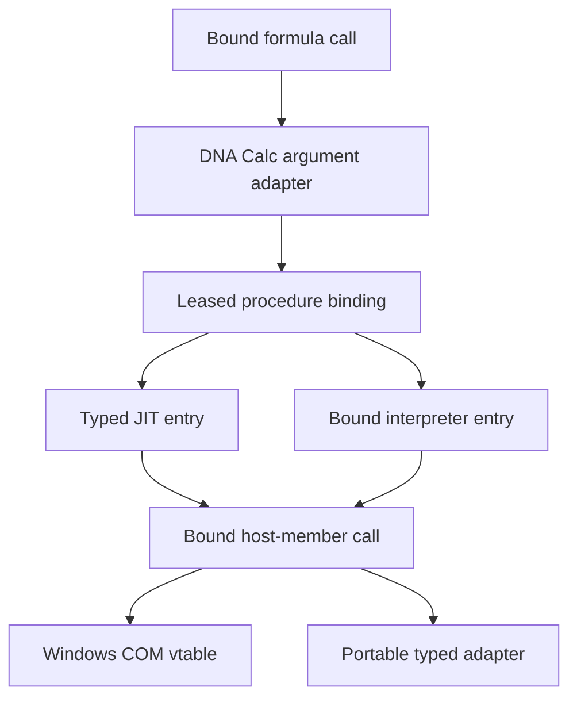

# Recommended direction

**I would adopt the separation in Appendix A and the broad architecture in Appendix D: CalcVBA owns language execution and typed hosting; DNA Calc owns worksheet registration, the Excel-compatible object model, and calculation semantics.**

I would tighten that architecture in four places:

1. **Specify two distinct call contracts.** A standard-module procedure has a typed callable entry with explicit runtime-state ownership. A host object exposes typed interfaces through COM on Windows and corresponding interfaces on portable targets. They can share type descriptions and ownership conventions without making module procedures into COM objects.
2. **Separate early binding from call overhead.** The newer native path described in B/D is early-bound when its IID, slot and signature are preserved. Variant vectors, repeated interface acquisition, generic helpers and libffi can still make it expensive.
3. **Promise common semantics with explicit target ABIs.** Windows COM, Linux native calls and wasm function tables need different physical projections.
4. **Make execution lifetime and observable state part of the contract.** Generations alone do not prevent calls into reclaimed code; read-only Range access does not make VBA pure; cancellation does not undo mutations to globals.

The discussion below distinguishes **documented behavior**, **observations reported in your appendices**, and **design recommendations**. Implementation assessments are based on the supplied [2-vba-hosting-prompt.md](2-vba-hosting-prompt.md), rather than a fresh inspection of the repositories or a new Excel experiment.

---

## 1. What public contracts establish about Office hosting VBA

### 1.1 Projects, storage and references

MS-VBAL supplies a useful logical hosting model. A project contains named modules and an **ordered list of references**; earlier references have higher precedence. It distinguishes source projects, library projects, and host projects. A host project is a library project introduced by the application, whose public entities are accessible to VBA source projects. The physical representation and mechanism of introduction are explicitly implementation-defined. [1]

This supports the proposed architecture directly: CalcVBA can understand host-supplied classes, procedures, constants and types without knowing what a spreadsheet is.

MS-OVBA supplies the storage contract, not an executable hosting ABI. One particularly useful boundary is explicit: a module stream contains compressed source and an implementation-specific, version-dependent performance cache; the cache must be ignored on read. The source is decoded using the project’s code page. CalcVBA therefore has a documented source-compilation route that requires no interpretation of Office’s executable cache. [2]

For the loader, I recommend preserving more than a collection of `.bas` strings:

- Project and component identities, module kinds, attributes and source locations.
- Ordered references, including their resolved identities and provenance.
- Host-attached class/document-module bindings.
- Compilation options and conditional-compilation inputs.
- Diagnostics for unresolved or unsupported references.

Several modules belonging to one project must share that project’s runtime state. The present “load one module” facility can remain a convenience operation that creates a one-module project.

### 1.2 The VBE is an editor/project surface

The public Visual Basic Add-In Model exposes `VBE`, `VBProject`, `VBComponent`, `CodeModule` and `Reference`. It supports project inspection, source editing and reference inspection. It does not document how Excel obtains or invokes a compiled worksheet-function entry. [3]

Consequently, CalcVBA’s editor integration and execution API should share project and symbol services, but the editor object model should not sit in the invocation path. Public VBE automation remains suitable for constructing controlled Excel experiments.

### 1.3 Application, globals and the object library

The `appobject` type-library attribute identifies an application coclass and makes its functions and properties globally available within the library. That is metadata describing exposure; it does not supply the actual application instance or define its lifetime. [4]

Excel also publicly exposes a `_Global` interface containing members such as `Application`, `Range`, `Cells`, `ThisWorkbook` and `WorksheetFunction`. A faithful model should therefore represent global exposure explicitly, rather than assume that every unqualified name is mechanically rewritten to an arbitrary member of `Application`. [5]

The neutral hosting API needs two separate inputs:

| Input | What it supplies |
|---|---|
| **Object-library description** | Types, interfaces, members, signatures, constants, default members, global exposure and event interfaces |
| **Host bindings** | The actual Application/root objects, document instances, activation services and their lifetimes |

A `.tlb` is insufficient by itself. Conversely, injecting an `IDispatch` pointer without corresponding compiler metadata cannot provide the desired typed binding.

For dual interfaces, public COM documentation expressly supports either `IDispatch::Invoke` or direct vtable binding. That establishes a suitable mechanism for **VBA → host** calls. [6]

### 1.4 Standard-module procedures do not need fabricated COM objects

COM type information already distinguishes static modules from interfaces and coclasses: `TKIND_MODULE` describes static functions and data. `ITypeInfo::AddressOfMember` can expose static callable addresses, whose documented validity lasts until the caller releases the type description. Those are useful precedents for metadata and code ownership. [7] [8]

They **do not establish** that Excel represents its VBA modules this way, calls `AddressOfMember`, or uses COM dispatch internally for worksheet calls.

Likewise, `Application.Run` is a public dynamic invocation facility taking positional Variant arguments, while `xlUDF` is Excel’s C API adapter for invoking VBA and other functions. Neither documents Excel’s private compiled-procedure ABI. [9] [10]

I would therefore replace the architectural hypothesis about Excel’s “small non-COM step” with this defensible requirement:

> CalcVBA exposes statically bound procedures with typed signatures and explicit code/state ownership. Host objects follow COM interface contracts. Excel’s private transition between its formula evaluator and VBA remains unspecified.

An internal session pointer on a procedure entry is legitimate runtime machinery. It does not turn the procedure into a source-language object.

### 1.5 Procedure discovery has three separate meanings

The ordinary documented route is a Function in a standard module, which Excel finds by name when a worksheet formula invokes it. VBA Functions are public by default. `Private` and `Option Private Module` establish VBA visibility rules, including restrictions on cross-project references. [11] [12] [13]

Keep these distinct:

| Question | Responsible policy |
|---|---|
| Can another VBA procedure/project reference this procedure? | VBA language and reference visibility |
| Can a worksheet formula resolve and invoke it? | Excel/DNA Calc formula resolver |
| Does it appear in a function-selection UI? | Host discovery and presentation policy |

`Application.MacroOptions` controls descriptions, argument descriptions, categories and related UI metadata. Its public contract does not register a native entry point or declare thread safety. [14]

**Your observations:** Appendix B reports worksheet calls reaching Private functions and functions in `Option Private Module`, including workbook-qualified calls. It also reports a Sub producing cell `0`. Those calculations occurred while `RunProbe` was active.

These observations justify further investigation. They do not justify either a universal “Private functions are unavailable to cells” rule or indiscriminate registration of Subs.

**API consequence:** public-procedure enumeration should be the normal convenience operation, but the host must also be able to inspect procedure visibility and, under an explicit host lookup policy, bind nonpublic procedures. Do not implement this by changing their VBA visibility.

---

## 2. Excel’s worksheet-to-VBA boundary

### 2.1 Preserve references until argument adaptation

Microsoft documents Range/cell references among the Variant categories passed to VBA UDFs. It also documents the apparently surprising reflection behavior: `VarType` can report an object’s default-property type, while the argument remains an object. Thus `TypeName = "Range"` alongside `VarType = 5` is coherent. [15] [16]

The formula evaluator must preserve the distinction between:

- A cell reference.
- The value read from that cell.
- An array value.
- An omitted argument.

Once every argument has been eagerly reduced to a scalar or array value, the glue cannot reliably reconstruct the intended Range object.

I would bind the following adaptation plans:

| Resolved formal type | Worksheet adapter |
|---|---|
| `ByVal x As Double` | Read/coerce the argument and pass a native `double` |
| `ByRef x As Double` | Read/coerce into invocation-owned scalar storage; pass its address |
| `r As Range` | Supply the required typed Range interface |
| `x As Variant` | Preserve reference/object versus value distinctions required by the compatibility profile |
| Typed array | Apply an explicit element-type, rank and bounds conversion |
| Optional parameter | Apply its declared default or Missing behavior |
| ParamArray | Construct the required Variant array using the specified bounds and ownership |

This table is a **recommended adapter design**, with unresolved Excel cases requiring measurement.

VBA’s ordinary ByRef semantics require particular care. ByRef is the default, and normal variable arguments must have the expected type. VBA can also create a temporary when an argument is forced through expression evaluation. That documents a temporary mechanism, but does not specify every detail of Excel’s cell adapter. [17]

Keep two contracts separate:

- **Worksheet calls:** converted scalar inputs can use private temporaries, with no implicit writeback into cells.
- **VBA calls:** genuine ByRef aliasing must be preserved. Passing the same variable to two parameters cannot silently become two independent copies.

For object parameters, copying the reference does not copy the object. Host mutation restrictions must therefore be enforced by the active execution context.

Your Long-coercion observations—`2.5 → 2`, numeric text accepted, incompatible text producing `#VALUE!`—are useful fixtures. They should be extended to overflow, locale-sensitive text, blanks, errors, dates and arrays before being generalized.

### 2.2 Caller and volatility are invocation context

`Application.Caller` is context-sensitive: a single-cell custom function receives that cell’s Range, and a legacy array-formula call receives its array range. Other invocation contexts can produce text or an error value. [18]

Implement Caller through a **stack of host invocation contexts**. Nested helpers inherit the relevant context; reentrant host evaluation can establish another context and restore the previous one afterward. A single unstacked TLS pointer is insufficient.

`Application.Volatile` defaults to true, accepts false, and has no scheduling effect outside a worksheet UDF. Excel’s recalculation documentation also describes discovering VBA-function volatility during execution. [19] [20]

**Appendix E adds measured detail:** volatility is local to the calling formula cell; executed requests are ordered; an ordinary call does not erase an earlier request; and each reevaluation starts without a VBA volatility request.

Therefore, the glue should record an evaluation effect such as:

```text
SetCallerVolatility(true | false)
```

It should not store a permanent `is_volatile` flag on the procedure descriptor. Static analysis may record that a procedure *can request* volatility, but that does not replace execution semantics. Built-in formula volatility remains a separate source of volatility.

Failure and cancellation edges still need measurement: successful-call observations do not establish whether a request made before an aborted call persists.

### 2.3 Error values, exceptions and host aborts are different

`CVErr` creates a Variant of subtype Error. It is a returned value, not automatically a raised exception. `On Error` governs raised runtime errors through the VBA call stack. Worksheet argument-conversion failures can produce `#VALUE!`. [21] [22] [23]

Use separate representations for:

1. A successfully returned error-valued Variant.
2. An unhandled VBA exception.
3. A failed COM call.
4. Cancellation or budget exhaustion.
5. A host evaluation abort, such as unavailable required input.

Also keep VBA error numbers, worksheet error identities, Automation SCODE representations and HRESULTs distinct. Microsoft’s DLL guidance itself distinguishes logical `CVErr` arguments from their raw Automation representations. [15]

**Your current evidence does not establish ordinary unhandled-error mapping.** Appendix B’s `Err.Raise` probe produced a runtime dialog and aborted the harness. Mapping an uncaught VBA exception to `#VALUE!` is a reasonable DNA Calc policy, but its Excel parity remains a separate test obligation.

CalcVBA should return structured execution information. DNA Calc should decide the cell result and diagnostic.

### 2.4 Recalculation is not memoization

Excel documents VBA UDFs and macros as executing on its main thread. Additional calculation threads evaluate eligible thread-safe cells; native compilation does not itself make a VBA function eligible for Excel-style multithreaded recalculation. [24]

For compatible scheduling, I recommend assigning VBA-containing formula cells to a designated host execution lane by default. Independent safe portions of the calculation graph can remain parallel.

Appendix E establishes another important constraint: equal argument values do not imply that an invocation can be skipped. Rewriting an input with the same value, or dirtying an upstream formula whose result stays unchanged, can advance VBA state. Preserve dirty/forced-calculation semantics rather than caching VBA results by argument values.

The hidden-read result has direct documentary support. Microsoft describes a UDF whose result stays stale because it reads cells beyond those supplied in its arguments. Passing all relevant ranges is one documented remedy. [25]

Consequently, distinguish:

- Recording a read for evaluation safety, diagnostics or missing-input detection.
- Creating an automatic recalculation dependency.

Automatically turning every internal Range read into an invalidation edge would be a deliberate behavioral extension. It should not silently become the Excel-compatibility policy.

---

## 3. The neutral CalcVBA hosting API

### 3.1 Four ownership objects

I would make these the fundamental objects:

| Object | Contents and lifetime |
|---|---|
| **ProjectImage** | Immutable verified code, resolved references, type/signature descriptors and compiled artifacts |
| **ProjectSession** | Mutable project globals, Statics, class instances, initialization state, host bindings and execution affinity |
| **BoundProcedure** | Procedure identity, signature/ABI identity, selected entry and ownership of the corresponding image/session |
| **Invocation** | Budget, cancellation, error state, reentry information and an opaque host context |

Immutable code can be shared. Mutable project state is shared only when the host deliberately uses the same session.

The control API should support:

```text
prepare_project(source, references, host_libraries, options)
create_session(image, host_bindings, execution_policy)
enumerate_procedures(image, visibility_filter)
bind_procedure(session, procedure_id, requested_entry_profile)
reset_session(session, reset_policy)
close_session(session)
```

Preparation must report compilation and binding diagnostics before registrations become visible. A failed replacement should leave the existing project active.

The source model must represent standard modules, classes and host-attached modules without containing concepts named Worksheet, UDF or Range.

### 3.2 Procedure descriptors: source semantics and ABI lowering

A descriptor needs both a **language signature** and a **lowered ABI signature**.

The language signature should contain:

- Project/component/procedure identity, kind and visibility.
- Fully resolved parameter and return types.
- ByVal/ByRef, Optional, defaults, Missing eligibility and ParamArray.
- Array element type and rank constraints.
- Nominal class, interface and UDT identities.
- Relevant module attributes and source locations.

The ABI descriptor should add:

- Target architecture and calling convention.
- Concrete scalar widths and aggregate layouts.
- Hidden session, context, receiver, LCID or result parameters where applicable.
- Pointer ownership, borrowing and writeback rules.
- Signature fingerprint and supported entry forms.

Keep names for diagnostics and rebinding. They should not be necessary for a steady-state call.

### 3.3 A genuine typed native procedure entry

For:

```vb
Public Function Add2(ByVal a As Double, ByVal b As Double) As Double
    Add2 = a + b
End Function
```

a suitable external entry is conceptually:

```c
typedef uint32_t CvStatus;

typedef CvStatus (CV_CALL *CvAdd2Entry)(
    CvProjectSession *session,
    CvInvocation     *invocation,
    double            a,
    double            b,
    double           *result);
```

`CV_CALL` must denote a documented target ABI. `CvStatus` reports execution outcome; the result is read only on success. Detailed diagnostics can live in invocation-owned storage and be materialized only on failure.

The session and invocation parameters are runtime environments. There is no invented `IUnknown` receiver.

**The entry must reach typed execution.** If it immediately allocates a Variant frame, boxes both arguments, and calls the existing generic executor, it provides a convenient ABI wrapper but misses the intended performance result. Typed parameters and locals should remain typed wherever the language permits.

A genuinely Variant parameter must retain Variant semantics. Moreover, a scalar `VARIANT` is an inline tagged structure; its existence does not inherently imply heap allocation. The avoidable cost is redundant packaging, conversion and heap-backed argument/frame construction. [26]

A checked universal Variant adapter remains useful for dynamic invocation. It should be an explicitly separate entry profile.

### 3.4 Interpreter support requires an honest entry contract

Both backends should support binding to a known procedure and a validated argument layout.

Native JIT execution can supply an arbitrary generated typed entry. An interpreter-only wasm build cannot automatically manufacture a new exported function shape for every user-authored signature.

Offer two entry capabilities:

| Entry profile | Suitable use |
|---|---|
| **Typed native entry** | Generated native JIT procedure calls |
| **Bound typed-frame entry** | General interpreter calls using a resolved procedure and immutable typed storage layout |

The typed-frame entry need not search names or construct a Variant vector. Its field offsets and types are determined once at bind time.

For **VBA → host** calls on wasm, generate adapters for the known host-library methods at build time. Loading another descriptor does not create executable adapter code; unsupported shapes must fail binding explicitly.

WebAssembly indirect calls use typed function-table entries, with a trap on incompatible function types. Treating them as arbitrary machine-code addresses is not a portable implementation strategy. [27]

### 3.5 Typed host-object calls

A bound object-member plan should retain:

```text
interface identity
member identity + accessor kind
logical vtable slot
language signature
target ABI signature
ownership/writeback plan
error plan
```

Do not merge DISPID, property accessor and slot into one token. `FUNCDESC` records these separately; property get and put accessors share a DISPID, while their callable entries differ. A used `oVft` is an offset aligned to the target pointer size. [28] [29]

Binding must account for inherited entries, the dual interface’s vtable partner, the implicit receiver, HRESULT/result separation and any hidden parameters.

Acquire the required interface when converting or assigning the receiver, and retain that typed interface pointer. Where the variable already contains the required interface, repeating `QueryInterface` on every member access is unnecessary.

The general JIT operation is then a **typed indirect call through the receiver’s vtable**. Knowing the IID and slot does not prove the concrete implementation address: different implementations and COM proxies can implement the same interface.

For the interpreter, the corresponding operation invokes a previously selected typed adapter. Neither path needs a member-name request.

A pure dispinterface has no additional custom slots. A compiler-bound IID/DISPID/accessor `Invoke` plan is legitimate for that interface kind. It should remain distinct from an unexpected fallback after a failed dual-interface call.

### 3.6 Common semantics, explicit platform projections

I would specify the portable contract this way:

| Target | Physical interface |
|---|---|
| **Windows** | Exact COM interface layout and calling conventions; standard Automation representations and ownership |
| **Linux** | Explicit native ABI projection preserving interface identities, typed slots, ownership and object semantics |
| **wasm** | Explicit memory/handle representation plus typed imports or function-table adapters |

`#[repr(C)]` defines aspects of data layout. It does not independently define calling convention, ownership or cross-target compatibility. Rust’s documentation also distinguishes layout from function-call ABI and recommends the target-appropriate system ABI for Windows APIs. [30] [31]

The type model should preserve, among other things:

- VBA Integer and Long widths.
- `VARIANT_BOOL`, including its true representation.
- Currency, Date and pointer-sized types.
- BSTR/string lengths and code units.
- SAFEARRAY rank, element type and bounds.
- Interface identity and reference ownership.

Automation’s type definitions are explicit about these distinctions. [32]

For real COM strings, follow BSTR allocation and ownership rules. BSTR supports embedded NULs; the neutral string representation must preserve 16-bit code units rather than force every value through Rust `String`. A worksheet-specific valid-text restriction belongs in the glue. [33] [34]

For pointer-bearing results, define who initializes, retains, replaces and releases storage, including failure exits. These rules must be generated alongside signatures.

### 3.7 Generations, leases and reload

A formula-plan reference can contain:

```text
registry_slot
project_generation
signature_fingerprint
argument_plan_id
```

But a generation comparison followed by a raw call is unsafe if another operation can reclaim the target between those actions.

The binding must acquire or already hold a lease protecting:

- Executable code.
- Referenced descriptors and helpers.
- The corresponding session state.
- Any runtime/provider module required to execute it.

I recommend publishing a replacement at a host execution boundary. An active invocation retains its old code and state consistently; it must never run old code against newly reset globals.

On signature change, invalidate the argument adaptation plan as well as the address. On project reset, distinguish a new state generation from a new compiled image. On unload, stop admitting new calls and reclaim only after active calls, retained exports and callbacks permit it.

A lease can cover a batch of evaluation work; safety need not require a fresh heap allocation or heavyweight reference-count operation for every scalar call.

### 3.8 Errors, cancellation, threading and events

A neutral execution result should distinguish:

```text
Success
UnhandledVbaError
ForeignCallFailure
Cancelled
BudgetExceeded
StaleBinding
HostExecutionAbort
```

The successful value can itself be `CVErr`.

For failed COM calls, capture `IErrorInfo` promptly. Microsoft documents that it belongs to the current logical thread and that intervening proxy calls can clear it. [35]

Cancellation and fuel should cover loops, recursion and runtime helpers, with nested calls and callbacks sharing the current allowance. Compilation and host calls require their own resource policies. A cooperative VBA budget cannot guarantee interruption of an uncooperative native call already executing.

Define what happens to state after an abort. A function may have changed a Static before cancellation. Automatically rerunning it on another backend can repeat observable effects. Backend admission fallback is safe **before execution begins**; replay after entry needs explicit semantics.

Sessions should be thread-affine and nonconcurrent by default. Windows interface references must respect apartments, including correct marshaling or agility for cross-apartment use. [36]

Reentry is a separate capability. A host call can invoke VBA again on the same thread. Avoid holding an exclusive Rust session borrow or a non-reentrant lock across such a callout.

For events, describe outgoing interface identity, sink binding, subscription cookies, ownership and unsubscription. Connection points retain a sink interface until disconnection. [37]

A queued event implementation is insufficient for an event whose caller expects synchronous ByRef cancellation or result writeback. Such events require synchronous callbacks, nested invocation state and leases on the handler’s code. Dispatch-based event interfaces also remain dispatch-based even when ordinary object methods use dual vtables.

---

## 4. DNA Calc’s glue and object library

### 4.1 Bind the worksheet call once

The intended execution structure is:



At formula binding time, `calc-vba` should:

1. Resolve the formula name under DNA Calc’s lookup and compatibility rules.
2. Select the procedure and validate worksheet eligibility.
3. Construct the argument-demand and result-conversion plans.
4. Bind the backend entry and signature.
5. Register a stable extension-call slot.

At execution time, that slot should lead directly to the prepared adapter. No uppercase allocation, procedure-name scan, repeated catalogue search or intermediate spreadsheet-value enum is needed.

A generic `CalcValue`-based formula evaluator can still participate. The adapter can borrow its arguments, extract typed scalars directly into stack storage and construct one result value afterward. A value-slice interface or virtual interface is not inherently late-bound; unresolved name lookup and repeated dynamic adaptation are the problems.

Persisted formulas can retain names and source text. Their executable plans should retain resolved bindings.

### 4.2 Registration metadata belongs in the glue

| Metadata | Recommended source and policy |
|---|---|
| Parameter and return types | Compiler’s resolved procedure descriptor |
| Reference versus value demand | Signature plus measured worksheet adaptation rules |
| Worksheet eligibility | Host policy over module kind, procedure kind and visibility |
| Thread affinity | Session/object capabilities; default to the VBA execution lane |
| Purity and state mutation | Conservatively stateful unless an explicit verified extension profile applies |
| Volatility | Ordered runtime effects, with optional conservative “may request” analysis |
| Host writes | Invocation policy distinguishing worksheet and macro contexts |
| Display category/descriptions | Host registration metadata, analogous to MacroOptions |

Typing alone cannot establish purity or thread safety. A `Double → Double` procedure can modify a global, inspect time or call an external object.

The worksheet host can refuse writes while the macro host permits them. Use the same object interfaces with context-appropriate services and enforcement.

For `WorksheetFunction`, bind each generated host method to its CalcFunc operation once. Its implementation should not resolve `"SUM"` by name on every call.

**Preserve genuine Variant signatures.** `Range.Value2` returns a Variant; `WorksheetFunction.Sum` accepts Variant arguments. A typed vtable call still uses those declared representations. Replacing them with private scalar methods would change the interface being tested. [38] [39]

### 4.3 Persistent Range objects require stable workbook identity

Appendix D’s `(SheetId, area)` descriptor is a useful starting point, but insufficient as the complete contract.

A persistent reference needs enough identity to distinguish:

```text
workbook identity and incarnation
worksheet identity and incarnation
reference/area identity
structural-update policy
```

The current invocation supplies access to an authorized reader or mutation service. It must not supply a replacement identity for whichever workbook happens to be active.

A saved Range must never retain a borrowed evaluation reader. It should retain stable reference identity and resolve that identity against an appropriate current host context.

Specify behavior for row/column insertion, sheet deletion, workbook closure, reopened workbooks and recycled IDs. The correct Excel behavior for those cases belongs in the black-box corpus.

COM identity adds a separate requirement: interfaces belonging to one object must preserve the required `IUnknown` identity and stable interface support. Equal coordinates do not establish that two Range acquisitions must be the same COM object. [40]

Reference counting can remove the arbitrary lifetime cap. It does not prove that every Range-returning operation is allocation-free, eliminate every possible object table, or prevent ownership cycles.

The appropriate initial performance promise is **allocation-free steady-state scalar invocation**. Escaping objects, strings and arrays have legitimate allocation requirements.

### 4.4 Generate the library and adapters from one model

The canonical object-library descriptor should generate:

- Windows IDL and `.tlb`.
- Native interface declarations and vtables.
- Portable interface declarations and adapters.
- Interpreter call adapters.
- JIT ABI-lowering descriptions.
- Dispatch metadata for supported dynamic paths.
- Layout and signature conformance manifests.

MIDL generates a type library from its library definitions; `CreateTypeLib2` provides a programmatic alternative with an explicit target `SYSKIND`. [41] [42]

Include default/source interfaces, appobject/global exposure, default members, accessor kinds, DISPIDs, logical slots, optional/default values, ownership and HRESULT/retval lowering in that model.

Round-trip the generated `.tlb` through the importer and compare it against the canonical descriptor. This tests the actual generator/importer boundary.

For DNA Calc’s known interfaces, generated adapters can meet the no-libffi hot-path target. Retaining a generic, prebound native marshaller for broader third-party COM signatures is compatible with early binding; it is a separate performance tier.

### 4.5 Excel GUIDs: distinguish source compatibility from binary compatibility

My recommendation is:

**Use DNA Calc’s own LIBID, CLSIDs, ProgIDs and interface identities for its primary object library. Provide explicit Excel compatibility mapping.**

Reusing an IID means implementing that interface’s immutable contract. A shortened interface with familiar names is not sufficient. COM’s interface rules require unique, immutable interface definitions. [43]

However, there is a significant limit to the “own GUIDs plus alias” strategy:

```vb
Dim r As Excel.Range
```

can be source-bound through an explicit compatibility mapping. An external COM method whose ABI expects Excel’s original Range interface cannot be satisfied by a namespace alias.

If full Windows interoperability includes those external consumers, DNA Calc needs a separately specified façade implementing the relevant original interface identity, layout and behavior. That does **not** require registering DNA Calc globally under Excel’s Application CLSID or replacing Excel’s registered type library.

Public type-library introspection is appropriate for collecting interface metadata. It does not prove behavioral compatibility. Record the Excel version, architecture and library identity associated with each captured contract.

### 4.6 Repository dependencies

I would allow a Cargo dependency from the glue to a narrow, neutral `calcvba-host-api` crate.

The intended boundaries are:

| Component | Dependency responsibility |
|---|---|
| `calc-fml` / `calc-func` | Generic resolved extension-call contract |
| `calc-vba` | Neutral CalcVBA API plus DNA Calc adapters |
| `calc-object-model` | Spreadsheet objects and generated interface implementations |
| OxVba runtime | Neutral API implementation, compiler, interpreter and JIT |
| Application binary | Selects and composes the runtime provider |

The formula libraries do not need a CalcVBA dependency merely because one extension provider uses VBA.

A stable C ABI is useful for independently built runtimes and other languages. It need not force dynamic loading into a statically linked Rust application. Rust convenience wrappers can sit over the specified boundary without being mistaken for a stable binary plugin ABI.

---

## 5. Critique of Appendices B–D

### Appendix B: retain it, but complete the execution contract

B is the strongest statement of the boundary. Its recognition that native transport alone does not prove worksheet-to-JIT performance is correct.

The major missing pieces are:

- Source types versus target ABI types.
- General interpreter entry capabilities.
- Whole-project state ownership.
- ByRef aliasing and failure-edge writeback.
- Reentry and synchronous event semantics.
- State after cancellation or abort.
- Nonpublic host lookup.
- Exact capability profiles by backend and target.

### Appendix C: preserve the audit, qualify its conclusions by revision and path

C’s diagnosis of spreadsheet-specific ownership, repeated name resolution and representation conversion remains useful.

Its blanket early-binding verdict must be attached to the revision it inspected. B/D describe a newer native COM route that preserves the descriptor and reaches a vtable without an Invoke retry.

**That does not mean the DNA Calc integration has automatically migrated.** The consumed pin and synthetic spreadsheet provider can still follow the older route. Report capabilities separately for the pinned integration, newer native HAL, portable provider, interpreter and JIT.

Also correct three overstatements:

- libffi does not inherently imply late binding.
- A value-oriented adapter does not inherently imply late binding.
- COM reference counting does not automatically eliminate all tables or allocations.

The estimated allocation count is a hypothesis to benchmark, not measured performance.

### Appendix D: approve the direction with sharper acceptance criteria

| Proposed wording or assumption | Required refinement |
|---|---|
| Typed-slot entry on every platform | Common semantic contract with explicit target ABI projections |
| No Variant vectors | No redundant generic argument packaging; retain actual Variant-typed parameters/results |
| Direct JIT calls | Typed vtable indirect calls unless concrete implementation identity permits devirtualization |
| Slot plus generation | Generation plus image/session leases and publication rules |
| Saved Range from sheet/area | Workbook identity, incarnation and structural-reference policy |
| Allocation-free Range calls | Narrow initial guarantee to scalar boundaries; measure object allocation separately |
| Queued native events | Separate asynchronous delivery from synchronous ByRef events |
| Read tracking | Keep evaluation evidence separate from Excel recalculation dependencies |

### The riskiest assumption

**The riskiest assumption is that preserving a typed descriptor means the complete call path has become a safe, inexpensive typed ABI.**

That assumption can hide generic execution frames behind a typed entry, unsafe reclamation behind a generation check, or a synchronous callback behind a non-reentrant session lock.

The decisive evidence must come from a small complete path that includes execution, ownership, errors and reentry—not merely successful descriptor transport.

### Black-box experiments that resolve the remaining Excel questions

| Experiment | What it resolves |
|---|---|
| Public/Private × Option Private × standard/class/document module; bare and qualified formulas | Formula eligibility independently of VBA visibility |
| Same procedures through cells, Insert Function, Macro dialog, `Run` and VBA references | Invocation versus discovery surfaces |
| Idle worksheet calculation versus calculation inside a running macro | Context dependence of B’s Private/Sub/error results |
| Scalar, Variant, Range and array formals against literals, references, arrays, spills and omissions | Argument demand and coercion |
| ByRef mutation and repeated arguments; object reassignment and attempted cell writes | Temporary storage, aliasing and object-reference behavior |
| Handled/unhandled `Err.Raise`, conversion failures, `CVErr` and host errors | Error mapping and debugger interaction |
| Saved Range across calls, structural edits, deletion and workbook closure | Reference lifetime and identity |
| Nested calls, callbacks and conditional volatility, including failure exits | Invocation-context restoration and effect ordering |

Record version, bitness, calculation mode, call origin and relevant debugger settings. Use in-memory observations or returned values so the logging mechanism does not itself depend on forbidden worksheet writes.

These experiments can establish observable semantics. They cannot prove Excel’s private internal calling convention.

---

## 6. The first three concrete implementation steps

### 1. Specify the neutral ABI and build a non-spreadsheet host fixture

Create a small versioned contract covering:

- Project image/session ownership.
- Procedure descriptors and typed entry profiles.
- Scalar, string, Variant, object and ByRef ownership rules.
- Status/error reporting.
- Affinity, reentry and cancellation.
- Target-specific ABI projections and schema fingerprints.

Use a neutral object such as a counter or calculator with a typed method, a property, a failing method and a synchronous callback. Successful hosting of that object should require no spreadsheet code.

### 2. Prove and measure the complete typed paths

Implement and measure:

- Formula adapter → `Add2(ByVal Double, ByVal Double)` → typed JIT execution.
- VBA → a generated typed host method in both interpreter and JIT.
- An actual Variant-returning `Range.Value2` call once the neutral path is established.
- A ByRef alias case, failed HRESULT, synchronous callback and reload with an active lease.
- Browser execution using its declared typed-frame and generated-host-adapter capabilities.

For the scalar path, require no name lookup, no intermediate spreadsheet-value representation, no heap argument vector and no immediate conversion back into a generic Variant execution frame.

Compare against a plain native typed call and report the full adapter cost. Measure object/Variant calls separately.

### 3. Extract the spreadsheet model and migrate registration transactionally

Move Application, Range, WorksheetFunction, worksheet coercion, volatility effects and cell-error mapping into DNA Calc.

Generate its object library and adapters from the canonical model. Replace name-bearing executable calls with resolved slots and prepared adaptation plans. Preserve failed-load behavior, state retention, code-cache ownership and the existing Excel observation corpus.

Extend the object-model surface only after the same mechanism supports both runtimes and the required targets. The next milestone should be a demonstrably typed, lifetime-safe call in each direction, with its measured cost and compatibility limits recorded.

<!-- Markdown source-reference definitions; citation numbers above link directly to the original sources. -->

[1]: https://learn.microsoft.com/en-us/openspecs/microsoft_general_purpose_programming_languages/ms-vbal/4cd406c7-1ade-4522-8d7b-933183059ac7 "MS-VBAL: Projects"
[2]: https://learn.microsoft.com/en-us/openspecs/office_file_formats/ms-ovba/c66b58a6-f8ba-4141-9382-0612abce9926 "MS-OVBA: Module Stream: Visual Basic Modules"
[3]: https://learn.microsoft.com/en-us/office/vba/language/reference/visual-basic-add-in-model/objects-visual-basic-add-in-model "Objects (Visual Basic Add-In Model)"
[4]: https://learn.microsoft.com/en-us/windows/win32/midl/appobject "appobject attribute"
[5]: https://learn.microsoft.com/en-us/dotnet/api/microsoft.office.interop.excel._global?view=excel-pia "Excel _Global Interface"
[6]: https://learn.microsoft.com/en-us/windows/win32/com/dual-interfaces "Dual Interfaces"
[7]: https://learn.microsoft.com/en-us/windows/win32/api/oaidl/ne-oaidl-typekind "TYPEKIND enumeration"
[8]: https://learn.microsoft.com/en-us/windows/win32/api/oaidl/nf-oaidl-itypeinfo-addressofmember "ITypeInfo::AddressOfMember"
[9]: https://learn.microsoft.com/en-us/office/vba/api/excel.application.run "Application.Run"
[10]: https://learn.microsoft.com/en-us/office/client-developer/excel/xludf "xlUDF"
[11]: https://support.microsoft.com/en-us/excel/create-custom-functions-in-excel "Create custom functions in Excel"
[12]: https://learn.microsoft.com/en-us/office/vba/language/reference/user-interface-help/function-statement "Function statement"
[13]: https://learn.microsoft.com/en-us/office/vba/language/reference/user-interface-help/option-private-statement "Option Private statement"
[14]: https://learn.microsoft.com/en-us/office/vba/api/excel.application.macrooptions "Application.MacroOptions"
[15]: https://learn.microsoft.com/en-us/office/client-developer/excel/how-to-access-dlls-in-excel "Access DLLs in Excel"
[16]: https://learn.microsoft.com/en-us/office/vba/language/reference/user-interface-help/vartype-function "VarType function"
[17]: https://learn.microsoft.com/en-us/office/vba/language/reference/user-interface-help/byref-argument-type-mismatch "ByRef argument type mismatch"
[18]: https://learn.microsoft.com/en-us/office/vba/api/excel.application.caller "Application.Caller"
[19]: https://learn.microsoft.com/en-us/office/vba/api/excel.application.volatile "Application.Volatile"
[20]: https://learn.microsoft.com/en-us/office/client-developer/excel/excel-recalculation "Excel Recalculation"
[21]: https://learn.microsoft.com/en-us/office/vba/language/reference/user-interface-help/cverr-function "CVErr function"
[22]: https://learn.microsoft.com/en-us/office/vba/language/reference/user-interface-help/on-error-statement "On Error statement"
[23]: https://learn.microsoft.com/en-us/office/client-developer/excel/excel-worksheet-and-expression-evaluation "Excel Worksheet and Expression Evaluation"
[24]: https://learn.microsoft.com/en-us/office/client-developer/excel/multithreaded-recalculation-in-excel "Multithreaded recalculation in Excel"
[25]: https://learn.microsoft.com/en-us/troubleshoot/microsoft-365-apps/excel/custom-function-calculate-wrong-value "Custom function may not calculate expected value in Excel"
[26]: https://learn.microsoft.com/en-us/windows/win32/api/oaidl/ns-oaidl-variant "VARIANT structure"
[27]: https://webassembly.github.io/spec/core/syntax/instructions.html "WebAssembly Core Specification: Instructions"
[28]: https://learn.microsoft.com/en-us/windows/win32/api/oaidl/ns-oaidl-funcdesc "FUNCDESC structure"
[29]: https://learn.microsoft.com/en-us/windows/win32/api/oaidl/nf-oaidl-icreatetypeinfo-addfuncdesc "ICreateTypeInfo::AddFuncDesc"
[30]: https://doc.rust-lang.org/reference/items/external-blocks.html "The Rust Reference: External blocks"
[31]: https://doc.rust-lang.org/reference/type-layout.html "The Rust Reference: Type layout"
[32]: https://learn.microsoft.com/en-us/windows/win32/midl/oleautomation "oleautomation attribute"
[33]: https://learn.microsoft.com/en-us/cpp/atl-mfc-shared/allocating-and-releasing-memory-for-a-bstr?view=msvc-170 "Allocating and Releasing Memory for a BSTR"
[34]: https://learn.microsoft.com/en-us/previous-versions/windows/desktop/automat/bstr "BSTR"
[35]: https://learn.microsoft.com/en-us/windows/win32/api/oleauto/nf-oleauto-geterrorinfo "GetErrorInfo"
[36]: https://learn.microsoft.com/en-us/windows/win32/com/processes--threads--and-apartments "Processes, Threads, and Apartments"
[37]: https://learn.microsoft.com/en-us/windows/win32/com/using-iconnectionpoint "Using IConnectionPoint"
[38]: https://learn.microsoft.com/en-us/office/vba/api/excel.range.value2 "Range.Value2"
[39]: https://learn.microsoft.com/en-us/office/vba/api/excel.worksheetfunction.sum "WorksheetFunction.Sum"
[40]: https://learn.microsoft.com/en-us/windows/win32/com/rules-for-implementing-queryinterface "Rules for Implementing QueryInterface"
[41]: https://learn.microsoft.com/en-us/windows/win32/midl/generating-a-type-library-with-midl-2 "Generating a Type Library with MIDL"
[42]: https://learn.microsoft.com/en-us/windows/win32/api/oleauto/nf-oleauto-createtypelib2 "CreateTypeLib2"
[43]: https://learn.microsoft.com/en-us/windows/win32/com/interface-design-rules "Interface Design Rules"
