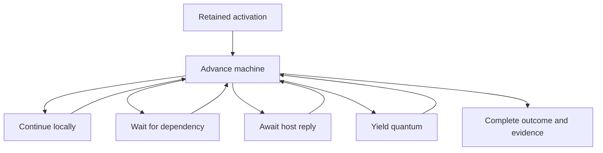

# DNA Calc evaluator design review

Review of commit `95c1b3bf9ff4661f64214be2d353cb549c5cef33`

## Scope and evidence

This review follows sections A–F of `8-evaluator-design-prompt.md`. The pinned repository could not be retrieved in this session, so the implementation findings are grounded in the supplied excerpts. No new Excel measurements or suspension benchmarks were performed.

**Shown** means demonstrated by a displayed excerpt. **Reported** means described by the prompt, including its measurements and source locations. **Risk** means an inference requiring a specific implementation check or witness. Bracketed references such as [D.4] refer to the supplied prompt's appendices; source locations are collected at the end. Proposed types are Rust-flavoured pseudocode, not patches.

# A. Design critique

## A1. Overall assessment and the plan

**Keep the current architecture. Make call semantics, continuation state, and execution evidence explicit before broadening optimisation.** The immutable plan, separate reference placement, common numerical kernels, caller-owned services, typed refusals, and single evaluator form a sound foundation. None of the problems below requires replacing the engine or adding a second interpreter.

The most valuable distinction is between three contracts:

1. **Expression semantics:** the values, references, coercions, demand order and numerical operations prescribed by Excel.
2. **Activation semantics:** which work has completed, which work can resume, and which invocation or draw an operation belongs to.
3. **Evidence semantics:** what establishes the validity of a result and which observations cause invalidation, ordering or a new calculation obligation.

The code already implements much of all three. The difficulty is that their boundaries are distributed across instruction cases, catalogue traits, cursor fields and optional sinks. [B–J]

**What the plan encodes well.** Anchor-free operands and literal number bits make sharing principled. Formula form, name bindings and callable bindings are part of the plan. Lazy arguments, name bodies and LAMBDA bodies use the same instruction language. Reference placement is outside evaluation, so copying a formula need not duplicate its executable representation. Weak ownership in `PlanCache` is an implementation detail that need not enter a portable semantic model. [B]

The sharing invariant should be stronger than “the two formulas return equal values”:

> Equivalent plans, placements, bindings, environments and admitted inputs must produce equivalent results and observable execution, including permitted callbacks and input consumption.

The root near-zero lowering demonstrates why source distinctions sometimes belong in the normal form: parentheses and a LET result can change eligibility even when an algebraic expression looks equivalent. Do not normalise those distinctions away. [F.3]

**What is implicit or fragile.** A block's role is implicit in who references its index. Its local layout, result boundary and effect summary are not explicit in the displayed `CompiledPlan`. `Call` combines several semantic stages: admission, lifting, kernel execution and result adaptation. Its `retain` and `synthetic` flags also carry part of the final-sum rule. [B, E.2]

Add typed block/site identities and a plan verifier before designing another IR. Verify reference and block indexes, stack effects on every guard path, local/capture layouts, call arity invariants and exactly one block result. A verifier makes a compact stack instruction set quite serviceable for transcoding. It does not need to turn every operand into an SSA register.

**Merely untidy.** File length, `usize` indexes, parallel arrays such as `references` and `wrapped`, and weak-cache bucket sweeping are not themselves semantic defects. Typed indexes and a reference record containing its placement policy would reduce maintenance mistakes, but should follow the correctness work rather than displace it.

## A2. Values and equality

**What is good.** The model preserves distinctions that are frequently lost in spreadsheet implementations: `Empty`, `Missing`, empty text and zero; error values versus evaluator faults; references versus their contents; UTF-16 code units rather than only valid Unicode strings; ordered reference areas with duplicates; nested and boxed arrays; and qualified overflow-number provenance. These are assets to retain. [C, K]

A core plus optional metadata is a reasonable storage representation. It becomes fragile when callers mistake that storage projection for the full semantic kind. A callable is not semantically an ordinary `#CALC!` error merely because that is its cell display; a cube member is not merely its caption. Expose a complete `SemanticValueRef` view while allowing `CoreRef` and compact storage to remain implementation choices. [C.1–C.2]

**A concrete issue is visible in the equality implementation.** `CalcValue::eq` compares the core, callable metadata and image metadata, but not cube metadata. Thus distinct cube values with the same display text can compare equal; a cube value and ordinary text with that caption can also compare equal under the displayed implementation. This is a demonstrated omission. It becomes a workbook correctness defect wherever that equality authorises reuse or suppresses a semantic change. The excerpts do not show those consumers. [C.2]

Separate:

- Worksheet comparison, with Excel's coercion rules.
- Runtime identity, for objects such as closures.
- Representation equality, including number bits and qualifications.
- Equivalence for a particular observable facet and reuse decision.

An overflow NaN equalling another equally qualified value with identical bits is defensible as representation equality. It is not a complete definition of all four relations. Preserve the qualification during copies and serialization; do not reconstruct it from a NaN payload alone.

**Transcoding implications.** UTF-16 units, numeric bits, array shape/exposure, reference area order and rich-value identity need explicit portable representations. `Arc` is a storage strategy; `Any` downcasts and pointer addresses should not be the portable callable contract. Preserve callable identity using a context-owned handle, not deep equality of captures.

**Merely untidy.** The estimated 56-byte value layout is not a measured performance problem. Use `CoreRef` as the abstraction seam, establish invariants and equality first, then measure compaction. Do not flatten boxed arrays or discard metadata to save space.

## A3. The loop, suspension and retry

**What is good.** The retained cursors already distinguish completed work from a pending eager kernel, lazy argument, child body or user activation. Random state and the candidate footprint survive a wait. This is substantially closer to an explicit abstract machine than to a conventional recursive evaluator that restarts everything. [D.2–D.4, J.4]

**What needs naming.** `EvalStep::Suspended` covers quantum exhaustion, an unfinished dependency and an outstanding host request. The engine recovers the distinction through other methods. Name these outcomes directly. Keep semantic reevaluation, including XLL provisional-argument unwind, distinct from all three. [D.1, D.4, I.4]

The correct semantic unit is a **retained activation**. An ordinary dependency wait preserves its completed work and identities. Whether a particular internal stage restarts is an implementation decision governed by its replay contract.

**The stack clone is not a transaction.** The guard at `run.rs:1160–1174` checks that the UDF-call counter did not change. That does not, by itself, prove that a stage did not advance random state, emit a name record, partially execute a kernel, alter a child cursor or record other service activity. Conversely, retained child state can sometimes make a stage resumable even after a callback has completed. [D.4]

This is a risk in the general justification for retry, not proof that a current formula duplicates an effect. The omitted kernel and cursor paths may enforce stronger invariants. Establish those invariants explicitly:

- A restartable stage has committed no non-repeatable semantic work; or
- The completed work is retained and the stage resumes after it.

Admit operands into owned preparation state without destroying the raw operand segment. Commit the stack change at a named transition. For a kernel that can read or call back after doing work, retain its element/iterator/child state. “Do not mutate the stack during admission” solves admission rollback; it cannot alone solve kernel suspension.

Final result conversion also reads the workbook. A dynamic reference result and a legacy intersected result can block after the formula block has finished. Make that conversion an explicit resumable phase rather than an invisible epilogue. [C.3, D.3]

**Merely untidy.** The separate `Option` cursor fields are awkward but not inherently wrong. A tagged frame state would make impossible combinations harder to construct. The important invariant is ownership of progress, not the number of boxes.

## A4. Admission, lifting and lazy evaluation

**What is good.** Parameter class and formula form are distinct. Admission occurs at a known call site, while kernels retain responsibility for their own function semantics. `Exit::Error` and `Exit::Fault` preserve the distinction between a calculated Excel error and unsupported execution. Resumable helpers can retain a LAMBDA child at the current element. [E.1–E.4]

**The main factoring problem.** A call's semantics are spread over `Admission`, `ParameterClass`, `EntryClass`, `LegacyPlace`, numerous `EntryTraits`, notation, formula form and local provenance checks. The rules are not necessarily wrong. Their interaction is difficult to review, summarise or translate.

Create a compiled `CallPolicy` view over the existing rules before simplifying them. In particular:

- Keep argument production/demand separate from result selection.
- Preserve raw blank-reference versus computed-`Empty` provenance where IFS/SWITCH needs it.
- Distinguish incoming boxed arrays from array-valued elements encountered during lifting.
- Preserve padding as a distinct origin until the error-precedence decision.
- Keep the aggregate kernel's treatment of an intact reference array separate from lifting once per reference.

The lifting stages in C2 below make these distinctions independently testable without declaring them freely reorderable.

**The lazy sentinel is conditional, not automatically wrong.** In the shown protocol, only the first missing demand is retained, provisional selector results are discarded, and an argument's completed value is cached. Consequently, a provisional `#CALC!` causing a selector to tentatively ask for another argument does not itself execute that other block. The approach can be value-sound if selection is pure and no provisional result escapes. [E.3]

However, the selector receives services capable of effects. Replace its interface with a typed `NeedArgument(i)`/selection result that has no access to workbook reads, callbacks or random draws. Preserve the existing array rule that an array decision causes every argument to run.

**IFS and SWITCH are a crucial exception to a superficial unification.** The supplied code handles their paired/whole-result behavior in the eager path. Do not convert them into IF-like short-circuit calls merely because all these functions select a result. Eager argument execution and returning the selected result whole are independent policies. [E.1–E.3]

**Potential invariant gap.** `invoke` checks arity before requesting prepared arguments, but eager expression arguments have already run, and `PendingLazy` requests argument zero before its first `invoke`. The API promise is local to `PreparedArguments`; earlier expression evaluation does not itself contradict it. Establish the required formula-level arity/error behavior and whether compilation excludes malformed calls before observable argument work. Audit zero-argument lazy calls in particular. A behavioral defect requires that compiler/Excel invariant, not just the ordering visible here. [E.1–E.3]

## A5. Legacy places and final arithmetic

The four supported `Place` states plus `Unknown` encode useful inherited context. `Array` and `ArrayAggregate` share immediate admission but can produce different child contexts. Do not merge them on the basis of `admission()`. The excerpts do not establish joins or meets, so “context states” is more accurate than “lattice.” [F.1]

A table indexed only by parameter class and place is too small. The same broad parameter class does not explain SUM, SUMPRODUCT, INDEX, TYPE, TRANSPOSE or repeated argument roles. Preserve a table over parent context and parameter role, with measured entry-specific overrides. Reuse `EntryClass` where it already carries the distinction. Factor repeated-position mapping out of variants whose only difference is “Repeated” or “Twice.”

Direct reference intersection, child expression admission and result intersection are separate decisions. The emitted `ImplicitReference` before an argument and `Implicit` after a result must remain visible in the factoring. Keep legacy LET/LAMBDA `Unknown` cells as refusals until measured. [F.1]

The near-zero rule deserves its own named semantic operation. The existing guard/copy/negation/check pattern encodes it, but is a fragile representation of syntax eligibility and coercion evidence. An eventual `RootSumFinalization` should preserve the exact left-operand coercion route and exponent comparison. It must not become a general epsilon rule or apply under parentheses, prefix operators, IF arguments or LET results. [B, F.3, K]

There is no need to make the intrinsic the first refactor. Validate the present pattern and keep it until an equivalent implementation is demonstrable.

## A6. LET, LAMBDA and defined names

**What is good.** LET slots, lexical captures, fresh name frames and per-use name invocations are compact and understandable. Name-binding proofs include failed scope probes, which is essential for shadowing. Name-relative reference wrapping is explicit. [G]

**Do not conflate evaluation policies.** LET currently lowers every binding value eagerly. A defined-name use executes its body per use. Constructing a closure captures values without executing its body. A name returning a closure is different again. An optimiser must not discard an unused LET binding, common two name uses or evaluate a latent body merely because analogous transformations are harmless in another language. P12 and P18 remain the authorities for unresolved cases. [G.1–G.3, L]

**Confirmed coverage limits.** The modelled LAMBDA recursion budget permits thousands of calls, while `check_depth` refuses beyond 64 native levels. A closure from another plan is also refused. These are honest unsupported cases, but they are failures against the requested compatibility coverage. [G.2]

An explicit frame dispatcher should cover evaluator blocks and kernel-to-LAMBDA callbacks. Flattening only `block_slice` leaves native recursion through helpers. Prefer a flat frame arena or vector so deep continuation destruction is also nonrecursive.

Supporting a foreign closure needs an executable unit plus a defined reference/binding environment. Deleting the same-plan check is insufficient: plan identity does not establish placement identity, because equal plans can be instantiated at different anchors. The correct definition/caller anchor treatment needs evidence before being generalised.

**The current name boundary is defensible.** Sharing compiled name bodies and sharing evaluated name results are independent changes. The former can reduce compilation duplication; the latter requires purity, context equivalence and a certificate. Neither requires changing per-use semantic identity. A memo hit must import its dependency evidence and preserve any required name-use record without pretending that an effectful body was physically re-executed. More detail appears in D5.

**Merely untidy.** Rejecting every body with locals from memo eligibility is conservative. Pure LET locals could eventually be analysed precisely. It is not a correctness bug and should not be loosened before the summary model is sound.

## A7. Binding and INDIRECT

Anchor-independent operands, distinct ordinary/wrapped placement and reuse of the binder for INDIRECT are good boundaries. Kernels do not need a second formula/reference parser. Keep area order and duplicates: dependency coverage can be deduplicated, but an evaluated reference union is not a mathematical set. [H, C.1]

The bindings need structural witnesses as well as resolved geometry. Expanding a 3-D span requires sensitivity to sheet order/membership; binding a table reference to areas requires sensitivity to relevant table changes. These witnesses may exist elsewhere in the engine. The excerpts do not establish their completeness. [H.1–H.2, J.5]

Similarly, `ReferenceLike` has no displayed tag distinguishing a union from a 3-D reference. Multiple sheets distinguish many cases, but a one-sheet 3-D reference deserves an audit if acceptance rules depend on its origin. This is a representation risk, not a proved incorrect result.

INDIRECT's resolved-area notification is useful, but **resolving a reference is not the same operation as reading its cell values**. Keep those evidence kinds distinct. The code explicitly refuses a defined name in INDIRECT text; tracing name lookup does not mean that feature is implemented. [H.3]

The external-workbook rule is supported by a closed-workbook measurement. If only closed link-cache access is in scope, the described `#REF!` is consistent. If open external-workbook INDIRECT is claimed, a blanket rejection of every external book would need a more specific supported or refused case. [H.3, K]

## A8. Reads, effects, user functions, RTD and randomness

The reader contract is a strong part of the design. It distinguishes blank runs, missing input, denied reads and malformed coverage. Facets and read policies prevent cached VBA observations from silently becoming dependency reads. `ReaderHost` records fact queries. User invocations have identity, state lanes and explicit resumable/awaiting states. RTD values come from a command-admitted cut. [I]

The weak point is how much mandatory evidence is carried through optional sinks or collected indirectly by wrappers. `UserFunctionEffects` is already more than user-function effects: it also contains names, callable bindings and RTD inputs. Make an `EvaluationEvidence` result with mandatory compact correctness records and optional diagnostic detail. The observer should observe this evidence, not be the only way correctness-relevant reference resolution reaches the engine.

A ledger does not make host effects pure or reversible. The pure boundary, if wanted, is a deterministic state transition that emits a service request and consumes its reply. An ordinary synchronous driver can implement that boundary without a separate evaluator. Callback entry, RTD connection/subscription and async requests remain effects.

The shown `volatile: bool` also deserves an audit against the stated “last executed request wins; untaken branch requests nothing” rule. Name the three states `NoRequest`, `Set(false)`, `Set(true)`; the certificate's `Option<bool>` suggests part of this distinction already exists downstream. Do not claim a bug until the adaptation is inspected. [I.3, J.5–J.7]

The per-evaluation random stream is useful for repeatability, and retaining it across suspension is correct for that model. It does not itself establish parity with Excel's native random stream. The supplied SplitMix64 description needs a clear conformance boundary: are draws admitted inputs supplied by an oracle/contract, or is native Excel stream equivalence claimed? The latter needs evidence not present here. Preserve draw identity independently of any future generator implementation; do not substitute a counter-based PRNG merely to simplify parallel execution. [I.5]

**Merely untidy.** The stale random-retry comment and INDIRECT nonvolatility comment should be corrected, but they are documentation defects, not evidence that the described runtime does what those comments say.

## A9. Engine contract and dynamic overlay

Preserve the engine's separation of order, read view and publication. Retained evaluator state and the existing reader/service ports fit that contract. Updating dynamic edges at publication, and carrying them forward with a reused result, is a sensible current lifecycle. [J.2–J.5]

The terminology “exact overlay” needs qualification. The structural graph contains references in untaken branches. The runtime footprint contains requested areas, cell-fact subjects, spill-extent anchors and INDIRECT resolutions. It is not an exact set of value reads made by the completed execution. [J.1–J.3]

Keep three meanings distinguishable:

- Compatibility invalidation coverage.
- Execution evidence with its actual policy and facet.
- Producer completion requirements for scheduling.

They can be projections into the existing graph and certificate machinery. They do not require three new engines or three independent workbook graphs.

Early cutoff is especially constrained. Excel's documented calculation behavior includes continuing to calculate dependents when a precedent recalculates to an unchanged value. An equal-value optimisation may skip eligible pure work internally, but cannot erase required callbacks in descendants. [MS-Performance] The same applies to an observer-driven necessary set: observable UDF/host obligations within the admitted command's calculation authority must be roots or constraints in its calculation, not assumed irrelevant because a cell is off screen.

The overlay is examined in detail in section E.

# B. Ranked improvement proposals

Effort ranges below are rough amounts of one agent's work, not calendar commitments. The first implementation of each proposal should preserve current supported behavior and refusals. Existing oracle fixtures should establish equivalence before widening coverage.

## B1. Audit semantic equality and validity inputs

**Change.** Define explicit equality for representation, worksheet comparison and reuse; fix or deliberately constrain the cube-metadata omission. Audit reuse consumers against boxed arrays, callable/rich-value identity, spill shape, binding absence and observable facets.

**Benefits.** Clarity: callers state the equality they need. Multithreading: publication decisions remain deterministic across workers. Smart recalculation: prevents invalid cutoff and memo hits. Transcoding/traces: defines a portable value equivalence instead of inheriting host-language equality.

**Parity risk and effort.** Low risk for adding explicit comparison APIs and conservative checks; medium risk when changing consumers. Approximately 2–5 agent-days for the focused audit and fixes.

**First evidence.** Enumerate equality users; compare two distinct cube members with equal captions and cube-versus-text; exercise unchanged top-left values with changed spill shape and changed binding identity. Do not infer a current workbook failure from the equality body alone.

## B2. Make evidence and stopping reasons first-class

**Change.** Introduce a compact `EvaluationEvidence` builder/result, typed yield/dependency-wait/host-await outcomes, and an explicit semantic-reevaluation disposition. Preserve existing `ReadRequest`, certificates and publication rules through adapters.

**Benefits.** Clarity: completion and evidence ownership become local invariants. Multithreading: every activation owns its evidence and can be staged deterministically. Smart recalculation: graph/certificate projections retain facets and completeness. Transcoding/traces: external requests and continuation exits have explicit representations.

**Parity risk and effort.** Low to medium if initially an interface refactor; 4–8 agent-days, depending on evidence currently spread through engine wrappers.

**First evidence.** Trace a successful value, an Excel error value, a refused formula, a dependency wait, an async wait and an XLL semantic unwind. Establish which evidence survives each transition and which is publishable. Verify that correctness does not depend on a diagnostic observer being present.

## B3. Replace generic rollback with retained call stages

**Change.** Separate operand acquisition, admission, kernel progress and result adaptation. Prepare arguments without destructive mutation; retain iterator/element/callback progress for stages that can suspend. Authorise restart through an explicit replay classification.

**Benefits.** Clarity: one stage owns each commit point. Multithreading: safe worker fallback and continuation ownership. Smart recalculation: avoids duplicated calls/evidence during dynamic discovery. Transcoding/traces: provides resumable operation boundaries and live-state maps.

**Parity risk and effort.** Medium to high because order and identity are involved; roughly 1–2 agent-weeks for staged conversion of the relevant paths.

**First evidence.** Use the ongoing `EVALUATOR_SUSPENSION.md` results and benchmarks; do not repeat that work. Audit whether any restartable stage can advance random, name, kernel or host state before returning a missing-input fault. Compare complete event sequences, not only resulting values.

## B4. Compute capability summaries and name volatility policies

**Change.** Compute per-block and per-plan static summaries, then combine them with stamped callable capabilities and runtime evidence. Derive the existing predicates from that model. Separate recalculation triggers from random/clock/host inputs and from replay/memo eligibility.

**Benefits.** Clarity: one conservative analysis with explicit unknowns. Multithreading: worker eligibility and continuation migration are separate decisions. Smart recalculation: certificates, memo eligibility and callback obligations have a common basis. Transcoding/traces: identifies pure regions and required guards.

**Parity risk and effort.** Low for shadowing existing decisions; high if eligibility is widened before evidence. About 4–8 agent-days for summaries, plus the existing P17/P21 work needed to settle conditional policies.

**First evidence.** Compare summary-derived decisions with all current plan predicates. Feed unknown callees and recursive/name blocks through the join. Use P17 for argument-dependent volatility and P21 for compatibility eligibility.

## B5. Compile named call policies and factor lifting and demand

**Change.** Introduce a `CallPolicy` over existing catalogue information; replace provisional-error demand with typed demand; preserve argument origin; factor legacy transitions, lifting, padding/error decisions and result boundaries.

**Benefits.** Clarity: every measured oddity has one named policy. Multithreading: element execution can be classified without inspecting tangled control flow. Smart recalculation: demand/read behavior becomes analysable. Transcoding/traces: the policy is language-independent and preserves Excel distinctions.

**Parity risk and effort.** High if everything is simplified together. Approximately 1–3 agent-weeks incrementally, first exposing existing behavior without changing it.

**First evidence.** Use the existing legacy placement table, reference-array cases, boxed/held cases, padding/error witnesses and whole-result tests. P18 governs any new hoisting, laziness or error-order changes. Preserve eager IFS/SWITCH and unmeasured refusals.

## B6. Finish the explicit frame machine

**Change.** Replace native evaluator/helper recursion with a flat frame stack or arena and one dispatcher. Keep Excel's logical recursion budget separate from resource limits.

**Benefits.** Clarity: scope, budget and return transitions are explicit. Multithreading: activations can be pinned or safely moved according to their capabilities. Smart recalculation: suspended nested work remains precisely attributable. Transcoding/traces: removes host-stack dependence and enables serialisable continuation maps.

**Parity risk and effort.** High but justified by a demonstrated coverage gap; roughly 2–4 agent-weeks including helpers, cancellation, fault unwinding and deep-state destruction.

**First evidence.** P19 and existing recursion-budget witnesses. Validate nested names, lazy arguments, MAP/REDUCE callbacks, waits and completion while preserving the current event order. Do not merely raise the native depth cap.

## B7. Add a checked worker capability boundary

**Change.** Keep the local/thread-affine callable registry and expose a separate, checked worker view for services and genuinely concurrent callables. Keep per-activation mutable state local.

**Benefits.** Clarity: thread affinity, reentry, state lanes and call limits are distinct. Multithreading: widens safe execution without imposing `Send + Sync` on desktop add-ins. Smart recalculation: cached execution cannot bypass host-lane obligations. Transcoding/traces: host calls become explicit adapter capabilities.

**Parity risk and effort.** Medium; 3–8 agent-days for the evaluator boundary, with host-adapter work dependent on the adapters.

**First evidence.** Inspect the existing parallel bridge, which is not shown in full. Use compile-time trait checks for worker objects and targeted state-lane/reentry witnesses. Prove machine safety and Excel compatibility separately.

## B8. Verify plans and expose semantic result operations

**Change.** Add a plan verifier, stable semantic site IDs and explicit expression/helper/cell result boundaries. When supported by equivalent fixtures, replace the near-zero instruction pattern with a named operation carrying the same coercion evidence.

**Benefits.** Clarity: invariants and finalisation are inspectable. Multithreading: malformed/shared plan state fails before workers execute it. Smart recalculation: hidden result reads enter the summary. Transcoding/traces: provides a validated source IR and stable deoptimisation sites.

**Parity risk and effort.** Low for verification; medium for changing numerical lowering. About 3–6 agent-days, with the near-zero replacement separable.

**First evidence.** Validate existing plans and compare root versus parenthesised/prefix/IF/LET forms. Check arity-before-demand. Preserve instruction/source identities across lowering rather than deriving external invocation identities solely from physical PCs.

## B9. Separate name code identity from evaluation identity

**Change.** Retain the present name boundary initially; later introduce immutable shared executable units and explicit callable environments. Add certified name-result reuse independently, only for eligible bodies.

**Benefits.** Clarity: definition, body, placement and use identity are separate. Multithreading: read-only code sharing is simple; concurrent memo publication can be controlled. Smart recalculation: name memos validate context and dependencies. Transcoding/traces: name bodies and closures have portable code/environment references.

**Parity risk and effort.** Medium for code sharing; high for cross-plan closures or broader memoisation. Roughly 1–3 agent-weeks, staged by feature.

**First evidence.** P12/P19; relative names at different anchors, shadowing, definitions changed during later commands, names returning closures, and identical bodies with different binding environments. Do not start by deleting the same-plan closure check.

## Bold ideas for later evaluation

### Certified trace segments

Compile frequently used pure segments with binding, shape and read-view guards. Give each segment an explicit continuation/deoptimisation map and effect frontier. A guard failure resumes the same evaluator at a safe point. This is promising after B2–B5; it should begin with a small scalar subset and a measured break-even point. It is a later agent-weeks experiment, with high parity risk if arithmetic or demand is altered.

### A portable semantic execution format

Describe block signatures, call policies, typed service requests, numeric operations and value encodings in a small schema from which multiple language representations can be generated. This could reduce accidental divergence when transcoding. Start with the existing instruction language plus verified policy records; do not build a general compiler framework before a second-language prototype demonstrates a concrete need.

### GPU execution of proven pure regions

Consider GPU execution only for regions whose value representation and exact numerical operations have a demonstrated backend implementation. Disable or explicitly emulate incompatible reassociation, contraction, reduction ordering and exceptional-number behavior. Binding, dynamic discovery, rich values and host callbacks remain outside the region unless specifically supported. A faster calculation with different bits or callback obligations is outside this project's goal. The initial experiment should establish exactness and transfer-cost break-even, not throughput alone.

# C. Explicit model of Excel behavior

## C1. Semantic inventory and current representation

“Implicit” below means that the behavior is implemented or described through control flow, composite traits or representation conventions rather than one complete named policy. “Not shown” is deliberately different from “absent.”

### Values, numbers and coercion

| Dimension to name | Current representation | Status and required clarification |
|---|---|---|
| `ScalarKind` | `CoreValue::{Number, Text, Logical, Error}` | Explicit. Keep logical, text and number distinct through admission. [C.1] |
| `EmptyKind` | `Empty`, `Missing`, empty `ExcelText`, numeric zero | Explicit kinds; conversion is distributed across admission, kernels and result boundaries. [C, E] |
| `ArgumentOrigin` | Computed-empty result indexes captured before admission | Implicit/local. Preserve blank-cell versus computed-empty origin where required, without imposing global taint tracking. [E.2] |
| `TextSemantics` | `ExcelText` as UTF-16 units | Explicit. Invalid surrogate sequences must survive transcoding. Locale/comparison/coercion details remain kernel/environment rules. [C.1, A.1] |
| `ParameterAcceptance` | `ParameterClass::{Value, ValueOrReference, Reference}`, `EntryClass` | Explicit. This is acceptance of references/values, not a complete text/logical/numeric coercion policy. [E.1] |
| `CoercionSite` | `admit`, kernel coercion, `Site`, numeric traits | Distributed. Distinguish operator, direct scalar argument, reference traversal and array element where the existing kernels do. A universal pre-coercion pass would be unsafe. [E.1–E.2] |
| `ReferenceErrorAdmission` | Reference parameter receiving `#REF!` returns that error | Explicit exception in `call.rs:641–648`; do not generalise it to every error or non-reference. [E.1, K] |
| `NumericSemantics` | `NumericMode`, `Site::add/subtract/multiply/divide/number` | Explicit route; x87-style double rounding, zero normalisation and exceptional cases are reported behavior. Preserve operation order and refusal boundaries. [E.1, K] |
| `ExceptionalNumberPolicy` | `flush_subnormal_inputs`, `retain_subnormal_output`, `retain_overflow_number`, `strict_number_arguments` | Explicit traits but composite behavior. Subnormal refusal is a coverage limit; do not silently map it to zero. [E.1, K] |
| `QualifiedOverflow` | `ValueMetadata::ExcelOverflow` plus number bits | Explicit provenance. Only the specified rounding conversion may originate it. [C.2] |
| `RichValueKind` | Callable/image/cube metadata over a display core | Present but semantic kind is split from display. Expose a full view and constructor invariants. [C.2] |
| `ValueEquivalence` | `PartialEq`, callable pointer identity | Incomplete for reuse: cube metadata is omitted; worksheet comparison, identity and reuse need separate contracts. [C.2] |

### Arrays, references and result boundaries

| Dimension to name | Current representation | Status and required clarification |
|---|---|---|
| `ReferenceGeometry` | `ReferenceLike`, ordered `Areas`, `GridArea` | Explicit geometry, order and duplicates. Dependency deduplication must not change the value. [C.1] |
| `ReferenceOrigin` | Sheet spans expanded into areas; external/spill operands handled separately | Union-versus-3-D origin is not fully explicit in the displayed value type. Audit one-sheet spans and acceptance rules. [C.1, H.1] |
| `ReferenceOperatorPolicy` | `refops.rs:1–26` | Explicit reported rules: empty intersection gives `#NULL!`, cross-sheet union gives `#VALUE!`, and 3-D operands meet no reference operator. [K] |
| `PlacementPolicy` | `AxisRef`, `SheetTarget`, `ReferenceShape`, `wrapped` | Explicit. Ordinary off-grid errors and name-relative wrapping are different policies. [B, H.1] |
| `FormulaDialect` | `FormulaForm::{Legacy, Dynamic}` | Explicit. This does not by itself describe legacy CSE destination/spill publication; that remains an engine boundary. [F.1, J.6] |
| `LegacyContext` | `Place`, `LegacyPlace` | Explicit context states; transition policy is distributed. `Unknown` is not a default admission. [F.1] |
| `IntersectionPolicy` | `Admission`, `Implicit`, `ImplicitReference`, result intersection traits | Explicit operations, distributed placement. Separate direct-reference projection, child expression context and result projection. [B, F] |
| `ArrayExposure` | Plain `CalcArray`, nested cells, `boxed: bool` | Explicit storage. Boxed whole-argument behavior and held-element behavior must remain distinct. [C.1, E.2] |
| `ReferenceArrayPolicy` | `take_reference_array`, `lift_dynamic_references`, legacy variants and kernel logic | Composite. Aggregate handling, per-reference lifting, rejection and refusal are different cases. [E.2, K] |
| `LiftShape` | `lift.rs`: maximum rows/columns, singleton-axis broadcasting | Explicit algorithm. Do not conflate a scalar with a short nonsingleton array. [E.2] |
| `PaddingOrigin` | Missing coordinate becomes `#N/A` during lifting | Implicit origin. Keep it distinct from a genuine argument `#N/A` until precedence is resolved. [E.2] |
| `PaddingPrecedence` | `padding_precedes_call` and earlier-formed-error logic | Partly explicit. Preserve the difference between operator and named-call behavior. [E.2, K] |
| `WholeResultPolicy` | `PairedResult`, `WholeResultPolicy`, pre-admission empty tracking | Explicit policies with local provenance. Scalar IFS/SWITCH selection can return a whole result despite eager argument evaluation. [E.2, K] |
| `ElementResultPolicy` | `lifted_element`, reference dereference, array first-cell projection | Implicit/composite. Missing-return handling must agree with `admit_return`. [E.2] |
| `BlankResultPolicy` | `zero_array_blanks`, `zero_lifted_blank`, `zero_dynamic_lifted_blank`, final Empty conversion | Explicit actions but spread across boundaries. No universal “convert blank to zero early” rule is valid. [C.3, E.3, K] |
| `ResultBoundary` | `reference_result` flag, final conversion, helper result conversion, engine `array_outcome` | Implicit aggregate model. Name expression return, helper return and cell publication are different boundaries; some read and suspend. [C.3, E.4, K] |
| `RootSumPolicy` | Retained operands, synthetic negations, `NearZeroGuard/Check` | Executable encoding is explicit; syntax eligibility and numerical intent deserve one named policy. [B, F.3] |

### Demand, scope and observable execution

| Dimension to name | Current representation | Status and required clarification |
|---|---|---|
| `ArgumentDemandPolicy` | `ArgumentDemand`, `LazyCall`, eager call path | Partly explicit. Eager selection functions and lazy selection functions must not be merged. [E] |
| `ArrayDemandPolicy` | Lazy path evaluates all arguments when an array decides | Reported explicit behavior in control flow. A masked GPU/array implementation must not silently omit argument execution. [E.3] |
| `ErrorPrecedencePolicy` | Argument order, padding logic, selector/kernel behavior | Implicit/composite. Worksheet errors are values; some functions inspect or ignore them. No global “first error always wins” rule. [E] |
| `LetBindingPolicy` | Eager lowering, `Store`, `Local` | Explicit present behavior. Unused-binding elimination needs P18 evidence. [G.1, L] |
| `ClosureEnvironment` | Plan/body/captured values and frame parameters | Explicit lexical capture; placement context and cross-plan execution remain restricted. [G.2] |
| `CallableArity` | Required/optional parameter counts, missing argument filling | Explicit. Keep omitted parameters as `Missing`, not blank or zero. [G.1–G.2] |
| `RecursionPolicy` | `RECURSION_BUDGET` and call/callable-argument costs | Explicit semantic model, distinct from native `MAX_CALL_DEPTH` and compilation `MAX_NAME_NESTING`. [G.2–G.3] |
| `NameUsePolicy` | `Name`, fresh frame, `NameInvocation` | Explicit per use. Physical memo reuse requires context/certificate equivalence and separate semantic-use attribution. [G.3] |
| `BindingValidity` | `NameBindingProof`, callable proofs, engine binding/absence stamps | Strong explicit static foundations. Full dynamic negative/scope/table/span coverage is not shown. [G.3, H, J.5] |
| `RecalcTrigger` | Catalogue `volatile: bool`, `CompiledPlan::volatile()` | Explicit coarse trigger, including all blocks. Argument-dependent policy is absent from the displayed model. [J.7] |
| `UdfVolatilityDirective` | Effects bool; certificate `udf_volatile: Option<bool>` | Split representation. Name no request versus an executed true/false request; preserve last executed request semantics. [I.3, J.5, K] |
| `InputEpoch` | Semantic environment, pass clock, admitted `RtdCut` | Explicit inputs. Environment and external-cut equivalence must be part of reuse validity. [I.2, I.5] |
| `DrawIdentity` | Per-evaluation stream seeded with pass/root/cell data and retained through suspension | Stream identity/state is explicit; a stable semantic draw-site/occurrence identity is not shown. Preserve order before introducing a new representation. [I.5] |
| `InvocationPolicy` | Invocation frames/records, parent, occurrence, state lanes, reentry and call limits | Explicit pieces. Thread affinity, concurrency, semantic reevaluation and resumability are independent properties. [I.3–I.4] |
| `ReadPolicyAndFacet` | `ReadRequest`, `ReadPolicy`, `ObservableFacets`, `FactInvalidation` | Explicit. Retain these distinctions when projecting graph edges. [I.1–I.2] |
| `AggregationExclusionPolicy` | `subtotal_exclusions`, `can_skip_nested_subtotals`, `is_subtotal` | Explicit access/traits. Certificate coverage for exclusion state, nested-subtotal classification and any represented visibility/filter state is not shown; ordinary value equality is insufficient. [E.1, I.1] |
| `StopReason` | `Suspended`, waiting-input/external getters, reevaluation effects | Operationally present, result type conflates distinct transitions. [D, I.4] |
| `ReplayClass` | UDF-count guard plus retained cursors and special refusals | Implicit; no complete general classification is shown. [D.4, E.4] |
| `EvidenceCompleteness` | Optional sinks; 1,024-name-detail cap plus omitted count | Partial. Truncated detail must not be mistaken for a complete proof of no effects or no uses. [G.3, I.3, J.5] |
| `OutcomeKind` | Worksheet error values, `EvalFault`, unavailable input and suspension | Explicit channels, but missing input should become a typed wait only with reader authority. Omitted argument `Missing` is unrelated. [D.1, I.1] |

The target is a small vocabulary with explicit composition rules. It is not necessary to add every row as a new heap object or attach every provenance bit to every stored cell.

## C2. A factored call model

A useful conceptual interface is:

```rust
struct CallPolicy {
    demand: DemandPolicy,
    parameters: ParameterPattern,
    result_selection: ResultSelectionPolicy,
    lift: LiftPolicy,
    result: ResultPolicy,
    numeric: NumericPolicyId,
}

enum DemandPolicy {
    EagerInArgumentOrder,
    ScalarSelection {
        selector: SelectorId,
        array_demand: ArrayDemandPolicy,
    },
    ErrorFallback {
        selector: SelectorId,
        array_demand: ArrayDemandPolicy,
    },
    Unmodelled { owner: OwnerId },
}

enum ArrayDemandPolicy {
    EvaluateAllArgumentsOnce,
}

struct ArgumentPolicy {
    acceptance: ParameterClass,
    child_context: LegacyContext,
    range_admission: RangeAdmission,
    array_admission: ArrayAdmission,
    direct_reference_projection: ReferenceProjection,
}

enum ArgumentState {
    Unrequested,
    Running(FrameId),
    Ready(AdmittedArgument),
}

enum SelectorStep {
    NeedArgument(ArgumentIndex),
    SelectArgument(ArgumentIndex),
    ReturnValue(CalcValue),
    BeginArraySelection,
}

enum ElementInput {
    Present { value: CalcValue, origin: ElementOrigin },
    PaddingNA { argument: ArgumentIndex },
}
```

The selector is a pure decision procedure over ready arguments and the explicitly supplied coercion/numeric policy. It cannot access arbitrary `EvalServices`. A return of `NeedArgument` exits immediately; no worksheet error serves as the missing-demand marker.

### The lifting order

1. **Produce demanded argument expressions.** Preserve the current order and evaluate each demanded block once per semantic use. Eager IFS/SWITCH stays eager. Mark only the origin distinctions that subsequent policy requires.

2. **Admit whole arguments.** Apply parameter class, range admission, legacy intersection and incoming boxed-array handling. The call retains preparation progress if a read blocks.

3. **Resolve whole-result selection before ordinary shape lifting.** This is where the existing IFS/SWITCH policy can select a complete result. It must not retrospectively make argument production lazy.

4. **Determine the lift domain.** Use only operands designated as lifted by the target's parameter policy. Compute maximum rows/columns, singleton-axis broadcasting and missing coordinates. Preserve padding as a token.

5. **Prepare one element in the prescribed argument order.** Apply reference-element and held-array-element policies, then the appropriate padding/error decision. This is an ordered state machine, not a license to pre-read every reference or eagerly coerce every operand.

6. **Run the kernel if the policy calls for it.** Retain the lane coordinate and any kernel/helper continuation. A pre-kernel padding result can suppress this activation; a padding value passed into the kernel is an argument it may handle according to its own semantics.

7. **Adapt the element result.** Apply the measured reference, array-first-cell and blank rules. A generic kernel may not return `Missing` if `admit_return` prohibits it.

8. **Apply the expression's eventual return boundary.** Cell finalisation, helper return and reference-preserving inspection are separate from per-element adaptation.

For a named call whose earlier formed error precedes later padding, “formed” matters: do not introduce new reads or coercions merely to search for an error that has not yet been formed. For operators whose padding preempts the kernel, preserve that policy. These are ordering rules, not an error-code priority list. [E.2, K]

For IFERROR/IFNA, the shown lifted-path trigger can arise from the first argument or from an admitted lifted fallback. It is not limited to the shape of argument zero. Preserve that detail when implementing the demand/shape transition. [E.3]

Tests can separately cover shape selection, element projection, padding arbitration, kernel admission and result adaptation. Composition tests must still compare value bits, error identity, reads and callbacks, because individually correct stages can be assembled in the wrong order.

## C3. Concrete measured policies to preserve

The semantic names above should carry the supplied rules, not just labels:

| Policy | Supplied measured content |
|---|---|
| `RootSumPolicy` | For an eligible nonzero numeric root addition/subtraction result, adjust to zero when the left operand's biased exponent exceeds the result's by **50 or more**. Eligibility excludes the parenthesised, prefix, IF-argument and LET-result cases described in F.3. Preserve the existing coercion route and refusal. [F.3, K] |
| `RecursionPolicy` | Budget **16,383 units**, charged **3 per call plus 1 per LAMBDA-valued argument**. The reported examples reach about 5,460 named-self calls or 4,094 calls when passing the LET-bound callable to itself; do not replace the budget with one universal depth number. [G.2, K] |
| `BoxedArrayExposure` | An array extracted from a held GROUPBY/PIVOTBY result cell exposes its first element at a value-taking site, the whole array at an array-taking site, and does not spill as an ordinary array result. A nested array encountered during lifting has a separate rule: first element for functions/legacy operators, `#VALUE!` for dynamic operators. [C.1, E.2, K] |
| `ImplicitIntersection` | Use the formula row where the reference spans rows and the formula column where it spans columns; outside the applicable span or with multiple areas, return `#VALUE!`. An ordinary array gives its first element. [F.2] |
| `LiftShape` | Maximum rows by maximum columns; singleton rows/columns broadcast; a missing coordinate of a nonsingleton short array contributes padding `#N/A`, with the target's before/after-kernel precedence. [E.2, K] |

The measured reference-array cases also need concrete policy fixtures. In the dynamic cases catalogued in K:

| Function group | Treatment of the array of references |
|---|---|
| SUM, AVERAGE, MAX | Read each reference's first cell. |
| COUNT | Count none of the reference elements. |
| COUNTA | Count each reference element. |
| ROWS | Inspect the outer array's row shape. |
| ISREF | Return FALSE for the array. |
| SUBTOTAL, SUMIF, COUNTIF, AVERAGEIF, SUMIFS, AREAS, ROW, CELL, INDEX, T, N | Run once per reference under the measured per-reference policy. |
| TEXT and operators at the described value sites | Produce `#VALUE!` for reference elements. |

These rows do not override the separate legacy rule that can select the first reference before admission. Nor do they imply that every aggregate should use the same reference-array adapter. COUNT and COUNTA illustrate why preserving the intact argument for the appropriate kernel can be necessary. [E.2, K]

# D. Parallel safety and transcodability

## D1. Smallest parallel boundary

The existing first wave already demonstrates a useful architecture: shared read-only evaluation inputs, local activation state, and deterministic staging by the main thread. Preserve it. Nothing in the excerpts justifies claiming that this wave is unsound. [J.6]

| Object or facility | Assessment |
|---|---|
| Immutable plans and placed references | Natural sharing boundary. Verify the actual compiled types' `Send + Sync` bounds, including target payloads. |
| `CalcValue`, immutable arrays/text, captured values | Reported `Send + Sync` in `calc-value`; shared immutable representation is appropriate. [A.1] |
| Operand/local stacks, random stream and evidence builder | Safe when owned by one activation/worker. Sharing a mutable source across workers is a different design. |
| `SharedReader` and `SharedRandom` using `RefCell` | Local use is compatible with independent parallel evaluations. They should not be shared concurrently. |
| `Rc<dyn UserFunction>`, `Rc<dyn Any>` read view | Cannot simply be sent/shared as worker objects. Preserve an owner-thread path or provide a checked parallel representation. [I.2, J.6] |
| `UserFunction`, user activation and kernel-task trait objects | Do not infer mobility from a call-count limit. A task can execute entirely on its creating worker without being migratable. |
| Host facts, RTD connector, reference handles, observer | Capability-specific. Immutable cuts and stamped snapshots can be shared; mutable host operations need their permitted lane/dispatcher. |
| `PlanCache` | Mutable compilation infrastructure, not per-formula execution state. No need to share it across evaluator workers merely because plans are shared. |

Rust's `RefCell<T>` is not `Sync`, but can be `Send` when its contained type is; `Rc<T>` is neither `Send` nor `Sync`. These facts do not require replacing all local `RefCell` values with locks. [Rust-RefCell, Rust-Rc]

The smallest useful changes are:

1. **Build contexts inside workers.** Pass immutable admitted inputs and owned work descriptors; construct local reader adapters, scratch and evidence there. The general context need not itself become `Send`.

2. **Separate callable metadata from callable execution capability.** A worker view can hold checked `Arc<dyn UserFunction + Send + Sync>` implementations or an equivalent capability type. An owner-thread registry retains `Rc` desktop adapters. Putting an unsafe payload in `Arc` does not make it safe.

3. **Replace the worker-facing untyped read-view payload with a typed immutable view or validated handle.** Preserve existing owner-thread invocation views where required by the host.

4. **Classify suspended activations separately.** Require `Send` on retained task objects only if the engine will move them. Pinning a continuation to its worker is a valid smaller policy.

5. **Check compatibility and safety separately.** Thread-safe storage does not authorise an Excel-incompatible call order or host lane. State-lane serialization, reentry permission, maximum concurrency and thread affinity must remain distinct.

A broad lock around the evaluator would obscure these differences and could introduce reentry deadlocks. A local `RefCell` borrow held across callback reentry can also panic; shorten service borrows to the actual operation and test the nested paths. D.5 explains why the adapters exist, but does not prove that every borrow lifetime is safe.

All of this can preserve the `wasm32-unknown-unknown` contract: the portable machine has no threads, files or network, and the host/engine decides how to drive it.

## D2. The retained machine

A proposed state model is:

```rust
struct Activation {
    identity: EvaluationIdentity,
    frames: Vec<Frame>,
    operands: Vec<CalcValue>,
    locals: Vec<CalcValue>,
    budget: RecursionBudget,
    draw_state: DrawState,
    evidence: EvidenceBuilder,
    admitted_inputs: InputViewIdentity,
}

enum Frame {
    Block(BlockFrame),
    Call(CallFrame),
    Lazy(LazyFrame),
    Helper(HelperFrame),
    User(UserFrame),
    Finalize(FinalizeFrame),
}

enum Advance {
    Yielded(Progress),
    NeedsDependency(DependencyWait),
    AwaitingHost { invocation: InvocationId, request: RequestId },
    Completed {
        outcome: EvaluationOutcome,
        evidence: EvaluationEvidence,
    },
    RequestsReevaluation {
        reason: SemanticReevaluation,
        abandoned_evidence: EvaluationEvidence,
    },
}
```

This is a refinement of the current state, not a proposal for a different calculation contract. An adapter can initially present the existing `EvalStep` API.



Semantic reevaluation leaves this lifecycle according to the existing contract; it must not be disguised as one of the loops in the diagram. Already exposed effects remain facts even if an activation is abandoned. Its returned or retained event evidence is not a successful result certificate.

A call frame should own a stage such as `AcquireArguments`, `AdmitArgument(i)`, `RunKernel`, `AwaitChild`, `AdaptResult` or `Commit`. A lifted call additionally owns its coordinate and partial output. No Rust borrow or native call stack needs to survive a wait.

The logical recursion budget is charged when the corresponding semantic call frame is created and released when that call ends, including fault/cancellation unwinding. Re-entry after a quantum yield must not charge the same call again. The native stack limit should disappear as a semantic restriction once all recursive evaluator/helper paths are explicit; host resource exhaustion remains a typed refusal.

## D3. Instruction and operation classification

“Local” means a deterministic transition on machine state and explicit policy, not permission to erase allocations or reorder observable identities.

| Instruction or operation | Local / workbook input / effect | Suspension treatment |
|---|---|---|
| `Literal`, `Omitted`, `Copy`, `Local`, `Store` | Local stack/frame operations | Quantum boundary only; no dependency wait inherent in the operation. |
| `Reference`, `Reference3D` | Push already placed reference values/errors | No value read merely from pushing a reference. |
| `Range`, `Intersect`, `Union` | Reference geometry over operands | Local, subject to typed acceptance/errors; preserve area order/duplicates. |
| `Implicit`, `ImplicitReference` | Reference projection/array selection in the shown control flow | Expose any implementation dereference separately. The excerpts do not settle every projection/read boundary. |
| `NearZeroGuard`, `NearZeroCheck` | Local given the retained/coerced operands and numeric policy | Can return a refusal; the synthetic coercion calls remain separately classified. |
| `Lambda`, `Function` | Local callable construction | Identity-sensitive allocation; not automatically safe for common-subexpression elimination. |
| `Call` | Depends on target and admission: pure arithmetic, reads, host facts, randomness, binding or callbacks; RTD can occur transitively through callbacks | Admission, kernel and helper stages may block/yield; classify by target capabilities, not opcode alone. The displayed `EvalServices` has no direct RTD port. |
| `LazyCall` | Pure selection plus demanded child activations and possible reads during admission | Retain argument states and selected child; array demand may require all argument blocks. |
| `Name` | Body execution plus name-use identity/binding context | Inherits body capabilities and retains a fresh use/frame identity. |
| `Invoke` | Callable/body execution, closure preparation and return conversion | Inherits callee capabilities; unknown callable is conservative. |
| `Spill` | Workbook spill-shape query | May require pending-producer handling or return absence/refusal according to the reader contract. |
| `External` | Link-cache/environment input | Must be stamped; the excerpt does not establish a live external-workbook wait mechanism. |
| `UserCall` | Host invocation and possible dependency/observation/RTD requests | Retained activation, host awaiting, typed refusal or semantic reevaluation as permitted. |
| Final cell/helper result materialisation | Potential cell/area reads, intersection, blank conversion and shape policy | Explicit finalisation cursor; a completed formula block does not guarantee finalisation cannot wait. |

Catalogue arithmetic is pure only relative to its specified numerical policy and operands. Any operation that may produce an unsupported-operation fault also participates in observable failure order; speculative execution cannot freely move such a fault before another required action.

## D4. Plan summaries without a misleading purity boolean

An exact dynamic read set cannot generally be computed once at compile time. Compute a conservative potential-read and capability summary, then combine it with bound capabilities and actual evidence.

```rust
struct PlanSummary {
    blocks: Vec<BlockSummary>,
    structural: StructuralDependencies, // anchor-free operands and binding proofs
    potential_reads: ReadCapabilities,
    environment: EnvironmentRequirements,
    effects: EffectCapabilities,
    recalc: RecalcPolicySummary,
    suspension: SuspensionCapabilities,
    replay: ReplayClass,
    result: ResultCapabilities,
    unmodelled: FacilitySet,
}

struct BlockSummary {
    potential_effects_when_entered: EffectCapabilities,
    latent_callable_effects: CallableEffectSummary,
    potential_reads: ReadCapabilities,
    required_context: ContextRequirements,
}

struct BoundCapabilities {
    callable_bindings: StampedCallableCapabilities,
    lanes: LaneRequirements,
    worker_capability: WorkerCapability,
    migration: MigrationCapability,
    read_views: ReadViewRequirements,
}

struct EvaluationEvidence {
    dependency_reads: ReadEvidence,
    observations: ObservationEvidence,
    bindings: BindingEvidence,
    facts: FactEvidence,
    invocations: InvocationEvidence,
    name_uses: NameUseEvidence,
    topics: TopicEvidence,
    draws: DrawEvidence,
    volatility: UdfVolatilityDirective,
    completeness: EvidenceCompleteness,
}
```

At minimum, `ReadCapabilities` should cover static references, computed references, text binding, spill shape, facts/metadata, caller context, external caches, RTD and callback-dependent reads. `EffectCapabilities` should distinguish host calls, random draws, clock input, topic-connection effects, state lanes, identity allocation and semantic reevaluation.

Compute per-block summaries with conservative joins. Treat recursive groups with a fixed point or an explicit unknown result. Unknown higher-order callees do not inherit purity merely because MAP or REDUCE is a known catalogue target.

Unknown or unmodelled capabilities disqualify an optimisation proof. The summary does not itself evaluate or newly refuse an untaken branch. Actual demand reaching unsupported work still refuses under the existing rules; the supplied all-block volatility policy remains a separate obligation.

Keep **latent effects** distinct from constructing a closure. At the same time, the supplied volatility rule scans all blocks, including untaken branches and bodies. Syntactic recalculation triggers therefore cannot be derived solely from actually executed effects. [B, J.7]

Derive separate decisions:

- `can_execute_in_worker`
- `can_migrate_activation`
- `can_restart_stage_in_same_view`
- `can_reuse_result_with_certificate`
- `can_memoise_name_body`
- `must_preserve_recalc_obligation`
- `can_compile_trace_region`

Initially, derive the current `volatile()`, `has_user_calls()`, parallel and name-memo predicates from the summary and compare decisions before removing the older implementations. A summary should improve knowledge, not silently widen permissions.

## D5. Names, closures and trace segments

### The name memo boundary

The present in-plan name body is a good initial executable boundary. A future `ExecutableUnit` may be shared independently, but the engine remains responsible for name revisions and invalidation, and the evaluator remains responsible for per-use execution.

A name memo needs either a key or a validity proof covering:

- Bound definition revision and executable body identity.
- Relative reference placement, sheet/scope and caller context relevant to that body.
- Formula form, applicable legacy context and return boundary.
- Numerical and semantic environment.
- Binding/callable versions and the admitted input view.
- Certified reads, facts, absences and external inputs allowed by eligibility.

Bodies whose summaries prove context independence can use a smaller key; do not assume every anchor must differ or every identical body must share. A memo hit imports certified dependencies, creates any required semantic name-use record, and identifies the reuse honestly in diagnostics. It cannot suppress required host calls, draws or other effects.

### A portable closure

A closure needs a `CodeRef`, capture environment, callable identity and a specified reference/binding context. Preserve reference-valued captures as references when that is what the code captured. Do not eagerly dereference them to simplify serialization.

The current same-plan refusal is a safe boundary until the correct context is explicit. A shared plan at two anchors is not automatically an interchangeable closure environment. Cross-plan support must be a measured feature, not a guard deletion.

### Straight-line traces are segments of a more general machine

The current instructions are a good source IR. Lower pure segments into explicit values/registers if useful, while retaining control, read and effect operations in the same semantic model.

- **Lazy arguments:** guarded branch regions and demand exits. A trace for one taken branch does not evaluate the other branch's reads as “guards.”
- **LAMBDA/name bodies:** code references and call frames; inline only when context, budget, identity and effect equivalence are preserved.
- **Suspension points:** continuation PC plus live operands, locals, frames, kernel element state, invocation/draw state and committed evidence frontier.
- **Dynamic inputs:** checked read/binding/shape requests or guards over already admitted stamps. A guard must not introduce a new semantic read obligation.
- **Effects:** ordered request/result tokens. A side exit after a callback resumes after it; restarting at formula entry would repeat an exposed action.

An arbitrary recursive, lazy formula is not one finite straight-line program. Straight-line segments with guarded exits are the useful target.

For a block of formulas, keep each formula's semantic identity and result boundary. Fusing arithmetic across cell boundaries must not accidentally move final-sum adjustment, blank conversion, error formation or a required invocation.

Numerical lowering must call or faithfully implement the existing exact operation primitives. Do not reassociate sums, contract multiply/add, change reductions or rely on ordinary host `f64` arithmetic to reproduce the reported x87-style behavior. Trace and GPU backends can enter through the same evaluator's operation/continuation interface, preserving one semantic route for tests and the engine.

# E. Runtime dependency overlay

## E1. What can be exact

Let `S` be structural compatibility dependencies, `R` be the typed observations of a completed semantic evaluation, and `D` be the runtime dependencies projected from `R` that are not already covered by `S`. The existing graph represents `S ∪ D`, with additional engine-derived publication requirements where applicable.

There are several different exactness claims:

1. Every relevant query is reported with the correct policy, facet, context and outcome.
2. The certificate captures enough evidence to validate reuse.
3. The compatibility graph represents the intended invalidation policy.
4. Scheduling waits occur only for producers whose completion the admitted read actually requires.
5. The observations describe exactly the cells whose values an implementation consumed.

The excerpts establish useful mechanisms for the first four, with gaps to audit. They do not establish the fifth. Nor should the structural graph be expected to equal the fifth: it deliberately includes untaken branches and latent bodies. [J.1–J.3]

The current footprint mixes requested areas, fact subjects, spill anchors and resolved references. Keep that conservative behavior initially, but name its meaning. A future optimisation must not treat an untyped area footprint as proof that every value in that area was consumed.

## E2. Coverage by route

| Route | What the excerpts establish | Remaining condition for precise evidence |
|---|---|---|
| Ordinary cells/ranges | `ReferenceReader` covers values, blanks and missing runs; `Observed` records area/value/blank evidence. | Enough for conservative requested-area coverage. Consumed-run precision after `Break` is not shown. [I.1, J.3] |
| LET | Executed binding expressions use the same reader. Current lowering evaluates all binding values. | Do not assume an unused LET binding made no reads; changing that requires P18. [G.1] |
| Executed LAMBDA/helper body | Same evaluator/read services, with retained helper child state. | Preserve attribution across suspension; non-resumable waiting callbacks and foreign-plan closures are currently refused. [E.4, G.2] |
| Defined-name use | Body reads use the common route; static binding proofs and per-use records exist. | A memo must import its certified reads. Invocation records alone are not dependency coverage. [G.3] |
| Untaken scalar lazy branch | Its argument block does not run. Its placed references remain structural. | It contributes no actual runtime reads; do not fabricate them or remove the structural edges on that basis. [E.3, J.1] |
| INDIRECT | Resolved areas are observed; name lookups during text binding are traced. | Resolution is distinct from dereference. Names in INDIRECT are explicitly unsupported despite lookup tracing. [H.3, J.3] |
| OFFSET/other computed references | Dereferencing the computed result goes through the shared reader. | A shape-only consumer need not read target values. Preserve whatever reference/shape validity evidence the operation requires. [E, J.3] |
| UDF/XLL dependency reads | Adapter-mediated `values_of`, argument reads and nested worksheet functions use the evaluator's services. | Coverage applies to those ports; arbitrary direct host accesses are not proved captured by evaluator evidence. Provisional argument policy must remain explicit. [I.4, J.3] |
| Cached VBA observations | Separate observation reader and footprint, deliberately excluded from dependency edges. | Keep them as observation evidence under the agreed contract. Adding dependency edges would change semantics. [I.2, J.3] |
| RTD | Topic/lease/sequence evidence comes from the admitted cut; invalidation is by topic. | Correctly not a cell edge. Subscription/connection activity is separately an effect. [I.5, J.5] |
| Spill extent | The anchor of each extent query is observed. | Need shape/absence validity independent of the anchor's scalar value. The full stamp projection is not shown. [J.3] |
| Spill blockage/destination | The dynamic-prerequisite documentation includes actual/prospective spill coverage. | Partly engine-generated occupancy evidence; it is not automatically a read of every destination value or a need to execute its producer. [J.1] |
| Host facts | `ReaderHost` records facet and invalidation class before answering. | Keep those distinctions through certificate and graph projection. [I.2] |
| Aggregation exclusions | Reader accessors and subtotal traits expose exclusion and nested-subtotal behavior. | Verify stamps for exclusion state and any visibility/filter/formula-classification state represented by that API. The stamping route is not shown. [E.1, I.1] |
| Dynamic names, sheets, tables and spans | Binder interfaces and generic binding/absence certificate fields exist. | Audit negative lookups, scope fallback, table structure and sheet-span changes; resolved IDs alone are insufficient. [H.2, J.5] |

A suitable compact vocabulary would include `ValueRead`, `FactRead`, `BindingProbe`, `ReferenceResolution`, `SpillShape`, `Occupancy`, `CachedObservation` and `TopicRead`, each carrying the applicable request/view identity. Existing types already provide much of this vocabulary.

Do not implement this as an obligatory event per cell. Read spans and run summaries can preserve correctness compactly; verbose diagnostic events can remain optional.

### Negative bindings

A `NameId` edge cannot encode “sheet-local name was absent, so workbook scope won.” Static `NameBindingProof` already handles this well. The dynamic path needs equivalent proofs, including a missing name that later appears, a new shadowing definition, and a sheet/table name becoming valid. Check whether existing `absences`, `names` and `bindings` fields already cover them before adding new machinery.

### Spill shape and absence

If `B1 = A1#` and A1's top-left value stays equal while the spill grows, B1's validity cannot be established solely by equality of that top-left value. The shape/ownership revision and the values consumed from the resulting area matter. “No spill here” is also an observation that can become false. Blocker removal concerns occupancy.

The excerpt's anchor footprint is a useful invalidation route; it does not by itself demonstrate a complete reuse certificate. This is an audit obligation, not a proven spill bug.

## E3. Is one edge per distinct area the right granularity?

**Yes as a baseline for compact coverage; no as the whole semantic model.** A per-cell replacement would be expensive for large ranges and whole axes. Area edges are appropriate for finding affected readers and resolving relevant producer nodes.

The first improvement is to retain facet, policy and proof meaning, not to split every rectangle.

The current containment test is not a demonstrated defect. For a normalised rectangle on the same sheet, one containing rectangle that contains both bounding corners contains the whole rectangle. The shown `.any(... first ... last ...)` asks about one placed area, not unrelated areas covering each endpoint. [J.3]

If several structural areas jointly cover a runtime area but no single one contains it, retaining the runtime area is redundant. Partial overlap similarly leaves redundant coverage. Neither case proves a missing edge. Exact rectangle subtraction can wait for a profile showing its value.

Useful invariants are:

- Containment includes sheet identity and appropriate edge semantics.
- Overlapping area edges do not cause mismatched prerequisite counting and completion notifications.
- Reordering or exact deduplication does not change reference-value traversal.
- Coalescing does not fill holes with a bounding rectangle or merge different read policies/facets.
- A structural edge covering a read does not remove that read's certificate witness.
- Range scheduling resolves spill-child ownership and actual producer nodes correctly.

Requested coverage and consumed coverage should remain distinguishable. A kernel may stop reading a range early through `Break`; changing its scan algorithm must not silently redefine Excel-compatible dependency behavior. Keep the requested range for the established compatibility policy, and retain consumed runs separately only where the optimisation needs and can justify them.

For parallel scheduling, an edge is a prerequisite only if its semantics require producer completion in the admitted view. A formula-text question or an occupancy query can invalidate a reader without requiring the subject's numeric formula to finish. The existing graph can support that distinction through typed projections; an additional engine is unnecessary.

## E4. Volatility is observable and orthogonal to discovery

INDIRECT and OFFSET are already declared volatile in the supplied catalogue. The stale INDIRECT comment does not make the running declaration nonvolatile. [J.7]

Microsoft's calculation documentation corroborates that volatile formulas and their dependents recalculate, lists INDIRECT/OFFSET, and identifies argument-dependent cases for CELL, INFO and SUMIF. [MS-Calc] Use P17 for the exact argument rules and supported Excel profile; the broad documentation does not settle that matrix.

Assume `CountMe(x)` records its invocation and returns x. These examples identify observable obligations, not newly measured retry counts:

| Formula arrangement | Why the policy matters |
|---|---|
| `=INDIRECT("D1")+CountMe(0)` | A required recalculation of the formula also reaches the callback according to normal execution. Knowing the resolved D1 edge does not remove volatility. |
| `A1=INDIRECT("D1")`; `A2=CountMe(A1)` | Equal A1 values do not automatically authorise deleting A2's required callback. |
| `=IF(FALSE,CountMe(0),INDIRECT("D1"))` | Formula volatility does not authorise executing an untaken scalar branch. |
| `=IF(FALSE,INDIRECT("D1"),CountMe(0))` | Under the supplied all-block volatility rule, the formula can be volatile although that INDIRECT occurrence is not executed. |

The policy should have orthogonal parts:

```rust
enum CatalogueRecalcTrigger {
    DependencyChanges,
    EveryAuthorizedCalculation,
    ArgumentDependent(VolatilityRuleId),
    Unclassified,
}

enum UdfVolatilityDirective {
    NoRequest,
    Set(bool),
}

struct InputEffects {
    clock: bool,
    random_draws: bool,
    topic_reads: bool,
    topic_connection: bool,
    host_observations: bool,
}
```

A UDF's false request should affect its specified UDF-volatility state; it must not erase a separate built-in INDIRECT/RAND trigger. The exact persistence/default rule remains the agreed contract.

RAND and INDIRECT may have the same trigger while requiring different services and replay treatment. RTD updates have event/input semantics; do not force every external source into the same volatility boolean. A continuation resume does not itself constitute a new authorised calculation or a reason to redraw.

For conditional volatility, overclassification is not automatically harmless: extra callback invocations can be a parity failure. Preserve current known behavior while exposing the gap, and use typed unsupported cases for argument patterns whose required policy cannot yet be represented, rather than silently guessing.

## E5. Discovery and steady state are one lifecycle

1. **Admit the evaluation.** Fix its permitted read view, external cut, context and semantic identity.

2. **Use the last successful overlay for ordering.** Structural plus previous dynamic dependencies provide the next scheduling prediction. They do not prove that the next execution will demand the same targets.

3. **Start candidate evidence for this evaluation.** A quantum yield or ordinary dependency wait retains it, together with operands, locals, kernel progress, draw state and invocation identities.

4. **Discover an unfinished producer.** Return a typed dependency wait. The engine creates the transient wait relation and detects wait cycles. Only the reader's authorised pending-producer condition permits a wait; missing/unloaded/denied input must not become an indefinite wait or provisional value.

5. **Resume the same activation.** Completed work stays completed. A new producer may be discovered on a later read. For a placed prerequisite, the described `UnscheduledRead` invariant violation applies when the producer is scheduled and not itself waiting; preserve that qualification.

6. **Complete with an outcome and evidence.** An Excel error value is a completed semantic result with dependencies. An evaluator refusal, cancellation or semantic unwind is not a successful result certificate.

7. **Stage and publish coherently.** Result, certificate, spill/shape effects and candidate dynamic edges become visible according to the existing publication contract. Replace the last successful overlay at that boundary; do not replace it with a partial failed footprint.

8. **Reuse honestly.** Reusing a valid result retains/imports its dependency evidence and overlay. It does not mean the formula has no dependencies because no new reader calls were made.

This preserves the behavior described by the L2 acceptance test: first-discovery waiting supplies information that makes subsequent ordering better. It does not require rerunning earlier callbacks merely to discover that information. [J.2–J.4]

**A future necessary set needs one additional boundary operation.** The shown `pending_producer` recognises only already-scheduled producers. A new INDIRECT target or callback read can discover a producer outside the initial necessary set. Where the admitted command permits it, the reader/engine must admit that producer into the set before treating the request as an ordinary dependency wait. Outside the command's authority, preserve the applicable terminal or refused read. Previous dynamic edges and a typed wait alone do not implement this first-discovery expansion.

Old dynamic edges can predict a cycle that the new evaluation will not use. The existing structural-order fallback followed by runtime waits is a sensible response. Do not treat a stale overlay cycle as conclusive evidence of a current demanded cycle. Actual wait cycles and iteration continue to use the agreed engine rules.

Replacement of old targets is the current implementation policy. P16 explicitly leaves Excel's old-target retention behavior under investigation. Keep it named and replaceable; do not describe the policy as independently proved Excel parity.

In the parallel first wave, dropping an unfinished formula and rerunning it is safe only under a real replay contract. “No UDF was observed” is not enough if random state, subscription activity, external observations or identities changed. A non-resumable concurrent callback that discovers a dependency remains a typed refusal until a supported continuation/host contract exists. Routing it to the main thread and invoking it again would not undo the first invocation. [J.4]

# F. Answers to the specific questions

## Q1. Retry instruction, suspend in the read, or avoid stack mutation?

**Retain the activation; use non-destructive admission; retain progress inside non-repeatable stages.** These solve different parts of the problem.

A read returns a typed blocked result to the explicit machine. It cannot preserve an arbitrary synchronous native call stack. Restart an internal stage only when it is explicitly replayable in the same admitted view; otherwise resume the retained kernel/child state. Operand preparation should not need to clone the entire stack. The ongoing suspension work should decide performance details and any Excel-specific semantic requeue cases. [D.4, L]

## Q2. Is the lazy sentinel sound, and what should replace it?

**Conditionally sound for pure demand discovery, but needlessly indirect.** Retaining only the first missing request and discarding provisional results can prevent the sentinel from changing the published result or executing extra argument blocks. It is unsound as a general contract if provisional selector runs can have effects.

Use typed `NeedArgument` with retained argument states and a service-free selector. Keep the measured array-demand rule. IFS/SWITCH belong to the shown eager/whole-result policy and must not automatically join IF/CHOOSE/IFERROR/IFNA. [E.1–E.3]

## Q3. Is the Place/LegacyPlace factoring right?

**Keep inherited context; replace sprawling policy selection with a measured table plus explicit parameter roles and exceptions.** A table using only parameter class and place loses information.

The four supported states are useful, including the difference between `Array` and `ArrayAggregate`; `Unknown` remains a refusal. Factor repeated parameter indexing away from semantic variants, and keep argument projection, child context and result intersection separate. The excerpts do not establish a mathematical lattice. [F.1]

## Q4. Can lifting's rules be made independently testable?

**Yes: preserve provenance and make the stages explicit.** Use demand/production, admission, whole-result decision, shape, ordered element preparation, padding arbitration, kernel activation and result adaptation.

Padding is initially a `PaddingNA` token, not indistinguishable from a real `#N/A`. Top-level boxed arrays differ from nested held elements. Reference-array aggregate handling differs from per-reference lifting. Preserve the ordering between stages and compare callbacks/reads as well as values in composition tests. [E.2–E.3, K]

## Q5. Is compiling names into caller plans the right boundary?

**Yes for now.** It makes placement, static dependencies and binding invalidation visible and supports per-use evaluation.

Share immutable name code and memoise eligible name results as independent later changes. A memo needs definition/context/environment equivalence plus a valid read certificate, and must preserve required semantic name-use records. It cannot remove per-use effects. No engine name-table rewrite is needed to establish this boundary. [G.3]

## Q6. Is core plus metadata sound for transcoding?

**Yes as storage, provided the semantic view and invariants are explicit.** Preserve numeric bits and overflow qualification, UTF-16 units, array exposure and rich-value identity. Replace Rust pointer/downcast assumptions at the portable boundary with context-owned identities.

The first change should be the equality contract and cube-metadata omission, followed by constructors/views that prevent display projections being mistaken for full values. Do not start with a large layout rewrite. [C]

## Q7. Is there a cleaner ledger model that keeps the evaluator pure?

**Use first-class evidence, but distinguish evidence from external action.** Collect mandatory compact proof data locally and return it with completion; make diagnostics optional. A deterministic machine can emit typed service requests and consume replies, which gives a pure transition boundary.

A ledger does not undo a UDF invocation or RTD connection. Failed/abandoned activations need honest event disposition, and a 1,024-name-detail cap must not invalidate the compact proof or masquerade as complete detail. [G.3, I, J.5]

## Q8. Should the evaluator become fully explicit-stack?

**Yes, because the existing native limit blocks already-modelled Excel behavior.** Cover helper callbacks as well as block, lazy, name and LAMBDA calls. A flat arena also avoids recursive destruction of thousands of nested boxes.

Keep Excel's logical budget and host resource limits separate. This is roughly 2–4 agent-weeks as a complete staged conversion, not a small limit increase. Preserve all current refusals until the corresponding path is supported. [D.4, E.4, G.2]

## Q9. What should the plan summary look like?

**A conservative capability summary plus binding refinement, not an exact read set or one purity bit.** Section D4 gives the shape: structural/potential reads, facts, dynamic resolution, environment, effects, recalculation policy, suspension/replay, result capabilities and explicit unknown facilities.

Compute it per block and aggregate conservatively. Add stamped callable/lane capabilities at binding time and actual read/effect evidence at runtime. Derive cutoff, memo, worker, migration and trace decisions separately. [B, I, J]

## Q10. What looks like a behavioral defect?

### Demonstrated issues and supported-coverage failures

| Finding | Evidence and location | Precise status |
|---|---|---|
| Cube metadata is omitted from value equality | `crates/calc-value/src/value.rs`, `CalcValue::eq`, [C.2] | **Shown equality omission.** Distinct cube identity can collapse to equal captions. Observable cutoff/memo/publication impact depends on consumers. The prompt supplies no numeric line for this method; none is invented here. |
| Native depth 64 prevents the modelled thousands-deep LAMBDA behavior | `crates/calc-fml/src/eval/run.rs:143–150, 2030–2119`, `check_depth`; [D.4, G.2] | **Reported coverage failure**, honestly refused. The semantic budget cannot be reached on this path. |
| Conditional volatility lacks a policy representation | Catalogue volatility declarations and `CompiledPlan::volatile()`, `eval/mod.rs:187–480`; [J.7] | **Shown/reported model gap.** Unconditional classification cannot express every argument-dependent case. P17 must identify exact callback-visible witnesses; the excerpts do not supply their entry line numbers. |
| Cross-plan LAMBDA invocation is refused | `crates/calc-fml/src/eval/run.rs:2030–2119`; [G.2] | **Reported coverage failure**, not a guessed worksheet result. |
| A non-resumable helper callback that waits is refused | `crates/calc-fml/src/eval/run.rs:1508–1556, 2348–2417`; [E.4] | **Reported coverage failure.** Keep the refusal until retained helper progress is supported. |
| Legacy LET/LAMBDA places and defined names inside INDIRECT remain unsupported | `compile.rs:1540–1541`; `run.rs:2302–2342`; [F.1, H.3] | **Reported explicit coverage limits.** They should stay visible in the compatibility ledger. |
| Exact numeric mode and certain subnormal cases are refused | `crates/calc-func/src/kernel.rs`; [E.1, K] | **Reported numeric coverage limits.** No numeric line ranges were supplied. Do not hide them under an approximate fallback. |

### Conditional behavioral risks requiring a concrete path

| Risk | Location | What would establish a defect |
|---|---|---|
| Instruction replay repeats or loses non-UDF semantic work | `run.rs:931–938, 1160–1174`; [D.4] | A supported path advances draw/kernel/name/host state, faults on a pending read, and restarts without retaining that progress. The UDF counter alone does not prove it safe. |
| Arity failure occurs after observable argument work | `run.rs:1280–1388, 1700–1820` versus `calc-func/src/call.rs` arity contract; [E.1–E.3] | Compiler permits an invalid builtin call to execute argument blocks before arity failure. Zero-argument lazy calls also need an indexing invariant. |
| `Missing` result is silently normalised | `run.rs:2199–2300` versus `call.rs:677–683`; [E.2, C.2] | A reachable path bypasses `admit_return` and converts an invalid function result into `Empty`. Otherwise the normalisation is likely dead defensive code. |
| No UDF volatility request is treated as an explicit false request | Effects at `eval/mod.rs:490–584`; certificate at `contract.rs:255–304`; [I.3, J.5] | Adaptation conflates absence of a request with `Set(false)` contrary to the applicable persistence/default contract. |
| Dynamic lookup or spill-shape changes reuse a stale result | `recalc.rs:4855–5062, 5355–5367, 5694–5946`; [J.3, J.5] | Missing/shadowing probes or shape/absence revisions are not represented by the actual certificate/invalidation implementation. |
| External INDIRECT rejects a supported open workbook | `run.rs:2322–2327`; [H.3] | The supported host scope includes open external workbooks, but the closed-workbook rule is applied unconditionally. |
| Worker fallback repeats an exposed action | `recalc.rs:2110–2125, 2173–2215`; [J.4–J.6] | “Pure” eligibility admits non-replayable work before dropping and rerunning the activation. |

The rectangular containment test in J.3 is **not** a demonstrated missed-dependency defect. The supplied code supports a redundancy concern, subject to its same-sheet rectangle invariant.

The INDIRECT comment at `crates/calc-func/src/catalogue/reference_text.rs:9–11` and the old retry description in `calc-engine/src/random.rs` are documentation defects. They should be corrected without claiming that current runtime behavior follows them.

## Completion criteria for the proposed refactoring

A useful acceptance boundary is the same evaluator producing the same:

- Value representation, numeric bits, error identity and boxed/spill behavior.
- Callback/name/draw identities and required occurrence order.
- Dependency, observation, binding, fact and external-input evidence.
- Results across different legal quantum sizes and supported suspension points.
- Publication inputs and dynamic-overlay updates.
- Typed refusals for every still-unmodelled construct.

The new model should make those properties inspectable at named stages. It should not claim better Excel behavior than the measured profile, weaken refusals, or turn unclassified work into an optimisation opportunity.

# Source locations

All repository locations below are those supplied in the prompt for commit `95c1b3bf9ff4661f64214be2d353cb549c5cef33`. Ranges identify the excerpts, not additional code inspected during this review.

| Reference | Principal supplied locations |
|---|---|
| [B] | `crates/calc-fml/src/eval/mod.rs:156–180, 187–480, 586–712, 810–963`; `compile.rs:2197–2222` |
| [C] | `crates/calc-value/src/value.rs`; `crates/calc-fml/src/eval/run.rs:355–370, 498–521`; `crates/calc-func/src/call.rs:677–683` |
| [D] | `crates/calc-fml/src/eval/run.rs:395–574, 902–1185`, especially `931–938, 1160–1174`; `cells.rs:47–198` |
| [E] | `crates/calc-func/src/call.rs`, `catalogue.rs`, `kernel.rs`; `crates/calc-fml/src/eval/run.rs:1280–1388, 1508–1664, 1700–1891, 2199–2300, 2348–2417`; `lift.rs` |
| [F] | `crates/calc-fml/src/eval/legacy.rs:1–62, 120–186`; `compile.rs:569–577, 1175–1232, 1540–1541, 2197–2222`; `refops.rs:118–153`; `run.rs:113–128, 2179–2194` |
| [G] | `crates/calc-fml/src/eval/compile.rs:1527–1631, 1670–1831`; `closure.rs`; `run.rs:1135–1152, 1927–2119` |
| [H] | `crates/calc-fml/src/reference/mod.rs`, `reference/bind.rs:46–100`; `eval/run.rs:2302–2342` |
| [I] | `crates/calc-fml/src/reference/read.rs`, `eval/context.rs`, `eval/mod.rs:490–584`, `eval/cells.rs:274–425`, `eval/run.rs:46–80, 681–901, 3671–4147`, `rtd.rs`; `crates/calc-func/src/udf.rs`; `crates/calc-engine/src/random.rs` |
| [J] | `crates/calc-engine/src/state.rs:20–56, 1329–1345`, `graph.rs:100–200`, `recalc.rs:1036–1056, 1801, 2005–2215, 2613–2619, 2629, 2831, 3000–3002, 3052–3070, 4855–5062, 5355–5367, 5694–5946`, `read.rs:1624–1634`, `contract.rs:255–304`; `tests/acceptance.rs:3596–3650` |
| [K] | The prompt's measured-fact catalogue; measurements are accepted as supplied and have not been independently repeated. |
| [L] | The prompt's scope/exclusions and open probes P12, P16, P17, P18, P19 and P21. |

Primary background references:

- [Microsoft Excel Recalculation][MS-Calc], for broad recalculation/volatility behavior, not the unresolved version-specific P17 matrix.
- [Microsoft Excel performance Improving calculation performance][MS-Performance], especially unchanged-value dependent recalculation.
- [Rust RefCell documentation][Rust-RefCell] and [Rust Rc documentation][Rust-Rc], for the threading and borrow properties discussed in D1.

[MS-Calc]: https://learn.microsoft.com/en-us/office/client-developer/excel/excel-recalculation
[MS-Performance]: https://learn.microsoft.com/en-us/office/vba/excel/concepts/excel-performance/excel-improving-calculation-performance
[Rust-RefCell]: https://doc.rust-lang.org/std/cell/struct.RefCell.html
[Rust-Rc]: https://doc.rust-lang.org/std/rc/struct.Rc.html
